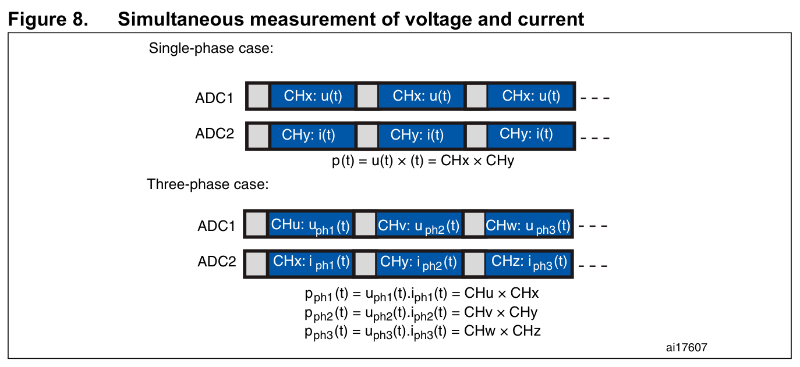
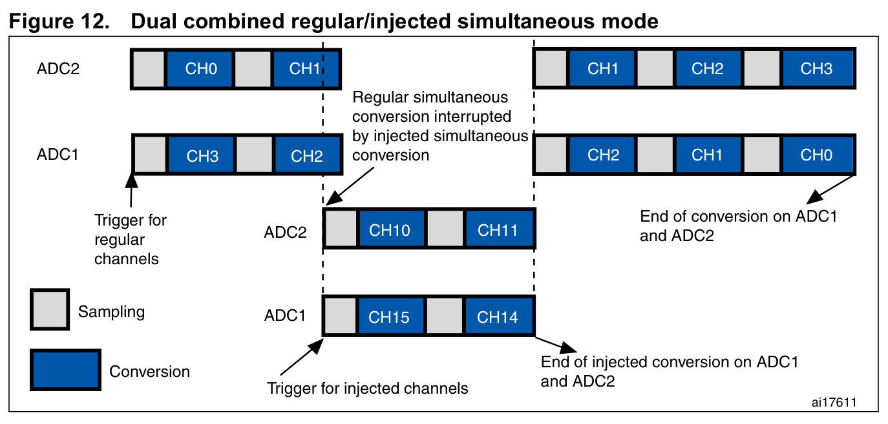
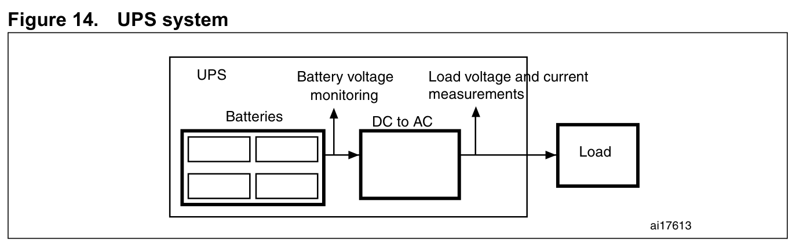

# ADC 模式选择与原厂应用关系

整合 AN3116 Rev1 的模式与应用例，并用 RM0008 Rev21 和 DS5319 Rev20 限定 STM32F103C8T6 的资源、时序与电气条件。应用框图与例程名称是资料入口，不表示本知识库提供了相应可运行固件或完整产品设计。

## 1 单次、连续与扫描


|模式|SCAN / CONT|一次启动后的规则转换|原文应用关系|
|---|---|---|---|
|单通道单次|0 / 0|完成所选通道的一次转换，等待下次启动|上电测电池电压，判断启动许可|
|多通道单次|1 / 0|依序完成全部 Rank，等待下次启动|读取多个关节位置；读取电压、压力、温度；多应变片测量|
|单通道连续|0 / 1|所选通道自动重复|电池持续监测、温度调节|
|多通道连续|1 / 1|末 Rank 完成后从首 Rank 重复|多路电池电压和温度轮询|

此表限定无间断、无注入抢占的独立规则组。表中的“等待下次启动”不表示 ADON 自动清零或 ADC 自动掉电。规则 DR 只有一个，多通道结果须及时搬走；只在整组结束时读取一次 DR 不能还原之前全部 Rank。数据缓冲可按完整扫描帧组织，但长度取序列长度整数倍属于数据组织建议，不是 DMA 硬件强制条件。[RM0008 Rev21 pp218–223、243](https://www.st.com/resource/en/reference_manual/cd00171190.pdf#page=218)

原 AN3116 图2使用9个位置、7个不同通道，包含三次 CH7，三者共享71.5周期采样时间。其CH11不是C8外部输入；重组图将该示意通道改为IN9，并明确标出改动，保留重复通道和逐通道采样时间关系。

## 2 注入抢占与采样窗口

原文以电机开关噪声后的采样窗口说明注入触发的用途。注入优先于规则转换，被打断的规则项需要重做；即使 DMA 结果数量与 Rank 顺序正确，采样时刻也可能不均匀。具体关系见[硬件采样与事件](硬件模式与事件.md)。

AN3116 图6的单 ADC 示意中，有沿用双模式的“regular simultaneous / alternate trigger”字样。图本身描述的规则项被注入抢占不要求启用双 ADC。该图的CH10同样属于系列示意，不能当作C8接线编号。RM0008关于独立注入和组间抢占的定义优先用于器件配置。[RM0008 Rev21 pp221–223](https://www.st.com/resource/en/reference_manual/cd00171190.pdf#page=221)

## 3 成对同步与功率计算



[AN3116 Rev1 §2.1.2，pp9–10](https://www.st.com/resource/en/application_note/an3116-stm32s-adc-modes-and-their-applications-stmicroelectronics.pdf#page=9)以信号和采样位置表示配对关系，未画出传感器、隔离或模拟调理电路。图中的同步配置不自动保证实际测量链路没有延迟差。

单相电压、电流分别由两个 ADC 同步采样。三相情形可以让 ADC1 扫描三相电压，ADC2 扫描对应三相电流；每一对同步，三对仍依次执行。

```math
p_n(t_n)=u_n(t_n)i_n(t_n)
```

$`p_n`$ 为第 $`n`$ 相的瞬时功率，单位W；$`u_n`$ 为电压，单位V；$`i_n`$ 为电流，单位A；$`t_n`$ 为该对采样的时刻，单位s；$`n`$ 为相编号。这里必须先把ADC码按实际比例、偏置和极性换算成物理量，原码乘积不自动具有瓦特含义。三相各对的 $`t_n`$ 通常不同，不能无说明地把它们相加解释成同一时刻的总瞬时功率。

原PDF图8的单相公式确实缺少第二因子的电流符号；§2.1.2正文明确给出电压乘电流关系，ADC2的 $`i(t)`$ 标签和三相公式也与之相符。上式按该正文整理，原图漏字保留，不将其视为另一种物理关系或ST正式勘误。

## 4 快交错与慢交错算例

快交错理想合成速率为 $`f_{\mathrm{ADC}}`$ /7。原文800 kHz信号的例子需要至少约1.6 MS/s的理想采样率，14 MHz ADC时钟下快交错可给2 MS/s；实际模拟带宽、抗混叠过渡带和幅相误差仍需另行验证。在常见PCLK2=72 MHz、ADC分频/6的12 MHz条件下，合成速率约1.714 MS/s，不能保留2 MS/s标称。

慢交错硬件启动间隔固定为合成14周期、单实例28周期。原文以10 kΩ源阻抗、14 MHz时钟、每个 ADC 目标500 kS/s计算：

```math
S_{\mathrm{budget}}=\frac{14\times10^6}{500\times10^3}-12.5=15.5
```

$`S_{\mathrm{budget}}`$ 为根据单实例目标吞吐得到的采样周期预算，无量纲；分子为ADC时钟Hz，分母为单实例采样率样本/s；12.5为逐次逼近所需周期。15.5不是硬件档位，按此预算选择13.5周期。

采用13.5周期时，采样加转换为26周期，但慢交错的单实例启动间隔仍为28周期。因此把14 MHz/26再乘2得到约1.0769 MS/s，只是忽略模式启动间隔的转换吞吐计算，不能用作该模式的实际采样率；实际合成值为1 MS/s。[RM0008 Rev21 pp231–232](https://www.st.com/resource/en/reference_manual/cd00171190.pdf#page=231)

原文1.2 kΩ、19 kΩ是其算例条件下的阻抗数值；C8知识库的设计限值采用DS5319自己的Table47/48，不把它们替换成C8现行参数。1 MS/s采500 kHz处于理想临界关系，不能据此声称已有抗混叠裕量。[DS5319 Rev20 pp74–75](https://www.st.com/resource/en/datasheet/stm32f103c8.pdf#page=74)

## 5 注入交替与间断的区别

未启用注入间断时，一次交替触发使轮到的ADC完成整个注入组；两侧都启用JDISCEN时，每次仅推进该ADC的一个Rank。AN3116图11中第1/3/5/7次触发推进ADC1、第2/4/6/8次推进ADC2，JEOC在各自四项结束后出现，属于开启注入间断的情形。[RM0008 Rev21 pp232–233](https://www.st.com/resource/en/reference_manual/cd00171190.pdf#page=232)

原文将交替触发用于三相电机单分流电阻电流采样，使两个采样窗口相互靠近，减少占用的PWM时间槽。所述最短1.5个ADC周期是采样窗口尺度，不是完整12位转换耗时；转换阶段可交叠，同一输入的采样阶段仍须避免重叠。具体系统的PWM、安全保护和电流重建不由该简图完整定义。

## 6 规则同时与注入同时的组合



[AN3116 Rev1 §2.5，p14](https://www.st.com/resource/en/application_note/an3116-stm32s-adc-modes-and-their-applications-stmicroelectronics.pdf#page=14)保留了触发、被打断的规则项及注入结束后的恢复关系。灰色表示采样，蓝色表示转换；原CH10、CH11、CH14、CH15是系列示意标签，实际外部输入仍按IN0～9配置。图块长度不表示精确时间比例。

注入事件可以打断两路规则同时转换，两 ADC 执行各自注入组后，恢复被打断的规则项。成对采样时间必须一致。保留的AN应用说明要求两序列长度相同，或使两次触发间隔超过较长序列的完成时间，以防轮次重叠。长度不同时，这一间隔条件不自动形成所有结果的一一配对关系；采用CONT=1自由循环时，也不能靠放慢后续外部触发来约束已经自行重复的序列。具体组、触发、连续模式及结果保存需同时明确。[RM0008 Rev21 §11.9.7](https://www.st.com/resource/en/reference_manual/cd00171190.pdf#page=233)

两路注入结果仍分别存入各自的JDRx；读取ADC1_DR的32位组合规则结果须满足ADC1_CR2.DMA=1，数据通路与读取条件见[双ADC结果保存](硬件模式与事件.md#6-双-adc-同时交错及组合模式)。

AN3116 §2.5.2说明可由两相电流推得第三相，未在原文列出重建公式。若三相电流采用一致的参考方向、在同一时刻满足所定义结点无其他支路电流的约束，可整理为 $`i_a+i_b+i_c=0`$。$`i_a`$、$`i_b`$、$`i_c`$ 为三个支路的电流，单位A，下标 $`a`$、$`b`$、$`c`$ 表示各相；该关系不能无条件推广到有额外中性线电流或其它支路的任意负载。不同采样时刻还需纳入重建误差。

## 7 注入同时与交错的 UPS 用例



[AN3116 Rev1 §2.6.2，p15](https://www.st.com/resource/en/application_note/an3116-stm32s-adc-modes-and-their-applications-stmicroelectronics.pdf#page=15)中的箭头标出电池电压监测和负载电压／电流测量位置；这是功能框图，未给出信号调理、功率级或安全保护电路。

原文UPS框图包括电池、DC到AC逆变和负载。规则交错持续测电池电压并结合模拟看门狗，注入同时成对测负载电压、电流以估算功率。该用例展示功能分工，原文没有附该组合的完整固件工程。规则抢占造成的时间缺口以及ADC分频/4时的8/6周期恢复条件，仍按[硬件双模式边界](硬件模式与事件.md#6-双-adc-同时交错及组合模式)处理。

## 8 原文例程入口

|模式或例子|原文保留名称|资料边界|
|---|---|---|
|单通道连续|SingleChannelContinuous|USE_DMA_Transfer用于选择DMA或中断路径|
|独立注入|Indep_InjectedGroup|示例入口，不代表已取得、编译或实测工程|
|双规则同时|Project/STM32F10x_StdPeriph_Examples/ADC/RegSimul_DualMode|标准外设库目录，不能直接当作HAL/LL接口名称|
|双快交错|Dual_FastInterleaved|沿用对应采样周期和CONT要求|
|双慢交错|Dual_SlowInterleaved|实际速率按14/28周期关系|
|双注入交替|Dual_AlternateTrigger|JDISCEN条件须明确|
|规则同时＋注入同时|Dual_Combined_Reg_Inj_Sumultaneous|保留原文拼写Sumultaneous；USE_DMA_Transfer选择搬运方式|

主要来源：[AN3116，Doc ID16840 Rev1](https://www.st.com/resource/en/application_note/an3116-stm32s-adc-modes-and-their-applications-stmicroelectronics.pdf)，对应独立模式、双同时、快/慢交错、交替触发及组合模式各节和图1–14。寄存器、电气及勘误结论以上列固定版本RM/DS/ES为依据。
