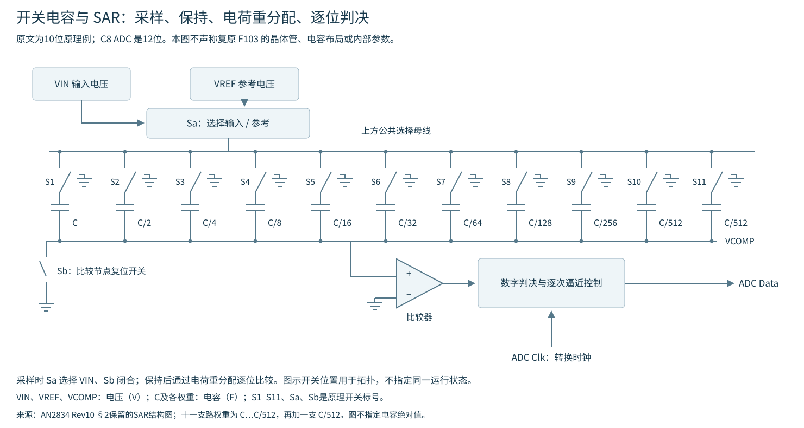
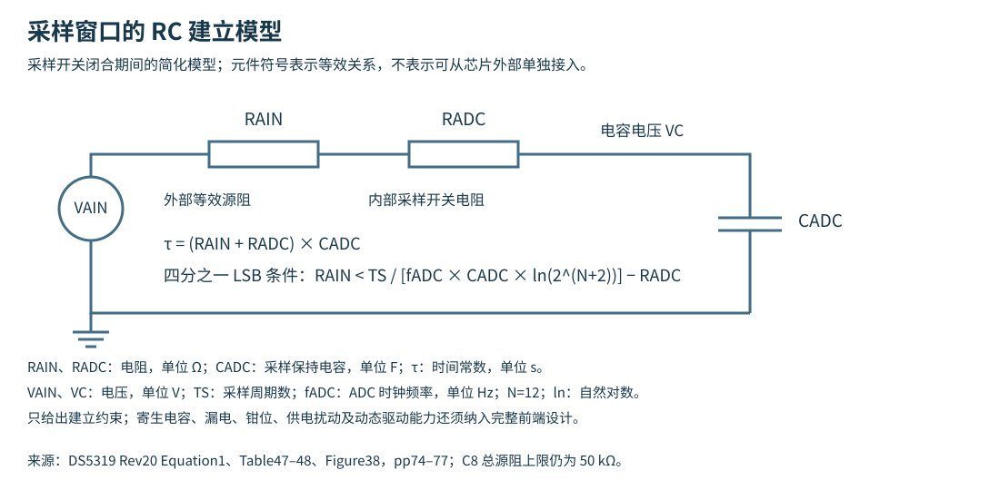
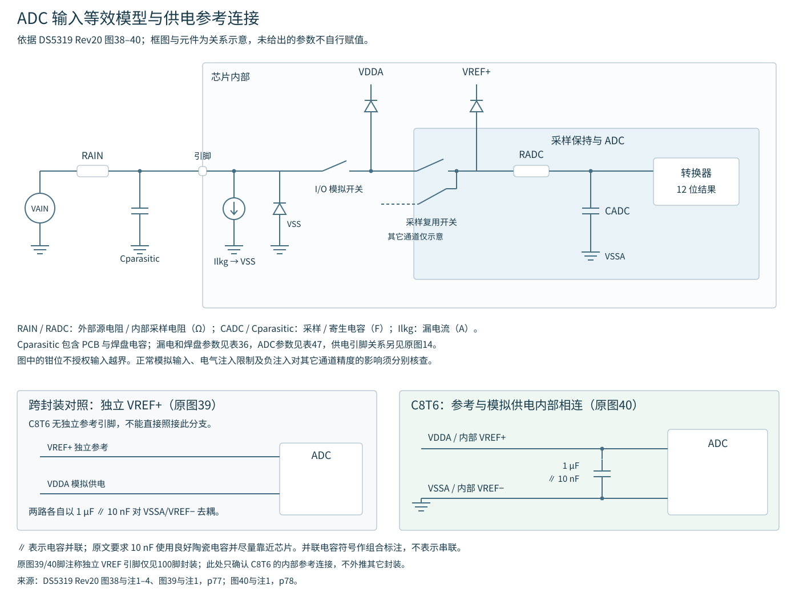
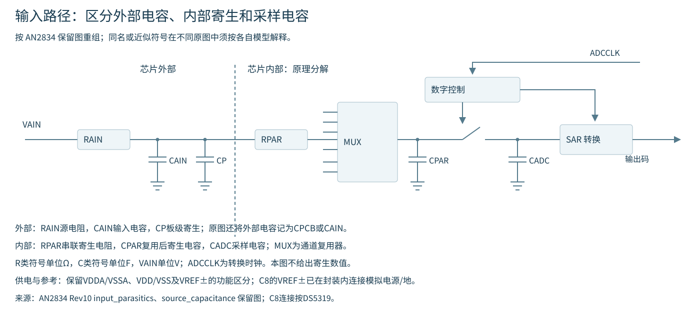
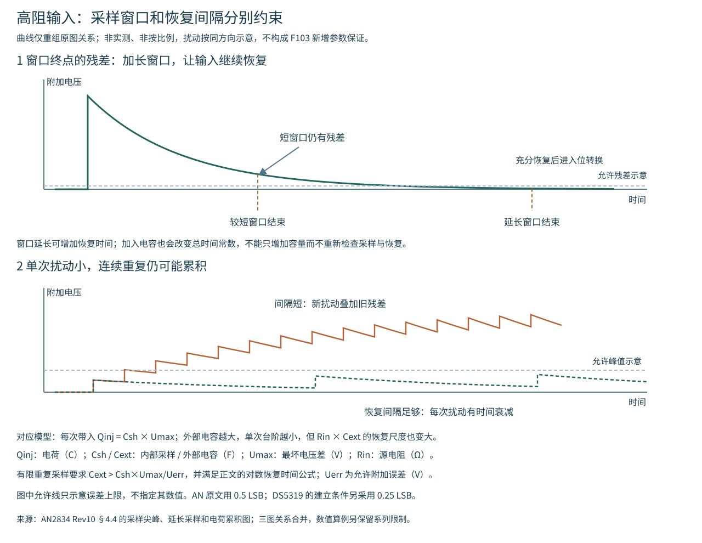
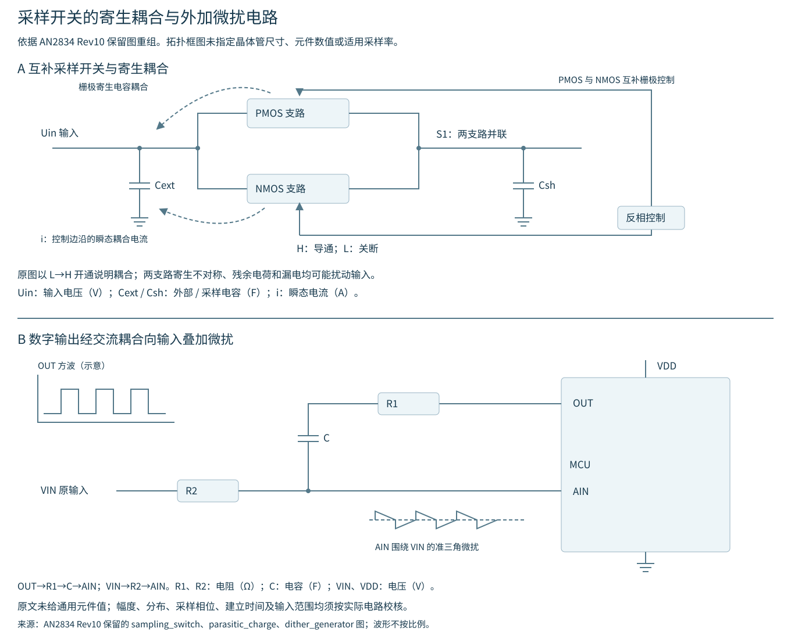
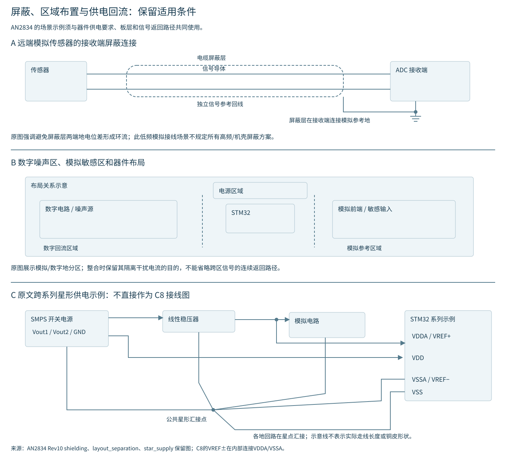

# ADC 前端建立、参考与误差预算

器件限值与原表条件见[ADC 电气参数](电气参数.md)，静态转换误差定义见[量化与静态误差](静态误差定义.md)。本文中的 RC、误差传播和平均公式明确标为模型推导，不把模型算例当作芯片保证值。

## 1 输入、参考与量化间隔

$V_{\mathrm{REF+}}$、$V_{\mathrm{REF-}}$ 分别内部连接 VDDA、VSSA。正常转换输入范围、模拟电源范围、引脚绝对最大值和异常注入电流敏感度应分别核对。数字引脚的耐压标识不扩展 ADC 转换量程。DS5319 Rev20 Table35 对 PA4/PA5 的注入电流功能敏感度要求尤其严格；不能用绝对最大额定取代正常模拟输入条件。[DS5319 Rev20 pp37、60、74–76](https://www.st.com/resource/en/datasheet/stm32f103c8.pdf#page=60)

$$
q=\frac{V_{\mathrm{REF+}}-V_{\mathrm{REF-}}}{4096}
$$

$q$ 为 12 位 ADC 的一个理想量化间隔，单位 V/LSB；$V_{\mathrm{REF+}}$、$V_{\mathrm{REF-}}$ 分别为正、负参考电位，单位 V。4096 是量化区间数，最大输出码为 4095；LSB 表示最低有效位。

VSSA 为 0 V 时，可用下式作简单比例估计：

$$
V_{\mathrm{est}}\approx\frac{D\,V_{\mathrm{DDA}}}{4096}
$$

$V_{\mathrm{est}}$ 为输入电压估计值，单位 V，下标 est 表示估计；$D$ 为 0–4095 的无量纲右对齐码；$V_{\mathrm{DDA}}$ 为 VDDA 电压，单位 V。该式未包含静态误差、采样建立误差或参考误差。[DS5319 Rev20 Figure37](https://www.st.com/resource/en/datasheet/stm32f103c8.pdf#page=76)

固定 LL 电压宏使用4095作端点映射。它与4096的 LSB 定义具有不同用途；整数实参的舍入、温度宏的符号和单位还须按[LL 辅助宏参考](LL字段接口与宏.md)核对。

## 2 简化 RC 与完整输入模型

AN2834 Rev10 §2采用10位开关电容结构解释逐次逼近：采样时 Sa 选择 VIN、Sb 闭合；保持后断开输入，依次切换二进制权重电容，以比较结果从最高位到最低位决定输出。图中十个权重为 C、C/2、…、C/512，另有一个 C/512，总电容为2C。C为基准电容，单位F；$V_{\mathrm{IN}}$、$V_{\mathrm{REF}}$ 及比较节点电压 $V_{\mathrm{COMP}}$ 的单位均为 V；Sa、Sb、S1–S11为原理开关标号。图中的开关位置用于表达拓扑，不代表同一运行状态。

该示意结构采样时 $V_{\mathrm{COMP}}=0$，保持时 $V_{\mathrm{COMP}}=-V_{\mathrm{IN}}$，第一次试探时 $V_{\mathrm{COMP}}=-V_{\mathrm{IN}}+V_{\mathrm{REF}}/2$；下一次试探参考项为 $V_{\mathrm{REF}}$/4 或 $3V_{\mathrm{REF}}/4$。原笔记记录了原文“3/4 $V_{\mathrm{REF}}$”情形的开关文字与等效关系不协调，故不将那句开关位置作为操作步骤。以上为原理关系，不推定F103内部电容布局；F103实际为12位，位转换阶段为12.5个ADC时钟，另加采样窗口。保持完成后输入继续恢复，不会自动改写已保持的本次样本。

在采样窗口内输入近似恒定、元件可线性化且忽略其它扰动时，电容建立残差可用一阶 RC 模型表示：

$$
\tau=(R_{\mathrm{AIN}}+R_{\mathrm{ADC}})C_{\mathrm{ADC}}
$$

$$
|\Delta V(t)|=|\Delta V(0)|\exp\left(-\frac{t}{\tau}\right)
$$

$\tau$ 为充电时间常数，单位 s；$R_{\mathrm{AIN}}$ 是外部等效源电阻、$R_{\mathrm{ADC}}$ 是内部采样开关电阻，单位 Ω；$C_{\mathrm{ADC}}$ 是采样保持电容，单位 F；$t$ 为采样开关闭合后的时间，单位 s；$\Delta V(t)$ 为采样电容电压距最终输入电压的残差，单位 V；$\Delta V(0)$ 是初始残差，单位 V；exp为自然指数函数。这是模型推导，不包括漏电、开关注入、运放动态和输入在采样期间变化的影响。

全量程初始阶跃、允许残差为 a 个 LSB 时：

$$
t_{\mathrm{sample}}\ge\tau\ln\left(\frac{2^N}{a}\right)
$$

$t_{\mathrm{sample}}$ 为采样窗口，单位 s，下标 sample 表示采样；$N=12$ 为分辨率位数；$a$ 是允许误差的 LSB 个数，无量纲；ln 为自然对数，其余符号同上。半 LSB 条件 $a=0.5$ 对应乘数约9.011；DS5319 Equation1采用四分之一 LSB，$a=0.25$，对应约9.704。DS 的严格阻抗不等式及表值仍按[原表条件](电气参数.md#采样时间与源阻抗)读取，不用本模型覆盖规格的其它限制。

例：$R_{\mathrm{AIN}}$=10 kΩ、$R_{\mathrm{ADC}}$=1 kΩ、$C_{\mathrm{ADC}}$=8 pF，则 $\tau$=88 ns，四分之一 LSB 建立时间约0.854 µs。$f_{\mathrm{ADC}}$=14 MHz时，7.5周期约0.536 µs不足，13.5周期约0.964 µs在该简化算例中满足。$f_{\mathrm{ADC}}$为ADC时钟频率，单位Hz。数值只是给定条件下的计算；器件容差、实际前端及所需裕量仍应另核。

完整模型还包括引脚漏电 Ilkg、PCB和焊盘寄生电容 Cparasitic、I/O模拟开关、钳位及采样复用开关。Ilkg单位A，Cparasitic单位F；原图将各自参数指向DS Table36、Table47，并要求结合供电连接检查。较大寄生电容可能降低精度，原文提出降低 $f_{\mathrm{ADC}}$ 的处理方向；具体是否改善仍取决于采样窗口与前端恢复条件。图中的内部钳位不授权输入越界。[DS5319 Rev20 Figure38及注1–4](https://www.st.com/resource/en/datasheet/stm32f103c8.pdf#page=77)

AN2834的模型进一步区分外部输入电容$C_{\mathrm{AIN}}$、PCB寄生$C_{\mathrm{P}}$或CPCB、内部串联寄生电阻RPAR、复用后寄生电容CPAR和采样电容$C_{\mathrm{ADC}}$；R类单位Ω，C类单位F。外部$C_{\mathrm{AIN}}$与$C_{\mathrm{P}}$位于源电阻$R_{\mathrm{AIN}}$之后，均会影响输入节点恢复。不同图的$C_{\mathrm{P}}$、CPAR、Cparasitic命名不能据名称相似就视为同一个精确元件，也不能未经建模把所有电容直接相加成$C_{\mathrm{ADC}}$。图中MUX为通道复用器，数字控制协调采样开关与SAR转换，ADCCLK为转换时钟；供电和参考的C8封装连接仍以DS为准。本图保留AN的分解关系，不提供未公布的内部寄生参数。

## 3 源阻抗、输入电容与缓冲器

$R_{\mathrm{AIN}}$ 应包括传感器输出阻抗、保护串阻、模拟开关以及分压网络的戴维南等效电阻。对一个理想电压源供电的两电阻分压网络，源的小信号等效电阻为：

$$
R_{\mathrm{TH}}=\frac{R_{\mathrm{top}}R_{\mathrm{bottom}}}{R_{\mathrm{top}}+R_{\mathrm{bottom}}}
$$

$R_{\mathrm{TH}}$为戴维南电阻，$R_{\mathrm{top}}$和$R_{\mathrm{bottom}}$分别为上、下分压电阻，单位均为Ω；TH表示Thévenin。该式假定上游电源的小信号阻抗可忽略，不包含后接串阻、传感器阻抗或开关电阻。这是线性电路推导。

增加引脚外部电容可以提供采样瞬间所需电荷，但也改变输入恢复时间和信号带宽。对独立的一阶外部 RC 低通模型：

$$
f_{\mathrm{c}}=\frac{1}{2\pi RC}
$$

$f_{\mathrm{c}}$为−3 dB截止频率，单位Hz；$R$ 为该模型的等效源电阻，单位Ω；$C$ 为外部电容，单位F；π为圆周率，下标c表示截止。实际ADC的采样开关使负载具有离散时变特征，不能只用这个连续时间截止频率证明每次采样已经建立。

缓冲运放的选择与校核还包括供电、输入共模范围、输出摆幅、闭环建立、驱动电容负载时的稳定性及输入偏置电流。直流输出阻抗较小不能单独证明采样瞬间足够快。前一通道与当前通道的电压差会改变采样电容初始条件，交替高低电平的通道序列可暴露单一静态输入掩盖的建立不足。

## 4 采样建立与整体精度条件分开使用

DS Table47的 $R_{\mathrm{AIN}}$上限为50 kΩ，Table48进一步按采样时间限制源阻抗；Table49/50的整体精度则要求$R_{\mathrm{AIN}}$<10 kΩ、内部校准后、PCLK2=56 MHz、$f_{\mathrm{ADC}}$=14 MHz，并有各自供电和温度条件。满足建立时间，并不自动取得另一组测试条件下的总误差上限。Table48的NA也不取消Table47的总上限。[DS5319 Rev20 pp74–76](https://www.st.com/resource/en/datasheet/stm32f103c8.pdf#page=74)

EO、EG、ED、EL、ET的比较基准在静态误差页中分别定义。ET已是未调整转换曲线相对理想曲线的综合偏差，不能再机械叠加同一曲线的所有子项。系统预算还要包括板上分压、参考、漏电及未充分建立等来源，避免遗漏，也避免重复计数。

## 5 参考波动、供电与回流

固定输入电压、远离饱和且采用理想比例模型时，对参考跨度的小变化作一阶线性化：

$$
\frac{\delta D}{D}\approx-\frac{\delta V_{\mathrm{REF}}}{V_{\mathrm{REF}}}
$$

$D$ 为非零输出码的连续近似值，无量纲；$V_{\mathrm{REF}}$ 为正、负参考之间的电压跨度，单位 V。$\delta$ 表示小扰动：$\delta D$ 为小码值变化，$\delta V_{\mathrm{REF}}$ 为小参考电压变化。公式两侧均为无量纲比值。

在输入固定的条件下，参考跨度升高会使比例码值降低。输入与参考来自同一电源的比率式测量，应同时分析二者的相关变化，不能直接套用“输入固定”的条件。

DS Figure40所示内部合并参考形式适用于C8T6；原图用1 µF与10 nF并联去耦，并要求10 nF为良好陶瓷电容且尽量靠近芯片。原图39展示独立参考的跨封装形式，C8T6没有对应独立参考引脚。去耦回路、电源回流与板上数字开关电流应结合实际布线检查，原图示例不替代整个器件的供电连接要求。[DS5319 Rev20 Figures39–40，pp77–78](https://www.st.com/resource/en/datasheet/stm32f103c8.pdf#page=77)

## 6 平均、校准和误差类型

对独立、同方差、零均值噪声作等权平均：

$$
\sigma_{\mathrm{avg}}=\frac{\sigma}{\sqrt{M}}
$$

$\sigma$为单次噪声标准差，$\sigma_{\mathrm{avg}}$为平均后标准差，单位统一使用V或LSB；$M$ 为正整数样本数，无量纲，下标avg表示平均。该式由独立随机变量方差相加推得。相关干扰、固定偏移、参考比例偏差、非线性和采样建立不足不满足这一消除条件。

两点校准可确定线性比例和偏移，前提是两点有效、码差非零、未饱和且测试条件与应用相符；它不自动修正非线性或随工作条件变化的误差。F103内部自校准处理芯片内部转换链的校准过程，不包含外部传感器、分压器、运放和参考电源的全链路校准。具体上电和校准时序见[硬件运行关系](硬件模式与事件.md#2-上电校准与真正的启动动作)。

## 7 高阻源、开关电荷与重复采样

AN2834 Rev10 §4.4描述高阻源上的附加电压：采样保持电容的残余电荷以及开关控制边沿的寄生耦合可能扰动输入节点；高源阻抗使扰动消退较慢。采样窗口结束时尚未消退的残差会进入结果。这里的电荷扰动与ADC“注入组转换”是不同概念。

图中曲线仅表达恢复关系，未使用新的器件参数或实测结果。短、长采样窗口比较同一恢复过程；重复扰动比较采用相同衰减常数与单次电压台阶，仅改变间隔。窗口后的输入恢复影响后续采样，不能据此认为本次保持值仍在跟随输入。

单纯延长采样窗口，对应让输入在采样开关闭合时充分恢复。原文半LSB简化条件为：

$$
S\ge f_{\mathrm{ADC}}R_{\mathrm{in}}C_{\mathrm{sh}}\ln(2^{N+1})
$$

$S$ 为采样周期数，无量纲；$f_{\mathrm{ADC}}$为ADC时钟，单位Hz；$R_{\mathrm{in}}$为外部源电阻，单位Ω；$C_{\mathrm{sh}}$为采样保持电容，单位F；$N$为分辨率位数；ln为自然对数。下标in表示输入，sh表示sample-and-hold（采样保持）。该式未计内部开关电阻及额外电容；与DS5319包含$R_{\mathrm{ADC}}$、采用四分之一LSB的式子分开使用。

另一方法是较大的外部储能电容配合足够恢复间隔。它降低每次转移电荷引起的电压台阶，但增加前端时间常数、减小带宽。不能只加电容后继续采用原来的高频连续采样。

$$
C_{\mathrm{ext}}\ge\frac{C_{\mathrm{sh}}U_{\mathrm{max}}}{U_{\mathrm{err}}}
$$

$C_{\mathrm{ext}}$为外部储能电容，$C_{\mathrm{sh}}$为内部采样电容，单位F；$U_{\mathrm{max}}$为内部电容与输入之间的最坏电压差，$U_{\mathrm{err}}$为允许附加误差，单位V；下标ext/max/err分别表示外部、最大值、误差。此式是外部电容远大于内部电容时的保守电荷分配估算。AN原文在该处把误差量记为Ulsb，但实际采用0.5 LSB；这里用$U_{\mathrm{err}}$避免把它误读成一个完整LSB。

若每次同方向扰动带入电荷 $Q_{\mathrm{inj}}=C_{\mathrm{sh}}U_{\mathrm{max}}$，并在间隔中经$R_{\mathrm{in}}$放电，则从允许峰值$U_{\mathrm{err}}$开始的一次恢复可移走：

$$
Q_{\mathrm{removed}}=\frac{U_{\mathrm{err}}}{R_{\mathrm{in}}}\int_0^{t_{\mathrm{w}}}\exp\left(-\frac{t}{R_{\mathrm{in}}C_{\mathrm{ext}}}\right)\,dt
$$

$Q_{\mathrm{inj}}$ 与 $Q_{\mathrm{removed}}$分别为每次扰动带入、恢复移走的电荷，单位C（库仑）；$t$为积分变量、$t_{\mathrm{w}}$为恢复间隔，单位s；exp为自然指数函数；其余量同上。inj在这个公式中表示电荷注入，不能与ADC注入组模式混同。令每次移走的电荷至少补偿每次带入的电荷，得到：

$$
t_{\mathrm{w}}\ge-R_{\mathrm{in}}C_{\mathrm{ext}}\ln\left(1-\frac{C_{\mathrm{sh}}U_{\mathrm{max}}}{C_{\mathrm{ext}}U_{\mathrm{err}}}\right)
$$

$t_{\mathrm{w}}$ 的单位为 s，$R_{\mathrm{in}}$ 的单位为 Ω；$C_{\mathrm{ext}}$ 和 $C_{\mathrm{sh}}$ 的单位均为 F；$U_{\mathrm{max}}$ 和 $U_{\mathrm{err}}$ 的单位均为 V。因此，等待时间公式中的对数自变量无量纲。

有限等待时间要求严格满足：

$$
C_{\mathrm{ext}}>\frac{C_{\mathrm{sh}}U_{\mathrm{max}}}{U_{\mathrm{err}}}
$$

当外部电容趋近单次估算的最小容量时，对数自变量趋近 0，所需恢复时间趋于无穷；恰好取该最小容量时，模型不给出有限恢复时间。

原文在不同图中将转换阶段和恢复间隔都记为 $t_{\mathrm{C}}$。本节用 $t_{\mathrm{w}}$ 专指恢复间隔，避免混用。

该模型解释了“每次扰动很小、重复后仍超差”：若旧误差还未消退就开始下一次采样，同向电荷会累积。它不涵盖所有芯片开关、电压、温度与漏电因素；等待不能消除由漏电和偏置电流在高阻源上形成的直流压降。

### 跨系列原例的数值边界

AN2834的完整例子属于STM32L1，使用$C_{\mathrm{sh}}$=16 pF、$R_{\mathrm{in}}$=150 kΩ、$U_{\mathrm{max}}$=4095 LSB、$U_{\mathrm{err}}$=0.5 LSB。单次电荷估算得到$C_{\mathrm{ext}}$至少131.04 nF，原文先举向上选150 nF。4095是该例采用的最大码跨度；若另采用4096 LSB的完整参考跨度，必须统一计算条件。

原文又选取 $R_{\mathrm{in}}C_{\mathrm{ext}}=t_{\mathrm{w}}$ 作为容量与等待时间的折中，代入可得：

$$
C_{\mathrm{ext}}=\frac{C_{\mathrm{sh}}U_{\mathrm{max}}/U_{\mathrm{err}}}{1-e^{-1}}\approx1.58\frac{C_{\mathrm{sh}}U_{\mathrm{max}}}{U_{\mathrm{err}}}
$$

$C_{\mathrm{ext}}$、$C_{\mathrm{sh}}$单位F，$R_{\mathrm{in}}$单位Ω，$t_{\mathrm{w}}$单位s，$U_{\mathrm{max}}$/$U_{\mathrm{err}}$是无量纲电压比；e为自然常数。1.58来自该特定折中条件，不是所有前端的普适最优系数。原例得到约207 nF，选220 nF；代回等待式约29.87954 ms，原文以整数微秒写为29879 µs，工程示例取30 ms。

这些数值不能作为F103C8T6的保证工作点：16 pF不是DS5319的8 pF参数，150 kΩ超过该器件常规$R_{\mathrm{AIN}}$表范围。原例用于保留方法和算术依据，实际C8设计仍以本器件条件为准。以上整理依据[AN2834 Rev10 §4.4](https://www.st.com/content/ccc/resource/technical/document/application_note/group0/3f/4c/a4/82/bd/63/4e/92/CD00211314/files/CD00211314.pdf/jcr%3Acontent/translations/en.CD00211314.pdf)的既有资料、保留图形和数学复核，尚未完成该PDF全文逐页对照。

## 8 信号带宽与建立时间的不同尺度

AN2834的外部RC估算还给出输入周期至少为外部时间常数十倍的条件：

$$
T_{\mathrm{AIN}}\ge10R_{\mathrm{AIN}}(C_{\mathrm{AIN}}+C_{\mathrm{P}})
$$

$$
f_{\mathrm{AIN}}\le\frac{1}{10R_{\mathrm{AIN}}(C_{\mathrm{AIN}}+C_{\mathrm{P}})}
$$

$T_{\mathrm{AIN}}$为输入信号周期，单位s；$f_{\mathrm{AIN}}$为输入频率，单位Hz，二者互为倒数；$R_{\mathrm{AIN}}$单位Ω；$C_{\mathrm{AIN}}$为外部输入电容、$C_{\mathrm{P}}$为寄生电容，单位F；P表示parasitic（寄生）。原例$R_{\mathrm{AIN}}$=25 kΩ、$C_{\mathrm{AIN}}$=7 pF、$C_{\mathrm{P}}$=3 pF，时间常数250 ns，十倍2.5 µs，对应400 kHz。它只表达该RC经验条件，不能据此宣称12位幅值精度、采样率或抗混叠条件都已满足。

原文采样频率为滤波截止频率2–5倍的范围同样属于经验建议；一阶RC在截止频率以上仍有有限输出，强干扰可能混叠，所需模拟衰减应按信号频谱和误差预算计算。数字滤波不能恢复已经折叠进有用频段的信息。

开关电容SAR原理、屏蔽、布局及抖动电路的独有图形关系仍按图形与来源清单核对；本页未以一阶模型替代这些原图。

## 9 采样开关寄生与有意施加的微扰

AN2834 Rev10 §4.4的原理图用并联NMOS/PMOS及互补栅极控制表示采样开关S1，H为导通、L为关断。原图以L→H边沿说明栅极寄生电容向输入节点耦合电流；NMOS/PMOS寄生不对称使电流不能完全抵消。采样电容残余电压、复位时的电荷转移及漏电也可产生附加扰动。$C_{\mathrm{sh}}$、$C_{\mathrm{ext}}$分别为采样和外部电容，单位F；Uin为输入电压，单位V；i为瞬态电流，单位A。此图解释机制，不给出F103的晶体管尺寸或寄生电容值。

另一原图说明有意加入微扰的方法：MCU的OUT输出经R1和C串联交流耦合到AIN，原输入VIN经R2连接AIN。R1、R2为电阻，单位Ω；C为电容，单位F；VIN为原输入电压，单位V；OUT、AIN为引脚功能名。原文用准三角扰动配合平均，使极稳定、量化受限的输入跨越相邻门限。它没有给出适配所有电路的元件值。

应用这一方法须同时核查扰动幅度、均值、分布、采样相位及窗口覆盖；确保输入不越界，GPIO开关不引入更大供电或地干扰，且叠加网络仍满足源阻抗和采样建立条件。交流耦合不自动保证有限平均窗口内的扰动均值为零。微扰与过采样不能自动修复非线性、参考偏差、温漂或前端失真；已有自然噪声时应先评估额外扰动是否有益。

以上AN图和文字基于已保留资料整理，尚未完成原PDF全文逐页对照。图A说明采样开关造成的寄生扰动，图B说明外加微扰方案，二者没有共用的元件选值或时序保证。

## 10 屏蔽、区域布置与供电回流

AN2834保留的远端传感器场景使用独立信号参考导体，屏蔽层在接收端连接模拟地，以避免两端地电位差造成屏蔽层环流。该低频模拟接线建议不能推广为所有频率、机壳及EMC场景的单端接地规则，也不能用于取消必要的保护接地。

布局图区分数字噪声源和敏感模拟区域，将MCU布置在二者接口附近。模拟前端、参考和去耦应有短连接及清楚的回流路径；高速数字信号、晶振和开关电源的返回电流不应经过高阻模拟参考路径。原图画出模拟/数字地分区；具体是否划分平面仍须检查层叠、跨区信号和返回路径。不能仅按分区外形切割地层而忽略回流绕行。

星形图保留了跨系列示例的连接：SMPS的Vout1进入线性稳压器，稳压器输出同时供模拟电路及VDDA/$V_{\mathrm{REF+}}$；Vout2供VDD；各模拟、数字和稳压器地回路在星点汇接。SMPS表示开关电源，Vout1、Vout2为其两路输出，GND为共同参考地；VDDA/VSSA、VDD/VSS分别为模拟、数字供电及地，$V_{\mathrm{REF}}$±为参考电位。图不提供电压值或上电时序。

C8T6没有独立$V_{\mathrm{REF}}$±引脚，其参考内部连接VDDA/VSSA。跨系列示例不能授权为C8配置任意不同的VDDA/VDD电压或任意先后上电；实际连接、滤波、压差及上电条件须遵守器件供电要求。该示例的用途是解释各回路与供电分支的关系。

板层相关的原文建议包括：双层板保留足够地铜并使用较宽供电连接；多层板利用专用参考层减少回流电感；单层板以铺地和必要跳线改善简单电路连接。跨层、跨分区信号仍须保持参考连续。原文“两层分别大面积电源/地”的形式也只是布局选择，不能覆盖整板的回流要求。晶振附近的接地和外壳连接需进一步按振荡器专门资料及元件规定核查，不把“外壳接地”概括为可任意连接晶体信号脚。

保留的AN2834资料还提到可向ST询取SAR采样仿真工具，用于估计ADC频率、$R_{\mathrm{AIN}}$/$C_{\mathrm{AIN}}$及容差与采样时间裕量的关系。这是该版文档的工具说明；本库未确认现行取得方式、F103支持范围或以该工具完成目标器件仿真。
