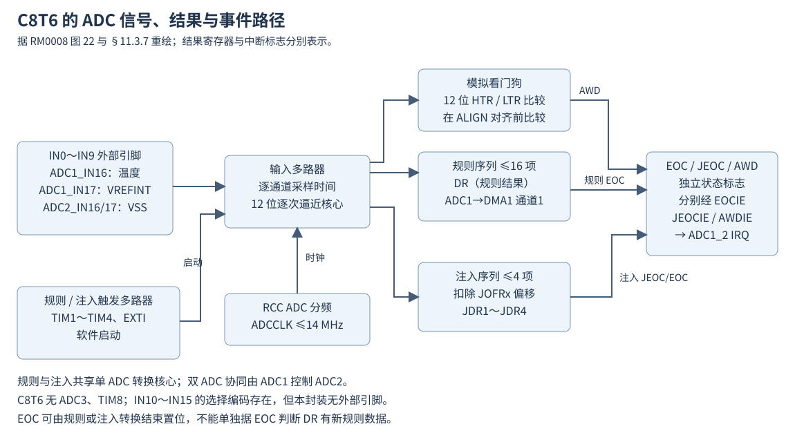
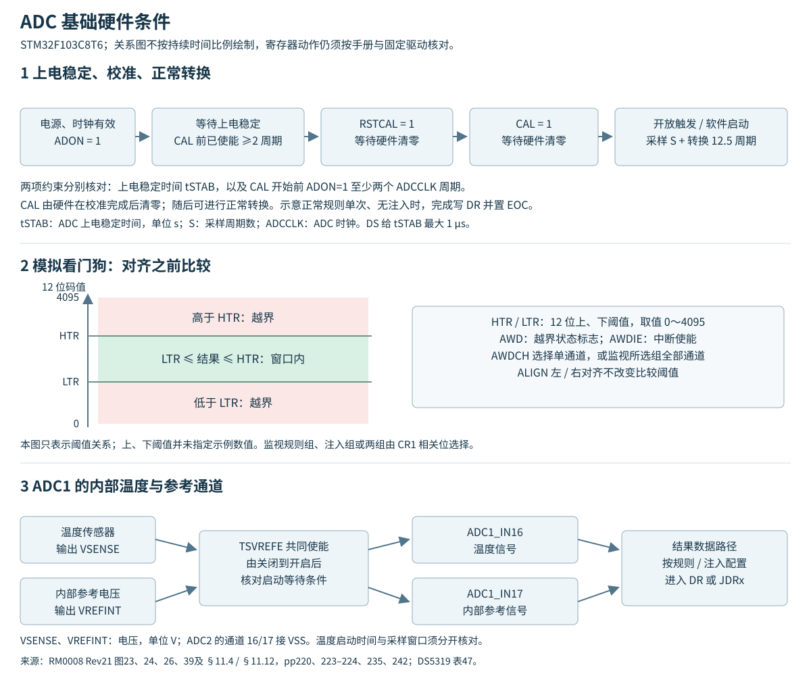
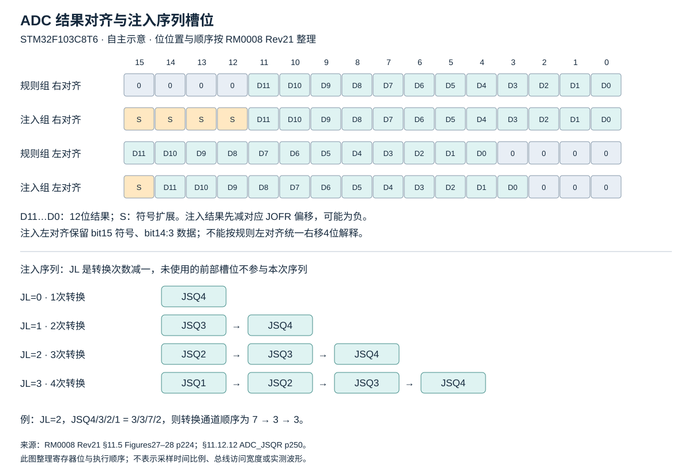
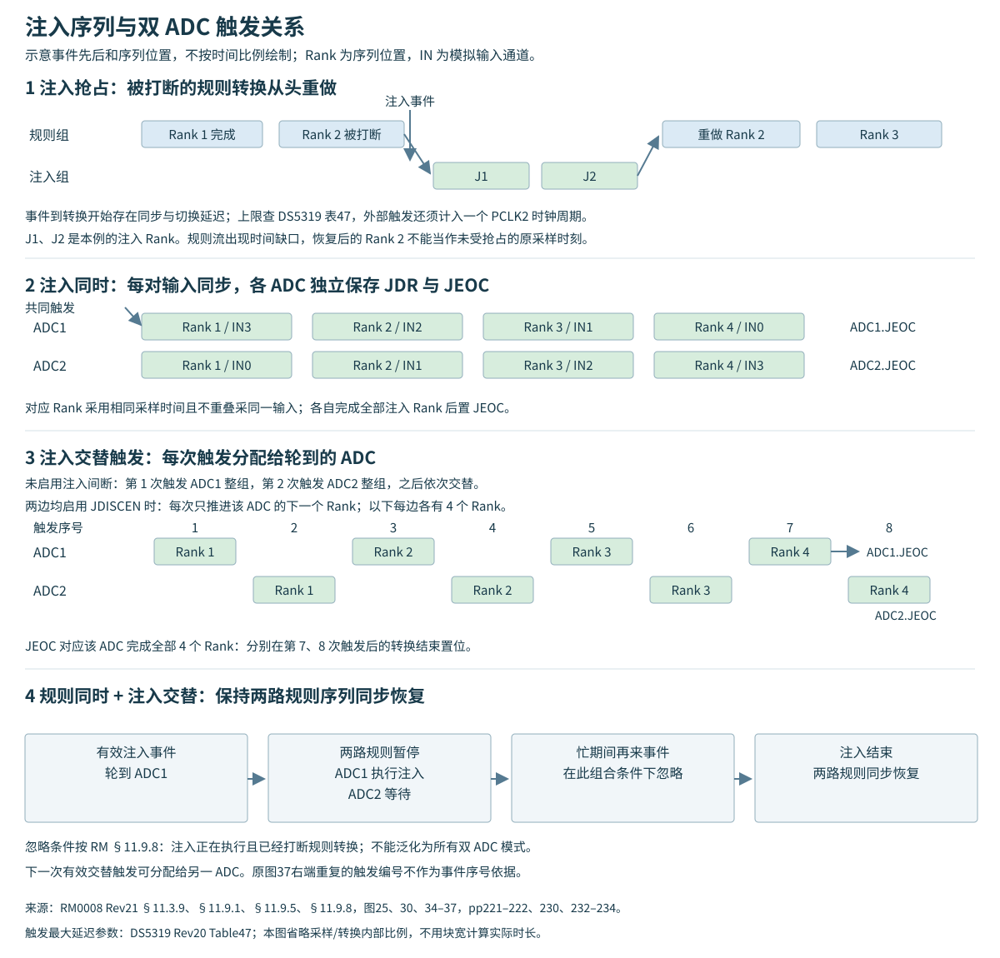
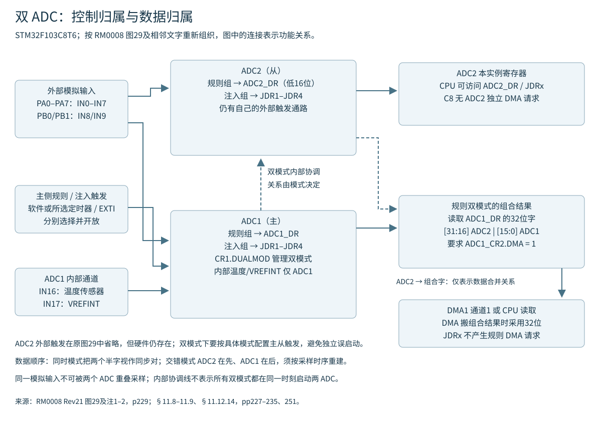
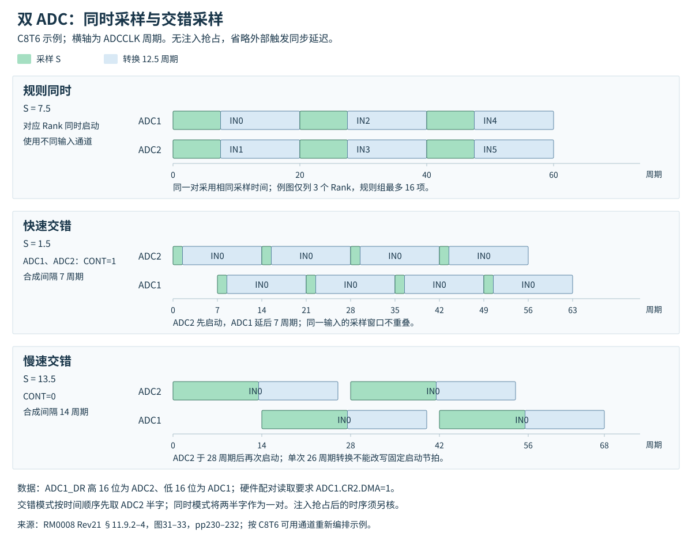
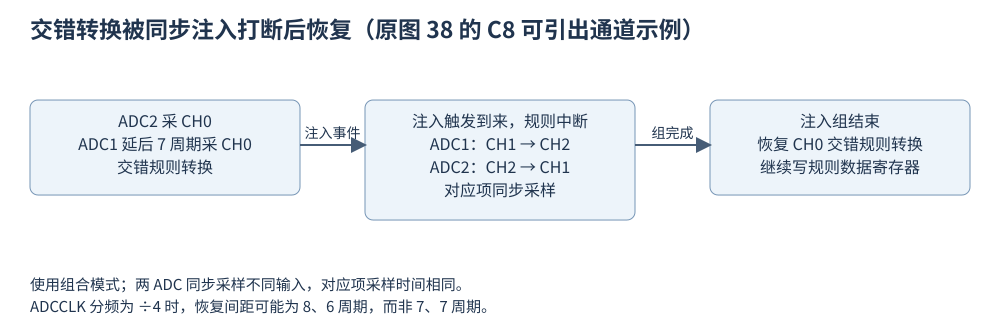

# ADC 采样、序列、事件与双模式

依据 RM0008 Rev21 第11章、DS5319 Rev20 与 ES096 Rev15。本文是按硬件行为整合的参考，数值表另见[模式与寄存器参数](寄存器与触发参数.md)、[电气与采样条件](电气参数.md)。HAL/LL 的返回值与软件状态另按固定实现解释。

## 1 实例、输入和结果通路

C8T6 有 ADC1、ADC2，固定12位；LQFP48 的外部模拟输入是 PA0–PA7 的 IN0–IN7、PB0/PB1 的 IN8/IN9。IN10–IN15 的编码不能当作本封装可接线输入。ADC1 的 IN16、IN17 分别连接温度传感器和 VREFINT；ADC2 对应通道接 VSS。内部温度与参考通路共用 ADC1_CR2.TSVREFE，选择其中一个通道不等于拥有两套独立的通路开关。

规则组共用一个 DR；注入组使用 JDR1–JDR4。C8 只有 ADC1 能发出 ADC DMA 请求，映射到 DMA1 通道1；独立 ADC2 结果需另行读取，双模式可由 ADC1 合并规则结果后搬运。注入组不产生这条规则 DMA 请求。[RM0008 Rev21 pp217–219、227、240、251](https://www.st.com/resource/en/reference_manual/cd00171190.pdf#page=217)

## 2 上电、校准与真正的启动动作

ADON 从0写成1使 ADC 上电，转换前满足 tSTAB。校准要求 ADC 已上电至少两个 ADC 周期；完成 RSTCAL 的复位等待后置 CAL，等待硬件清零。校准码会出现在 DR，不能当作正常通道样本。tSTAB 最大1 µs、校准时间表值及其适用条件见电气参数页；等待过程须结合应用的超时机制。[RM0008 Rev21 pp218、223–224、242–243](https://www.st.com/resource/en/reference_manual/cd00171190.pdf#page=218)

ADON 已为1时再次写1，如果 CR2 其它位未同时改变，会启动转换。因此“使能”操作须结合当前状态使用。直接置位 ADON 的 LL_ADC_Enable 没有先判断状态；校准后保持上电的流程不能再无条件重复使能。CR2 的其它配置位与 ADON 在同一次写操作中确实发生变化时，手册说明不会由这次 ADON 写入触发转换；这也要求区分“执行了一次寄存器写入”与“其它位的值实际发生变化”。[RM0008 Rev21 p243](https://www.st.com/resource/en/reference_manual/cd00171190.pdf#page=243) · [LL 实现边界](LL固定实现边界.md)

## 3 序列位置、物理通道与采样时间

规则组最多16个 Rank，注入组最多4个 Rank。Rank 表示序列位置，Channel 表示物理输入；同一通道可以重复安排在不同位置。采样时间由物理通道的 SMPR 字段决定，规则/注入组共享同一通道的设置。

规则长度为 SQR1.L+1，规则序列字段从 SQ1 开始。注入长度为 JSQR.JL+1；不足4项时，实际起始字段为 JSQ(4−JL)。这里 L、JL 为无量纲寄存器编码，Rank 个数也无量纲。例如 JL=1 表示两项，使用 JSQ3、JSQ4，但结果仍按顺序进入 JDR1、JDR2。改变注入长度后应重新建立全部有效 Rank 的通道映射，不能只改长度后沿用先前的字段布局。[RM0008 Rev21 pp218、247–251](https://www.st.com/resource/en/reference_manual/cd00171190.pdf#page=247)

扫描由 CR1.SCAN 控制。LL 的 REG_SEQ_SCAN/INJ_SEQ_SCAN 长度常量写的是 SQR1.L/JSQR.JL；这些名字本身不表示会同时修改 SCAN。规则 CONT=1 表示首次启动后连续转换，后续速率不能仅靠外部触发周期限制；规则间断每次触发执行 DISCNUM+1 项，1–8项，末组可以不足。注入间断每次触发推进一项。规则连续与间断不能同时启用；自动注入与两组间断的组合限制须按手册执行。[RM0008 Rev21 pp219–223、238–243](https://www.st.com/resource/en/reference_manual/cd00171190.pdf#page=219)

修改正在转换的 SQR/JSQR 会使当前转换复位并重新启动新的组。因此序列重配须先隔离触发并确认停止；双模式还须按手册先解除双模式后变更相关通道配置，以免失去同步。[RM0008 Rev21 pp218、238](https://www.st.com/resource/en/reference_manual/cd00171190.pdf#page=218)

### 完成事件、中断与保存每个样本

规则扫描的各次结果依次写入同一个DR；RM §11.3.8要求使用DMA在每次DR更新后搬到SRAM。注入结果进入各JDRx。RM p239的CR1.SCAN注释将扫描时的EOC/JEOC中断描述为最后通道完成时产生；p223的规则间断示例又逐次列出EOC事件，注入间断示例则在整个注入序列末项完成时产生EOC和JEOC。使用这些描述必须保留模式及“事件/中断”的上下文，不能合成每种扫描配置都可在每次ISR中可靠保存每个Rank的承诺。

固定HAL扫描轮询不逐次确认EOC，LL的EOS/JEOS名称也不增加F1硬件标志。完整规则序列的数据保存应采用经过检查的搬运和缓冲区计数，不通过一个结束标志反推所有中间样本均已读取。[RM0008 Rev21 pp221、223、237、239](https://www.st.com/resource/en/reference_manual/cd00171190.pdf#page=221) · [HAL轮询条件](HAL轮询边界.md)。

## 4 规则与注入的时间关系

每次转换的基础时间为：

`tCONV = (S + 12.5) / fADC`

tCONV 为采样加逐次逼近转换的时间，单位 s；S 为所选采样窗口的 ADC 周期数，无量纲；12.5 为转换阶段占用的周期数；fADC 为 ADC 时钟频率，单位 Hz。该式不包含外部触发同步、组切换、注入抢占与间断等待。采样窗口结束后进入保持/位转换阶段，当前转换结果在该转换结束时更新；不能把采样窗口末端当成数据已经可读的时刻。组合模式还须按各ADC完成和组合读数条件判断。八档 S 及触发延迟见参数表。[RM0008 Rev21 p225](https://www.st.com/resource/en/reference_manual/cd00171190.pdf#page=225)

独立外部事件触发注入时，可以打断规则转换。被中断的规则转换在注入序列结束后重做；时间轴因而出现额外等待及重采样。自动注入由规则组完成事件引出，JAUTO 与注入触发配置的约束须同时成立。应用不能把含抢占的结果数组直接当作严格等间隔采样。[RM0008 Rev21 pp221–223](https://www.st.com/resource/en/reference_manual/cd00171190.pdf#page=221)

外部触发选择和允许触发是两个配置层次；规则组用 EXTSEL/EXTTRIG，注入组用 JEXTSEL/JEXTTRIG，F1 外部事件为上升沿。完整事件编码见[触发选择表](寄存器与触发参数.md#117-完整触发选择)。使用定时器 TRGO 时，ES096 要求先使能接收外设时钟，并避免在触发运行中改变相应时钟预分频；初始化产生的定时器事件也须纳入首笔采样的隔离过程。§2.6.2将此列为文档说明问题；满足上述时钟条件时，不要求额外应用规避。条款标题中的TRGO2不表示F103C8具备TRGO2输出。[ES096 Rev15 p14](https://www.st.com/resource/en/errata_sheet/es096-stm32f101x8b-stm32f102x8b-and-stm32f103x8b-mediumdensity-device-limitations-stmicroelectronics.pdf#page=14)

## 5 数据位域、标志和看门狗

规则右对齐数据在 DR[11:0]，左对齐在 DR[15:4]。注入转换先减 JOFR 对应偏移，可得到负数；右对齐在 JDR[11:0] 并由[15:12]符号扩展，左对齐在[14:3]并由bit15表示符号。JDR 的半字数据范围与规则无符号码不同；无符号返回类型不会自动完成有符号解释。[RM0008 Rev21 pp224、245–246、251](https://www.st.com/resource/en/reference_manual/cd00171190.pdf#page=224)

SR 包含 EOC、JEOC、AWD、STRT、JSTRT。F1 没有另一套独立 EOS/JEOS 寄存器位或硬件 OVR 事件。EOC 既可由规则转换结束置位，也可由注入组结束置位；单看 EOC 或某个 HAL 规则完成回调，不足以证明 DR 是新规则结果。读取 DR 清 EOC；JEOC 等标志按 SR 的写零清除机制处理，不能假定读取 JDR 自动清 JEOC。DMA 对 DR 的读取也参与 EOC 的清除，轮询和 DMA 不应竞争同一事件。[RM0008 Rev21 pp236–237、251](https://www.st.com/resource/en/reference_manual/cd00171190.pdf#page=236)

模拟看门狗使用共享上下阈值，可选单通道或全部通道、规则或注入或两组；比较在数据对齐之前进行，低于下阈值或高于上阈值才属于越界。AWDSGL/AWDEN/JAWDEN 的组合见参数表。看门狗阈值写入合法范围与两阈值的相对关系需要应用检查；所核 HAL/LL 接口不提供完整的高低阈值关系验证。[RM0008 Rev21 pp220–221、238–240、246](https://www.st.com/resource/en/reference_manual/cd00171190.pdf#page=220)

## 6 双 ADC 同时、交错及组合模式

ADC1 控制 DUALMOD，ADC2 为从。实例选择、触发开放、两侧使能与通道配置须一致，不能只配置主侧后假定从侧全部就绪。不同输入的同步测量可采用同时模式；同一输入不应被两 ADC 重叠采样。同步对的采样时间匹配，扫描得到的多对结果仍各自具有不同采样时刻。[RM0008 Rev21 pp228–230](https://www.st.com/resource/en/reference_manual/cd00171190.pdf#page=228)

- 快交错：ADC2先开始，ADC1相差7个 ADC 周期；采样时间小于7周期，C8的可选档位仅1.5周期，两 ADC 均使用连续转换。
- 慢交错：两 ADC 相差14周期，同一 ADC 相邻启动间隔28周期；采样时间小于14周期，可取1.5、7.5、13.5；CONT保持0。
- 交替注入：注入触发在两 ADC 间交替分配，是否逐 Rank 推进还取决于注入间断配置。不能把每次注入触发统一解释成两个 ADC 同时启动。

以上依据[RM0008 Rev21 pp230–234](https://www.st.com/resource/en/reference_manual/cd00171190.pdf#page=230)。快/慢交错的理想合成速率分别为 fADC/7、fADC/14；fADC 单位 Hz，结果单位 样本/s。触发、抢占和恢复等边界仍须另计。

规则双模式从 ADC1_DR 读取组合字：高半字是 ADC2，低半字是 ADC1；ADC1_CR2.DMA 必须为1，即使由 CPU 读组合字，也不能省略这个硬件位条件。真正启用 DMA1 通道属于另一配置步骤。交错结果重建时间顺序时 ADC2在前、ADC1在后；同时模式则按同步对解释。某些固定 HAL 轮询/LL 读数实现与这一路径存在额外限制，见[轮询边界](HAL轮询边界.md)和[LL 参考](LL字段接口与宏.md)。[RM0008 Rev21 pp228–231、251](https://www.st.com/resource/en/reference_manual/cd00171190.pdf#page=228)

RM0008 §11.9.9 对“注入同时＋交错”给出额外恢复条件：ADC预分频为/4时，注入结束后的相邻规则转换间隔可为8、6周期交替。丢弃抢占阶段的缺口，仍不足以把之后结果认作7、7周期的均匀采样。图中采用 C8 有效的外部通道示意，原系列图的通道编号不扩展本封装引脚范围。[RM0008 Rev21 pp234–235](https://www.st.com/resource/en/reference_manual/cd00171190.pdf#page=234)

## 7 内部温度与 PA0 耦合边界

温度通道的启动稳定时间、采样时间与测温换算精度是独立条件。RM 推荐约17.1 µs采样窗口，DS Table51 的列归属另在参数页保留；12 MHz下239.5周期约19.96 µs。V25和平均斜率是数据手册典型参数，不能替代逐芯片校准。内部传感器反映芯片温度，不能无条件当作环境温度。[RM0008 Rev21 pp235–236](https://www.st.com/resource/en/reference_manual/cd00171190.pdf#page=235) · [温度参数](电气参数.md#内部温度传感器)

ES096 Rev15 §2.5.1说明，注入序列开始及结束时，内部耦合可能在ADC_IN0/PA0产生毛刺，与实际注入通道选择无关。原文给出的幅度小于150 mV、典型持续时间10 ns，是在I/O配置为高阻输入且悬空时测得；不能把10 ns当作最大持续时间，也不能把这组测量条件推广为任意外部负载下的波形保证。

|PA0使用方式或ADC模式|原文影响范围及条件|
|---|---|
|PA0为数字输出|原文说明不影响输出信号|
|PA0为数字输入|外部驱动阻抗小于5 kΩ时，原文说明不会被识别为伪跳变；该条件不表示内部耦合消失|
|单ADC配置|原文说明不影响其余PA引脚，也不影响注入转换结果；不能将此结论扩大到所有双ADC情形|
|双ADC并使用注入触发|原文建议分配模拟通道时将通道0配置到注入组，以避免副作用；不能遗漏这一模式专属建议|

Table3对§2.5.1各列硅修订均标N，Workaround栏写None。上述模式和外部驱动建议须保留，但不应据此宣称该限制已有完整规避。ADC“注入组转换”与引脚越界电压引起的“电气注入电流”分别处理。[ES096 Rev15 §2.5.1](https://www.st.com/resource/en/errata_sheet/es096-stm32f101x8b-stm32f102x8b-and-stm32f103x8b-mediumdensity-device-limitations-stmicroelectronics.pdf#page=14) · [硅修订矩阵](../硅修订矩阵.md)
