# ADC 采样、序列、事件与双模式

依据 RM0008 Rev21 第11章、DS5319 Rev20 与 ES096 Rev15。本文是按硬件行为整合的参考，数值表另见[模式与寄存器参数](寄存器与触发参数.md)、[电气与采样条件](电气参数.md)。HAL/LL 的返回值与软件状态另按固定实现解释。

## 1 实例、输入和结果通路

ADC1、ADC2 均为12位；LQFP48 的外部模拟输入是 PA0–PA7 的 IN0–IN7、PB0/PB1 的 IN8/IN9。IN10–IN15 的编码不能当作本封装可接线输入。ADC1 的 IN16、IN17 分别连接温度传感器和 VREFINT；ADC2 对应通道接 VSS。内部温度与参考通路共用 ADC1_CR2.TSVREFE，选择其中一个通道不等于拥有两套独立的通路开关。

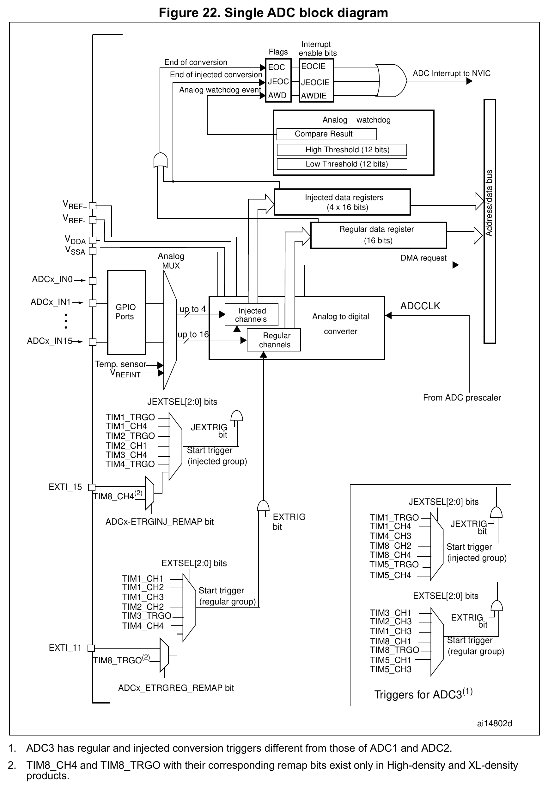

图22为系列通用原图，原标签与脚注1、2保持不变。输入映射见上段；规则与注入触发分别使用 EXTSEL/EXTTRIG、JEXTSEL/JEXTTRIG，具体来源按[ADC1/2触发选择表](寄存器与触发参数.md#117-完整触发选择)。VREF+、VREF− 分别内部连接 VDDA、VSSA，见[参考连接](模拟前端与建立.md#5-参考波动供电与回流)。

规则组共用一个 DR；注入组使用 JDR1–JDR4。只有 ADC1 能发出 ADC DMA 请求，映射到 DMA1 通道1；独立 ADC2 结果需另行读取，双模式可由 ADC1 合并规则结果后搬运。注入组不产生这条规则 DMA 请求。[RM0008 Rev21 pp217–219、227、240、251](https://www.st.com/resource/en/reference_manual/cd00171190.pdf#page=217)

## 2 上电、校准与真正的启动动作

ADON 从0写成1使 ADC 上电，转换前须等待稳定时间 $`t_{\mathrm{STAB}}`$ 。其最大值为1 µs，适用条件见[电气参数](电气参数.md#触发延迟与采样时间)；等待过程须结合应用的超时机制。[RM0008 Rev21 pp218、220、242–243](https://www.st.com/resource/en/reference_manual/cd00171190.pdf#page=218)

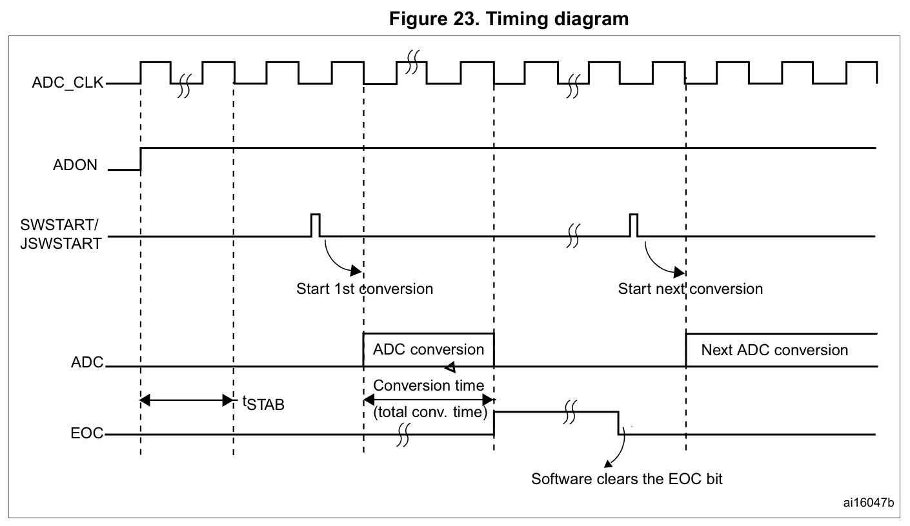

ADON 已为1时再次写1，如果 CR2 其它位未同时改变，会启动转换。因此“使能”操作须结合当前状态使用。直接置位 ADON 的 LL_ADC_Enable 没有先判断状态；校准后保持上电的流程不能再无条件重复使能。CR2 的其它配置位与 ADON 在同一次写操作中确实发生变化时，手册说明不会由这次 ADON 写入触发转换；这也要求区分“执行了一次寄存器写入”与“其它位的值实际发生变化”。[RM0008 Rev21 p243](https://www.st.com/resource/en/reference_manual/cd00171190.pdf#page=243) · [LL 实现边界](LL固定实现边界.md)

校准要求 ADC 已上电至少两个 ADC 周期；置 RSTCAL 后等待硬件清零，再置 CAL 并等待硬件清零。校准码会出现在 DR，不能当作正常通道样本。校准时间表值及其适用条件见[电气参数](电气参数.md#触发延迟与采样时间)；等待过程须结合应用的超时机制。[RM0008 Rev21 pp223–224、242](https://www.st.com/resource/en/reference_manual/cd00171190.pdf#page=223)

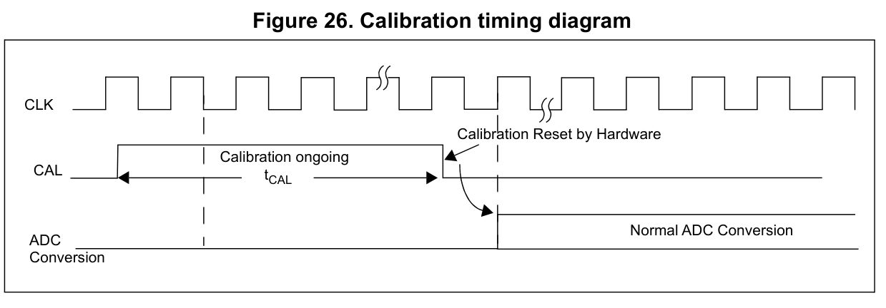

## 3 序列位置、物理通道与采样时间

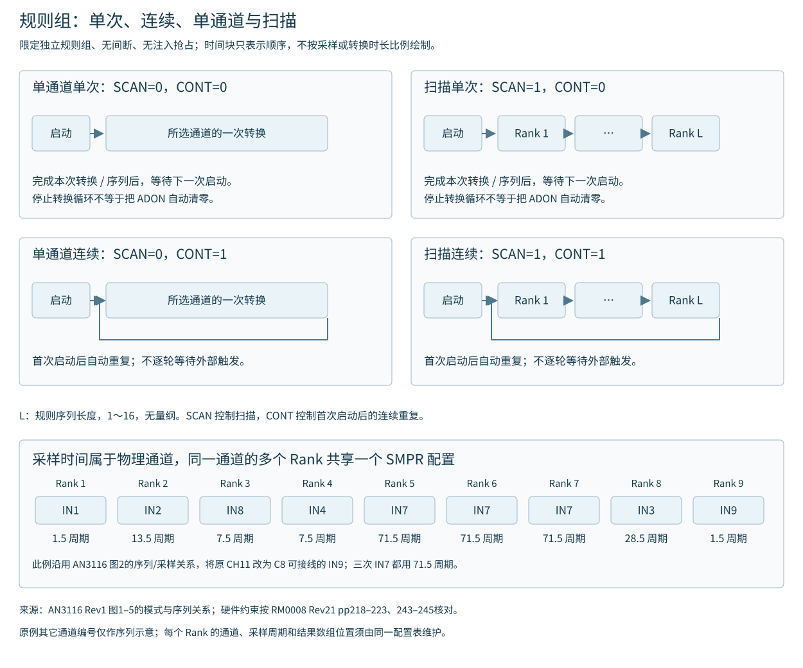

此图只比较独立规则组、无间断且无注入抢占时的SCAN/CONT组合；图中L表示实际序列长度1～16，对应寄存器SQR1.L+1。下文的L则指SQR1.L字段编码0～15。

规则组最多16个 Rank，注入组最多4个 Rank。Rank 表示序列位置，Channel 表示物理输入；同一通道可以重复安排在不同位置。采样时间由物理通道的 SMPR 字段决定，规则/注入组共享同一通道的设置。

规则长度为 SQR1.L+1，规则序列字段从 SQ1 开始。注入长度为 JSQR.JL+1；不足4项时，实际起始字段为 JSQ(4−JL)。这里 L、JL 为无量纲寄存器编码，Rank 个数也无量纲。例如 JL=1 表示两项，使用 JSQ3、JSQ4，但结果仍按顺序进入 JDR1、JDR2。改变注入长度后应重新建立全部有效 Rank 的通道映射，不能只改长度后沿用先前的字段布局。[RM0008 Rev21 pp218、247–251](https://www.st.com/resource/en/reference_manual/cd00171190.pdf#page=247)

扫描由 CR1.SCAN 控制。LL 的 REG_SEQ_SCAN/INJ_SEQ_SCAN 长度常量写的是 SQR1.L/JSQR.JL；这些名字本身不表示会同时修改 SCAN。规则 CONT=1 表示首次启动后连续转换，后续速率不能仅靠外部触发周期限制；规则间断每次触发执行 DISCNUM+1 项，1–8项，末组可以不足。注入间断每次触发推进一项。规则间断在末组结束后等待下一次触发，再从序列首项开始，不在同一次触发中跨过序列末尾补足DISCNUM+1项。[RM0008 Rev21 pp219–223、238–243](https://www.st.com/resource/en/reference_manual/cd00171190.pdf#page=219)

配置组合须同时满足：

- 规则连续CONT与规则间断DISCEN不能同时启用。
- 同一ADC的DISCEN与JDISCEN只能选择一个；两组不能同时间断。
- JAUTO自动注入不能与任一组间断并用；启用JAUTO时须关闭注入触发允许位JEXTTRIG。

后两条是[RM0008 Rev21 pp222–223](https://www.st.com/resource/en/reference_manual/cd00171190.pdf#page=222)的硬件模式限制；固定HAL中的检查分支不能代替应用核对完整寄存器组合。规则连续/间断冲突的HAL返回值边界见[初始化约束](HAL初始化边界.md#连续间断冲突不能只检查返回值)。

修改正在转换的 SQR/JSQR 会使当前转换复位并重新启动新的组。因此序列重配须先隔离触发并确认停止；双模式还须按手册先解除双模式后变更相关通道配置，以免失去同步。[RM0008 Rev21 pp218、238](https://www.st.com/resource/en/reference_manual/cd00171190.pdf#page=218)

### 完成事件、中断与保存每个样本

规则扫描的各次结果依次写入同一个DR；RM §11.3.8要求使用DMA在每次DR更新后搬到SRAM。注入结果进入各JDRx。RM p239的CR1.SCAN注释将扫描时的EOC/JEOC中断描述为最后通道完成时产生；p223的规则间断示例又逐次列出EOC事件，注入间断示例则在整个注入序列末项完成时产生EOC和JEOC。使用这些描述必须保留模式及“事件/中断”的上下文，不能合成每种扫描配置都可在每次ISR中可靠保存每个Rank的承诺。

固定HAL扫描轮询不逐次确认EOC，LL的EOS/JEOS名称也不增加F1硬件标志。完整规则序列的数据保存应采用经过检查的搬运和缓冲区计数，不通过一个结束标志反推所有中间样本均已读取。[RM0008 Rev21 pp221、223、237、239](https://www.st.com/resource/en/reference_manual/cd00171190.pdf#page=221) · [HAL轮询条件](HAL轮询边界.md)。

## 4 规则与注入的时间关系

每次转换的基础时间为：

```math
t_{\mathrm{CONV}}=\frac{S+12.5}{f_{\mathrm{ADC}}}
```

$`t_{\mathrm{CONV}}`$ 为采样加逐次逼近转换的时间，单位 s；S 为所选采样窗口的 ADC 周期数，无量纲；12.5 为转换阶段占用的周期数； $`f_{\mathrm{ADC}}`$ 为 ADC 时钟频率，单位 Hz。该式不包含外部触发同步、组切换、注入抢占与间断等待。采样窗口结束后进入保持/位转换阶段，当前转换结果在该转换结束时更新；不能把采样窗口末端当成数据已经可读的时刻。组合模式还须按各ADC完成和组合读数条件判断。八档 S 及触发延迟见参数表。[RM0008 Rev21 p225](https://www.st.com/resource/en/reference_manual/cd00171190.pdf#page=225)

独立外部事件触发注入时，须令 JAUTO=0、SCAN=1。注入事件可打断并复位当前规则转换；被中断的规则转换在注入序列结束后重做，时间轴因而出现额外等待及重采样。反向关系不同：若一个规则事件在注入转换期间到达，它不会抢占注入，规则序列在注入序列结束后执行。应用不能把含抢占的结果数组直接当作严格等间隔采样。[RM0008 Rev21 pp221–223](https://www.st.com/resource/en/reference_manual/cd00171190.pdf#page=221)

外部注入触发间隔须严格长于注入序列。手册以两次1.5周期采样、总计28个 ADC 周期的注入序列为例，要求触发间隔至少29个 ADC 周期。[RM0008 Rev21 p221](https://www.st.com/resource/en/reference_manual/cd00171190.pdf#page=221)

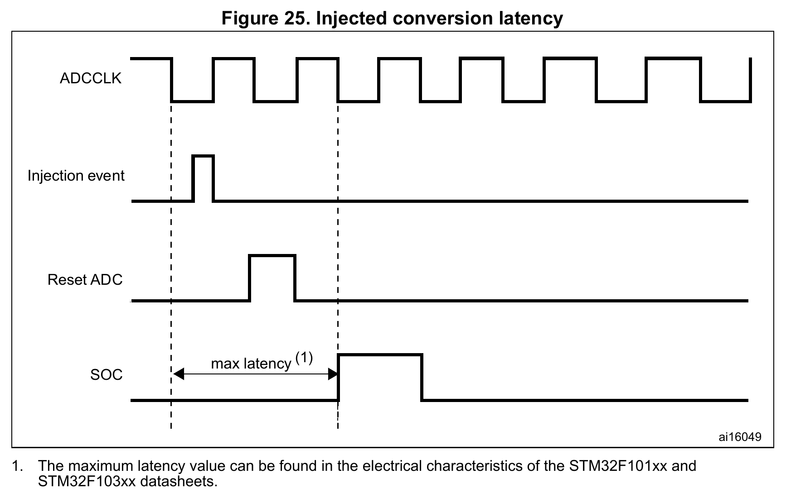

图25展示注入事件、ADC复位与 SOC 之间的启动延迟，不展示完整规则序列恢复过程；被中断项重做的条件依据前述§11.3.9正文。最大延迟按器件数据手册的电气条件确定，不能按绘图宽度推算；具体上限及额外 PCLK2 周期见[触发延迟与采样时间](电气参数.md#触发延迟与采样时间)。

自动注入由规则组完成事件引出，须令 JAUTO=1 并禁用注入组外部触发。若CONT也为1，则按“规则组→注入组→规则组……”连续执行。规则组与注入组相互切换时，ADC 预分频为/4、/6或/8会插入1个 ADC 周期，预分频为/2则插入2个 ADC 周期；这与图25的注入触发启动延迟分别处理。[RM0008 Rev21 p222](https://www.st.com/resource/en/reference_manual/cd00171190.pdf#page=222)

触发选择和允许触发是两个配置层次；规则组用 EXTSEL/EXTTRIG，注入组用 JEXTSEL/JEXTTRIG，F1 外部事件为上升沿。SWSTART/JSWSTART软件启动也须选中对应软件源并使能触发允许位；它们不是绕过定时器或EXTI选择的强制启动按钮。完整事件编码及固定HAL启动分支见[触发选择表](寄存器与触发参数.md#117-完整触发选择)。使用定时器 TRGO 时，ES096 要求先使能接收外设时钟，并避免在触发运行中改变相应时钟预分频；初始化产生的定时器事件也须纳入首笔采样的隔离过程。§2.6.2将此列为文档说明问题；满足上述时钟条件时，不要求额外应用规避。此处应用该条款中的TRGO接收时钟条件。[ES096 Rev15 p14](https://www.st.com/resource/en/errata_sheet/es096-stm32f101x8b-stm32f102x8b-and-stm32f103x8b-mediumdensity-device-limitations-stmicroelectronics.pdf#page=14)

## 5 数据位域、标志和看门狗

注入转换先减 JOFR 对应偏移，结果可以为负；规则转换不执行该减偏移步骤。

**右对齐。** 规则数据位于 DR[11:0]，高四位为 0。注入数据位于 JDR[11:0]，并由 [15:12] 符号扩展；原图的 SEXT 表示扩展符号值。

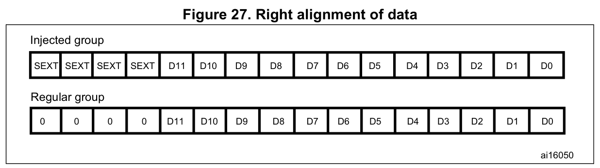

**左对齐。** 规则数据位于 DR[15:4]，低四位为 0。注入数据位于 JDR[14:3]，bit15 表示符号，低三位为 0。

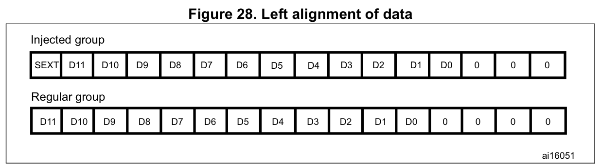

JDR 的半字数据范围与规则无符号码不同；无符号返回类型不会自动完成有符号解释。来源：[RM0008 Rev21 Figures27–28，p224；寄存器 pp245–246、251](https://www.st.com/resource/en/reference_manual/cd00171190.pdf#page=224)。

SR 包含 EOC、JEOC、AWD、STRT、JSTRT。F1 没有另一套独立 EOS/JEOS 寄存器位或硬件 OVR 事件。EOC 既可由规则转换结束置位，也可由注入组结束置位；单看 EOC 或某个 HAL 规则完成回调，不足以证明 DR 是新规则结果。读取 DR 清 EOC；JEOC 等标志按 SR 的写零清除机制处理，不能假定读取 JDR 自动清 JEOC。DMA 对 DR 的读取也参与 EOC 的清除，轮询和 DMA 不应竞争同一事件。[RM0008 Rev21 pp236–237、251](https://www.st.com/resource/en/reference_manual/cd00171190.pdf#page=236)

模拟看门狗使用共享上下阈值，可选单通道或全部通道、规则或注入或两组；比较在数据对齐之前进行，低于下阈值或高于上阈值才属于越界。AWDSGL/AWDEN/JAWDEN 的组合见参数表。看门狗阈值写入合法范围与两阈值的相对关系需要应用检查；所核 HAL/LL 接口不提供完整的高低阈值关系验证。[RM0008 Rev21 pp220–221、238–240、246](https://www.st.com/resource/en/reference_manual/cd00171190.pdf#page=220)


## 6 双 ADC 同时、交错及组合模式

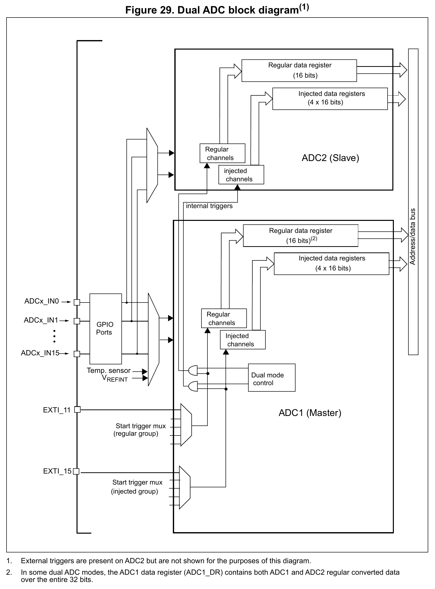

ADC1 为主并控制 DUALMOD，ADC2 为从。双模式使用外部事件触发时，应只在 ADC1 选择所需外部触发源，ADC2 的对应触发源选择软件触发，以免额外事件意外启动从侧；两侧对应组的外部触发允许位仍须使能。规则组使用 EXTSEL/EXTTRIG，注入组使用 JEXTSEL/JEXTTRIG。两侧 ADC 还须分别完成使能与通道配置，不能只配置主侧后假定从侧就绪。[RM0008 Rev21 p228](https://www.st.com/resource/en/reference_manual/cd00171190.pdf#page=228)

图29脚注1说明 ADC2 也有外部触发通路，只是在原图中省略；脚注2说明部分双模式下 ADC1_DR 的整个32位保存两侧规则转换结果。各 ADC 的注入结果仍分别存入自己的 JDRx。图29、31保留 IN15、CH15 等系列原图标签，不扩展 LQFP48 的外部输入范围；实际可接线通道仍按[实例、输入和结果通路](#1-实例输入和结果通路)判断。[RM0008 Rev21 pp229–230、251](https://www.st.com/resource/en/reference_manual/cd00171190.pdf#page=229)

**注入同时。** 外部触发源来自 ADC1 的注入组多路器，由 ADC1_CR2.JEXTSEL 选择，并同时触发 ADC2。两侧注入结果分别进入各自的 JDR1–JDR4；在注入组全部转换完成且相应 JEOCIE 已使能时，产生 JEOC 中断。这里不把注入结果打包进 ADC1_DR，也不改变前述 EOC 可由注入组结束置位的条件。[RM0008 Rev21 §11.9.1，p230](https://www.st.com/resource/en/reference_manual/cd00171190.pdf#page=230)

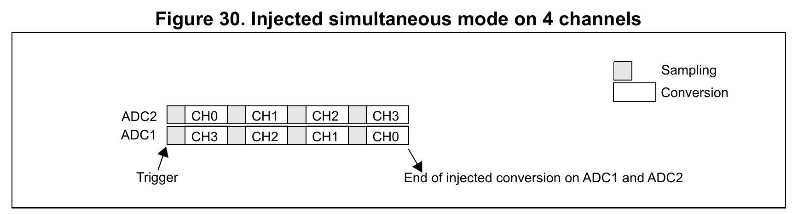

**规则同时。** 外部触发源来自 ADC1 的规则组多路器，由 ADC1_CR2.EXTSEL 选择，并同时触发 ADC2。ADC1_DR 的高半字保存 ADC2 规则结果，低半字保存 ADC1 规则结果；DMA 位置1时可产生32位 DMA 搬运请求。在相应 EOCIE 已使能时，该模式的 EOC 中断描述对应规则通道全部转换完成；完整扫描数据的保存仍须遵守[完成事件与保存每个样本](#完成事件中断与保存每个样本)中的事件、中断和搬运边界；不能靠序列末端箭头证明各中间结果已被保存。[RM0008 Rev21 §11.9.2，p230](https://www.st.com/resource/en/reference_manual/cd00171190.pdf#page=230)

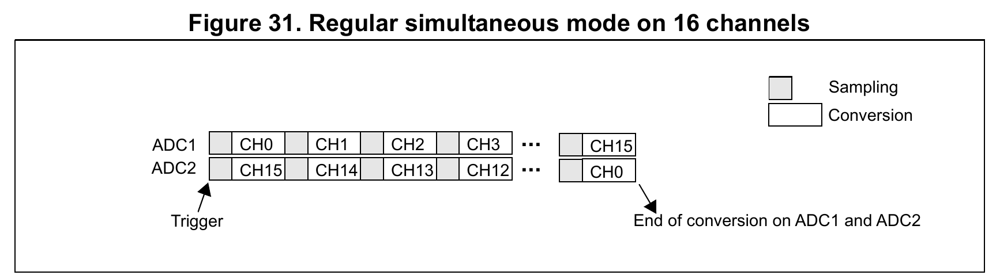

两种同时模式都要求同步采样的一对通道配置完全相同的采样时间，并禁止两 ADC 对同一物理输入的采样窗口重叠。图30、31中的同步关系逐对成立；扫描中先后各对具有不同采样时刻，不能理解为整组所有通道同时采样。灰色 Sampling 与白色 Conversion 的分界不是结果完成时刻；各次结果在各自 Conversion 段结束时形成，图中结束箭头标出该示例整组的末项完成。[RM0008 Rev21 p230](https://www.st.com/resource/en/reference_manual/cd00171190.pdf#page=230)

**快交错。** ADC2先开始，ADC1延后7个 ADC 周期；图32的连续情形要求两侧 CONT 均置1。为避免对同一通道的采样窗口重叠，采样时间须小于7个 ADC 周期，可选档位中仅1.5周期满足。该档位下单次采样加转换共14个 ADC 周期；两个 ADC 交替启动的理想间隔为7个 ADC 周期。

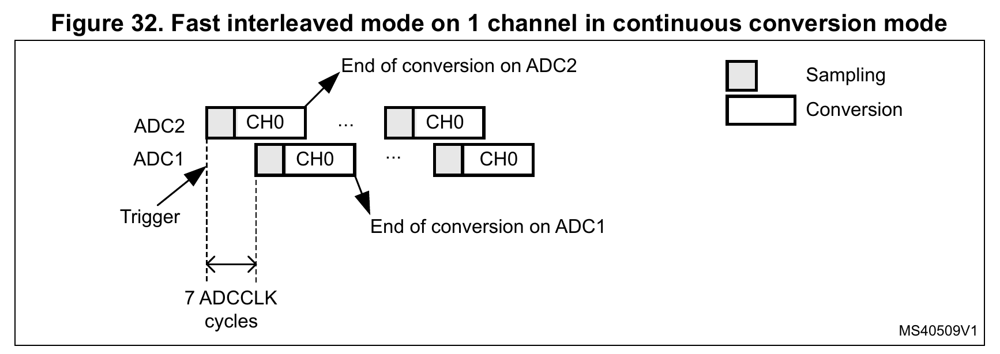

**慢交错。** ADC2先开始，ADC1延后14个 ADC 周期；随后 ADC2 在首次启动28个 ADC 周期后再次自动启动。采样时间须小于14个 ADC 周期，可取1.5、7.5、13.5周期；CONT须保持0，该模式自身按上述间隔连续启动选定规则通道。

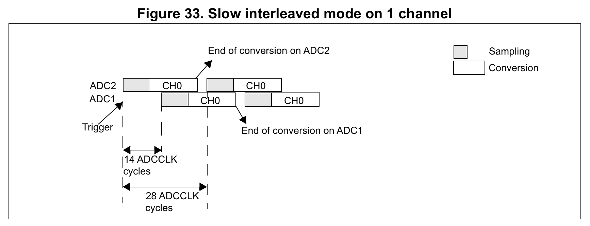

灰色 Sampling 段结束仅表示采样窗口关闭；各 ADC 结果要到其 Conversion 段结束后才形成，原图的 End of conversion 箭头保留了这一边界。7或14个 ADC 周期描述交错启动/采样节拍，不能解释为触发后同一笔结果立即可读。[RM0008 Rev21 pp231–232](https://www.st.com/resource/en/reference_manual/cd00171190.pdf#page=231)

普通交错模式的应用须确保不发生外部注入通道触发；需要注入打断交错时，应采用§11.9.9所述“注入同时＋交错”组合模式并核对其恢复条件，不能把组合模式的行为直接套用到所有交错配置。[RM0008 Rev21 p231](https://www.st.com/resource/en/reference_manual/cd00171190.pdf#page=231) · [§11.9.9，p234](https://www.st.com/resource/en/reference_manual/cd00171190.pdf#page=234)

**交替注入：整组交替。** 该模式只用于注入组，外部触发源来自 ADC1 的注入组多路器。未启用注入间断时，第一次触发转换 ADC1 的整个注入组，第二次触发转换 ADC2 的整个注入组，随后按 ADC1、ADC2 的顺序循环。[RM0008 Rev21 §11.9.5，p232](https://www.st.com/resource/en/reference_manual/cd00171190.pdf#page=232)

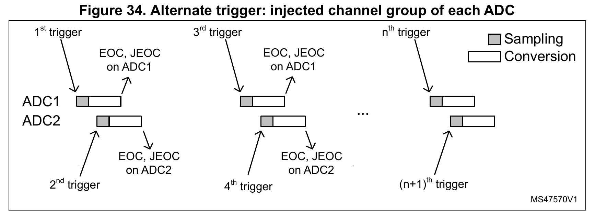

**交替注入：两侧均启用注入间断。** 仅在 ADC1、ADC2 都启用 JDISCEN 时，每次触发才推进被选 ADC 的一个注入 Rank，依次为 ADC1 第1项、ADC2 第1项、ADC1 第2项、ADC2 第2项……。图35以每侧4项为例；各 ADC 自己的整组末项完成后，若其 JEOCIE 已使能，才产生该 ADC 的 JEOC 中断。图34的整组交替也遵守这一整组完成与中断使能条件。两侧注入序列完成后，后续触发重新开始交替过程。[RM0008 Rev21 §11.9.5，pp232–233；JDISCEN 说明 p223](https://www.st.com/resource/en/reference_manual/cd00171190.pdf#page=232)

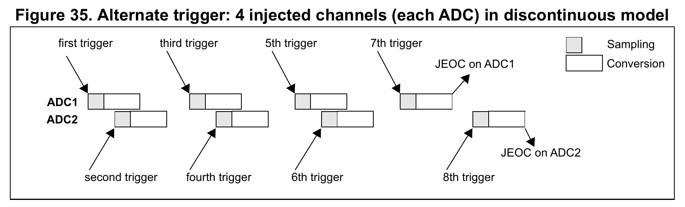

**规则同时＋交替注入。** §11.9.8允许交替注入事件打断正在进行的规则同时转换；事件到达后立即启动轮到的 ADC 注入转换。为保持恢复后的同步，主、从两侧正在进行的规则转换都停止，注入转换结束后同步恢复。图36的 MASTER 对应 ADC1，SLAVE 对应 ADC2；原通道号与重复通道标签均保留。同时采样的一对规则通道必须配置完全相同的采样时间。[RM0008 Rev21 §11.9、§11.9.8，pp228、233–234](https://www.st.com/resource/en/reference_manual/cd00171190.pdf#page=233)

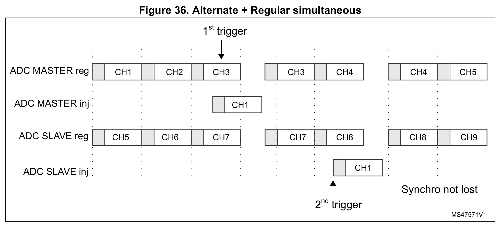

在该组合模式中，若新的注入触发发生于已经打断规则转换的注入转换期间，该触发被忽略。图37原样保留两处“2nd trigger”；按相邻正文，被忽略的是左侧落在 ADC1 注入转换进行期间的那次触发。右侧重复序号保留，不据此重新编号或推导触发计数规则。[RM0008 Rev21 §11.9.8，p234](https://www.st.com/resource/en/reference_manual/cd00171190.pdf#page=234)

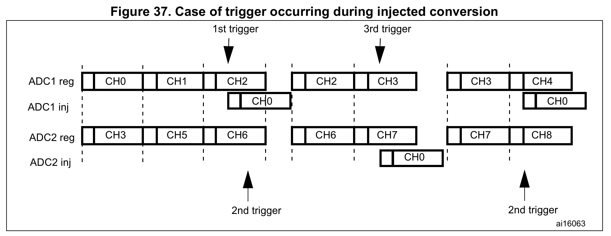

图34–37用于核对整组或逐项推进、抢占和恢复关系；具体时长须按采样设置、时钟和模式条件计算，不能由线段长度推算。

以上依据[RM0008 Rev21 pp230–234](https://www.st.com/resource/en/reference_manual/cd00171190.pdf#page=230)。快/慢交错的理想合成速率分别为 $`f_{\mathrm{ADC}}`$ /7、 $`f_{\mathrm{ADC}}`$ /14； $`f_{\mathrm{ADC}}`$ 单位 Hz，结果单位 样本/s。触发、抢占和恢复等边界仍须另计。

规则双模式从 ADC1_DR 读取组合字：高半字是 ADC2，低半字是 ADC1；ADC1_CR2.DMA 必须为1，即使由 CPU 读组合字，也不能省略这个硬件位条件。真正启用 DMA1 通道属于另一配置步骤。交错结果重建时间顺序时 ADC2在前、ADC1在后；同时模式则按同步对解释。某些固定 HAL 轮询/LL 读数实现与这一路径存在额外限制，见[轮询边界](HAL轮询边界.md)和[LL 参考](LL字段接口与宏.md)。[RM0008 Rev21 pp228–231、251](https://www.st.com/resource/en/reference_manual/cd00171190.pdf#page=228)

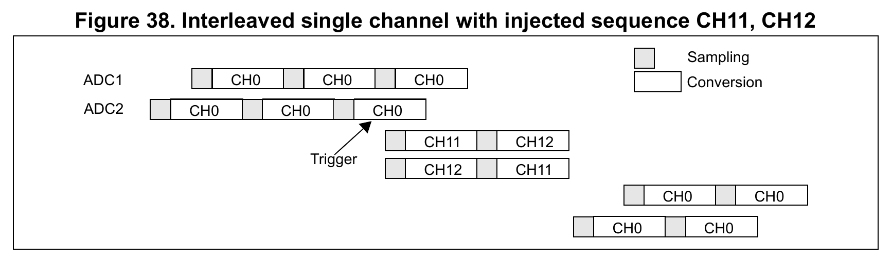

RM0008 §11.9.9允许“注入同时＋交错”组合模式中的注入事件打断交错转换，并在注入序列结束后恢复交错转换。对原本7、7周期的快交错采样节拍，手册指出 ADC 预分频为/4时，恢复后的相邻采样间隔变为8、6个 ADC 周期交替；仅丢弃抢占缺口并不能恢复均匀采样假设。这一8/6限制来自p234正文，不能由图38的绘制比例推算。图38保留系列原图中的 CH11、CH12 标签；LQFP48封装没有这些外部输入引脚，示例通道号不扩展可接线范围。[RM0008 Rev21 pp234–235](https://www.st.com/resource/en/reference_manual/cd00171190.pdf#page=234)

## 7 内部温度与 PA0 耦合边界

温度通道的启动稳定时间、采样时间与测温换算精度是独立条件。RM 推荐约17.1 µs采样窗口，DS Table51 的列归属另在参数页保留；12 MHz下239.5周期约19.96 µs。V25和平均斜率是数据手册典型参数，不能替代逐芯片校准。内部传感器反映芯片温度，不能无条件当作环境温度。[RM0008 Rev21 pp235–236](https://www.st.com/resource/en/reference_manual/cd00171190.pdf#page=235) · [温度参数](电气参数.md#内部温度传感器)

ES096 Rev15 §2.5.1说明，注入序列开始及结束时，内部耦合可能在ADC_IN0/PA0产生毛刺，与实际注入通道选择无关。原文给出的幅度小于150 mV、典型持续时间10 ns，是在I/O配置为高阻输入且悬空时测得；不能把10 ns当作最大持续时间，也不能把这组测量条件推广为任意外部负载下的波形保证。

|PA0使用方式或ADC模式|原文影响范围及条件|
|---|---|
|PA0为数字输出|原文说明不影响输出信号|
|PA0为数字输入|外部驱动阻抗小于5 kΩ时，原文说明不会被识别为伪跳变；该条件不表示内部耦合消失|
|单ADC配置|原文说明不影响其余PA引脚，也不影响注入转换结果；不能将此结论扩大到所有双ADC情形|
|双ADC并使用注入触发|原文建议分配模拟通道时将通道0配置到注入组，以避免副作用；不能遗漏这一模式专属建议|

Table3对§2.5.1各列硅修订均标N，Workaround栏写None。上述模式和外部驱动建议须保留，但不应据此宣称该限制已有完整规避。ADC“注入组转换”与引脚越界电压引起的“电气注入电流”分别处理。[ES096 Rev15 §2.5.1](https://www.st.com/resource/en/errata_sheet/es096-stm32f101x8b-stm32f102x8b-and-stm32f103x8b-mediumdensity-device-limitations-stmicroelectronics.pdf#page=14) · [硅修订矩阵](../硅修订矩阵.md)
