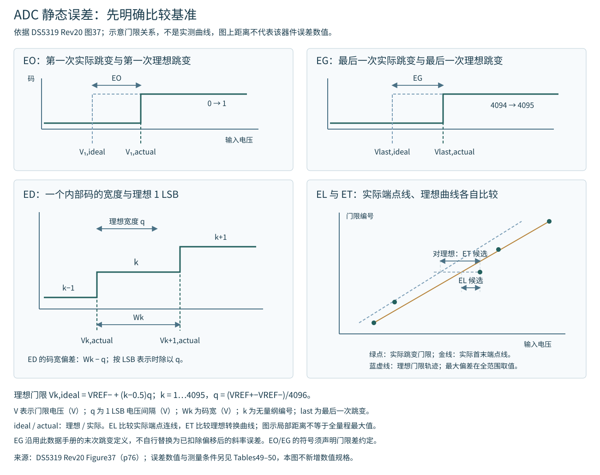

# ADC 量化间隔与静态误差定义

以 DS5319 Rev20 Figure37（p76）的转换曲线、码跳变和端点连线定义为依据。此处给出数学记法以便复核，未使用任何实测传递曲线；它不改变 Table49/50 的条件或保证范围。

## 量化间隔

$$
q=\frac{V_{\mathrm{REF+}}-V_{\mathrm{REF-}}}{2^N}
$$

$q$ 是一个理想 LSB 对应的电压间隔，单位 V；$V_{\mathrm{REF+}}$、$V_{\mathrm{REF-}}$ 是正、负参考电位，单位 V；$N$ 是分辨率位数，C8T6 的 N=12，2^N=4096。LSB 为最低有效位。C8T6 的参考端内部连接 VDDA/VSSA，因此跨度按实际模拟电源与地计算。

最大输出码为 4095，量化区间数为 4096；不能将二者混用。原图采用理想首次跳变位于半个 LSB 的约定，理想内部跳变门限可写为：

`V_k,ideal = VREF− + (k − 0.5) q`，`k = 1, …, 2^N−1`

V_k,ideal 是输出码从 k−1 跳到 k 的理想输入电压，单位 V；k 为无量纲的跳变编号；下标 ideal 表示理想值。其余符号同上。最后一次跳变为 4094→4095，对应 4094.5 LSB 高于 $V_{\mathrm{REF-}}$，距 $V_{\mathrm{REF+}}$ 还有 1.5 LSB。

## 五项误差的比较基准

图形将原图的比较关系拆分展示，所有曲线和门限间距均为定义示意，不是芯片实测值；全量程最大值仍须在完整门限范围内评估。

|数据手册符号|比较对象|边界|
|---|---|---|
|EO 偏移误差|第一次实际跳变与第一次理想跳变|按输入门限的偏差解释，不能直接等同于输出码偏差的正负号|
|EG 增益误差|最后一次实际跳变与最后一次理想跳变|采用该数据手册的端点定义；不能无说明地替换成已去除偏移后的斜率误差|
|ED 差分线性误差|实际码宽与理想码宽 q|比较相邻门限间的宽度，不是整段量程的偏移|
|EL 积分线性误差|实际跳变与实际端点连线|端点连线由实际首、末跳变确定；比较基准不同于理想转换曲线|
|ET 总未调整误差|实际与理想转换曲线的最大偏差|同一条转换曲线的综合偏差，不把 EO、EG、ED、EL 直接相加|

E 表示误差，下标 O、G、D、L、T 分别表示 offset、gain、differential、linearity、total。表中数值用 LSB 表示时，以 $q$ 为归一化尺度；数据手册的 Typ/Max 及正负范围仍按原表读取。

对两个相邻实际跳变门限之间的内部码，可写：

$$
W_k=V_{k+1,\mathrm{actual}}-V_{k,\mathrm{actual}}
$$

$$
\mathrm{DNL}_k=\frac{W_k}{q}-1
$$

$W_k$ 是码 k 的输入电压宽度，单位 V；$V_{k,\mathrm{actual}}$、$V_{k+1,\mathrm{actual}}$ 是相邻实际跳变门限，单位 V；actual 表示实际；$\mathrm{DNL}_k$ 是该码宽相对理想码宽的无量纲偏差，常按 LSB 报告。k 必须对应两侧门限都存在的内部码；最低、最高饱和码不能用任意截取电压区间代替码宽。

端点法积分非线性的电压形式可写：

$$
E_{\mathrm{L},V}=\max_k|V_{k,\mathrm{actual}}-V_{k,\mathrm{endpoint}}|
$$

$E_{\mathrm{L},V}$ 是最大端点法偏差，单位 V；$V_{k,\mathrm{endpoint}}$ 是实际首、末跳变连线在编号 k 处对应的输入电压，单位 V；endpoint 表示端点连线，max 表示在所评估门限范围内取最大值。除以 q 可换算成 LSB。它与以理想门限为比较基准的 ET 不同，不能把二者当作互不相关的独立噪声量相加。

## 精度规格的使用范围

Table49 的较小误差与 Table50 的一般条件误差须分别使用。两者共同要求内部校准后、PCLK2=56 MHz、$f_{\mathrm{ADC}}$=14 MHz、$R_{\mathrm{AIN}}$<10 kΩ；供电、温度条件及最大值的特性表征脚注见[ADC 电气参数](电气参数.md)。

实际前端还包括参考电源、分压/缓冲、电阻容差、漏电、建立不足等影响；总误差预算要区分相关偏差和独立随机量，避免重复计入同一误差来源。数字平均不能单独消除固定偏移、增益、非线性或采样建立不足。

[来源：DS5319 Rev20 Figure37](https://www.st.com/resource/en/datasheet/stm32f103c8.pdf#page=76)。

## AN2834 算例的数值与端点约定

保留的 AN2834 Rev10 笔记在偏移、增益及积分线性示例中使用3.3 V参考跨度、550 µV首次实际跳变、3.298435 V末次实际跳变。它们是应用笔记的说明数值，不能作为F103C8T6的保证值。该AN原PDF全文逐页对照尚未完成；下表对这些已保留数值进行独立算术复核，源文措辞冲突仍保留核查边界。

|量|按本页统一约定计算|
|---|---|
|q=3.3/4096|805.6640625 µV|
|理想首次跳变0.5q|402.83203125 µV|
|首次实际跳变减理想跳变|147.16796875 µV，约+0.182667 LSB|
|理想末次跳变4094.5q|3.29879150390625 V|
|末次实际跳变减理想跳变|−356.50390625 µV，约−0.442497 LSB|

$q$为一个理想量化间隔，单位V；LSB为最低有效位对应的归一化单位。表内较多小数仅用于复核算术，不代表测量或器件精度。积分线性示例的端点直线仍由550 µV与3.298435 V这两个实际门限确定。

保留笔记记录了两处差异：偏移算例原结果141.2 µV、0.17 LSB与上述减数不一致；末次理想跳变的文字又使用$V_{\mathrm{REF+}}$−0.5q及3.299597 V，与图示4094.5q不一致。前者可由算术识别；后者涉及端点约定，必须明示采用哪一种。按$V_{\mathrm{REF+}}$−0.5q计算会得到约−1.442497 LSB，不能与本页统一约定下的−0.442497 LSB混用。
