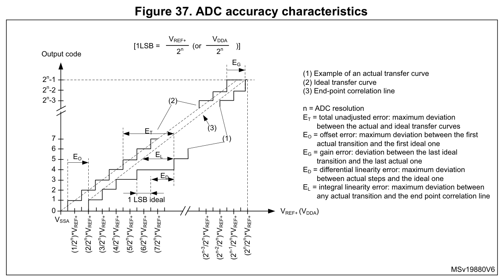

# ADC 量化间隔与静态误差定义

以 DS5319 Rev20 Figure37（p76）的转换曲线、码跳变和端点连线定义为依据。此处给出数学记法以便复核，未使用任何实测传递曲线；它不改变 Table49/50 的条件或保证范围。

## 量化间隔

```math
q=\frac{V_{\mathrm{REF+}}-V_{\mathrm{REF-}}}{2^N}
```

$`q`$ 是一个理想 LSB 对应的电压间隔，单位 V； $`V_{\mathrm{REF+}}`$ 、 $`V_{\mathrm{REF-}}`$ 是正、负参考电位，单位 V； $`N`$ 是分辨率位数， $`N=12`$ ， $`2^N=4096`$ 。LSB 为最低有效位。参考端内部连接 VDDA/VSSA，因此跨度按实际模拟电源与地计算。

最大输出码为 4095，量化区间数为 4096；不能将二者混用。原图采用理想首次跳变位于半个 LSB 的约定，理想内部跳变门限可写为：

```math
V_{k,\mathrm{ideal}}=V_{\mathrm{REF-}}+(k-0.5)q,
\qquad k=1,\ldots,2^N-1
```

$`V_{k,\mathrm{ideal}}`$ 是输出码从 $`k-1`$ 跳到 $`k`$ 的理想输入电压，单位 V； $`k`$ 为无量纲的跳变编号；下标 ideal 表示理想值。其余符号同上。最后一次跳变为 4094→4095，对应 4094.5 LSB 高于 $`V_{\mathrm{REF-}}`$ ，距 $`V_{\mathrm{REF+}}`$ 还有 1.5 LSB。

## 五项误差的比较基准



来源：[DS5319 Rev20，Figure37，p76](https://www.st.com/resource/en/datasheet/stm32f103c8.pdf#page=76)。保留原图的三条曲线、五项误差标记和图内说明。

原图中 (1) 为实际转换曲线示例，(2) 为理想转换曲线，(3) 为实际端点连线。曲线用于说明比较基准，不是具体芯片的实测结果；全量程最大值仍须在完整门限范围内评估。

|数据手册符号|比较对象|边界|
|---|---|---|
| $`E_{\mathrm{O}}`$ 偏移误差|第一次实际跳变与第一次理想跳变|按输入门限的偏差解释，不能直接等同于输出码偏差的正负号|
| $`E_{\mathrm{G}}`$ 增益误差|最后一次实际跳变与最后一次理想跳变|采用该数据手册的端点定义；不能无说明地替换成已去除偏移后的斜率误差|
| $`E_{\mathrm{D}}`$ 差分线性误差|实际码宽与理想码宽 $`q`$ |比较相邻门限间的宽度，不是整段量程的偏移|
| $`E_{\mathrm{L}}`$ 积分线性误差|实际跳变与实际端点连线|端点连线由实际首、末跳变确定；比较基准不同于理想转换曲线|
| $`E_{\mathrm{T}}`$ 总未调整误差|实际与理想转换曲线的最大偏差|同一条转换曲线的综合偏差，不把 $`E_{\mathrm{O}}`$ 、 $`E_{\mathrm{G}}`$ 、 $`E_{\mathrm{D}}`$ 、 $`E_{\mathrm{L}}`$ 直接相加|

E 表示误差，下标 O、G、D、L、T 分别表示 offset、gain、differential、linearity、total。表中数值用 LSB 表示时，以 $`q`$ 为归一化尺度；数据手册的 Typ/Max 及正负范围仍按原表读取。

对两个相邻实际跳变门限之间的内部码，可写：

```math
W_k=V_{k+1,\mathrm{actual}}-V_{k,\mathrm{actual}}
```

```math
\mathrm{DNL}_k=\frac{W_k}{q}-1
```

$`W_k`$ 是码 $`k`$ 的输入电压宽度，单位 V； $`V_{k,\mathrm{actual}}`$ 、 $`V_{k+1,\mathrm{actual}}`$ 是相邻实际跳变门限，单位 V；actual 表示实际； $`\mathrm{DNL}_k`$ 是该码宽相对理想码宽的无量纲偏差，常按 LSB 报告。 $`k`$ 必须对应两侧门限都存在的内部码；最低、最高饱和码不能用任意截取电压区间代替码宽。

端点法积分非线性的电压形式可写：

```math
E_{\mathrm{L},V}=\max_k|V_{k,\mathrm{actual}}-V_{k,\mathrm{endpoint}}|
```

$`E_{\mathrm{L},V}`$ 是最大端点法偏差，单位 V； $`V_{k,\mathrm{endpoint}}`$ 是实际首、末跳变连线在编号 $`k`$ 处对应的输入电压，单位 V；endpoint 表示端点连线，max 表示在所评估门限范围内取最大值。除以 $`q`$ 可换算成 LSB。它与以理想门限为比较基准的 $`E_{\mathrm{T}}`$ 不同，不能把二者当作互不相关的独立噪声量相加。

## 精度规格的使用范围

Table49 的较小误差与 Table50 的一般条件误差须分别使用。两者共同要求内部校准后、PCLK2=56 MHz、 $`f_{\mathrm{ADC}}`$ =14 MHz、 $`R_{\mathrm{AIN}}`$ <10 kΩ；供电、温度条件及最大值的特性表征脚注见[ADC 电气参数](电气参数.md)。

实际前端还包括参考电源、分压/缓冲、电阻容差、漏电、建立不足等影响；总误差预算要区分相关偏差和独立随机量，避免重复计入同一误差来源。数字平均不能单独消除固定偏移、增益、非线性或采样建立不足。

[来源：DS5319 Rev20 Figure37](https://www.st.com/resource/en/datasheet/stm32f103c8.pdf#page=76)。

## AN2834 算例的数值与端点约定

已直接对照 AN2834 Rev10 的相关原文：§3.1.1 p10 以 550 µV 为首次实际跳变，§3.1.2 p11 以 3.298435 V 为末次实际跳变，§3.1.4 p13 又用这两个门限构造积分线性的端点连线。前两个算例均设参考电压为 3.3 V。这些是说明数值，不能作为器件保证值；下表保留本页约定下的独立算术复核，与原文印刷结果分开使用。[AN2834 Rev10，pp10–13](https://www.st.com/content/ccc/resource/technical/document/application_note/group0/3f/4c/a4/82/bd/63/4e/92/CD00211314/files/CD00211314.pdf/jcr%3Acontent/translations/en.CD00211314.pdf#page=10)。

|量|按本页统一约定计算|
|---|---|
| $`q=3.3/4096`$ |805.6640625 µV|
|理想首次跳变 $`0.5q`$ |402.83203125 µV|
|首次实际跳变减理想跳变|147.16796875 µV，约+0.182667 LSB|
|理想末次跳变 $`4094.5q`$ |3.29879150390625 V|
|末次实际跳变减理想跳变|−356.50390625 µV，约−0.442497 LSB|

$`q`$ 为一个理想量化间隔，单位 V；LSB 为最低有效位对应的归一化单位。表内较多小数仅用于复核算术，不代表测量或器件精度。p13 Figure12 的横轴是模拟输入电压，纵轴是数字输出码；端点线连接首次实际跳变处的码 1 与末次实际跳变处的码 4095，所对应电压正是 550 µV 与 3.298435 V。粉色 $`E_{\mathrm{L}}`$ 沿输入电压方向比较实际跳变与这条端点线，不以理想转换曲线为基准。[§3.1.4、Figure12，p13](https://www.st.com/content/ccc/resource/technical/document/application_note/group0/3f/4c/a4/82/bd/63/4e/92/CD00211314/files/CD00211314.pdf/jcr%3Acontent/translations/en.CD00211314.pdf#page=13)。

原文有以下差异，须与本页复算分开读取：

- 偏移算例直接印为 $`E_{\mathrm{O}}=550\,\mathrm{\mu V}-402.8\,\mathrm{\mu V}=141.2\,\mathrm{\mu V}`$ ，随后写为 0.17 LSB。141.2 µV 与该减式不符；这不是原文与本页采用不同精度的 $`q`$ 所能解释的舍入差异。[§3.1.1，p10](https://www.st.com/content/ccc/resource/technical/document/application_note/group0/3f/4c/a4/82/bd/63/4e/92/CD00211314/files/CD00211314.pdf/jcr%3Acontent/translations/en.CD00211314.pdf#page=10)。
- 增益正文将 0xFFE→0xFFF 的理想末跳变写为 $`V_{\mathrm{REF+}}-0.5q`$ 、3.299597 V，并给出 −1162 µV、−1.44 LSB。Figure9 却把理想末跳变标在 $`4094.5q`$ ，即距正参考还有 $`1.5q`$ 。本页沿用前述 DS5319 的约定；按正文的 $`V_{\mathrm{REF+}}-0.5q`$ 复算会得到约−1.442497 LSB，不能与本页的−0.442497 LSB混用。原文同一算式的分母印为 805.6 V，遗漏了与前文 LSB 电压一致的 µ 前缀，不能按 V 直接作单位换算。[§3.1.2、Figure9，p11](https://www.st.com/content/ccc/resource/technical/document/application_note/group0/3f/4c/a4/82/bd/63/4e/92/CD00211314/files/CD00211314.pdf/jcr%3Acontent/translations/en.CD00211314.pdf#page=11)。
- Figure10 的横轴也标 4094.5 LSB，但该标线落在蓝色实际曲线的末跳变，黑色理想曲线的末跳变在其右侧。它与 Figure9 的标线定位不同，不能再据此推导另一套理想端点约定。[Figure10，p12](https://www.st.com/content/ccc/resource/technical/document/application_note/group0/3f/4c/a4/82/bd/63/4e/92/CD00211314/files/CD00211314.pdf/jcr%3Acontent/translations/en.CD00211314.pdf#page=12)。
- 差分线性算例在 p12 假定同一输出码覆盖 1.9998–2.0014 V；p13 将 0x9B3 的码宽印为“1.6 mV（1660 µV）”，随后用 1660 µV 减 805.6 µV，得到 854.4 µV、1.06 LSB。

  按列出的端点相减，码宽 $`W_k`$ 是 1.6 mV，即 1600 µV。沿用原文使用的量化间隔 $`q=805.6\,\mathrm{\mu V}`$ ，码宽超出理想宽度 794.4 µV；再除以 $`q`$ ，得 $`(1600-805.6)/805.6\approx0.9861`$ ，按 LSB 报告约为 +0.9861 LSB。

  这是按给定端点的复算，不改变前述码宽定义；仅凭这些不一致的印值，不能判定 ST 原本想修正区间端点还是 1660 µV 等后续数值。[§3.1.3，pp12–13](https://www.st.com/content/ccc/resource/technical/document/application_note/group0/3f/4c/a4/82/bd/63/4e/92/CD00211314/files/CD00211314.pdf/jcr%3Acontent/translations/en.CD00211314.pdf#page=12)。

以上是对固定版本原文的差异说明及本页采用的解释，不是 ST 发布的勘误；本次原文上下文核查也不代表 AN2834 全部 53 页或全部算例已逐项通过。
