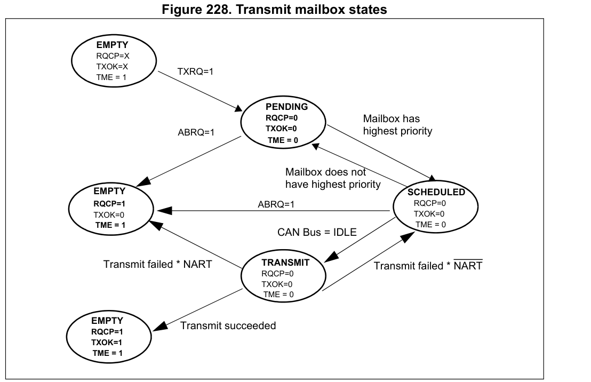

# CAN 邮箱 FIFO 与错误边界

[返回 USB 与 CAN](../../知识库/09_USB与CAN.md) · [HAL 开发参考](../../知识库/HAL开发参考入口.md)

使用 CAN 时，应分别判断请求是否已提交、控制器是否成功发送、应用是否处理了相应业务。接收端也要区分报文读取、FIFO 出队和溢出记录。本页依据 RM0008 Rev21、ES096 Rev15，以及 STM32CubeF1 v1.8.6 配套 HAL v1.1.10 的[固定实现](../../来源/驱动实现.md#src-hal-can-v1110)。

## 1 资源与启动条件

CAN1 含 3 个发送邮箱，FIFO0、FIFO1 各容纳 3 条报文，过滤组为 0–13。经典 CAN 数据帧有效载荷为 0–8 字节；DLC 是数据长度码，远程帧的 DLC 表示请求长度，远程帧本身没有数据载荷。CAN 需要外部收发器，内部回环结果不能证明外部收发器、接线、终端及其他节点 ACK 正常。[RM0008 §24.1–24.5、§24.7，pp653–664](../../来源/RM0008.md#src-rm0008-r21-can-mailbox-fifo)

USB/CAN 共享 SRAM 的选择约束见[硬件限制](../../知识库/01_器件边界与硬件设计.md#12-引脚图与复用限制)；PA11/PA12 与 PB8/PB9 的 CAN 选择及封装限制见[引脚映射](../引脚复用与AFIO.md#通信定时器映射)。共享 IRQ 的分配见[C8 外部向量表](../C8外部向量表.md)。改引脚不会解除内部共享限制。

CAN 位时序使用 PCLK1，不套用定时器的 APB 倍频规则。位率、采样点、传播延迟和重同步条件需一起设计；本页不提供可直接套用的位时序配置。通常按 `Init → ConfigFilter → Start` 建立接收条件，再按需启用通知。初始化请求 `INRQ` 与确认 `INAK` 不同，退出初始化还需总线同步；写完请求位不能立即当作已正常工作。[RM §24.4 pp656–657、§24.7.7 pp670–671](../../来源/RM0008.md#src-rm0008-r21-can-mailbox-fifo) · [固定驱动使用说明 L43–72](https://github.com/STMicroelectronics/stm32f1xx-hal-driver/blob/77fbb30b7a1d02533980400083e48c559aae5a4f/Src/stm32f1xx_hal_can.c#L43-L72)

固定 `Start/Stop` 用 `HAL_GetTick` 差值严格大于 10 时判超时，返回 `HAL_ERROR` 并记录 `HAL_CAN_ERROR_TIMEOUT`；该阈值依赖实际时基推进，不是无条件 10 ms 墙钟上限。超时路径也没有撤回已经发出的模式请求，须重新检查硬件状态。[Start/Stop L1006–1093](https://github.com/STMicroelectronics/stm32f1xx-hal-driver/blob/77fbb30b7a1d02533980400083e48c559aae5a4f/Src/stm32f1xx_hal_can.c#L1006-L1093) · [HAL 时基条件](../HAL毫秒计数与阻塞延时.md)

ES096 §2.11.1 明确本器件不支持时间触发通信模式，`MCR.TTCM` 必须保持 0。HAL 配置应关闭 `TimeTriggeredMode`，发送头也不启用 `TransmitGlobalTime`；接收头存在 `Timestamp` 字段并不使时间戳可用。[ES096 p23](../../来源/ES096.md#src-es096-r15-can-ttcm)

## 2 发送提交 完成与取消

`HAL_CAN_AddTxMessage` 在允许的句柄状态和空邮箱条件下，填写标识符、长度及数据，最后置 `TXRQ` 后返回 `HAL_OK`。它不等待总线发送完成；其允许的 `READY` 状态甚至不能单独证明控制器已经离开初始化模式。以下表述以参数有效、单一所有者管理句柄及邮箱为前提。[AddTxMessage L1222–1310](https://github.com/STMicroelectronics/stm32f1xx-hal-driver/blob/77fbb30b7a1d02533980400083e48c559aae5a4f/Src/stm32f1xx_hal_can.c#L1222-L1310)

|状态或操作|实际证明范围与副作用|
|---|---|
|`TME=1`|对应邮箱可用于填写新请求；不等同上一条请求成功|
|置 `TXRQ`|提交发送请求，邮箱进入待处理状态；离开空闲态后软件不能继续改写其报文寄存器|
|`RQCP=1`|上次发送或取消请求已经完成，仍须区分 `TXOK`、`ALST`、`TERR`|
|`TXOK=1`|该帧被控制器成功发送；不证明指定应用节点已经执行相应业务|
|`ALST` / `TERR`|分别表示仲裁丢失、发送错误；自动重发策略影响请求是否继续等待|
|向 `RQCP` 写 1|同时清该邮箱的 `TXOK/ALST/TERR`，需要的结果应先保存|
|置 `ABRQ`|请求取消，不撤销已经发送的位；若当前发送尝试成功，取消后仍可能得到 `TXOK`|

依据：[RM0008 §24.7.1 pp660–661、TSR pp677–679](../../来源/RM0008.md#src-rm0008-r21-can-mailbox-fifo)。`AutoRetransmission` 开启时，未成功且未取消的请求可继续等待；应用应另行定义发送期限。关闭自动重发时，一次尝试结束也须检查结果，不能只看邮箱重新空闲。

### 原图：发送邮箱的状态变化

图：RM0008 Rev21 Figure 228，印刷/PDF p662。`TXRQ` 使空闲邮箱进入 `PENDING`，之后按优先级进入 `SCHEDULED`，总线空闲时进入 `TRANSMIT`。图中的两种完成后 `EMPTY` 分别保留 `TXOK=0` 和 `TXOK=1`，对应上表“邮箱可用”与“成功发送”的区别；不能由 `HAL_OK` 或 `TME=1` 跳过结果判断。[官方原图](https://www.st.com/resource/en/reference_manual/cd00171190.pdf#page=662) · [原图来源记录](../../assets/manual/usb-can/README.md)

右侧失败路径的 `NART` 上横线表示逻辑取反：`NART=0` 允许自动重发，`NART=1` 时一次尝试结束后完成请求。图中的 `ABRQ` 直接取消箭头画在等待/已调度状态；已经进入发送状态时，取消仍可能遇到本次发送成功，须同时阅读前页的 Abort 说明和下文固定 HAL 行为，不能把图理解为能撤回已发送的位。[RM §24.7.1，pp660–661](https://www.st.com/resource/en/reference_manual/cd00171190.pdf#page=660)

固定 `HAL_CAN_AbortTxRequest` 只设置所选邮箱的 `ABRQ` 后返回，没有等待取消完成。发送已经成功的业务是否需要补偿，由上层协议决定，不能将取消请求视为业务撤销。[Abort L1322–1363](https://github.com/STMicroelectronics/stm32f1xx-hal-driver/blob/77fbb30b7a1d02533980400083e48c559aae5a4f/Src/stm32f1xx_hal_can.c#L1322-L1363)

该取消函数对 TSR 使用 `SET_BIT` 读改写。如果读取时已有邮箱的 `RQCP/TXOK/ALST/TERR` 为 1，写回这些 1 可能连带确认相应结果，涉及的可以是其他邮箱。因此取消与完成处理须统一协调，先保存仍需要的完成证据；不能假定一次取消仅改变所选 `ABRQ`。这是固定宏与 TSR 写1清语义的条件性推导，不声称所有并发事件都会丢失。[RM TSR pp677–679](../../来源/RM0008.md#src-rm0008-r21-can-mailbox-fifo) · [固定 SET_BIT L177](https://github.com/STMicroelectronics/cmsis_device_f1/blob/8a76309ed1250d817e9c888c4417171d2ba3ba63/Include/stm32f1xx.h#L177)

`HAL_CAN_IRQHandler` 先保存 TSR 快照，再清 `RQCP`，随后依据快照选择完成、错误或取消分支。因此完成回调里重新读取硬件结果位，可能已经看不到原值；应使用相应事件含义，并按需要保存诊断信息。[IRQ L1696–1837](https://github.com/STMicroelectronics/stm32f1xx-hal-driver/blob/77fbb30b7a1d02533980400083e48c559aae5a4f/Src/stm32f1xx_hal_can.c#L1696-L1837)

### 发送缓冲需要完整 8 字节可读空间

固定 `AddTxMessage` 的成功提交路径读取 `aData[0]` 到 `aData[7]`，不按 DLC 或 RTR 缩短源访问。即使有效载荷较短或发送远程帧，传入对象仍须提供 8 字节合法可读空间，并避免读取未初始化内容。这个约束来自软件复制路径，不表示线上每条报文都有 8 字节载荷。[数据装载 L1280–1295](https://github.com/STMicroelectronics/stm32f1xx-hal-driver/blob/77fbb30b7a1d02533980400083e48c559aae5a4f/Src/stm32f1xx_hal_can.c#L1280-L1295)

## 3 接收读取 出队与溢出

接收报文须先通过协议检查和启用的过滤组，才进入指定 FIFO。过滤时需要同时考虑 ID、IDE（标准/扩展帧）和 RTR（数据/远程帧）；全零掩码意味着所有位都不参与比较，不能作为空槽。使用 `FINIT` 重新配置过滤器会停止接收，应纳入接收停顿管理。[RM §24.4.1 p657、§24.7.3–24.7.4 pp662–667](../../来源/RM0008.md#src-rm0008-r21-can-mailbox-fifo) · [ConfigFilter L840–955](https://github.com/STMicroelectronics/stm32f1xx-hal-driver/blob/77fbb30b7a1d02533980400083e48c559aae5a4f/Src/stm32f1xx_hal_can.c#L840-L955)

FIFO 的 `FMP` 表示待处理数量。先完整读取头部和数据，再通过 `RFOM` 释放输出邮箱；仅仅读取数据不会出队。释放后下一条最旧报文映射到同一输出邮箱，不能在报文读到一半时释放。[RM pp662–664、679–680](../../来源/RM0008.md#src-rm0008-r21-can-mailbox-fifo)

固定 `HAL_CAN_GetRxMessage` 在有效状态且指定 FIFO 非空时，填写接收头并写入 `aData[0..7]`，随后释放 FIFO。目标对象必须有完整 8 字节可写空间；应用只按有效 DLC 使用载荷，远程帧不解释这些字节为数据。该版本会把读到的大于等于 8 的 DLC 字段归一为 8，但不会据短 DLC 缩短内存写入。[GetRxMessage L1480–1571](https://github.com/STMicroelectronics/stm32f1xx-hal-driver/blob/77fbb30b7a1d02533980400083e48c559aae5a4f/Src/stm32f1xx_hal_can.c#L1480-L1571)

|FIFO条件或操作|含义|
|---|---|
|第三条报文入队|置 `FULL`，表示FIFO曾达到满状态|
|FIFO满后又来有效报文|置 `FOVR`，发生报文丢失；不能仅凭本次仍读到一帧认定连续接收无损|
|`RFLM=1`|保留原先三条，丢弃新报文|
|`RFLM=0`|新报文覆盖FIFO中最后存入的一条；不是任意覆盖队头|
|向 `FULL/FOVR` 写1|确认相应事件；不等于取出报文|
|置 `RFOM`|在FIFO非空时释放输出邮箱；推进队列与保存溢出证据是两件事|

依据：[RM §24.7.3 pp663–664、RF0R/RF1R pp679–680](../../来源/RM0008.md#src-rm0008-r21-can-mailbox-fifo)。

**固定释放路径还有读改写副作用。** `GetRxMessage` 用 `SET_BIT` 对 RF0R/RF1R 置 `RFOM`；该宏是 `REG |= BIT`。若读改写读取时 `FULL/FOVR` 已为1，回写的1会同时确认这些事件。这个结论来自固定代码与寄存器写1清语义的组合，未作实板复现。尤其在轮询路径中，不能用调用之后 `FOVR=0` 证明此前没有丢帧；所需状态应在释放前记录，并统一中断与轮询的资源所有权。[GetRxMessage L1545–1566](https://github.com/STMicroelectronics/stm32f1xx-hal-driver/blob/77fbb30b7a1d02533980400083e48c559aae5a4f/Src/stm32f1xx_hal_can.c#L1545-L1566) · [固定 SET_BIT L177](https://github.com/STMicroelectronics/cmsis_device_f1/blob/8a76309ed1250d817e9c888c4417171d2ba3ba63/Include/stm32f1xx.h#L177)

固定IRQ会按已使能通知读取并处理溢出/满事件；待接收回调本身不自动完成报文出队。处理完后若 FIFO 仍非空，相应挂起条件仍可成立。一次寄存器快照或一个粘滞标志也不能恢复全部丢帧数量和先后顺序。[IRQ L1696–1705、L1840–1935](https://github.com/STMicroelectronics/stm32f1xx-hal-driver/blob/77fbb30b7a1d02533980400083e48c559aae5a4f/Src/stm32f1xx_hal_can.c#L1696-L1935)

## 4 协议错误与总线关闭恢复

`TEC`、`REC` 分别为发送、接收错误计数；`LEC` 表示最近一次错误类别，成功收发会将其清零，不能替代历史日志。硬件错误状态和软件 `ErrorCode` 的保存、清除各有含义，清软件状态不会使物理链路恢复。

|硬件条件|状态|
|---|---|
|TEC或REC至少96|`EWGF`，错误警告|
|TEC或REC大于127|`EPVF`，错误被动状态；两者均降至128以下才满足回到错误主动的计数条件|
|TEC大于255|`BOFF`，总线关闭；ESR的TEC字段只暴露计数器低8位，不能只看该字段数值判断未关闭|

来源：[RM0008 §24.7.5–24.7.6 pp668–670、ESR pp682–683](../../来源/RM0008.md#src-rm0008-r21-can-mailbox-fifo)。计数是协议维护的状态量；表中阈值不是应用随意重写计数器的操作说明。

bus-off 恢复必须监测到 128 次连续 11 个隐性位。`ABOM=1` 时硬件自动开始恢复；`ABOM=0` 时由软件请求进入再退出初始化来启动恢复。初始化模式不监测 CANRX，不能一直停在初始化模式等待恢复序列完成。恢复到可通信状态仍需确认总线与应用条件，避免无限重复提交。[RM §24.7.6 p670、MCR p675](../../来源/RM0008.md#src-rm0008-r21-can-mailbox-fifo)

本页未运行固件或发送总线报文，也未测量实际位时序、负载、丢帧率或故障恢复。完整过滤编码/FMI布局、网络协议、总线负载设计和应用重试策略不在本页覆盖范围。
