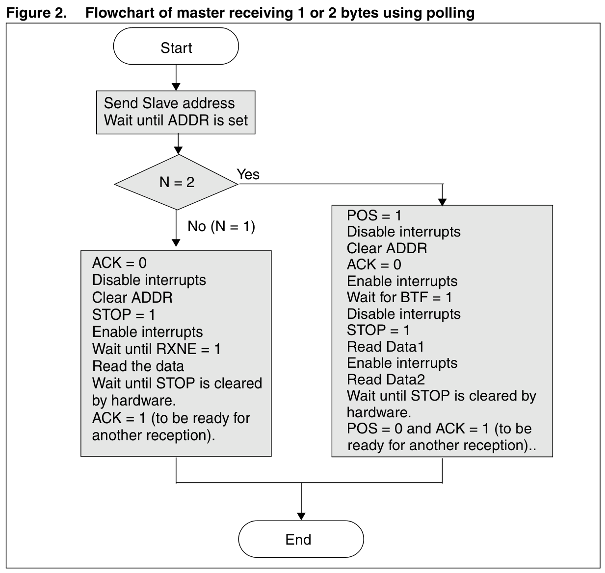
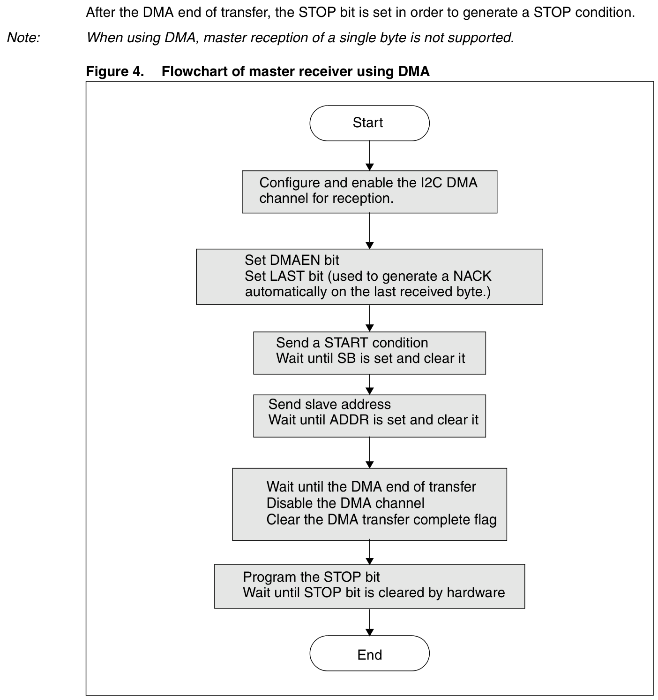

# I²C 主接收：长度分支与 DMA 中断协作

使用 HAL 接收时，需要同时确认接收长度、事件中断和 DMA 完成处理。下面按开发时最常遇到的问题组织。

## 1 轮询接收为何按长度分支

`HAL_I2C_Master_Receive()` 对接收末尾分别处理，避免最后一个字节的应答与 STOP 时机出错。

| 接收阶段 | 固定 HAL 实现的处理 |
|---|---|
| 总长度为 1 字节 | 清 ACK；屏蔽中断后清 ADDR、设置 STOP，再恢复中断；等 RXNE 后读 DR |
| 总长度为 2 字节 | 设置 POS；屏蔽中断后清 ADDR、清 ACK，再使能中断；等 BTF 后再次屏蔽中断，设置 STOP、读第一个字节；使能中断后读第二个字节 |
| 剩余 3 字节 | 等 BTF、清 ACK；屏蔽中断后读第一个剩余字节，再等 BTF，设置 STOP、读第二个，恢复中断后读最后一个 |

ACK 是应答控制位；POS 控制 ACK 的位置。ADDR 表示地址阶段完成，RXNE 表示接收数据寄存器非空，BTF 表示字节传输完成。DR（Data Register）是数据寄存器。这里的步骤由 HAL 管理，调用期间不要再由应用自行读 DR 或清 ADDR。

来源：[HAL 轮询接收函数](https://github.com/STMicroelectronics/stm32f1xx-hal-driver/blob/bd368aa335c529641d2e567574885e02deacc64a/Src/stm32f1xx_hal_i2c.c#L1195-L1428)。

### 原图：1 字节与 2 字节轮询接收

AN2824 Rev4 Figure 2 将旧寄存器例程的 1 字节、2 字节接收并排显示，便于看到两条路径的中断屏蔽窗口。图中不含 N>2 接收；上表的“剩余 3 字节”仍按固定 HAL 源码解释。

图从发送地址阶段展开；请求 START、等待 SB 再发送地址的公共前序见 [p5](https://www.st.com/resource/en/application_note/an2824-stm32f10xxx-ic-optimized-examples-stmicroelectronics.pdf#page=5)，仍须先完成。图示选择 STOP 收尾，p6 正文提到的重复 START 不沿用图末等待 STOP 清零的步骤。

原图：[AN2824 Figure 2，p8](https://www.st.com/resource/en/application_note/an2824-stm32f10xxx-ic-optimized-examples-stmicroelectronics.pdf#page=8)。配套的 [p6 正文与三条时序注释](https://www.st.com/resource/en/application_note/an2824-stm32f10xxx-ic-optimized-examples-stmicroelectronics.pdf#page=6)应一起看：

- 1 字节的 EV6_3 序列要求在当前字节结束前完成，保护窗口是清 ADDR 到设置 STOP/START。
- 2 字节的 EV6_1 序列要求在当前字节的 ACK 脉冲前完成，保护窗口是清 ADDR 到清 ACK。原文另因数据读取限制，要求保护设置 STOP 到读取 Data1 的窗口；图中完整保留这两段屏蔽与恢复。
- 2 字节正文先列设置 POS 和 ACK、再等待 ADDR；图中在 ADDR 置位后列 POS=1，但仍在清 ADDR 前。图中没有重新列出入场的 ACK=1，不应把它省略。

图末的等待 STOP 清零、恢复 ACK/POS 属于旧例流程；不能据此增加固定 HAL 的返回保证。图中的 Enable interrupts 也不表示恢复原 PRIMASK，调用环境限制见本节下文。

### 对照 AN2824 原流程图时的注意点

AN2824 Rev4 第 7 页 Figure 1 的三字节收尾分支漏列了读取倒数第三个字节 `DataN-2` 的步骤。第 5 页正文明确写出：清 ACK 后读取这个字节，以启动最后一个字节的接收。上表所列固定 HAL 实现也包含这次读取，因此不能只按该图编写收尾代码。

对照来源：[AN2824 正文，第 5 页](https://www.st.com/resource/en/application_note/an2824-stm32f10xxx-ic-optimized-examples-stmicroelectronics.pdf#page=5)、[原图 Figure 1，第 7 页](https://www.st.com/resource/en/application_note/an2824-stm32f10xxx-ic-optimized-examples-stmicroelectronics.pdf#page=7)。此处记录图文差异，不将其称为 ST 已确认的勘误。

### 中断屏蔽会影响调用环境

上述临界段直接调用 `__disable_irq()` 与 `__enable_irq()`，没有在这些位置保存并恢复调用前的 PRIMASK。PRIMASK 是控制可配置优先级异常屏蔽的寄存器。

因此，外层已经屏蔽中断时，不能默认该调用会保持原来的屏蔽状态。三字节收尾段还会在屏蔽期间轮询 BTF；该等待使用软件计数，并有超时返回分支。评估中断延迟时应把这段也纳入。

来源：[一、二字节临界段](https://github.com/STMicroelectronics/stm32f1xx-hal-driver/blob/bd368aa335c529641d2e567574885e02deacc64a/Src/stm32f1xx_hal_i2c.c#L1247-L1281)、[三字节收尾与超时退出](https://github.com/STMicroelectronics/stm32f1xx-hal-driver/blob/bd368aa335c529641d2e567574885e02deacc64a/Src/stm32f1xx_hal_i2c.c#L1354-L1417)。

## 2 使用 DMA 仍要接入 I²C 中断

以下讨论长度大于 0 的普通主机接收。`HAL_I2C_Master_Receive_DMA()` 的正常启动路径依次完成：

1. 设置接收计数与内部 DMA 回调。
2. 通过 `HAL_DMA_Start_IT()` 启动接收通道。
3. 设置 ACK、产生 START。
4. 解锁句柄，开启 I²C EVT 和 ERR 中断，再使能 DMA 请求。

EVT 是事件中断，ERR 是错误中断。地址等事件由 `HAL_I2C_EV_IRQHandler()` 继续处理；DMA 负责数据搬运。

工程中应分别接入 I²C 事件、I²C 错误和 DMA 中断处理，并将接收 DMA 句柄正确关联到 I²C 句柄。仅打开 DMA 中断不足以完成这条调用链。

启动前等待 BUSY 清除使用软件计数，超时返回 `HAL_BUSY`。接收 DMA 句柄为空时返回 `HAL_ERROR` 并置 `HAL_I2C_ERROR_DMA_PARAM`；DMA 启动失败时置 `HAL_I2C_ERROR_DMA`。成功返回 `HAL_OK` 只表示启动流程已受理。

来源：[DMA 主接收启动](https://github.com/STMicroelectronics/stm32f1xx-hal-driver/blob/bd368aa335c529641d2e567574885e02deacc64a/Src/stm32f1xx_hal_i2c.c#L2180-L2321)、[事件中断分发](https://github.com/STMicroelectronics/stm32f1xx-hal-driver/blob/bd368aa335c529641d2e567574885e02deacc64a/Src/stm32f1xx_hal_i2c.c#L4885-L4922)。

## 3 单字节 DMA 接收要按库版本核对

AN2824 Rev4 在主机 DMA 接收部分注明不支持单字节接收。该笔记的读写流程直接访问寄存器，初始化使用标准外设库。

本库固定 HAL 源码中存在单字节 DMA 接收分支：

- ADDR 事件处理发现接收计数为 1、当前为普通主接收且 DMA 请求已启用时，先清 ACK，再清 ADDR。
- DMA 完成处理随后产生 STOP、清 LAST 和 DMAEN，再执行正常完成或错误回调。

这项对照确认的是两份官方材料描述的实现不同。实际使用时应核对工程采用的 HAL 版本，以及单字节传输的总线波形；不能直接把旧示例的限制写成所有 HAL 版本的结论。

来源：[AN2824 Rev4，pp10、14](https://www.st.com/resource/en/application_note/an2824-stm32f10xxx-ic-optimized-examples-stmicroelectronics.pdf#page=10)、[HAL 单字节 ADDR 分支](https://github.com/STMicroelectronics/stm32f1xx-hal-driver/blob/bd368aa335c529641d2e567574885e02deacc64a/Src/stm32f1xx_hal_i2c.c#L5987-L6009)、[DMA 完成处理](https://github.com/STMicroelectronics/stm32f1xx-hal-driver/blob/bd368aa335c529641d2e567574885e02deacc64a/Src/stm32f1xx_hal_i2c.c#L7103-L7171)。

### 原图：旧例 DMA 接收的准备与收尾

Figure 4 保留了旧例从 DMA 通道准备、LAST 到 STOP 的完整顺序，以及图前“单字节主接收不支持”的原注。它帮助解释上述版本差异，不能代替第 2 节固定 HAL 的启动与中断调用链。

原图：[AN2824 Figure 4，p10](https://www.st.com/resource/en/application_note/an2824-stm32f10xxx-ic-optimized-examples-stmicroelectronics.pdf#page=10)。读图时区分以下几件事：

- 图中的 DMA 通道使能与 I²C 的 DMAEN 是两个配置步骤；LAST 用于让最后一个接收字节自动产生 NACK。
- [p9 的 DMA 接收说明](https://www.st.com/resource/en/application_note/an2824-stm32f10xxx-ic-optimized-examples-stmicroelectronics.pdf#page=9)将 DMA 限于数据搬运，SB、ADDR 等控制事件仍由软件管理，随附主机例程用轮询处理。本页第 2 节固定 HAL 则由 EVT 中断继续处理这些事件。
- 原图等待 DMA 完成后，禁用 DMA 通道、清 DMA 完成标志，再请求 STOP 并等待 STOP 清零。固定 HAL 的接收回调与总线释放需分别判断，见紧接着的第 4 节。

两幅原图只画正常推进路线。[p11 的共用错误说明](https://www.st.com/resource/en/application_note/an2824-stm32f10xxx-ic-optimized-examples-stmicroelectronics.pdf#page=11)明确：主机轮询或 DMA 例仍启用 BERR、OVR、AF、ARLO 错误中断，并由软件清相应错误标志。图中未画出的超时、错误退出与恢复，不能当作不需要处理；HAL 的启动失败条件保留在第 2 节。

## 4 接收回调与总线释放

正常主接收的 DMA 完成处理会设置 STOP，清除 LAST、DMAEN，清零接收计数，并在正常路径更新状态后调用接收完成回调。

这段回调路径没有等待 STOP 位被硬件清除，也没有等待总线 BUSY 清除。因此，“接收回调已经执行”和“总线已经释放”应分别判断。紧接着启动另一笔传输时，还会经过新调用自身的 BUSY 检查。

来源：[STOP 与回调顺序](https://github.com/STMicroelectronics/stm32f1xx-hal-driver/blob/bd368aa335c529641d2e567574885e02deacc64a/Src/stm32f1xx_hal_i2c.c#L7115-L7171)、[下一次启动的 BUSY 检查](https://github.com/STMicroelectronics/stm32f1xx-hal-driver/blob/bd368aa335c529641d2e567574885e02deacc64a/Src/stm32f1xx_hal_i2c.c#L2185-L2202)。

## 核查依据

- HAL 固定提交：`bd368aa335c529641d2e567574885e02deacc64a`。
- 源文件：`stm32f1xx_hal_i2c.c`；blob：`645f2498b0f278d6b38d2e592e6910450c1715b9`。
- [AN2824 来源记录](../../来源/AN2824.md)。

本文为上述函数路径的静态核查；尚未完成板端波形验证。Figure 2、4 仅作旧例硬件时序对照；[原图版本与裁切记录](../../assets/manual/an2824-r4/原图来源.md)保留来源、页码和图外条件。

## 总线电气时序入口

SCL高低电平、SDA建立保持、STOP到START空闲时间及上拉负载请查[I²C电气时序、上拉与负载](电气时序与上拉负载.md)。该页另行保留DS5319表41注2与表42的400 kHz条件差异；软件回调完成不替代电气时序检查。
