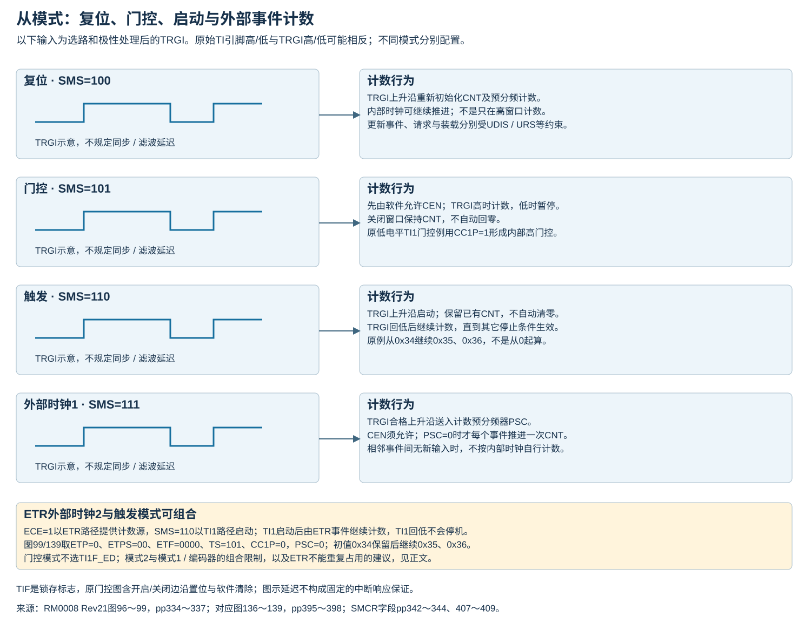
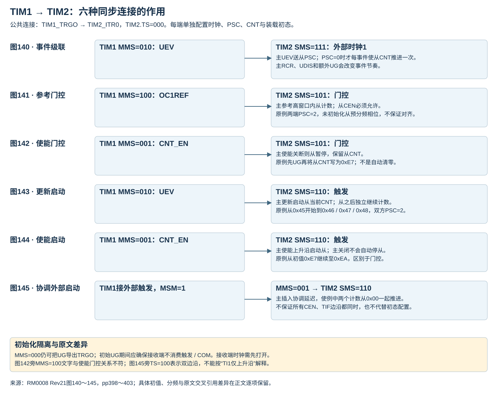
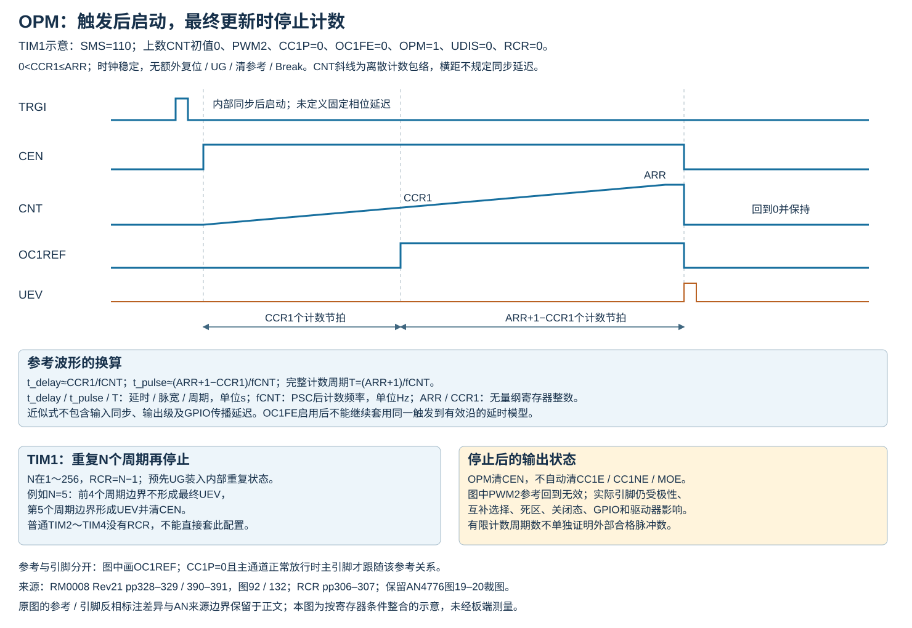
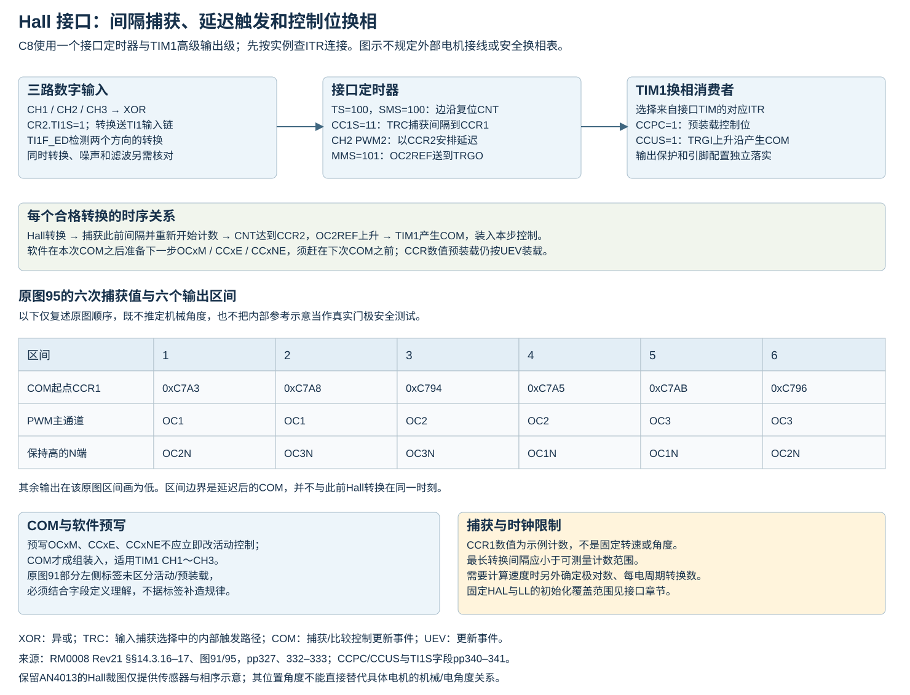
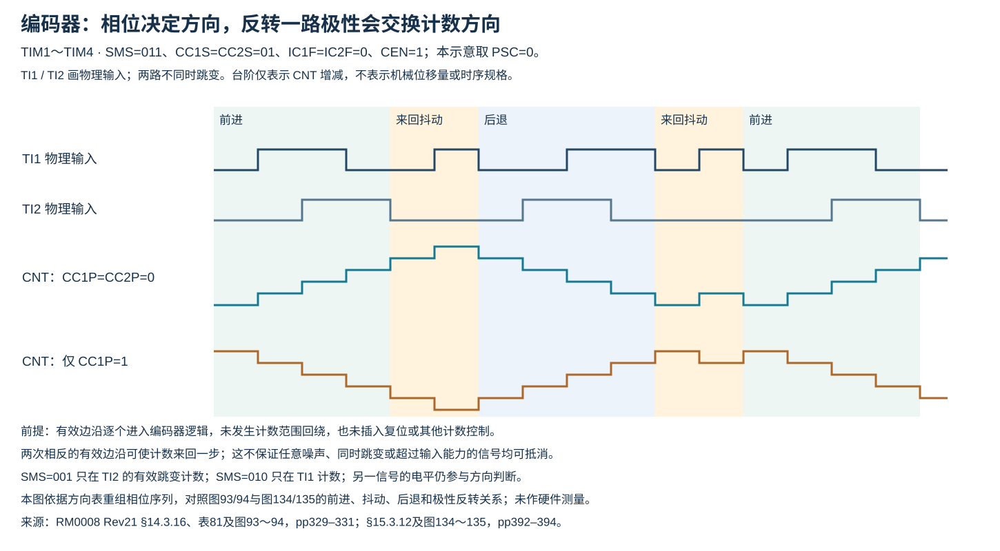

# TIM 同步控制、单脉冲与 Hall 接口

下文保留原手册模式条件、库实现边界及尚未由硬件验证的推导；通道及引脚应另外按具体实例核对。

## 从模式的动作差别

|SMS|触发后的动作|持续条件|
|---|---|---|
|100 复位|TRGI上升沿重新初始化计数器及预分频计数|更新装载及请求继续受UDIS/URS等控制；不能据复位模式名屏蔽UG副作用|
|101 门控|TRGI高电平期间允许计数|软件先使能CEN；低电平暂停，不自动清CNT；TI1F_ED不适用门控|
|110 触发|TRGI上升沿启动计数|不自动清CNT，输入变低不会自动停止|
|111 外部时钟1|合格TRGI事件作为计数源|另经PSC；需要CEN允许；不等同于单次启动触发|

SMS为从模式选择，TRGI为触发输入，CEN为计数器使能，CNT为计数值，PSC为预分频字段；UDIS禁止更新事件，URS选择更新请求来源。复位、门控、触发模式可以使用内部计数时钟；SMS=000并非内部时钟的通用必要条件。ECE为外部时钟模式2使能，须独立按所需计数源设置。切换TS前须确认其未被使用，以免过渡产生错误边沿；不能只清CEN就认为所有触发消费者已隔离。手册以SMS=000为例，TIM1的CCUS/COM路径仍需另查。固定LL_TIM_SetClockSource同时改SMS与ECE，LL_TIM_SetSlaveMode和LL_TIM_SetEncoderMode只改SMS，配置顺序及遗留位见[LL接口](LL接口.md#ll_tim_setclocksource)。

来源：[RM0008 Rev21 pp334–336](https://www.st.com/resource/en/reference_manual/cd00171190.pdf#page=334)、[SMCR pp342–344](https://www.st.com/resource/en/reference_manual/cd00171190.pdf#page=342)。复位从模式叙述中的URS措辞差异见[时基与更新](计数时基与更新.md)。

### 原触发例子的输入极性校核

TIM1与TIM2～TIM4的TI2触发例子分别在p336/p396写“TI2上升沿启动”，但步骤给CC2P=1且括号写低电平，图98/138又画上升沿启动。按CCER输入极性字段，TI2FP2不反相的上升沿应使用CC2P=0；CC2P=1选择反相后的有效边沿。本文保留该来源矛盾，以明确配置字段解释边沿，不将门控低电平条件混入触发例子。

图136复位例采用ARR=0x36，图137门控例在CNT=0x34暂停后继续0x35、0x36等值，图138触发例从已有0x34启动，图139外部时钟组合从0x34经ETR事件到0x35、0x36。这些例子合并后仍分别体现清零、保持、启动和外部计数四种作用。图136旁的URS/UEV措辞差异与TIM1章节相同，仍按[更新事件与请求](计数时基与更新.md)分开核对。

来源：[RM0008 Rev21 pp335–336](https://www.st.com/resource/en/reference_manual/cd00171190.pdf#page=335)、[pp395–398](https://www.st.com/resource/en/reference_manual/cd00171190.pdf#page=395)、[CC2P字段p418](https://www.st.com/resource/en/reference_manual/cd00171190.pdf#page=418)。

## TIM1→TIM2 的六种同步关系

以下实例均由TIM1.TRGO连接TIM2.ITR0，因此TIM2.TS=000。换用别的发送/接收实例必须重新查[ITR映射](硬件参数表.md#c8内部触发互联)。接收定时器的时钟必须在接收主事件之前打开，接收期间不动态改变该时钟。

|原图|TIM1 TRGO选择|TIM2模式|实际关系|
|---|---|---|---|
|140|MMS=010，UEV|SMS=111，外部时钟1|每个主更新提供一个从定时器PSC输入事件；TIM2.PSC=0时才每个事件推进CNT一次|
|141|MMS=100，OC1REF|SMS=101，门控|TIM2在参考高窗口内用自己的内部时钟计数；需先使能TIM2.CEN；计数时钟相位不因门控自动对齐|
|142|MMS=001，CNT_EN|SMS=101，门控|主计数使能关闭时，从门控也关闭；不因此重置从CNT|
|143|MMS=010，UEV|SMS=110，触发|首次合格主更新置从CEN，从当前CNT开始持续计数；后续主停止不自动停止从|
|144|MMS=001，CNT_EN|SMS=110，触发|主使能上升沿启动从计数；主之后关闭，从仍可继续计数|
|145|MMS=001，CNT_EN；主本身使用外部触发与MSM=1|SMS=110，触发|MSM协调主自身启动与传给从端的触发；初值和时基仍分别配置|

原图数值和时基条件保留如下，计数数值均按原图十六进制标签记录，分频整数另按十进制；不作为新的程序初始值要求：

|原图|初始值/计数片段|时基与初始化条件|
|---|---|---|
|141|主FC→FD→FE→FF→00→01；从3045→3046→3047→3048|两端内部时钟各÷3，即PSC=2；从计数器和预分频计数未先初始化|
|142|主75经UG到00；从AB经UG到00，再写E7，计数至E8/E9|两端相同预分频；主计数使能关闭后从门控关闭，保留从值|
|143|主FD→FE→FF→00；从45在首次主UEV后继续46→47→48|两端内部时钟各÷3，即PSC=2；从初值允许非零|
|144|主75经UG到00；从CD经UG到00，再写E7，继续E8/E9/EA|从端为触发模式，主停止后从仍继续；不能套用图142门控停机行为|
|145|两端00→01→…→09|先UG初始化；MSM在主CNT_EN到CK_PSC之间插入协调延迟。图中CEN和TIF边沿并非全部重合|

p401关于图144的交叉引用把已有触发例又描述成“改成触发、替代门控”，与相邻模式说明不一致；本文按图144标题的Enable来源和SMS=110区分，不能据这句交叉引用把图143的UEV来源自动照搬。p400的TIM2_CNTL字样也不建立独立8位计数写接口，按C8的CNT寄存器访问规则处理。

级联例中的计数事件仍经过从端PSC，不能把“每个主UEV”无条件等同“TIM2.CNT加1”。主端非零RCR、UDIS以及额外UG等又会改变UEV节奏；不能只用主ARR直接推定整个级联频率。

图142/144保留的初始化示例是：先分别UG初始化，再把TIM2.CNT写为0xE7；该写值提供初始计数偏移。图141展示未重新初始化时从原计数值继续计数。UG会产生其他已配置事件/触发，应在两端尚未接收工作触发时安排初始化，不能在运行中随意插入。

原厂文本与图示有两处已知差异：p400的“使能门控”步骤写MMS=100，但图142和主停止即关闭从门控的条件要求按CNT_EN来源MMS=001解释；OC1REF门控另见图141。p402的同步启动例称TI1上升沿，却写TS=100（TI1F_ED双边沿检测）；明确只需要上升沿时，应按字段选择TI1FP1、TS=101及CC1P=0，并配置对应TI1输入链。本文分别保留配置编码及其真实来源含义，不把两个条件合并为同一保证。

来源：[RM0008 Rev21 §15.3.15、图140～145，pp398–403](https://www.st.com/resource/en/reference_manual/cd00171190.pdf#page=398)、[SMCR字段pp407–409](https://www.st.com/resource/en/reference_manual/cd00171190.pdf#page=407)。

## 单脉冲的启动、脉宽与停机

OPM=1使下一个有效UEV清CEN。UEV是更新事件；OPM为单脉冲模式位。更新若被UDIS禁止，或TIM1的RCR尚未到更新边界，不能按“一次计数溢出就一定停机”推断。停止计数也不保证实际引脚处于安全电平。

RM0008 pp328–329的示例用TI2上升沿触发OC1：CC2S=01、CC2P=0、TS=110、SMS=110，输出通道OC1M=111（PWM2）、CC1P=0，DIR=0、CMS=00。在UDIS=0且触发接收隔离的条件下，根据预装载配置写ARR/CCR并用UG建立初态；实际输出仍需CC1E，TIM1还需MOE及正确引脚复用。

触发前必须满足：上数CNT<CCRx≤ARR；下数CNT>CCRx。上数初始CNT=0时，CCRx必须大于0。比较值等于初始计数值不满足手册给出的正常脉冲前提。

原文p328用ARR−CCR1描述脉冲长度，而p329明确停止发生在ARR回绕到0的更新边界。对正常向上PWM2、起始CNT=0、OC1FE关闭且不受清参考/刹车等干预的离散计数解释，参考有效区间包含CCR1至ARR，对应：

`nPulse = ARR + 1 − CCR1`；`tPulse,count = nPulse / fCNT`。

nPulse是有效区间计数节拍数，无量纲；ARR、CCR1为寄存器整数；tPulse,count为按计数节拍得到的参考有效时间，单位s；fCNT为PSC之后的计数频率，单位Hz。下标Pulse/count分别表示脉冲/计数模型。该式是按边界作出的离散推导，保留与原文简写的差异；不包含触发同步、输出驱动、死区或板端实测延迟。

OCxFE快速功能仅在PWM1/PWM2有效。启用后，触发沿能按比较匹配作用于输出，绕过单纯等待CNT达到CCR的路径；此时不能再把触发至有效沿的全部延迟视为CCR/fCNT。CCMR字段给出的最小响应由5个时钟周期缩为3个时钟周期，也不能无条件换算成经PSC后的5/3个计数节拍。

图92还有一个需保留的图文差异：图中的OC1REF与OC1画为相反电平，而同段配置指定PWM2及CC1P=0。按输出极性字段，这组条件不应被解释为主输出必然反相；不能直接把图中的两条参考/引脚波形同时作为无条件依据。本文采用寄存器定义描述模式，并保留原图差异，未作板测裁决。

来源：[RM0008 Rev21 §14.3.15 pp328–329](https://www.st.com/resource/en/reference_manual/cd00171190.pdf#page=328)、[OC1FE字段p350](https://www.st.com/resource/en/reference_manual/cd00171190.pdf#page=350)。HAL普通OnePulse四个Start/Stop接口忽略OutputChannel并成对管理CH1/CH2，TIMEx的N通道接口行为不同，见[HAL生命周期](HAL生命周期与DMA.md#单脉冲参数与通道成对启停)。

## Hall接口的触发与捕获

TI1S=1把CH1、CH2、CH3输入经异或汇合到TI1输入链。以TI1F_ED为TRGI、SMS=100，每次合格转换重新建立计数起点；CH1选择TRC捕获转换间隔，CH2可设置PWM2及CCR2延迟，MMS=101把OC2REF作为TRGO送到另一高级定时器。计数周期应覆盖预期最长转换间隔，避免溢出使读数失去直接间隔含义。

这里的汇合逻辑是XOR（异或）。RM0008 p332例子某一步使用“ORed”措辞，同页§14.3.17及TI1S字段明确为XOR，不能按三输入逻辑或建立状态/边沿模型。多个Hall输入同时变化、噪声、滤波延迟或无效码仍需按真实传感器及系统验证，不能把每次捕获自动解释为可靠机械位置。

TRC的范围须结合例子核对：CCxS字段写“internal trigger input”，而RM0008 p332的Hall配置同时要求CC1S=11与TI1F_ED复位。固定HAL和LL实现也分别设置TIM_ICSELECTION_TRC/LL_TIM_ACTIVEINPUT_TRC及TS_TI1F_ED。因此本知识库不把TRC收窄为“只允许ITR0～ITR3”，也不把这一例子扩展为所有TS组合均已验证。

源码证据：[HAL TIMEx固定de129f1，L175–209](https://github.com/STMicroelectronics/stm32f1xx-hal-driver/blob/de129f1c0af55ea4b2cfa8ba5686af54b7a51cf9/Src/stm32f1xx_hal_tim_ex.c#L175-L209)、[LL固定de129f1，L624–640](https://github.com/STMicroelectronics/stm32f1xx-hal-driver/blob/de129f1c0af55ea4b2cfa8ba5686af54b7a51cf9/Src/stm32f1xx_ll_tim.c#L624-L640)。固定LL Hall初始化对旧MMS/CC2S的保留条件另见[LL初始化约束](LL初始化边界.md)；HAL实现不能直接套用相同缺陷结论。

## COM同步装载的对象

接收端TIM1按实际连接选择ITR，CCPC=1为具有互补输出的通道启用控制预装载，CCUS=1允许TRGI上升沿产生COM。软件也可写EGR.COMG。预先写入的OCxM、CCxE、CCxNE在COM生效；PSC/ARR/CCRx数值预装载仍由UEV管理。

COMIF、COMIE、COMDE分别是换相事件标志、中断使能和DMA请求使能。设置请求使能不等于已经配置DMA传输；HAL TIMEx ConfigCommutEvent_DMA只配置相应寄存器/回调，不自行启动数据搬运，见[扩展接口](HAL扩展接口.md)。

RM0008 p327图91用三个例子说明COM前后输出变化，图中部分左侧配置标签没有清楚区分预装载值与当时活动值。不能单凭标签把COM之前的实际OCxM或CCxNE定死，再据此反推新的硬件规律。整合时采用字段定义表达“预写→COM生效”，保留原图来源及这一解释边界。

来源：[RM0008 Rev21 pp327、332–333](https://www.st.com/resource/en/reference_manual/cd00171190.pdf#page=327)、[CR2与EGR pp340–341、348](https://www.st.com/resource/en/reference_manual/cd00171190.pdf#page=340)。

## 编码器相位、抖动与索引信号

图中具体相位序列按方向表重组，表示与原图相同的关系类别；未把台阶数量作为机械编码器的参数。

编码器模式的SMS=001/010/011选择单路或双路的有效跳变，具体方向表见[硬件参数](硬件参数表.md)。CC1P、CC2P在此作用于输入极性；两路编码计数所用的上升和下降跳变不能等同于普通单通道捕获的双边沿能力。

图93采用CC1S=CC2S=01、CC1P=CC2P=0、IC1F=IC2F=0000、SMS=011、CEN=1。其前进、抖动、后退、抖动、前进序列分别表现为整体增计数、局部来回、整体减计数、局部来回、整体增计数。图94仅反转CC1P，整体计数方向随之交换。图中抖动段的抵消依赖实际先后边沿；不能推广为任意毛刺、同时跳变、超速或滤波不匹配都不丢计数。

CNT在0～ARR范围内按方向循环，初始CNT、ARR、有效PSC和回绕处理都会影响位置解释。手册提到第三路机械零位信号可接外部中断并触发计数复位；这不表示C8定时器具有自动索引复位专用字段。实际复位方法、并发边沿和相位连续性需要另行设计，本文未加入未验证的复位流程。

原文寄存器名称需按字段校正：p330例子的CC2S写为CCMR2，实际位于CCMR1；同段把TI2FP2写成TI1FP2，并将IC1F/IC2F的括号寄存器名放在CCER。对应滤波字段实际也位于CCMR1。上述仅为定位差异，参数值保持原例。来源：[RM0008 Rev21 pp329–331及图93–94](https://www.st.com/resource/en/reference_manual/cd00171190.pdf#page=329)、[CCMR1输入字段p351](https://www.st.com/resource/en/reference_manual/cd00171190.pdf#page=351)。

### 编码器计数到机械量的换算

令P为编码器每机械转的A相完整周期数，K为解码倍数，SMS=001/010时K=2、SMS=011时K=4；PSC=0，输入相序、滤波及捕获速率满足条件且没有漏边沿。每机械转累计计数为KP。

`Δθ = 360 ΔC / (K P)`；`n = 60 ΔC / (K P Δt)`。

Δθ为这段采样期间的机械角增量，单位度；n为平均转速，单位r/min；ΔC为按实际方向展开回绕后的有符号计数差，Δt为正的采样间隔，单位s；P、K为无量纲计数参数。正负方向取决于输入相序与极性约定；绝对机械位置还需要零点信息。

这两式为计数定义的换算，不能直接把未经展开的16位CNT差用于任意多圈间隔。非零PSC、方向切换时的预分频状态或丢边沿都会破坏上述直接计数假设；机械角到电角还须另外知道电机极对数。依据：[RM0008 Rev21编码器方向与计数关系pp329～331](https://www.st.com/resource/en/reference_manual/cd00171190.pdf#page=329)，并保留既有AN4013笔记的测位/测速用途范围。

## 外部时钟模式2与触发从模式组合

ECE=1可与复位、门控、触发从模式组合，不能与外部时钟模式1或编码器模式同时选用。RM还建议不要在这种组合中把ETR再经TS选作TRGI。

图99使用ETP=0、ETPS=00、ETF=0000、ECE=1，以ETR上升沿作为计数源；CC1S=01、IC1F=0000、CC1P=0、TS=101、SMS=110，以TI1上升沿启动计数。触发前CNT保持原值0x34；触发置CEN及TIF，之后符合条件的ETR上升沿使CNT依次到0x35、0x36（图例PSC=0）。TI1回落不会像门控模式那样停止计数；软件CEN控制与OPM结束条件另行适用。

p337在延迟说明中使用“reset of the counter”，与本例SMS=110及图中保留初始0x34不符；此处按触发启动与外部计数路径解释，不能给SMS=110补造每次ETR边沿复位CNT的行为。外部重同步延迟也不能按图中比例写成通用固定时间。

同步前必须先使能从定时器时钟，接收主定时器触发期间不应动态改动该时钟。来源：[RM0008 Rev21 §§14.3.19–20，pp336–337、图99及注释](https://www.st.com/resource/en/reference_manual/cd00171190.pdf#page=336)。

TIM2～TIM4的图132（p390）沿用图92的单脉冲画法，OC1REF与OC1互反的图示和后续PWM2、CC1P=0示例之间同样存在标注差异；不能据此改变内部高有效参考与最终极性的定义。图134/135（p394）则对应图93/94的编码器与单路极性反转示例，合并时保留相位、无同时跳变及PSC等条件。来源：[RM0008 Rev21 pp390–394](https://www.st.com/resource/en/reference_manual/cd00171190.pdf#page=390)。

### 原Hall图的数值与传感器边界

RM0008图95的六个示例捕获值依次为0xC7A3、0xC7A8、0xC794、0xC7A5、0xC7AB、0xC796。对应COM区间的主PWM/保持高N端依次为OC1/OC2N、OC1/OC3N、OC2/OC3N、OC2/OC1N、OC3/OC1N、OC3/OC2N。表中的CCR1值对应区间开始的COM时刻；下一Hall转换会先更新CCR1，随后才到下一COM，不能把它视为整个区间均不改变。该例未规定电机极对数，也未验证具体功率级接线。

既有AN4013笔记列出单极、双极、全极Hall开关和锁存器。动作/释放阈值、磁场符号与输出有效电平需要对应传感器资料；保留图9用BOF/BRF标阈值，不能自行把图中阈值符号当作所有传感器统一的BOP/BRP规则。图10横轴标为电机位置，包含0°～660°的相序示意；机械角与电角的关系仍须由具体电机极对数确定。C8的定时器接口接收数字信号，不提供图示Hall传感器自身的模拟滞回功能。

来源：[RM0008 Rev21图95 p333](https://www.st.com/resource/en/reference_manual/cd00171190.pdf#page=333)；[AN4013官方入口](https://www.st.com/resource/en/application_note/an4013-stm32-crossseries-timer-overview-stmicroelectronics.pdf)图9～10的既有裁图，完整原页未核验。

[返回定时器主题](../../知识库/06_定时器PWM与同步.md) · [图形关系与来源](图形关系与来源.md)
