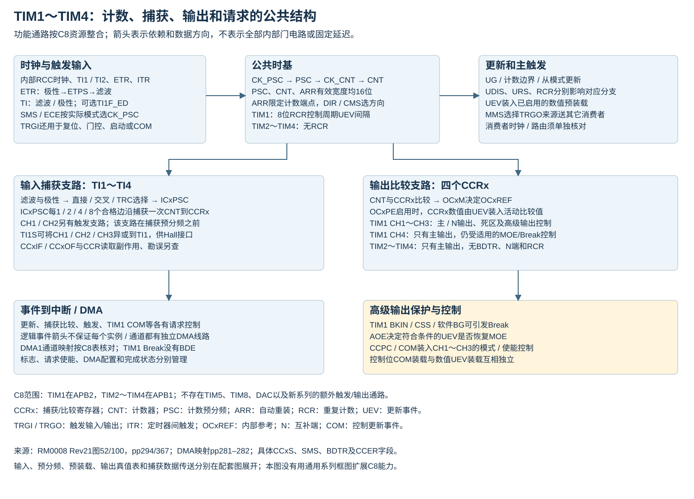

# TIM 器件范围、装载关系与数值核对



本文整理定时器资源、寄存器装载关系与数值例子，以 RM0008 Rev21、DS5319 Rev20 及器件定义为依据。

## 功能与资源

TIM1～TIM4 共有的计数与通道资源如下；TIM1 位于 APB2，TIM2～TIM4 位于 APB1。

|共有资源|规格与使用条件|
|---|---|
|CNT、PSC、ARR、CCRx 有效宽度|16位|
|计数方式|向上、向下、中心对齐|
|捕获/比较通道|每个实例均有 CH1～CH4|
|通道功能|普通 PWM、输出比较、输入捕获、单脉冲|
|同步与接口|主从同步、外部计数、编码器、Hall接口；按所选模式与引脚条件配置|
|DMA 与 DMA burst|逐项核对物理请求映射|

TIM1 还提供以下功能：

|增加的资源|规格与通道范围|
|---|---|
|重复计数器|RCR低8位，0～255|
|互补输出、死区、刹车及保护锁定|互补输出为CH1N～CH3N；CH4没有N输出|
|COM 控制位预装载|作用于具备互补输出的CH1～CH3|

通道信号还需落实到封装引脚；重映射会涉及 AFIO、调试引脚及引脚复用冲突，具体接线须核对数据手册引脚表。

来源：[RM0008 Rev21 TIM1简介/特性§14.1–14.2，pp292–293](https://www.st.com/resource/en/reference_manual/cd00171190.pdf#page=292)、[TIM2～TIM5简介/特性§15.1–15.2，pp365–366](https://www.st.com/resource/en/reference_manual/cd00171190.pdf#page=365)。

## 功能单元与配置入口

|单元|主要寄存器和信号|作用及相关章节|
|---|---|---|
|主从控制器|SMCR.SMS/TS、CR2.MMS、ITRx、TRGI/TRGO|计数源、复位、门控、启动、编码器方向及同步分别按模式配置，见[同步模式](同步控制与Hall.md)|
|时基|PSC、CNT、ARR；TIM1另有RCR|预分频、计数方向、周期与更新，见[时基与更新](计数时基与更新.md)|
|捕获/比较通道|CCMR、CCER、CCRx|输入模式锁存CNT；输出模式由比较及OCxM决定OCxREF，见[输入捕获](输入捕获与滤波.md)和[PWM边界](比较与PWM边界.md)|
|输出保护级|TIM1 BDTR、CR2.OISx/OISxN、BKIN，以及通道CCER极性和使能|TIM1高级输出保护；互补输出仅CH1～3。极性位位于CCER，不能归入BDTR，见[输出安全](输出级与保护.md)|

本表整合既有AN4776笔记的四单元索引；硬件关系可由[RM0008 Rev21图52及§14.3，pp294–337](https://www.st.com/resource/en/reference_manual/cd00171190.pdf#page=294)与[图100及§15.3，pp367–403](https://www.st.com/resource/en/reference_manual/cd00171190.pdf#page=367)定位。AN完整原件未重核的边界同本文原例说明。

## 按目标检索寄存器与限制

**计时**

字段与资源：PSC、ARR、CNT、UG、UIF、CEN。

边沿周期用 $`\mathrm{ARR}+1`$ 、分频用 $`\mathrm{PSC}+1`$ ，中心周期另算。见[时基](计数时基与更新.md)。

**捕获**

字段与资源：CCxS、CCxP、ICxF、ICxPSC、CCxE、CCxIF/CCxOF。

普通单通道极性选择、首样本、计数回绕与标志竞争分别处理，见[捕获](输入捕获与滤波.md)。

**PWM**

字段与资源：OCxM、CCRx、OCxPE、ARPE。

OCxREF有效比例与实际引脚极性、保护状态分别核对，见[PWM](比较与PWM边界.md)及[输出级](输出级与保护.md)。

**外部计数模式1**

字段与资源：TS、SMS=111。

使用从模式控制器；选路按TI1/TI2相关路径、ITR或ETRF，见[字段表](硬件参数表.md)。

**外部计数模式2**

字段与资源：ETPS、ETF、ETP、ECE。

ETR经ETP极性选择、ETPS分频后形成ETRP，再进入ETF滤波。见[时钟字段](硬件参数表.md)。

**有限周期输出**

字段与资源：OPM、TIM1 RCR。

RCR低8位；UDIS不得屏蔽用于OPM停机的UEV。具体引脚脉冲数还依赖计数方式、初始化、CCR和使能时序，见[单脉冲](同步控制与Hall.md)。

**外部故障切断**

字段与资源：BKE、BKP、AOE、MOE、OIS、OSSI。

TIM1 BKIN可接外部比较器；单片机不因此获得内部比较器或完整限流闭环。故障有效、自动重使能及引脚终态见[输出安全](输出级与保护.md)。

**多参数DMA更新**

字段与资源：UDE、DCR.DBA/DBL、DMAR；TIM1_UP对应DMA1通道5。

此映射限定TIM1更新请求；DBL=项数−1、外设地址固定DMAR，须核对预装载流水及完成边界。见[DMA窗口](事件与DMA窗口.md)。

**捕获DMA例子**

字段与资源：TIM2 CC2DE、DMA1通道7。

TIM2_CH2固定映射至DMA1通道7。见[请求映射](硬件参数表.md)及[停止契约](HAL生命周期与DMA.md)。

**定时器同步**

字段与资源：MMS、TS、SMS、MSM。

核对定时器互联矩阵、初始化UG及下游状态，见[同步模式](同步控制与Hall.md)。

**控制状态同步**

字段与资源：CCPC、CCUS、COMG、COMIE。

TIM1具备互补输出的CH1～3；COM装载控制位、UEV装载相应数值，见[COM范围](同步控制与Hall.md)及[保护级](输出级与保护.md)。

配置前请结合各链接章节核对硬件与软件依据。以上入口参考既有 AN4776 笔记，不构成已测试电路方案或安全保护认证。

## 数据手册的时序参数

DS5319 Rev20 §5.3.15、表40（印刷页/PDF文件页均为67）说明这些参数由设计保证，未在生产中逐项测试；其TIMx包括TIM1、TIM2、TIM3、TIM4。仍需同时满足§5.3.12的引脚电气条件、实际时钟配置及所选输入滤波。

|符号|条件/含义|Min|Max|单位|
|---|---|---:|---:|---|
| $`t_{\mathrm{res(TIM)}}`$ |时间分辨率|1|—| $`t_{\mathrm{TIMxCLK}}`$ |
| $`t_{\mathrm{res(TIM)}}`$ | $`f_{\mathrm{TIMxCLK}}=72\,\mathrm{MHz}`$ |13.9|—|ns|
| $`f_{\mathrm{EXT}}`$ |CH1～CH4上的外部输入时钟频率|0| $`f_{\mathrm{TIMxCLK}}/2`$ （本行以MHz代入）|MHz|
| $`f_{\mathrm{EXT}}`$ | $`f_{\mathrm{TIMxCLK}}=72\,\mathrm{MHz}`$ |0|36|MHz|
| $`\mathrm{Res}_{\mathrm{TIM}}`$ |计数器位宽|—|16|bit|
| $`t_{\mathrm{COUNTER}}`$ |内部时钟模式，一个计数刻度可选时间|1|65536| $`t_{\mathrm{TIMxCLK}}`$ |
| $`t_{\mathrm{COUNTER}}`$ | $`f_{\mathrm{TIMxCLK}}=72\,\mathrm{MHz}`$ |0.0139|910|µs|
| $`t_{\mathrm{MAX\_COUNT}}`$ |最大完整计数周期|—| $`65536\times65536`$ | $`t_{\mathrm{TIMxCLK}}`$ |
| $`t_{\mathrm{MAX\_COUNT}}`$ | $`f_{\mathrm{TIMxCLK}}=72\,\mathrm{MHz}`$ |—|59.6|s|

$`t_{\mathrm{TIMxCLK}}=1/f_{\mathrm{TIMxCLK}}`$ ，为定时器内核时钟周期，单位s； $`f_{\mathrm{TIMxCLK}}`$ 为该时钟频率，公式中默认单位Hz，表40外部时钟频率的MHz行按MHz代入。 $`\mathrm{res}`$ 表示分辨率， $`\mathrm{EXT}`$ 表示外部输入， $`\mathrm{COUNTER}`$ 表示计数刻度， $`\mathrm{MAX\_COUNT}`$ 表示完整计数范围。横杠保留原表未给值的含义，不视作0。表中13.9ns、910µs、59.6s沿用原表显示精度；具体计算应使用实际时钟及整数分频。例如 $`\frac{65536}{72\,\mathrm{MHz}}\approx910.222\,\mathrm{\mu s}`$ ， $`\frac{65536^2}{72\,\mathrm{MHz}}\approx59.6523\,\mathrm{s}`$ ，这些是公式换算值，不能无说明替换原表数值。

表40的CH1～CH4输入电气参数不增加SMCR的时钟选路。外部时钟模式1的TI路径仍经TI1FP1、TI2FP2或TI1F_ED等明确列出的触发源；不能因此给CH3/CH4补造相同计数时钟选路。ETR路径另受分频后`ETRP`频率不超过 $`f_{\mathrm{CK\_INT}}/4`$ 的约束，ETPS最高÷8也不能单独作为ETR引脚允许任意更高频率的证明。滤波配置、同步和输入波形约束还可能进一步限制有效事件速率。

来源：[DS5319 Rev20 表40](https://www.st.com/resource/en/datasheet/stm32f103c8.pdf#page=67)、[RM0008 Rev21时钟选择pp308–311](https://www.st.com/resource/en/reference_manual/cd00171190.pdf#page=308)、[SMCR ETPS字段](https://www.st.com/resource/en/reference_manual/cd00171190.pdf#page=342)。本次直接核对保留的DS原页；其完整文件字节身份的既有验证边界仍保留。

## 预装载的事件归属

|对象|预装载控制|装入活动配置的事件|
|---|---|---|
|PSC|始终具有预装载|UEV|
|ARR|CR1.ARPE|启用时由UEV装载|
|输出模式CCRx|CCMR.OCxPE|启用时由UEV装载|
|TIM1 CH1～CH3的OCxM、CCxE、CCxNE|CR2.CCPC|启用时由COM装载|

UEV 为更新事件，COM 为捕获/比较控制更新事件；PSC 是时基预分频值，ARR 为自动重装值，CCRx 为通道x的捕获/比较值，OCxM 为输出模式，CCxE/CCxNE 为主/互补通道使能。缓冲的存在不意味着所有对象在同一事件生效；CH4 的CCR4数值预装载仍属于UEV，其控制位没有上述COM预装载能力。

来源：[RM0008 Rev21 pp295–307](https://www.st.com/resource/en/reference_manual/cd00171190.pdf#page=295)、[CR2 pp340–341](https://www.st.com/resource/en/reference_manual/cd00171190.pdf#page=340)、[EGR/CCMR pp348–352](https://www.st.com/resource/en/reference_manual/cd00171190.pdf#page=348)。

## OCxM 三位模式编码

|OCxM|模式|内部参考行为|
|---|---|---|
|000|冻结|比较匹配不改变OCxREF，仍可产生比较事件|
|001|匹配置有效|匹配时OCxREF置1|
|010|匹配置无效|匹配时OCxREF置0|
|011|翻转|匹配时翻转OCxREF|
|100|强制无效|OCxREF置0，不等待比较匹配|
|101|强制有效|OCxREF置1，不等待比较匹配|
|110|PWM1|上数时CNT<CCRx有效；下数时CNT≤CCRx有效|
|111|PWM2|对应PWM1的参考逻辑反向|

OCxREF 为通道x的内部高有效参考，CNT 为计数器值。该表限定为输出模式 CCxS=00，不能直接当作实际引脚高低表；极性、使能、死区及保护级见[输出安全](输出级与保护.md)。强制模式下比较器仍能产生匹配标志和相应请求；“参考被强制”不等于“比较事件停止”。中心对齐端点和CCR超出ARR的情况见[PWM边界](比较与PWM边界.md)。

来源：[RM0008 Rev21 pp316–318](https://www.st.com/resource/en/reference_manual/cd00171190.pdf#page=316)、[CCMR1字段p350](https://www.st.com/resource/en/reference_manual/cd00171190.pdf#page=350)。

## 比较翻转的非预装载例子

RM0008图83采用输出模式OC1M=011、OC1PE=0、CC1P=0、CC1E=1：原比较值为0x003A，CNT到达该值时OC1REF翻转；软件随后将CCR1改为0xB201，CNT达到0xB201时再次翻转。图中间的断线表示省略了大量计数刻度，不能把两次匹配间隔看成图上的相邻几拍。

OC1PE=0使软件写入直接参与后续比较；OC1PE=1时则需等待UEV装载。图中文字“CC1R”按该通道实际寄存器名CCR1理解。图中的OC1REF=OC1同时隐含有效输出通路及所列极性，TIM1还须满足MOE和保护级条件，不能只按比较值保证实际引脚翻转。已启用CC1IE时匹配产生相应中断请求，NVIC和软件处理另核对。

来源：[RM0008 Rev21 §14.3.9、图83，pp316–317](https://www.st.com/resource/en/reference_manual/cd00171190.pdf#page=316)。

## 应用笔记例子的数值复算

下表保留既有 AN4013/AN4776 笔记中的输入参数并重新计算。现有记录标注 AN4013 Rev14、AN4776 Rev4，均为2026年2月；完整原PDF全文及整页上下文尚未核验，所以下列“原例”身份仅沿用已有资料记录。计算结果依据已核对的RM计数关系，不能称为原AN全文或全部图表已验收。

边沿对齐、连续计数、更新允许、没有额外UG/从模式复位时：

```math
f_{\mathrm{UEV}}=\frac{f_{\mathrm{CK\_PSC}}}{(\mathrm{PSC}+1)(\mathrm{ARR}+1)(\mathrm{RCR}+1)}
```

$`f_{\mathrm{UEV}}`$ 为周期性更新事件频率， $`f_{\mathrm{CK\_PSC}}`$ 为进入PSC前的计数源频率，单位均为Hz； $`\mathrm{PSC}`$ 、 $`\mathrm{ARR}`$ 、 $`\mathrm{RCR}`$ 为无量纲寄存器整数。外部输入已经过ETPS等上游处理时， $`f_{\mathrm{CK\_PSC}}`$ 必须使用处理后的频率。非零RCR例子限定TIM1。ARR必须大于0；TIM2～TIM4计算中取RCR=0，不访问不存在的寄存器。

|既有例子的输入|PSC|ARR|RCR|复算 $`f_{\mathrm{UEV}}`$ |
|---|---:|---:|---:|---:|
|内部72MHz|1|65535|0|549.3164Hz|
|ETR100kHz，先经ETPS÷2|1|255|2|32.5521Hz|
|TI合格输入事件50kHz|1|255|2|32.5521Hz|
|ITR合格输入事件8kHz|1|255|1|7.8125Hz|

既有 AN4013 笔记记录第二行原例标21.7Hz；按所列参数复算为32.5521Hz。这里保留参数与数值差异的可追溯关系，不把未重核原页的内容称为新确认的原厂勘误。

在向上PWM1、正常参考极性、稳态完整计数周期中：

```math
f_{\mathrm{PWM}}=\frac{f_{\mathrm{CNT}}}{\mathrm{ARR}+1},\qquad
D=\frac{\mathrm{CCR1}}{\mathrm{ARR}+1}.
```

$`f_{\mathrm{PWM}}`$ 是PWM参考频率， $`f_{\mathrm{CNT}}`$ 是经PSC后的计数频率，单位Hz； $`D`$ 是内部参考有效占空比，无量纲，百分比为 $`100D\%`$ 。该式的 $`D`$ 适用于 $`0\leq\mathrm{CCR1}\leq\mathrm{ARR}+1`$ 且值可由16位字段表达的范围；死区或输出反相后的引脚结果须另算。下表各行均在此范围内。

|既有AN4776参数解释|ARR|RCR|CCR1|每组完整周期数| $`f_{\mathrm{CNT}}=32\,\mathrm{MHz}`$ 时 $`f_{\mathrm{PWM}}`$ |参考有效占空比|
|---|---:|---:|---:|---:|---:|---:|
|A段|4000|1|800|2|7998.0005Hz|19.9950%|
|B段|10000|0|8500|1|3199.6800Hz|84.9915%|
|C段，按代码表字面|4000|2|200|3|7998.0005Hz|4.99875%|
|C段，按已有图示目标记录|4000|2|2000|3|7998.0005Hz|49.9875%|

每组完整周期数采用 $`\mathrm{RCR}+1`$ ，前提为对应参数已正确装入、无中途复位/停机且处于正常边沿对齐重复计数。DMA TC不保证最后一段波形已输出完成，首组/后组预装载次序还需单独核对。

若目标为精确8kHz、3.2kHz及20%、85%、50%，在32MHz计数时钟下分别采用ARR=3999/9999/3999，CCR1=800/8500/2000。72MHz定时器输入时，单靠整数PSC无法精确得到32MHz；必须使用实际合法时钟配置重算，不能把 $`72/32`$ 的截断整数当作精确比例。

原例来源入口：[AN4013官方页面](https://www.st.com/resource/en/application_note/an4013-stm32-crossseries-timer-overview-stmicroelectronics.pdf)、[AN4776官方页面](https://www.st.com/resource/en/application_note/an4776-generalpurpose-timer-cookbook-for-stm32-microcontrollers-stmicroelectronics.pdf)。来源核验范围如上，完整原页尚未核验。

[返回定时器主题](../../知识库/06_定时器PWM与同步.md) · [图形关系与来源](图形关系与来源.md)
