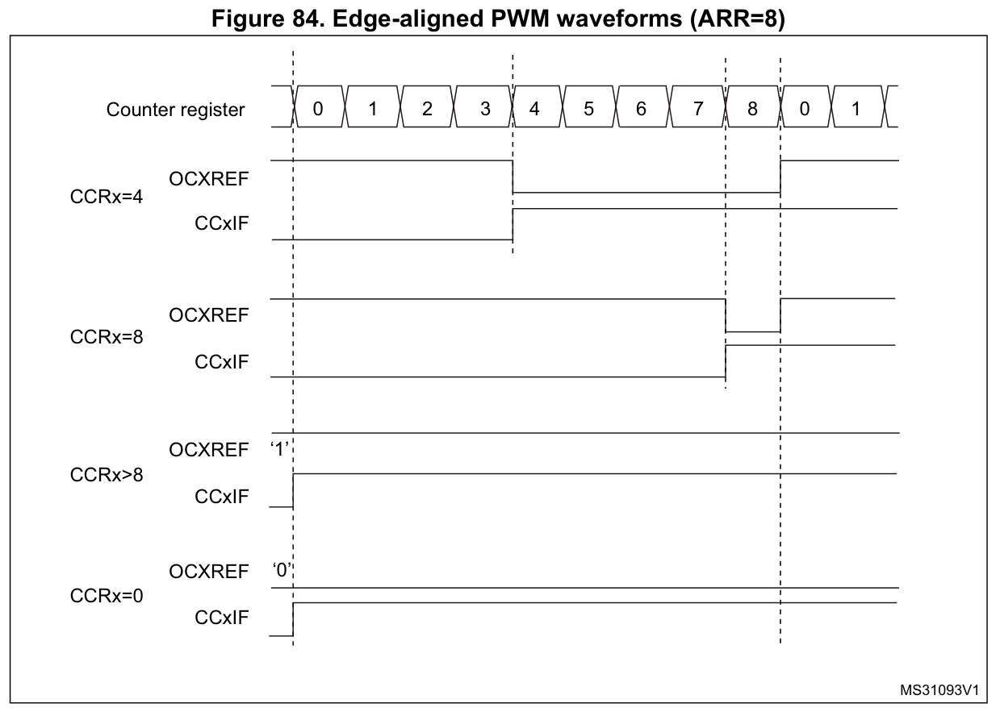
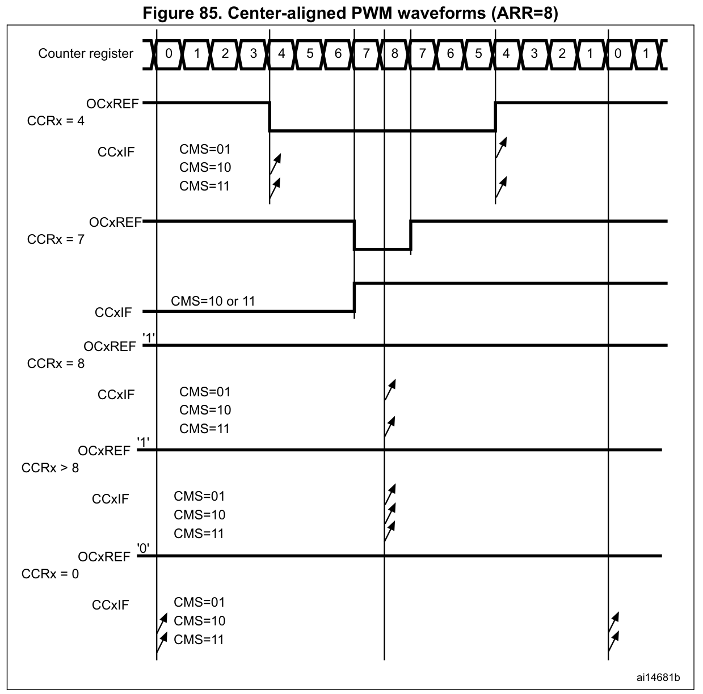
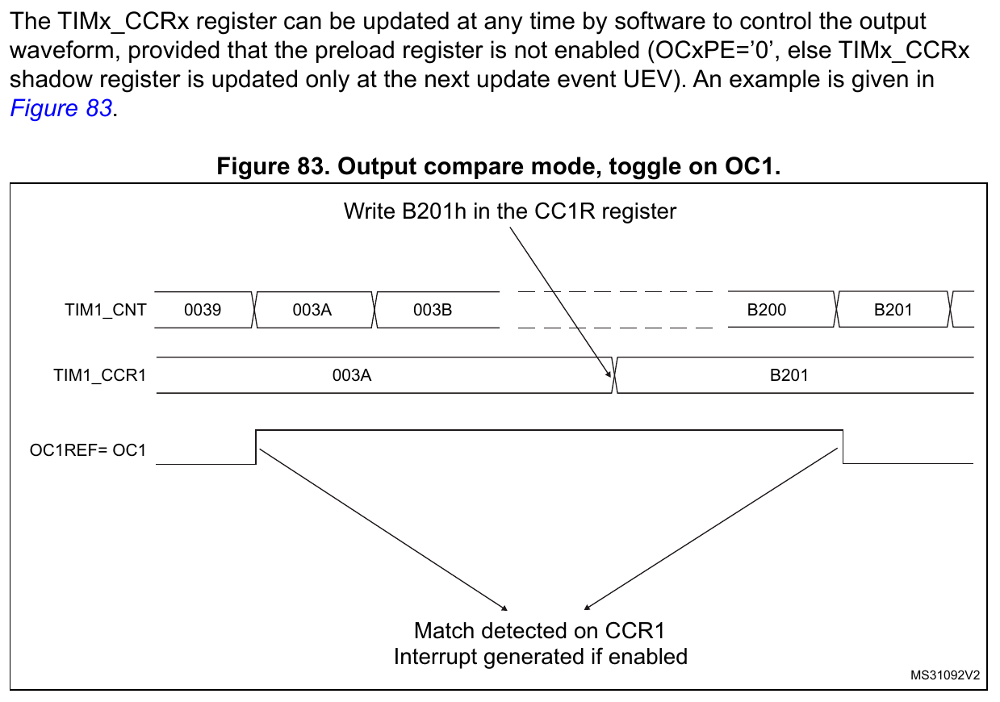

# PWM边沿、中心对齐与比较标志边界

下述关系针对固定ARR/CCR、内部稳定计数时钟、PWM1内部参考OCxREF；不包含输出极性、死区、OCREF清除、刹车、外部复位或启动暂态。TIM1的RCR可改变更新事件节奏，不改变这里固定计数波形的基本往返周期。

## 1 周期与参考占空

向上边沿对齐：

```math
T_{\mathrm{edge}}=\frac{\mathrm{ARR}+1}{f_{\mathrm{CNT}}}
```

$`D_{\mathrm{edge}}=\mathrm{CCR}/(\mathrm{ARR}+1)`$ ，适用0≤CCR≤ARR。

$`T_{\mathrm{edge}}`$ 为完整周期，单位s； $`D_{\mathrm{edge}}`$ 为OCxREF有效时间比例，无量纲；ARR和CCR分别为自动重装值及对应通道比较整数，无量纲，ARR>0； $`f_{\mathrm{CNT}}`$ 为预分频后的计数频率，单位Hz；edge表示边沿对齐。CCR>ARR时参考恒有效，CCR=ARR仍留一个无效计数节拍。C8的CCR也是16位；当ARR=65535时，已没有可写入的更大CCR，因此不能把“CCR>ARR恒有效”当作这个最大ARR配置下仍可实现的数值选项。

向下边沿对齐（PWM1）：

```math
T_{\mathrm{down}}=\frac{\mathrm{ARR}+1}{f_{\mathrm{CNT}}}
```

$`D_{\mathrm{down}}=(\mathrm{CCR}+1)/(\mathrm{ARR}+1)`$ ，适用0≤CCR≤ARR。

$`T_{\mathrm{down}}`$ 为完整向下计数周期，单位s； $`D_{\mathrm{down}}`$ 为OCxREF有效时间比例，无量纲；down表示向下计数；ARR、CCR和 $`f_{\mathrm{CNT}}`$ 的含义与单位同上。此式按RM0008的“CNT>CCR无效、其余有效”比较关系统计ARR→0共ARR+1个计数节拍得到。CCR=0仍有一个有效节拍，CCR=ARR或CCR>ARR均恒有效；手册明确说明这个模式不能仅靠CCR数值实现0%参考占空。该结论仍受本篇稳态条件限定。

同一比较与计数条件下，PWM2的内部参考有效比例为 $`D_{\mathrm{PWM2}}=1-D_{\mathrm{PWM1}}`$ 。 $`D_{\mathrm{PWM1}}`$ 、 $`D_{\mathrm{PWM2}}`$ 分别为PWM1、PWM2内部OCxREF有效时间比例，无量纲；下标表示所选PWM模式，不表示主/互补引脚。向下计数时PWM2在CCR=0得到ARR/(ARR+1)，不能由这个数值设置得到100%；实际输出还须经过极性、使能及死区路径。

依据：[RM0008 Rev21 p319向下PWM叙述](https://www.st.com/resource/en/reference_manual/cd00171190.pdf#page=319)、[p350 OC1M两种PWM定义](https://www.st.com/resource/en/reference_manual/cd00171190.pdf#page=350)、[p389 TIM2～4对应条件](https://www.st.com/resource/en/reference_manual/cd00171190.pdf#page=389)。上述占空公式为按固定比较不等式进行的计数推导，未作板端测量。

中心对齐：

```math
T_{\mathrm{center}}=\frac{2\mathrm{ARR}}{f_{\mathrm{CNT}}}
```

$`D_{\mathrm{center}}=\mathrm{CCR}/\mathrm{ARR}`$ ，适用0≤CCR≤ARR。

$`T_{\mathrm{center}}`$ 为一次完整上、下往返周期，单位s； $`D_{\mathrm{center}}`$ 为参考有效时间比例，无量纲；center表示中心对齐，其余符号与上式相同。ARR>0；CCR=0为恒无效，CCR=ARR及CCR>ARR为恒有效。该比例由手册比较规则和图85的稳定往返波形得到，不包含实际引脚的保护与驱动延迟。

同样ARR=8时，边沿周期是9个计数节拍，中心周期是16个；CCR=8分别对应8/9及1的参考占空。不得把两种模式都写成ARR+1个节拍，也不得把CCR=ARR在两种模式下都当成相同极限。

来源：[RM0008 Rev21 p318图84](https://www.st.com/resource/en/reference_manual/cd00171190.pdf#page=318)、[p319模式条件与p320图85](https://www.st.com/resource/en/reference_manual/cd00171190.pdf#page=319)。

## 2 ARR=8的原图边界条件

### 向上边沿对齐



原图来源：[RM0008 Rev21 Figure84，印刷页/PDF文件第318页](https://www.st.com/resource/en/reference_manual/cd00171190.pdf#page=318)。图中保留CCRx=4、8、>8、0的四种情况，以及内部参考OCxREF和CCxIF。

两幅原图中的OCxREF高低表示内部参考，不等同实际输出引脚电平。下表列出CCxIF可能被置位的计数位置；标志不会随每次事件自动清零，若不清标志，后续事件不能由同一高电平区分次数。

|模式|CCR|OCxREF有效比例|CCxIF置位条件|
|---|---|---|---|
|向上边沿|4|4/9|CNT=4比较|
|向上边沿|8|8/9|CNT=8比较|
|向上边沿|>8|1|溢出边界，虽然没有范围内相等值|
|向上边沿|0|0|CNT=0的边界比较|

### 中心对齐



原图来源：[RM0008 Rev21 Figure85，印刷页/PDF文件第320页](https://www.st.com/resource/en/reference_manual/cd00171190.pdf#page=320)。图中保留CCRx=4、7、8、>8、0的五种情况和不同CMS下的CCxIF置位位置；不能按两幅图片的显示尺寸比较实际时间。

|模式|CCR|OCxREF有效比例|CCxIF置位条件|
|---|---|---|---|
|中心|4|4/8|CMS=01：下数4；10：上数4；11：两者|
|中心|7|7/8|CMS=01：下数7；10：上数7；11：两者|
|中心|8|1|峰顶8；图85中CMS=01或11置位，CMS=10无该箭头|
|中心|>8|1|峰顶溢出；图85对CMS=01、10、11均标出置位|
|中心|0|0|谷底0；图85中CMS=10或11置位，CMS=01无该箭头|

CMS为CR1[6:5]，01/10/11为中心对齐的比较标志方向选择；它们具有相同的中心对齐参考波形，改变的是输出比较标志报告的方向条件。极值处按图85的端点方向解释，不能把中间值的上下数两次相等简单复制到每个端点。

CCxIF字段另见[RM0008 Rev21 p347](https://www.st.com/resource/en/reference_manual/cd00171190.pdf#page=347)。两张表分别保留图84的4种CCR情形及图85的5种情形；原图和文字说明均不构成板端测量。中心模式启动、UG及DIR/CMS条件见下一节。

## 3 初始化与动态改值限制

RM0008 p317及p350的OCxPE说明要求连续PWM使用比较预装载，并在启动前通过UG装入有效寄存器；OCxPE=0仅在OPM单脉冲条件下给出允许说明，其余PWM行为未保证。本篇稳态公式不应作为关闭预装载后任意动态写CCR的保证。UG仍须按下游触发隔离条件处理。

切入中心模式采用此前的DIR方向，软件不能在同一次操作同时改变DIR与CMS；CEN=1时不能由边沿切入中心。运行中写CNT可能产生非预期结果：写入大于ARR的数值不会修正方向，写0或ARR会改变方向但不产生UEV。手册建议在启动前用UG建立状态，运行中避免改写CNT；同时检查UG对下游触发的作用。

动态改CCR使相邻两个计数周期连续匹配时，ES096 §2.6.3规定部分边界会漏掉第二次比较事件：边沿ARR→0；中心峰顶ARR−1→ARR、谷底1→0，并有RCR=0条件。原件没有规避；静态表中的置位条件不能作为这种动态窄脉冲或中断序列的保证。

来源：[RM0008 Rev21 p320页底条件](https://www.st.com/resource/en/reference_manual/cd00171190.pdf#page=320)、[ES096 Rev15 p15](https://www.st.com/resource/en/errata_sheet/es096-stm32f101x8b-stm32f102x8b-and-stm32f103x8b-mediumdensity-device-limitations-stmicroelectronics.pdf#page=15)。

## 4 通用定时器的对应波形与动态参考更新

TIM2～TIM4图130/131（pp388–389）分别对应本章图84/85的4种边沿、5种中心CCR情形，采用相同计数与CCxIF边界关系。通用输出级图127只包含OCxM、参考清除、CCxP和CCxE等路径；C8的TIM2～TIM4没有TIM1的MOE、死区和N输出。

§15.3.9还说明，为兼容ETRF参考清除，OCxREF在比较结果变化时，或从冻结OCxM=000切换到PWM模式时重新有效。因此本章固定参数稳态占空关系不能单独作为运行中任意切换模式、改值、清除参考后立即恢复的保证。涉及OCxCE的恢复仍要满足UEV及ETRF状态条件，见[参考清除](输出级与保护.md)。

来源：[RM0008 Rev21图127](https://www.st.com/resource/en/reference_manual/cd00171190.pdf#page=383)、[§15.3.9及图130/131，pp387–389](https://www.st.com/resource/en/reference_manual/cd00171190.pdf#page=387)。

## 非预装载输出比较的翻转时序

本例通过改写捕获/比较寄存器CCRx设置下一次匹配值；OCxM为输出比较模式，OCxPE为比较值预装载使能，UEV为更新事件。

本例向上计数，CC1S=00、OC1M=011、OC1PE=0，初始参考为0。p317的示例步骤先选计数时钟、设置ARR/CCR，再选择翻转模式、禁用比较预装载、设置CC1P=0与CC1E=1，最后以CEN启动；需要比较中断时另置CC1IE。图中OC1REF=OC1还以实际输出路径放行为前提，TIM1仍须满足MOE等输出控制及GPIO/AFIO条件，不能把内部参考直接当作引脚保证。



本页采用RM0008图83原图裁切，保留0x003A、0xB201两个真实匹配值、中间省略区间，以及图前OCxPE/UEV条件段落。图129是通用定时器对应例子，本次未另收录其原图。OC1PE=0时写CCR1不等待UEV；OC1M=011在真实匹配时翻转参考。图中的初始参考、更新时刻与计数跨度均为所示情形，不能据此推导任意动态写CCR的固定周期或最窄脉冲。相关限制按ES096 §2.6.3与前述CCIF条件核对。

原图中的“Write B201h in the CC1R register”保留来源拼写CC1R；应按图内TIM1_CCR1信号及寄存器定义定位到CCR1，图片像素未作改字。图内序列0039→003A→003B与B200→B201之间有省略，两次匹配不是相邻计数节拍。

CC1IF为锁存的比较标志，保持到按寄存器规则清除，不是OC1REF波形；只有使能相应中断请求时才产生图注所说的中断。CCR>ARR时的边界标志不构成CNT=CCR的真实匹配，不能据标志置位推导翻转。

固定CCR且每个完整计数周期恰有一次真实匹配时，翻转方波的完整周期包含两个计数周期；此动态改CCR例子不具有该固定周期保证。所示过程不包含回绕、额外复位、模式切换或保护动作；写入标记只表示发生在两次匹配之间，不能由图宽推算总线写入延迟或最窄脉冲。

来源：[RM0008 Rev21 Figure83及示例步骤，p317](https://www.st.com/resource/en/reference_manual/cd00171190.pdf#page=317)、[通用定时器对应Figure129，p387](https://www.st.com/resource/en/reference_manual/cd00171190.pdf#page=387)、[输出比较字段pp349–350](https://www.st.com/resource/en/reference_manual/cd00171190.pdf#page=349)；动态相邻匹配仍受前述ES096 §2.6.3限制。

[返回定时器主题](../../知识库/06_定时器PWM与同步.md) · [图形关系与来源](图形关系与来源.md)
