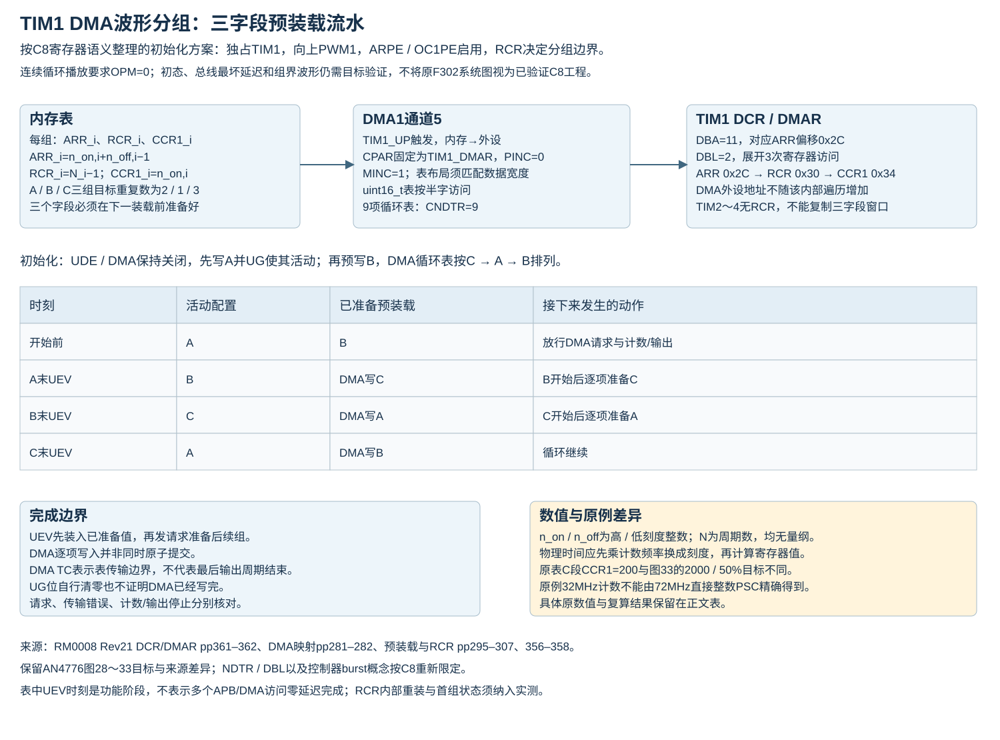

# TIM 波形分组、周期触发与停止状态

本文把既有AN4776笔记中的配置意图、数值和迁移限制按功能重组；完整AN原PDF尚未完成全文复核，原F302平台图和示波器结果不作为C8板测证据。硬件行为以固定RM0008 Rev21、ES096 Rev15及C8资源范围交叉核对。下述配置阶段不构成已编译、已烧写的完整工程，也不保证外部功率级安全。

## 1 时基延时、输入捕获与PWM2基础片段的边界

以下延时时基使用独占且已复位的 TIM2。保留其ARR=0x0FFF参数，完整向上周期为4096个计数刻度。若使用OPM使首次有效UEV后停止，这是显式的有限计数选择；原持续计数行为需保留OPM=0。

```math
T_{\mathrm{delay}}=\frac{n_{\mathrm{delay}}(\mathrm{PSC}+1)}{f_{\mathrm{TIM}}}
```

$`T_{\mathrm{delay}}`$ 为计数区间，单位s； $`n_{\mathrm{delay}}`$ 为所需刻度数，整数2～65536； $`\mathrm{PSC}`$ 为0～65535的预分频整数； $`f_{\mathrm{TIM}}`$ 为实际内部计数源频率，单位Hz。 $`\mathrm{ARR}=n_{\mathrm{delay}}-1`$ 且`ARR>0`；轮询退出和后续CPU指令还具有软件延迟， $`T_{\mathrm{delay}}`$ 不代表下一条指令发生的精确时刻。

在独占资源、请求未开放且计数停止时准备PSC/ARR，再UG装载并处理初始化状态，最后启动计数。清UIF不撤销已有TRGO。等待标志须有超时/错误路径；ARR=0会阻塞计数，不能用于一拍延时。输入捕获也应在CCxE关闭时配置CCxS，并在开放输入前处理旧标志；单次时间戳不能单独给出输入周期。

PWM2正常极性下，CNT<CCR时内部参考无效。保留以period_ticks表示完整周期、CCR=period_ticks/2的整数表达：period_ticks为偶数时才是精确50%参考占空；奇数时必须保留整数截断造成的差别。需要period_ticks在2～65536、PSC在0～65535；软件中间变量应容纳65536。原ARR=65535且用ARR/2的表达不等于精确半周期。

来源：[RM0008 Rev21时基、ARR与PWM字段](https://www.st.com/resource/en/reference_manual/cd00171190.pdf#page=368)、[PWM1/PWM2边界](比较与PWM边界.md)、[初始化UG范围](HAL初始化边界.md)。

## 2 TIM1 OPM与RCR形成有限周期组

向上计数、PWM2正常极性、OC1FE=0、0<CCR1≤ARR、稳定参数且无额外复位/UG、OCREF清除或刹车干预时，OPM在最终有效UEV清CEN。`RCR=N−1`使正常边沿计数每 $`N`$ 个周期产生周期性UEV； $`N=5`$ 时`RCR=4`，前四个周期边界不形成最终更新，第五个边界更新并停止。

```math
\begin{aligned}
T_{\mathrm{delay}}&\approx\frac{\mathrm{CCR1}}{f_{\mathrm{CNT}}},\\
T_{\mathrm{pulse}}&\approx\frac{\mathrm{ARR}+1-\mathrm{CCR1}}{f_{\mathrm{CNT}}},\\
T_{\mathrm{group}}&=\frac{N(\mathrm{ARR}+1)}{f_{\mathrm{CNT}}}.
\end{aligned}
```

$`T_{\mathrm{delay}}`$ 为开始计数到参考有效的延时， $`T_{\mathrm{pulse}}`$ 为每个参考有效脉宽， $`T_{\mathrm{group}}`$ 为完整计数组时长，单位s； $`f_{\mathrm{CNT}}`$ 为PSC后的计数频率，单位Hz； $`\mathrm{ARR}`$ 、 $`\mathrm{CCR1}`$ 、 $`N`$ 为无量纲整数， $`N`$ 在1～256。该关系不包含外部触发同步、GPIO与驱动延迟；比较边界采用本文离散计数模型，原图 $`\mathrm{ARR}-\mathrm{CCR}`$ 标注差异见[单脉冲模式](同步控制与Hall.md)。

|保留参数或约束|C8解释|
|---|---|
|8MHz定时器输入，目标1MHz计数|PSC=7|
|72MHz定时器输入，目标1MHz计数|PSC=71，先确认实际所在APB时钟树|
|period_ticks|2～65536，ARR=period_ticks−1|
|delay_ticks|1≤delay_ticks<period_ticks，CCR1=delay_ticks|
|pulse_count|1～256，RCR=pulse_count−1|
|输入/输出状态|独占TIM1，明确GPIO、极性、使能、保护及初始计数状态|

配置时先隔离工作触发及输出，在计数静止时建立目标时钟、向上边沿模式与OPM=1，并在发出UG之前确认UDIS=0；准备时基、RCR及PWM2/比较预装载后，再用UG建立活动配置并处理标志，最后开放CC1E/MOE并选择软件启动或等待触发。若原先UDIS=1，发出UG之后才把它清零，不能证明前一UG已经完成PSC及已启用预装载的ARR等缓冲配置的装载；应在正确更新条件下重新安排初始化。若等待外部/ITR触发，CEN保持0，不能在最后又软件置CEN而抢先启动。BDTR的死区、刹车、空闲态和LOCK需一次规划；不能先整字写MOE，再假设后续仍能任意改变LOCK首次写入选择。

停止计数不自动清MOE。最终CNT=0时，内部参考、极性、CCER、OSSI/OSSR及GPIO决定实际输出； $`N`$ 个计数周期也不单独证明外部门极上恰有 $`N`$ 个合格脉冲。

来源：[RM0008 Rev21 RCR pp306–307](https://www.st.com/resource/en/reference_manual/cd00171190.pdf#page=306)、[OPM pp328–329](https://www.st.com/resource/en/reference_manual/cd00171190.pdf#page=328)、[输出安全与锁定](输出级与保护.md)。

## 3 三组DMA波形的参数与装载次序



保留原目标：A段2个脉冲，B段1个脉冲，C段3个脉冲。向上PWM1正常极性，若第 $`i`$ 段的高/低刻度数为 $`n_{\mathrm{on},i}`$ 与 $`n_{\mathrm{off},i}`$ ，重复数为 $`N_i`$ ：

```math
\mathrm{ARR}_i=n_{\mathrm{on},i}+n_{\mathrm{off},i}-1,\qquad
\mathrm{CCR}_i=n_{\mathrm{on},i},\qquad
\mathrm{RCR}_i=N_i-1.
```

$`\mathrm{ARR}_i`$ 、 $`\mathrm{CCR}_i`$ 、 $`\mathrm{RCR}_i`$ 为第 $`i`$ 段寄存器整数， $`n_{\mathrm{on},i}`$ 和 $`n_{\mathrm{off},i}`$ 分别为高、低刻度数， $`N_i`$ 为该段完整周期数，均无量纲； $`i`$ 是段序号。需要实际字段可表达；若要求每周期高低都存在， $`n_{\mathrm{on},i}`$ 和 $`n_{\mathrm{off},i}`$ 均须大于0。

```math
\begin{aligned}
t_{\mathrm{on},i}&=\frac{n_{\mathrm{on},i}}{f_{\mathrm{CNT}}},&
t_{\mathrm{off},i}&=\frac{n_{\mathrm{off},i}}{f_{\mathrm{CNT}}},\\
f_i&=\frac{f_{\mathrm{CNT}}}{\mathrm{ARR}_i+1},&
D_i&=\frac{\mathrm{CCR}_i}{\mathrm{ARR}_i+1}.
\end{aligned}
```

$`t_{\mathrm{on},i}`$ 和 $`t_{\mathrm{off},i}`$ 分别为高、低持续时间，单位s； $`f_{\mathrm{CNT}}`$ 和 $`f_i`$ 为计数/输出频率，单位Hz； $`D_i`$ 为参考有效比例，无量纲。不能把物理时间直接写入ARR，也不能省略从刻度总数到ARR的减一。

保留笔记中的原表为{4000,1,800, 10000,0,8500, 4000,2,200}，与图示C段CCR1=2000的50%目标有差别。图33把逐周期递减的内部重复状态标成TIMx_RCR；不能据此认为CPU读到的RCR寄存器会自行递减。两种C段含义及32MHz下的全部数值已列于[例子复算](器件范围与例子复算.md)，不静默替换原输入。原时钟记录为64MHz系统、APB1÷2、APB2不分频、TIM1输入64MHz、PSC=1得到32MHz；C8用72MHz输入时不能以截断整数PSC冒充32MHz。

### DMAR与DMA1配置

TIM DMA burst通过自身状态机展开多次DMA请求；C8 DMA1没有Stream/FIFO或F2/F4式控制器burst。CPAR始终指向DMAR，PINC=0；DCR.DBA为寄存器偏移/4，DBL为项数减一。TIM1的ARR/RCR/CCR1连续对应偏移0x2C/0x30/0x34，因此DBA=11、DBL=2：每次触发依次写ARR、RCR、CCR1。TIM2～TIM4没有RCR，不能照搬三字段窗口。

TIM1_UP使用DMA1通道5。三组数据共9项，内存到外设、MINC=1、PINC=0、循环模式CNDTR=9；uint16_t表与半字宽度匹配，uint32_t表需明确宽度和地址递增，不能按半字步进把32位表项拆成上下半字。常量表在Flash、运行时可改数组在SRAM的布局由链接与启动方式决定；非零初始化镜像不等于两份同时运行数组。

### 预装载流水与完成边界

在已确认静止、独占且实际时序可满足的条件下，先建立向上连续计数、OPM=0、UDIS=0、ARPE=1和OC1PE=1，再安排下列三组装载阶段。内部独立时钟需排除旧编码器、复位/门控及外部时钟选择的影响；UG/TRGO的下游消费者保持隔离。ARPE/OC1PE保证下一组B进入预装载，UDIS=0保证UG及组界UEV能够消费这些配置，OPM=0保证组界不会自动停止计数：

1. 保持UDE和DMA未开放，写第一组A并UG，使A成为活动配置。
2. 将B写入下一组预装载；准备DMA循环顺序C→A→B。
3. 配置DMAR窗口、DMA宽度/长度/优先级并处理旧标志，然后开放DMA接收请求与UDE；输出保护和启动条件分别落实。
4. A结束的UEV先使B装入，再通过DMA写入C作为下一组；后续按同一流水继续。

这是一种依据预装载语义整理的初始化方案，首组、组界、RCR内部装载和总线最坏负载尚需目标时序验证。多项DMA写入不是原子同时发生；每组三项必须在下一有效装载边界前全部准备好。应用还应检查 DMA 完成、错误及超时状态。

EGR.UG自动清零不证明DMA搬完；反复UG并轮询UG会混淆事件发出与搬运完成。检查DMA计数/完成/错误及超时后，仍须区分“数据表搬完”“预装载已消费”“最后波形周期结束”。DMA TC及正常模式传输结束均不自动停止TIM；循环模式会无限重复。保留笔记的系统图标“OPM mode”也不能与持续循环播放直接并用：OPM会在有效UEV清CEN。

来源：[RM0008 Rev21 DCR/DMAR pp361–362](https://www.st.com/resource/en/reference_manual/cd00171190.pdf#page=361)、[DMA1映射pp281–282](https://www.st.com/resource/en/reference_manual/cd00171190.pdf#page=281)、[DMA窗口说明](事件与DMA窗口.md)、[固定HAL DMA burst边界](HAL生命周期与DMA.md)。

## 4 TIM2周期触发TIM1有限脉冲组

C8连接为TIM2_TRGO→TIM1_ITR1，TIM1.TS=001、SMS=110、OPM=1、`RCR=N−1`；TIM2.MMS=010选择更新。保留AN笔记的概览图ITR2标注与详细图ITR1/TS001不一致，本文按C8的RM触发矩阵。原文“TIM2与TIM3相连”的记录也不改变本例TIM2→TIM1的明确对象。

|目标/实例|计数频率1MHz时的参数|结果|
|---|---|---|
|TIM1帧内PWM|ARR=49、CCR1=25|20kHz，50µs周期|
|TIM1重复数 $`N=5`$ |RCR=4|5周期共250µs|
|TIM1重复数 $`N=6`$ |RCR=5|6周期共300µs|
|TIM2帧触发|ARR=19999|50Hz，20ms帧周期|
|两端各有72MHz输入|各PSC=71|分别确认APB1/APB2实际输入|

$`F_1`$ 和 $`F_2`$ 在原图中分别表示帧内频率20kHz和帧频50Hz，单位Hz；横向时间跨度应写 $`1/F_1`$ 、 $`1/F_2`$ ，单位s。保留笔记的图中5脉冲与代码6脉冲是两个不同 $`N`$ ，不能互换。

先使能两端时钟，在接收触发/COM路径隔离时分别装载参数，再建立最终互连；MMS=000会导出UG，不是通用的TRGO关闭编码。TIM1输出就绪后保持CEN=0等待主触发，TIM2初始化完成后才开放MMS=更新并计数。若需要立即第一组，可单独计划一次主UG并核对其所有消费者。

保留原代码对象修正：清改主模式字段应针对TIM2.CR2，不能误写TIM1.CR2；“APB prescaler=64−1”的笔记实际上指TIMx.PSC，不是RCC的APB分频。普通SMS=110触发不在运行中复位CNT，也不为新触发建立队列；20ms帧周期须覆盖整组脉冲、同步延迟与裕量。

OPM结束于CNT=0时，PWM1正常极性可能保持参考有效；若要求间歇主输出低，应明确PWM2/反相极性及输出级条件，不能只查看脉冲个数。互补端还须独立核对。

来源：[RM0008 Rev21内部触发表82](https://www.st.com/resource/en/reference_manual/cd00171190.pdf#page=344)、[SMS触发字段](https://www.st.com/resource/en/reference_manual/cd00171190.pdf#page=344)、[同步模式与原例数值](同步控制与Hall.md)。

## 5 20个互补脉冲后双低的目标与缺口

保留原目标：每周期500µs、50%占空，20周期共10ms，最终CH1与CH1N都低。1MHz计数时，TIM1 ARR=499、CCR1=250；TIM2 ARR=9999控制10ms窗口。C8默认TIM1_CH1=PA8、CH1N=PB13；原F302的PA7/AF6不得直接迁移。

COM控制位预装载可使TIM1 CH1～3的OCxM/CCxE/CCxNE同步改变；CCPC=1预装载，CCUS=1允许TRGI上升沿产生COM，软件COMG也可产生COM。COMIE只控制通知，在中断里才写停机字段会引入软件响应延迟。

原双向意图是TIM1 UG/TRGO→TIM2 ITR0复位作为时间参考，TIM2在10ms终点更新/TRGO→TIM1 ITR1产生COM装入停机状态。相关配置为TIM1.MMS=000、TS=001、CCPC/CCUS开启；TIM2.TS=000、SMS=100、MMS=010。TIM2位于APB1，不能照笔记中的PCLK2/APB2对象误写其时钟来源。

必须保留启动回传问题：当URS=0、UDIS=0且全部接收路径已开放时，TIM1 UG使TIM2复位产生更新，TIM2.MMS=010可立即把该更新回传为TIM1 COM。如果停机状态已预装载，就可能在启动附近提前生效，未等10ms。TIM2自身初始化UG也有同类风险。URS不能作为通用TRGO屏蔽；初始化期间应隔离实际消费者，之后按已验证顺序建立时间参考和终态配置。此处只核对机制，未给出保证精确20个边界的完整启动/重启工程。

强制OC1M=100只使OC1REF无效；主/N均正常开启时，互补端可能有效，不能据此保证两端物理低。停机需同时规划CC1E/CC1NE、极性、OSSI/OSSR、OIS、MOE、GPIO及驱动器输入；同时禁用输出可能仅释放驱动，仍非固定低。原笔记的“CCMR1 &= OC2M”掩码保留错误字段且清其它位，修改OC1M应按其实际字段掩码并保留其它通道；CCPC使能后新控制模式仍须COM，UG不能代替。

验证对象包括首脉冲、最后脉冲、互补死区、双低电平、触发回传和再次启动，不能以软件循环次数或DMA完成单独代替。来源：[RM0008 Rev21 CR2/SMCR/EGR pp340–348](https://www.st.com/resource/en/reference_manual/cd00171190.pdf#page=340)、[输出控制表83 p355](https://www.st.com/resource/en/reference_manual/cd00171190.pdf#page=355)、[本库输出级条件](输出级与保护.md)。

## 6 原逐周期限流例子的适用范围

AN4776 原例以 PWM 经电阻 $`R`$ 、电容 $`C`$ 模拟被测响应，再将所得电压与阈值比较； $`R`$ 的单位为 Ω， $`C`$ 的单位为 F。这是演示模型。按本器件实现时，保护通路采用外部比较器和阈值源，将判定信号接入正确配置的 TIM1 BKIN 输入。ADC 中断中的软件判断不能直接等同于异步硬件保护。

原逻辑参数：计数500kHz、向上PWM1、CH1高有效、死区0、LOCK关闭、OSSI开启、OSSR关闭、BKE开启、BKP高有效、AOE开启；72MHz输入对应PSC=143，逐周期更新需RCR=0且更新正常。引脚不得悬空，阈值/极性和启动MOE时机需明确；不能把这些原例参数作为通用功率级安全推荐。

OCxREF清除及Break的层级、互补端行为、AOE恢复、CSS非锁存和CCR>ARR/外部复位勘误统一见[输出安全](输出级与保护.md)。原局部示波器图缺少完整反馈轨迹，不能据此给出C8响应时间、RC衰减全貌或完整闭环性能。

原参考文件：[AN4776官方入口](https://www.st.com/resource/en/application_note/an4776-generalpurpose-timer-cookbook-for-stm32-microcontrollers-stmicroelectronics.pdf)。本页按保留笔记整理应用目标；完整原件及板端行为尚未核验。

[返回定时器主题](../../知识库/06_定时器PWM与同步.md) · [图形关系与来源](图形关系与来源.md)
