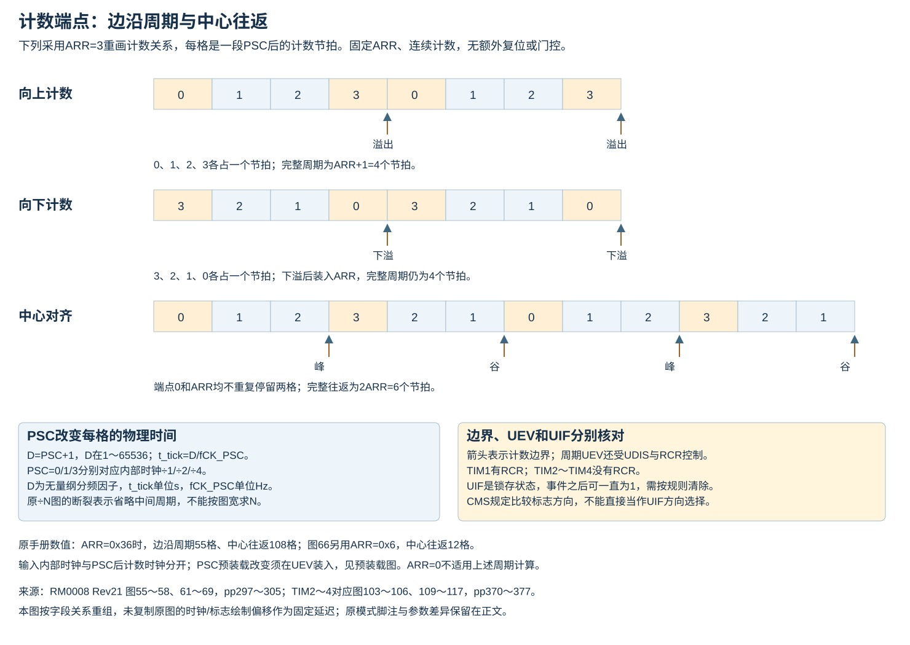
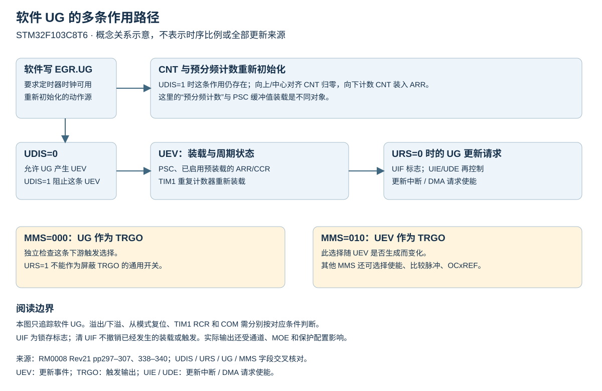
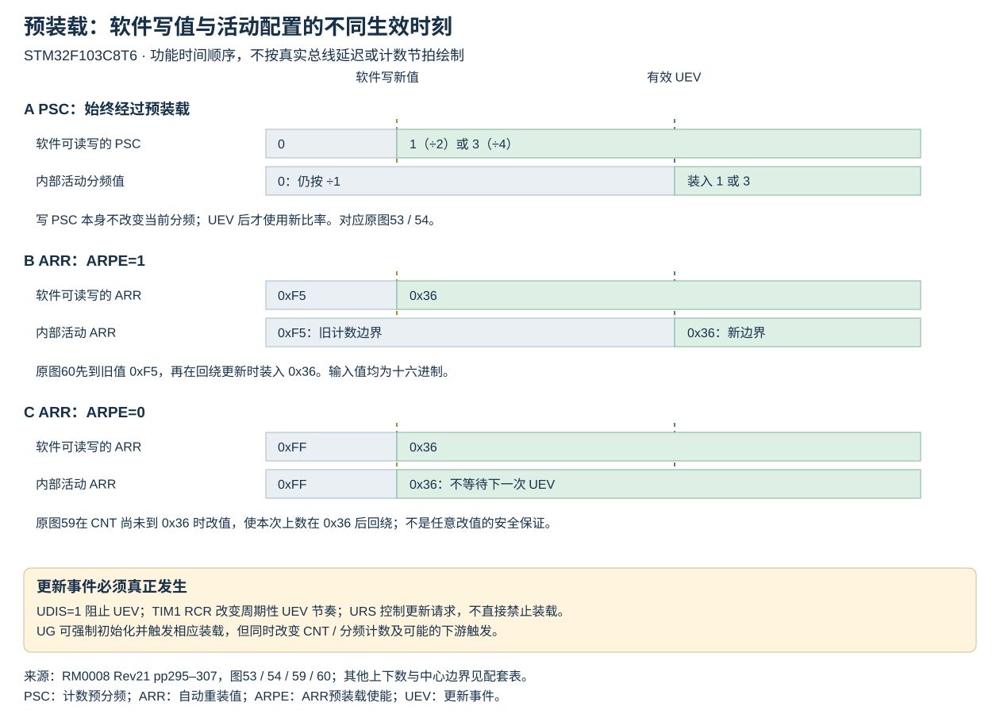
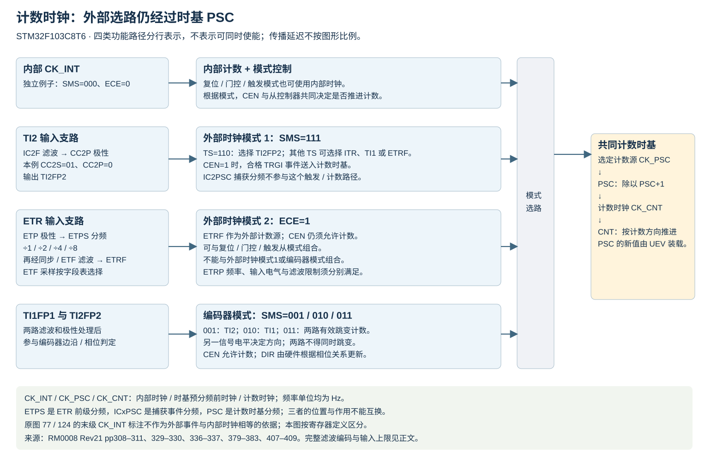
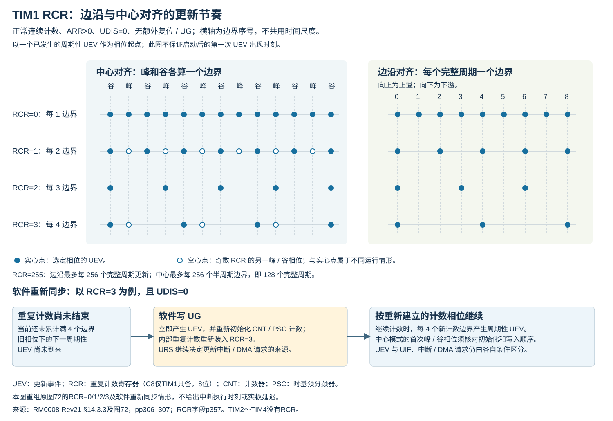

# TIM 计数时基、更新与初始化触发

适用STM32F103C8T6的TIM1、TIM2～TIM4。本文按固定来源整合；只展开已核对的计数与控制关系，不能替代完整通道、引脚和保护参数表。TIM1有8位重复计数器，TIM2～4没有RCR。

## 1 计数公式及适用条件



不使用从模式控制的独立内部计数，可设SMS=000且ECE=0；只清SMS不能关闭先前的ETR外部时钟模式2。内部时钟也可以配合复位、门控或触发从模式使用，此时SMS分别为100、101或110，ECE仍须按实际时钟源配置。RM0008 pp334–336的三个例子明确使用内部时钟，不能把SMS=000写成所有内部计数的必要条件。所在APB预分频为1时，定时器时钟等于PCLK，否则为2倍PCLK。

```math
f_{\mathrm{CNT}}=\frac{f_{\mathrm{TIM}}}{\mathrm{PSC}+1}
```

$`f_{\mathrm{CNT}}`$ 为计数器时钟频率， $`f_{\mathrm{TIM}}`$ 为定时器内核时钟频率，单位均为Hz；PSC为预分频寄存器整数，范围0～65535，无量纲。下标CNT/TIM分别表示计数器/定时器。CKD控制数字滤波和死区的采样时间基准，不能用来替代PSC。

向上边沿对齐、固定时钟、无额外复位或门控时：

```math
T_{\mathrm{period}}=\frac{\mathrm{ARR}+1}{f_{\mathrm{CNT}}}
```

```math
T_{\mathrm{UEV}}=(\mathrm{RCR}+1)T_{\mathrm{period}}
```

$`T_{\mathrm{period}}`$ 为计数周期， $`T_{\mathrm{UEV}}`$ 为周期性更新事件间隔，单位s；ARR为自动重装整数，正常周期计数要求1～65535；RCR为重复计数值，TIM1范围0～255，TIM2～4仅在公式中取0，不访问不存在的寄存器。period表示计数周期，UEV表示更新事件。第二式要求更新事件允许，并排除软件UG、从模式复位等额外事件。

中心对齐完整往返为0→ARR→0：

```math
T_{\mathrm{center}}=\frac{2\mathrm{ARR}}{f_{\mathrm{CNT}}}
```

$`T_{\mathrm{center}}`$ 为中心对齐完整计数周期，单位s；center表示中心对齐，其余符号同上，ARR>0。每个上、下边界都有更新机会，TIM1的RCR对这些半周期边界计数；不能把RCR+1直接解释为完整中心PWM周期数。RCR为奇数时首次更新的相位还取决于写入与启动顺序。

以上是计数关系，不包含输出极性、死区、GPIO/驱动器延迟，也不保证任意模式的引脚占空比。ARR=0时计数被阻塞，不能代入边沿公式声称一拍周期。

来源：RM0008 Rev21 §14.3.1–3，pp295–307；ARR字段§14.4.12，p356；RCR字段§14.4.13，p357。定时器时钟支路另见同版本§7.2和对应APB分频字段。

## 2 更新事件、请求与装载



图为软件UG作用的整合示意，依据下列寄存器定义绘制；不替代完整的原手册时序图，也不表示各动作延迟比例。

|操作或条件|已核对的行为|不能据此推断|
|---|---|---|
|写PSC|更新缓冲值，下次UEV装入有效分频值|写后立即改变当前分频|
|ARPE=1时写ARR|更新预装载，下次UEV装入有效值|当前计数周期已采用新ARR|
|UDIS=1|禁止UEV；ARR/PSC/CCRx影子值保持|UG与从模式复位都不再改变CNT|
|UDIS=1时UG或从模式复位|CNT及预分频计数仍重新初始化|影子寄存器也已完成装载|
|URS=1|更新中断/DMA请求限于计数溢出/下溢|通用屏蔽TRGO、阻止UG装载|
|OPM=1|下一个更新事件清CEN|终点输出必为低或功率级已关闭|
|RCR参与边界更新|每RCR+1次相应边界产生周期UEV|软件UG也必须等待该计数结束|
|UDIS=0时软件UG或从模式更新|不等待重复计数到零，并重新装载重复计数器|任意运行时插入均不扰动相位|

UDIS禁止UEV也会影响依赖UEV的OPM结束和预装载更新。UG重新初始化CNT的值与计数方向有关：向上/中心归零，向下装入ARR；当前分频计数同时清零。参数重配应先隔离触发和输出，不能把UG视为仅清一个软件标志。

原文差异：RM0008 p334的复位从模式叙述将“URS为低”与UEV生成连写，容易与p339中URS仅选择更新中断/DMA请求、UDIS决定UEV生成的字段定义混淆。本文按寄存器字段及pp297/303的更新说明区分事件与请求，同时保留该段措辞差异；未以硬件测试判定全部边界情形。

来源：[RM0008 Rev21 pp297–307](https://www.st.com/resource/en/reference_manual/cd00171190.pdf#page=297)、[CR1字段pp338–339](https://www.st.com/resource/en/reference_manual/cd00171190.pdf#page=338)。

## 3 预装载与活动值的原图对照



软件读回PSC/ARR时读到可访问寄存器的值，不应据此认定内部活动配置已装入。下表合并保留原图中的独立参数场景，十六进制值均加0x前缀；图中的UIF为锁存标志，不能读作每个事件都会自动回低的脉冲。

|原图|模式/条件|写入变化|原图体现的装载边界|
|---|---|---|---|
|53/54，p296|PSC动态改值|PSC由0改为1或3|下次UEV才把分频由÷1改为÷2或÷4；相应内部预分频计数循环为0～1或0～3|
|59，p299|上数，ARPE=0|ARR由0xFF改为0x36|写时CNT尚未到新ARR，本次在0x36之后回绕；不等待另一更新事件才改变活动ARR|
|60，p299|上数，ARPE=1|ARR预装载由0xF5改为0x36|先到旧活动值0xF5，回绕UEV时装入0x36|
|65，p303|下数，不使用重复计数|ARR由0xFF改为0x36|当前仍数到0，再在下溢边界装入0x36继续下数；写ARR没有立刻把CNT改成新ARR|
|70，p306|中心对齐，ARPE=1，下溢更新|ARR预装载由0xFD改为0x36|谷底更新后使用新边界继续向上；原图内部某行写Counter overflow，与标题/计数方向不一致，按下溢边界理解|
|71，p306|中心对齐，ARPE=1，上溢更新|ARR预装载由0xFD改为0x36|原图上数序列到0xFC后装入新0x36并转为下数；活动ARR在这一边界更新|

这些原例不覆盖任意运行时写ARR的全部情况，尤其不能用“ARPE=0无需等待”保证把ARR缩到当前CNT以下时仍得到预期周期。更改PSC/ARR/CCR、RCR及模式前，需按目标边界安排装载，并核对更新是否允许。RCR改变更新节奏、UG/从模式更新改变相位的条件继续适用。

来源：[RM0008 Rev21 p296](https://www.st.com/resource/en/reference_manual/cd00171190.pdf#page=296)、[p299](https://www.st.com/resource/en/reference_manual/cd00171190.pdf#page=299)、[pp300–306](https://www.st.com/resource/en/reference_manual/cd00171190.pdf#page=300)。

原图55～58（pp297–298）、61～64（pp301–302）、66～69（pp304–305）分别给出上数、下数、中心对齐在内部时钟÷1、÷2、÷4、÷N下的边界时序。这里的N表示预分频因子，PSC=N−1，范围1～65536；它与RCR表示的重复更新次数分开计算。固定ARR=0x36（十进制54）时，边沿完整周期包含55个计数节拍，中心往返包含108个；图66另用ARR=0x6，中心往返为12个计数节拍。÷N图中的断裂线表示中间区间省略，不能按图片横向长度反推实际N。

图66脚注注明中心模式1；图68脚注注明模式2或3并在上溢处画UIF。这里保留示例上下文。CMS字段定义的是输出比较标志的方向选择，不能仅凭这些图注推出“某个CMS只在单一方向产生更新/UIF”；更新还需分别核对UDIS、URS、RCR及实际更新来源。图66的UIF绘制相对UEV有偏移，不作为固定中断延迟数值使用。

## 4 TRGO与COM的独立消费路径

MMS=000选择由UG导出TRGO，不表示关闭TRGO。MMS=010选择UEV，MMS=011在CC1IF将要置位时产生正脉冲，即使标志原先已为1；MMS=100～111选择OC1REF～OC4REF。不能只靠清状态位阻止实际触发事件。

TIM1的CCPC仅作用于具有互补输出的CH1～CH3：CCxE、CCxNE、OCxM可预装载，并在COM更新。CCUS=1时，TRGI上升沿也可触发COM；因此SMS=000并不单独隔离这条TRGI消费路径。CH4控制位不受该预装载机制延迟，但CCR4数值仍可用OC4PE经UEV装载。

CCPC为捕获/比较控制预装载位；CCUS为其更新来源选择位；COM为换相控制更新事件；TRGI/TRGO分别为定时器触发输入/输出；MMS为主模式选择字段；OCxREF为通道x的内部输出参考，x表示通道编号。COM与UEV分别控制不同的缓冲对象，不能互换。

接收定时器或ADC的时钟应在接收主事件前启用；接收触发期间不改变目标时钟频率。ES096 Rev15 §2.6.2将此列为文档说明问题，不是额外的TRGO2硬件能力。

来源：[RM0008 Rev21 CR2，pp340–341](https://www.st.com/resource/en/reference_manual/cd00171190.pdf#page=340)、[ES096 Rev15 p14](https://www.st.com/resource/en/errata_sheet/es096-stm32f101x8b-stm32f102x8b-and-stm32f103x8b-mediumdensity-device-limitations-stmicroelectronics.pdf#page=14)。

## 5 外部计数的时钟通路




|来源|模式与选择|进入PSC前的信号|原图保留的关系|
|---|---|---|---|
|内部时钟|独立例子SMS=000、ECE=0；其他从模式须另核对|CK_INT|图73中PSC=0，CEN打开后计数，软件UG使CNT重新初始化；图中31→36→00→07为示意初值与序列|
|TI2上升沿|SMS=111、TS=110、CC2S=01、CC2P=0；IC2F按输入条件设置|TI2FP2经从控制器形成CK_PSC|图74–75中不使用捕获预分频IC2PSC；PSC=0时有效边沿对应34→35→36，TIF锁存并由软件清除|
|ETR外部模式2|ECE=1；例子ETP=0、ETPS=01、ETF=0000|ETR经极性、÷2、同步/滤波形成ETRF，再作CK_PSC|图76–77的例子每两个ETR上升沿对应一次计数；该一一关系仍采用PSC=0|

CK_INT是内部定时器时钟，CK_PSC是送入时基预分频器的计数源，CK_CNT是预分频后的计数时钟。PSC=0时CK_CNT与CK_PSC的有效计数脉冲相对应；外部模式下不能把它们统一称为内部时钟。ETPS控制ETR支路预分频，IC2PSC控制通道2捕获事件分频，两者与PSC作用位置各不相同。

外部输入边沿到实际计数存在重同步延迟，ICxF/ETF滤波还可能改变或抑制有效事件。原图水平间隔为该例示意，不能据图形比例给出覆盖所有相位、滤波和频率的固定延迟。

原图标签差异：RM0008 Rev21图77（p311）把最后的计数脉冲写成“CK_INT=CK_PSC”，同图顶行另画连续内部时钟。按图76的模式2选路与§14.3.1的PSC关系，此处应按外部事件生成的计数脉冲理解；本文使用CK_CNT/CK_PSC区分。保留原标签差异，不把它作为内部时钟与外部事件频率相等的依据，也不称为经过实测确认的原厂勘误。

来源：[RM0008 Rev21 §14.3.4，图73～77，pp308–311](https://www.st.com/resource/en/reference_manual/cd00171190.pdf#page=308)、[SMCR字段pp342–344](https://www.st.com/resource/en/reference_manual/cd00171190.pdf#page=342)。ETR输入速率和分频后限制见[数据手册时序参数](器件范围与例子复算.md)。

## 6 TIM2～TIM4 对应时基图的合并范围

RM0008 Rev21图101～119（pp369–378）与TIM1图53～71分别对应：预分频装载、向上/向下/中心计数的÷1/2/4/N时序，以及ARR在非预装载或更新事件边界生效的例子。本文共享计数公式、预装载表与示意图；TIM2～TIM4没有RCR，不能复制TIM1图72的重复计数器条件。

- 图101/102保留PSC从0变1/3，先写预装载、后由UEV生效。
- 图107/108保留ARR从0xFF立即改0x36、或从0xF5经预装载改0x36的两个场景。
- 图113保留下数05→00后重装36；其内部“Counter overflow”标签按本例下溢理解，不能改变向下计数的定义。
- 图118/119保留ARR从0xFD经UEV改0x36的下/上边界两种情形，上边界例子按新ARR进入下数。
- 图114/116的模式脚注保留在来源对照中；CMS主要选择输出比较标志的计数方向条件，不能仅据UIF画法推导出CMS控制更新事件方向。图117及其他÷N例子的断线表示省略时间，不能按画出的脉冲总数推算N。

依据：[RM0008 Rev21 §15.3.1–2，pp368–378](https://www.st.com/resource/en/reference_manual/cd00171190.pdf#page=368)、[CR1字段pp404–405](https://www.st.com/resource/en/reference_manual/cd00171190.pdf#page=404)。相同信息合并不取消每个来源的器件条件、数值和脚注；这里也不将逻辑图延迟当作时序规格。

TIM2～TIM4的图120～124（pp379–382）对应内部、TI2外部模式1、ETR外部模式2例子，可共享本章时钟通路说明。图124与图77同样将末级计数脉冲标为CK_INT=CK_PSC；按其外部事件选路使用CK_CNT/CK_PSC区分。图123把ETR滤波器时钟入口简写为CK_INT，实际ETF的16档采样定义同时包含fCK_INT、fDTS及其分频，不能据结构图认定所有档都固定用fCK_INT。详见[RM0008 Rev21 pp379–382](https://www.st.com/resource/en/reference_manual/cd00171190.pdf#page=379)与[ETF完整字段p407](https://www.st.com/resource/en/reference_manual/cd00171190.pdf#page=407)。

## 7 重复计数器的边界节奏与重新同步



图中RCR=0/1/2/3分别对应每1/2/3/4个计数边界产生周期性UEV；中心模式的峰与谷分别计数，因此RCR=2可跨越3个半周期边界，更新位置在峰谷间交替。奇数RCR的两种峰/谷相位表示不同运行情形，不能把空心和实心事件合并成同一次运行。

TIM1的RCR最大255：边沿计数最多间隔256个完整计数周期，中心计数最多间隔256个半周期边界，即128个完整计数周期。这些间隔要求ARR稳定、更新允许且无额外UG/从模式复位。

RM0008 p307的文字区分启动前和启动后写RCR时的首次上/下边界相位。具体初始化序列还必须计入已有内部重复计数状态及UG；本文不把该简述扩展为任意运行时写RCR立即替换当前内部计数的保证。软件UG在UDIS=0时可立即产生UEV并重装重复计数器，不等待原重复计数结束；CNT和PSC计数也被重新初始化，后续边界时间需按新相位解释。

来源：[RM0008 Rev21 §14.3.3及图72，pp306–307](https://www.st.com/resource/en/reference_manual/cd00171190.pdf#page=306)、[RCR字段p357](https://www.st.com/resource/en/reference_manual/cd00171190.pdf#page=357)。

## 9 应用笔记中的活动值与预装载示意

保留AN4776图5以C1～C5表示关闭预装载后，软件写入因响应延迟落在UEV之后；图6以活动值C1～C5、预装载值C2～C6表示提前准备下一配置并在UEV装入。C1～C6只是不同配置的代号，延迟没有给出确定数值。图6把活动寄存器同时称作shadow，箭头说明又写shadow到active，命名不一致；按RM字段应理解为预装载向活动值传送。启用预装载仍需满足每次装载之前写入已完成，不能据示意图保证CPU或DMA总能赶上。

来源范围：既有[AN4776](https://www.st.com/resource/en/application_note/an4776-generalpurpose-timer-cookbook-for-stm32-microcontrollers-stmicroelectronics.pdf)图5～6保留裁图，完整原页未核验；器件语义按[RM0008 Rev21时基](https://www.st.com/resource/en/reference_manual/cd00171190.pdf#page=295)。

[返回定时器主题](../../知识库/06_定时器PWM与同步.md) · [图形关系与来源](图形关系与来源.md)
