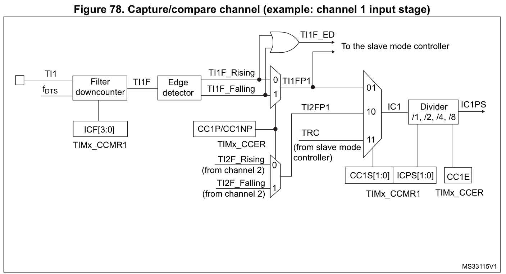
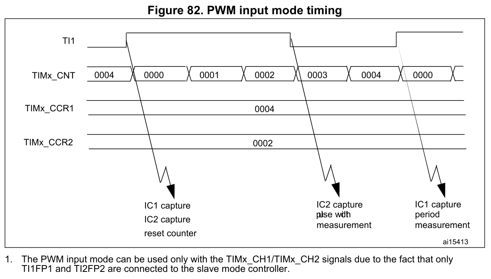
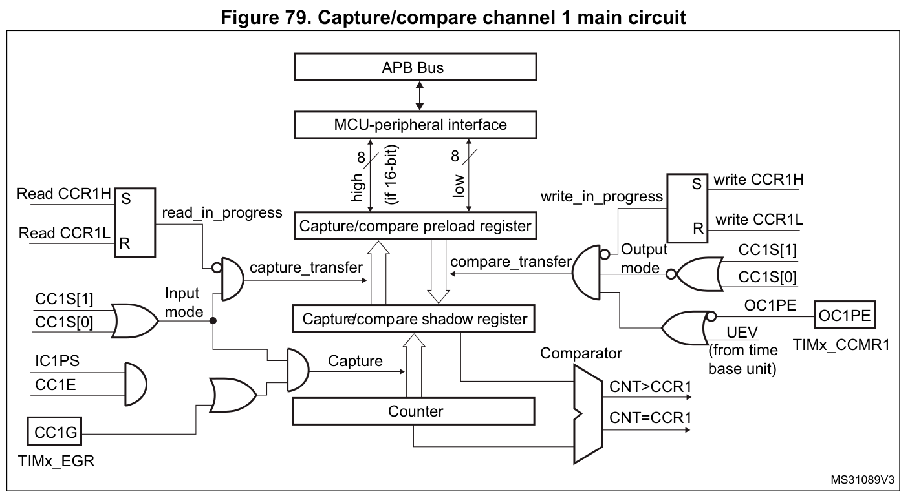

# TIM 输入捕获、滤波与 PWM 输入

适用 STM32F103C8T6 的 TIM1～TIM4。本文为固定来源整合参考；依据保留的 RM0008 Rev21 和 ES096 Rev15，未做板端测试。

## 捕获通路与三个不同的分频位置



图78为[RM0008 Rev21 p312](https://www.st.com/resource/en/reference_manual/cd00171190.pdf#page=312)中的TIM1通道1输入级原图裁切，保留标题、完整边框、全部输入支路与原标签。

对通道1，CC1S=01选择TI1直接输入，CC1S=10选择TI2间接输入，CC1S=11选择TRC。通道2的CC2S=01选择TI2，CC2S=10选择TI1，PWM输入正是用直接／间接选择让两路捕获观察同一外部输入。图内ICF、ICPS分别按该通道的IC1F、IC1PSC字段解释；图中的 $`f_{\mathrm{DTS}}`$ 标记不能覆盖字段表的全部采样档位。原CC1P/CC1NP标签保持不改，C8输入极性仍按下文CCER字段边界使用。

TIx 先经数字滤波、边沿/极性选择，再经 CCxS 输入选择和 ICxPSC 捕获分频，合格捕获把当前 CNT 锁存到 CCRx。TIxFPx 到从模式控制器的支路在捕获分频之前；ICxPSC 不会替从模式触发、复位或外部计数时钟做同样分频。

|控制|作用位置|已核对的边界|
|---|---|---|
|CR1.CKD|生成 $`t_{\mathrm{DTS}}`$ ，供部分滤波档与死区使用|ICxF=0001～0011 直接采用 $`f_{\mathrm{CK\_INT}}`$ ；这些档位不随 CKD 换成 $`f_{\mathrm{DTS}}`$ |
|PSC|计数时基|改变 CNT 的计数间隔，PSC 新值经更新事件装载|
|CCMR.ICxPSC|捕获事件分频|00/01/10/11 对应每 1/2/4/8 个合格输入事件捕获一次；CCxE=0 时捕获分频器复位|

$`t_{\mathrm{DTS}}`$ 是采样时间基准，单位 s； $`f_{\mathrm{DTS}}=1/t_{\mathrm{DTS}}`$ ，单位 Hz。 $`f_{\mathrm{CK\_INT}}`$ 为定时器内部时钟频率，单位 Hz； $`x`$ 为通道号。CKD、PSC、ICxPSC 是寄存器字段名。完整滤波 16 档见[硬件参数表](硬件参数表.md#外部触发及捕获滤波)。

输入配置前须令 CCxE=0 才能写 CCxS。CCxS=11 选择 TRC；不能把字段中的“internal trigger input”措辞收窄为仅 ITR0～ITR3，因为原厂 Hall 示例明确采用 TI1F_ED→TRC 路径，见[Hall接口](同步控制与Hall.md#hall接口的触发与捕获)。CCxS 非零时，CCRx 为输入捕获数据寄存器，软件读取有清 CCxIF 的副作用。ICxPSC 的事件分频不能当作输入毛刺滤波；滤波依据连续采样电平判定，捕获分频依据已选有效事件计数。停止捕获使CCxE=0时分频器复位，之后重新启用属于新的事件计数段；配置过程中改变ICxPSC或禁用/启用通道，不能默认跨越这一边界的两个时间戳仍相隔固定1/2/4/8个输入周期。启动到首个捕获的等待还受输入相位影响；连续测频应以同一稳定配置段内的有效捕获对为依据。

来源：[RM0008 Rev21 pp311–314，图78/79及§14.3.6](https://www.st.com/resource/en/reference_manual/cd00171190.pdf#page=311)、[CCMR1输入字段p351](https://www.st.com/resource/en/reference_manual/cd00171190.pdf#page=351)。

## 滤波示例与字段表的来源差异

RM0008 Rev21 p314 的示例把 IC1F=0011 写成以 $`f_{\mathrm{DTS}}`$ 连续采样8次；p351 字段表明确此编码采用 $`f_{\mathrm{CK\_INT}}`$ 、 $`N=8`$ 。CKD=00 时两种时钟相等；CKD 为其他合法编码时不能把示例文字直接推广。本文按字段表记录频率，并保留此来源差异。该记录属于文档交叉核查，未据此宣称 ST 发布正式勘误。

$`N`$ 是确认电平转换所需的连续样本数，无量纲。 $`N/f_{\mathrm{SAMPLING}}`$ 可用于表达采样窗口尺度；输入边沿相对采样时钟的相位、同步及后级路径仍影响实际响应延迟，不能把窗口尺度直接当作所有工况下的精确捕获延迟。 $`f_{\mathrm{SAMPLING}}`$ 是该档实际采样频率，单位 Hz。

## 捕获值、标志与丢样边界

有效捕获将 CNT 锁存到 CCRx 并置 CCxIF；若此前 CCxIF 仍为1，正常定义下还置 CCxOF。CCxIF 可写0清除，也可由读取输入模式的 CCRx 清除；CCxOF 通过写0清除。清 SR 应遵守 rc_w0 位语义，见[事件与DMA](事件与DMA窗口.md)。

RM0008 p314 建议先读捕获数据再检查过捕获标志，以减少先看标志、再读数据期间漏看新过捕获的窗口。这个顺序仍受 [ES096 Rev15 §2.6.5/§2.6.6](https://www.st.com/resource/en/errata_sheet/es096-stm32f101x8b-stm32f102x8b-and-stm32f103x8b-mediumdensity-device-limitations-stmicroelectronics.pdf) 限制：并发捕获/读取可能使捕获标志漏报，也可能误报过捕获。CCxOF=0 不能单独证明没有漏事件；CCxOF=1 也不能在所有竞争情形下直接等同数据已丢。

CCxIE/CCxDE 分别控制中断/DMA 请求；DMA 还需要真实物理请求映射，TIM3_CH2、TIM4_CH4 在 C8 的 DMA1 映射中没有独立请求通道。CCxG 软件事件也能锁存 CNT 并影响标志，因此数据解释必须排除软件生成的捕获事件。

## 同一输入的周期与脉宽捕获



图82直接裁自[RM0008 Rev21 p315](https://www.st.com/resource/en/reference_manual/cd00171190.pdf#page=315)，完整保留TI1、CNT、CCR1、CCR2、捕获／复位箭头、原数值和图下脚注。图内0004／0002分别对应本例的周期／高电平宽度计数；CCR2中的数值还不是无量纲占空比，仍需按下文条件除以周期计数。

RM0008 p315 §14.3.7 的 TI1 示例：CC1S=01，CC1P=0，使 CCR1 记录上升沿；CC2S=10，CC2P=1，使 CCR2 记录同一 TI1 的下降沿；TS=101 选择 TI1FP1，SMS=100 选择复位从模式。上升沿同时用于周期捕获及计数复位，下降沿用于高电平宽度捕获。两路捕获均须使能，并置CEN=1启动计数；计数时钟和量程须另按输入范围配置。

TIM2～TIM4图128的TI1 PWM输入配置和图82相同，CH1/CH2限制也相同。两图首个边沿附近均保留IC1 capture、IC2 capture与reset counter标注，脉宽说明的原排版也有拥挤／重叠；本页不修改原像素。应以图前配置明确的上升沿CCR1、下降沿CCR2解释采样，不能由起始处标签推导同时捕获两路CCR的硬件保证，也不能把首次复位前的值视为完整周期。

这里只描述这组 TI1 路由。采用 TI2 时周期与宽度的 CCR 归属可能交换，不能给 CCR1/CCR2 永久贴上“周期/占空比”的标签。两个寄存器也不提供软件成对原子快照；解释为同一周期的数据时，需要按捕获顺序、状态及缓存方案确认一致性。首次复位前的残留值不能自动当作完整周期。

[图82及脚注，RM0008 Rev21 p315](https://www.st.com/resource/en/reference_manual/cd00171190.pdf#page=315) 明确：这种通过 TI1FP1/TI2FP2 进入从模式控制器的 PWM 输入测量只支持 CH1/CH2，不能照搬成 CH3/CH4 自动复位测量。

### PWM输入数值的换算条件

对上述TI1上升沿复位、下降沿测高电平的路由，若两路ICxPSC均为DIV1，计数时钟稳定，已取得同一完整周期的数据，且没有回绕、漏捕获或额外复位，可作计数刻度换算：

```math
\begin{aligned}
T&\approx\frac{C_{\mathrm{T}}}{f_{\mathrm{CNT}}},&
t_{\mathrm{H}}&\approx\frac{C_{\mathrm{H}}}{f_{\mathrm{CNT}}},\\
f_{\mathrm{IN}}&\approx\frac{f_{\mathrm{CNT}}}{C_{\mathrm{T}}},&
D_{\mathrm{H}}&\approx\frac{C_{\mathrm{H}}}{C_{\mathrm{T}}}.
\end{aligned}
```

$`T`$ 为输入周期、 $`t_{\mathrm{H}}`$ 为高电平持续时间，单位s； $`f_{\mathrm{CNT}}`$ 为PSC后的计数频率、 $`f_{\mathrm{IN}}`$ 为输入频率，单位Hz； $`C_{\mathrm{T}}`$ 为周期捕获值（本路由CCR1）、 $`C_{\mathrm{H}}`$ 为高电平捕获值（本路由CCR2），均为无量纲计数值； $`D_{\mathrm{H}}`$ 为高电平时间比例，无量纲。下标 $`\mathrm{T}`$ 、 $`\mathrm{H}`$ 、 $`\mathrm{IN}`$ 分别表示周期、高电平、输入。要求 $`C_{\mathrm{T}}>0`$ ；近似号保留整数计数量化、输入同步、滤波及通路时序误差，不能据该换算声称无限测量精度。

图82/128分别标出的周期值0004和脉宽值0002是该来源示意中的数值；横向画法不能当作精确传播延迟或量化误差规格。CCR1/CCR2的用途依输入选路而定；改为测低电平或切换TI2时，需要重新建立值与时间的对应关系。

若周期捕获为零，即 $`C_{\mathrm{T}}=0`$ ，不能执行上述频率或占空比除法。无输入、输入恒高／恒低、尚未获得完整周期或量程／捕获异常时，旧CCR值不能代替新的有效测量。 $`C_{\mathrm{H}}=0`$ 本身也不能证明真实占空比恰好为0%；还须确认同周期捕获确实发生并满足分辨率条件。恒定0%／100%输入缺少这组双边沿测量所需的完整边沿序列，不能仅从保留的CCR值判定。此处是由捕获事件与换算条件作的使用边界说明，不是新增的器件精度规格。

依据：[RM0008 Rev21 PWM输入配置及图82](https://www.st.com/resource/en/reference_manual/cd00171190.pdf#page=315)、[图128及脚注](https://www.st.com/resource/en/reference_manual/cd00171190.pdf#page=385)。公式是按已说明的计数时基和捕获定义作的换算；不替代捕获有效性验证及ES096限制。

## 单通道极性与双边沿触发支路

C8 普通输入捕获按 CCxP 选择上升或下降沿。TIM2～TIM4 的 CCER 对应 CCxNP 位置为保留位；TIM1 的 CCxNP 字段说明为互补输出极性。通用库中存在 BOTHEDGE 常量，不能据此保证 C8 的单个普通 CCR 通道具有对应双边沿捕获模式。TI1F_ED 是另一个双边沿检测触发支路，必须通过相应 TS/时钟源路由选择，且不适用于门控模式。

来源：[TIM1 CCER，RM0008 pp353–355](https://www.st.com/resource/en/reference_manual/cd00171190.pdf#page=353)、[TIM2～TIM4 CCER pp417–418](https://www.st.com/resource/en/reference_manual/cd00171190.pdf#page=417)。库编码及入口边界见[HAL宏](HAL辅助宏.md)。

原图输入极性的范围校核：图78（p312）和图125（p382）均保留“CC1P/CC1NP”选择标注；TIM1的CC1NP字段定义为互补输出极性，TIM2～TIM4的CCER位图则把对应位置列为保留。本页原图不改写该标签，实际输入捕获仍按C8的CC1P字段配置，并保留TI1F_ED的独立双边沿触发分支；不能从通用图补出CC1NP输入极性编码。来源：[图78](https://www.st.com/resource/en/reference_manual/cd00171190.pdf#page=312)、[TIM1 CCER字段p354](https://www.st.com/resource/en/reference_manual/cd00171190.pdf#page=354)、[图125](https://www.st.com/resource/en/reference_manual/cd00171190.pdf#page=382)、[TIM2～TIM4 CCER位图及字段pp417–418](https://www.st.com/resource/en/reference_manual/cd00171190.pdf#page=417)。

## 捕获与比较共用寄存器的数据方向



图79直接裁自[RM0008 Rev21 p312](https://www.st.com/resource/en/reference_manual/cd00171190.pdf#page=312)。为保留共享CCRx电路的完整含义，没有删除输出比较一侧；本节借它解释捕获数据的锁存和总线读侧传送，不增加其他输出级原图。

RM0008图79/126用内部shadow与总线可见preload两级说明同一个CCRx的输入/输出用途：捕获时，CNT先锁存到内部捕获值，再送到总线可读侧；比较时，在CCxS=00及相应写传送条件下，OCxPE=0使软件写入值直接更新活动比较值，OCxPE=1则经UEV装载；读回CCRx不能证明新活动值已经装入。名称中的preload不能自动当作软件可读出的双样本FIFO，也不提供跨通道原子快照。图中read_in_progress/write_in_progress还表示传送控制；并发读与新捕获仍须遵守ES096竞争限制。

CCRx数值与通道控制位的预装载须分开；OCxPE的使用限制见[初始化与动态改值限制](比较与PWM边界.md#3-初始化与动态改值限制)，COM可由软件COMG产生，CCUS=1时也可由TRGI上升沿产生。TIM1的CCPC/CCUS与CH1～CH3/CH4控制预装载范围见[TRGO与COM的独立消费路径](计数时基与更新.md#4-trgo与com的独立消费路径)。

图中CCR1H/CCR1L和8位连线为内部示意；C8实际CCRx的CPU写访问仍按寄存器访问规则使用半字或字，不能据该画法生成两个独立8位写来更新16位CCR的推荐流程。

对应图125、126、128的正文核对继续保留，本批未另收录这三幅通用定时器原图。

来源：[RM0008 Rev21图79](https://www.st.com/resource/en/reference_manual/cd00171190.pdf#page=312)、[图126/128及说明，pp383–385](https://www.st.com/resource/en/reference_manual/cd00171190.pdf#page=383)、[TIM2～4寄存器访问规则p404](https://www.st.com/resource/en/reference_manual/cd00171190.pdf#page=404)。

[返回定时器主题](../../知识库/06_定时器PWM与同步.md) · [图形关系与来源](图形关系与来源.md)
