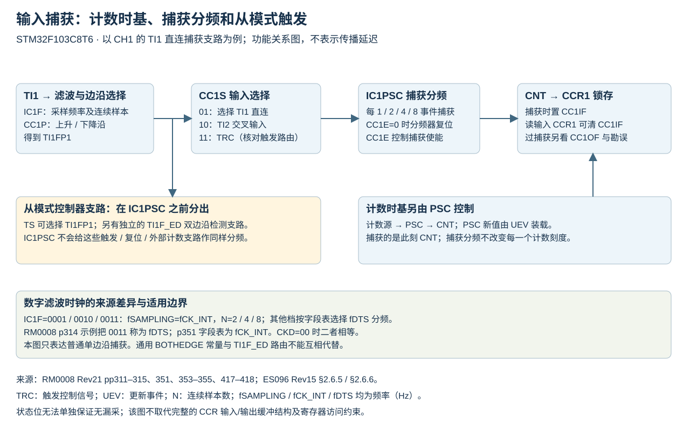
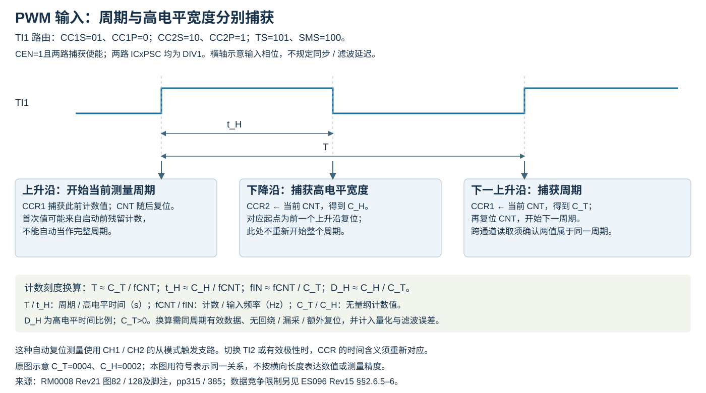
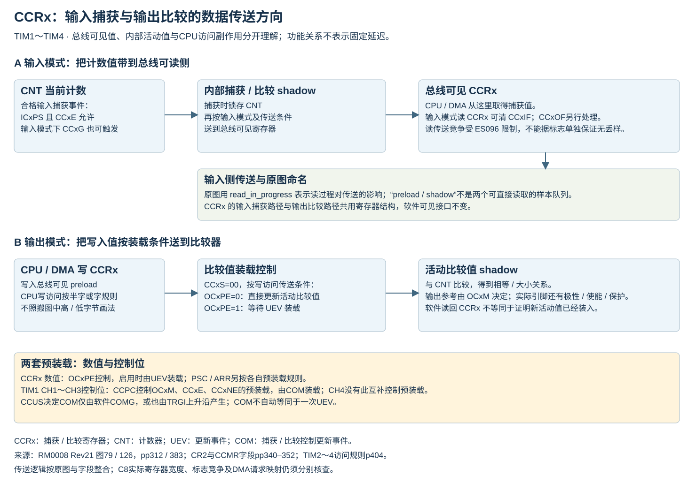

# TIM 输入捕获、滤波与 PWM 输入

适用 STM32F103C8T6 的 TIM1～TIM4。本文为固定来源整合参考；依据保留的 RM0008 Rev21 和 ES096 Rev15，未做板端测试。

## 捕获通路与三个不同的分频位置

该图是按字段适用范围整理的功能关系，不等同于原图78/79完整电路。

TIx 先经数字滤波、边沿/极性选择，再经 CCxS 输入选择和 ICxPSC 捕获分频，合格捕获把当前 CNT 锁存到 CCRx。TIxFPx 到从模式控制器的支路在捕获分频之前；ICxPSC 不会替从模式触发、复位或外部计数时钟做同样分频。

|控制|作用位置|已核对的边界|
|---|---|---|
|CR1.CKD|生成 tDTS，供部分滤波档与死区使用|ICxF=0001～0011 直接采用 fCK_INT；这些档位不随 CKD 换成 fDTS|
|PSC|计数时基|改变 CNT 的计数间隔，PSC 新值经更新事件装载|
|CCMR.ICxPSC|捕获事件分频|00/01/10/11 对应每 1/2/4/8 个合格输入事件捕获一次；CCxE=0 时捕获分频器复位|

tDTS 是采样时间基准，单位 s；fDTS=1/tDTS，单位 Hz。fCK_INT 为定时器内部时钟频率，单位 Hz；x 为通道号。CKD、PSC、ICxPSC 是寄存器字段名。完整滤波 16 档见[硬件参数表](硬件参数表.md#外部触发及捕获滤波)。

输入配置前须令 CCxE=0 才能写 CCxS。CCxS=11 选择 TRC；不能把字段中的“internal trigger input”措辞收窄为仅 ITR0～ITR3，因为原厂 Hall 示例明确采用 TI1F_ED→TRC 路径，见[Hall接口](同步控制与Hall.md#hall接口的触发与捕获)。CCxS 非零时，CCRx 为输入捕获数据寄存器，软件读取有清 CCxIF 的副作用。ICxPSC 的事件分频不能当作输入毛刺滤波；滤波依据连续采样电平判定，捕获分频依据已选有效事件计数。

来源：[RM0008 Rev21 pp311–314，图78/79及§14.3.6](https://www.st.com/resource/en/reference_manual/cd00171190.pdf#page=311)、[CCMR1输入字段p351](https://www.st.com/resource/en/reference_manual/cd00171190.pdf#page=351)。

## 滤波示例与字段表的来源差异

RM0008 Rev21 p314 的示例把 IC1F=0011 写成以 fDTS 连续采样8次；p351 字段表明确此编码采用 fCK_INT、N=8。CKD=00 时两种时钟相等；CKD 为其他合法编码时不能把示例文字直接推广。本文按字段表记录频率，并保留此来源差异。该记录属于文档交叉核查，未据此宣称 ST 发布正式勘误。

N 是确认电平转换所需的连续样本数，无量纲。N/fSAMPLING 可用于表达采样窗口尺度；输入边沿相对采样时钟的相位、同步及后级路径仍影响实际响应延迟，不能把窗口尺度直接当作所有工况下的精确捕获延迟。fSAMPLING 是该档实际采样频率，单位 Hz。

## 捕获值、标志与丢样边界

有效捕获将 CNT 锁存到 CCRx 并置 CCxIF；若此前 CCxIF 仍为1，正常定义下还置 CCxOF。CCxIF 可写0清除，也可由读取输入模式的 CCRx 清除；CCxOF 通过写0清除。清 SR 应遵守 rc_w0 位语义，见[事件与DMA](事件与DMA窗口.md)。

RM0008 p314 建议先读捕获数据再检查过捕获标志，以减少先看标志、再读数据期间漏看新过捕获的窗口。这个顺序仍受 [ES096 Rev15 §2.6.5/§2.6.6](https://www.st.com/resource/en/errata_sheet/es096-stm32f101x8b-stm32f102x8b-and-stm32f103x8b-mediumdensity-device-limitations-stmicroelectronics.pdf) 限制：并发捕获/读取可能使捕获标志漏报，也可能误报过捕获。CCxOF=0 不能单独证明没有漏事件；CCxOF=1 也不能在所有竞争情形下直接等同数据已丢。

CCxIE/CCxDE 分别控制中断/DMA 请求；DMA 还需要真实物理请求映射，TIM3_CH2、TIM4_CH4 在 C8 的 DMA1 映射中没有独立请求通道。CCxG 软件事件也能锁存 CNT 并影响标志，因此数据解释必须排除软件生成的捕获事件。

## 同一输入的周期与脉宽捕获

RM0008 p315 §14.3.7 的 TI1 示例：CC1S=01，CC1P=0，使 CCR1 记录上升沿；CC2S=10，CC2P=1，使 CCR2 记录同一 TI1 的下降沿；TS=101 选择 TI1FP1，SMS=100 选择复位从模式。上升沿同时用于周期捕获及计数复位，下降沿用于高电平宽度捕获。两路捕获均须使能；计数时钟和量程须另按输入范围配置。

这里只描述这组 TI1 路由。采用 TI2 时周期与宽度的 CCR 归属可能交换，不能给 CCR1/CCR2 永久贴上“周期/占空比”的标签。两个寄存器也不提供软件成对原子快照；解释为同一周期的数据时，需要按捕获顺序、状态及缓存方案确认一致性。首次复位前的残留值不能自动当作完整周期。

[图82及脚注，RM0008 Rev21 p315](https://www.st.com/resource/en/reference_manual/cd00171190.pdf#page=315) 明确：这种通过 TI1FP1/TI2FP2 进入从模式控制器的 PWM 输入测量只支持 CH1/CH2，不能照搬成 CH3/CH4 自动复位测量。

### PWM输入数值的换算条件

对上述TI1上升沿复位、下降沿测高电平的路由，若两路ICxPSC均为DIV1，计数时钟稳定，已取得同一完整周期的数据，且没有回绕、漏捕获或额外复位，可作计数刻度换算：

`T ≈ C_T / fCNT`；`t_H ≈ C_H / fCNT`；`fIN ≈ fCNT / C_T`；`D_H ≈ C_H / C_T`。

T为输入周期、t_H为高电平持续时间，单位s；fCNT为PSC后的计数频率、fIN为输入频率，单位Hz；C_T为周期捕获值（本路由CCR1）、C_H为高电平捕获值（本路由CCR2），均为无量纲计数值；D_H为高电平时间比例，无量纲。下标T/H/IN分别表示周期、高电平、输入。要求C_T>0；近似号保留整数计数量化、输入同步、滤波及通路时序误差，不能据该换算声称无限测量精度。

图82/128分别标出的周期值0004和脉宽值0002是该来源示意中的数值；横向画法不能当作精确传播延迟或量化误差规格。CCR1/CCR2的用途依输入选路而定；改为测低电平或切换TI2时，需要重新建立值与时间的对应关系。

依据：[RM0008 Rev21 PWM输入配置及图82，p315](https://www.st.com/resource/en/reference_manual/cd00171190.pdf#page=315)、[图128及脚注，p385](https://www.st.com/resource/en/reference_manual/cd00171190.pdf#page=385)。公式是按已说明的计数时基和捕获定义作的换算；不替代捕获有效性验证及ES096限制。

## 单通道极性与双边沿触发支路

C8 普通输入捕获按 CCxP 选择上升或下降沿。TIM2～TIM4 的 CCER 对应 CCxNP 位置为保留位；TIM1 的 CCxNP 字段说明为互补输出极性。通用库中存在 BOTHEDGE 常量，不能据此保证 C8 的单个普通 CCR 通道具有对应双边沿捕获模式。TI1F_ED 是另一个双边沿检测触发支路，必须通过相应 TS/时钟源路由选择，且不适用于门控模式。

来源：[TIM1 CCER，RM0008 pp353–355](https://www.st.com/resource/en/reference_manual/cd00171190.pdf#page=353)、[TIM2～TIM4 CCER pp417–418](https://www.st.com/resource/en/reference_manual/cd00171190.pdf#page=417)。库编码及入口边界见[HAL宏](HAL辅助宏.md)。

TIM2～TIM4输入结构图的范围校核：RM0008图125（p382）沿用了“CC1P/CC1NP”选择标注，但本章节CCER位图把CC1NP对应位置列为保留。因此整合图仅使用C8实际CC1P字段，保留TI1F_ED的独立双边沿触发分支，不从通用图补出CC1NP输入极性编码。来源：[图125](https://www.st.com/resource/en/reference_manual/cd00171190.pdf#page=382)、[CCER位图及字段pp417–418](https://www.st.com/resource/en/reference_manual/cd00171190.pdf#page=417)。

## 捕获与比较共用寄存器的数据方向

RM0008图79/126用内部shadow与总线可见preload两级说明同一个CCRx的输入/输出用途：捕获时，CNT先锁存到内部捕获值，再送到总线可读侧；比较时，软件写入值按OCxPE/UEV等条件进入用于比较的活动值。名称中的preload不能自动当作软件可读出的双样本FIFO，也不提供跨通道原子快照。图中read_in_progress/write_in_progress还表示传送控制；并发读与新捕获仍须遵守ES096竞争限制。

图中CCR1H/CCR1L和8位连线为内部示意；C8实际CCRx的CPU写访问仍按寄存器访问规则使用半字或字，不能据该画法生成两个独立8位写来更新16位CCR的推荐流程。

TIM2～TIM4图128的TI1 PWM输入配置和图82相同，CH1/CH2限制也相同。其首个边沿附近的IC1/IC2捕获文字有重叠；输入配置明确为上升沿CCR1、下降沿CCR2，不能从重叠标注推导同时采两路CCR的硬件保证。

来源：[RM0008 Rev21图79，p313](https://www.st.com/resource/en/reference_manual/cd00171190.pdf#page=313)、[图126/128及说明，pp383–385](https://www.st.com/resource/en/reference_manual/cd00171190.pdf#page=383)、[TIM2～4寄存器访问规则p404](https://www.st.com/resource/en/reference_manual/cd00171190.pdf#page=404)。

[返回定时器主题](../../知识库/06_定时器PWM与同步.md) · [图形关系与来源](图形关系与来源.md)
