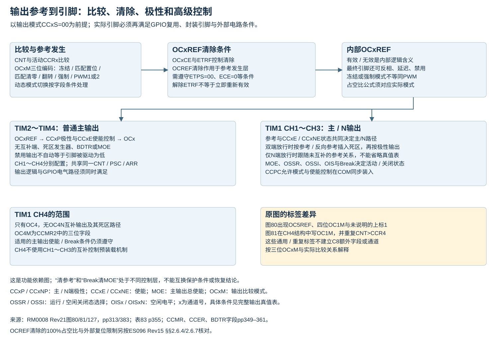
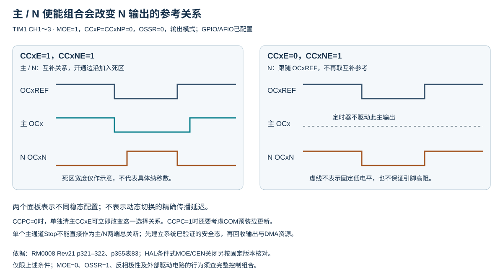
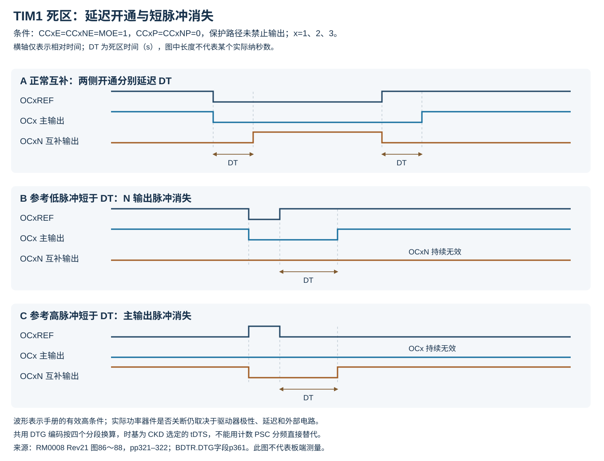
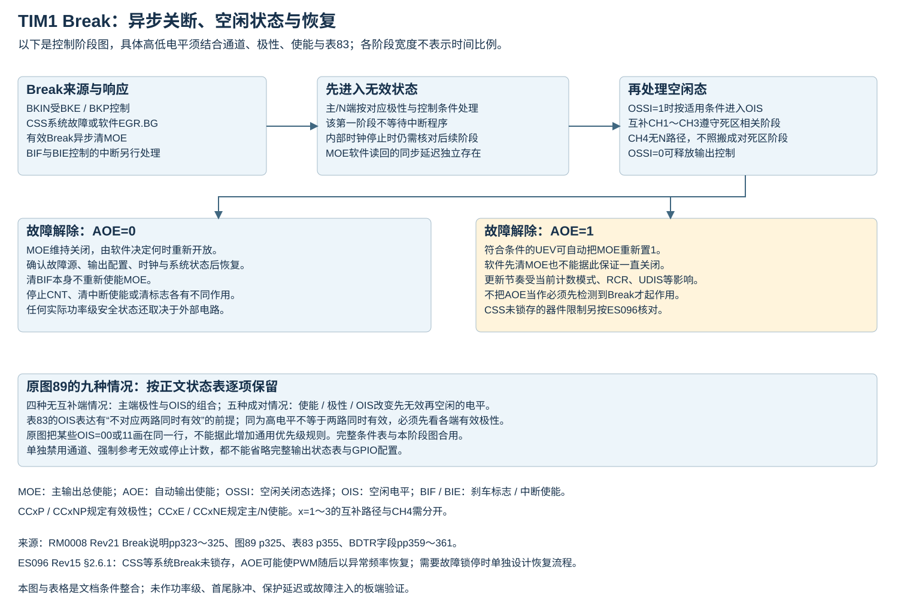
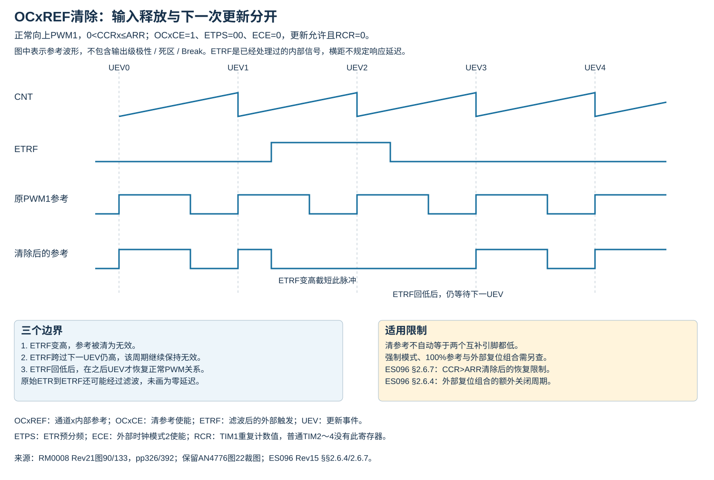

# TIM 输出比较、互补输出与保护状态

TIM1的CH1～CH3具有互补输出，CH4没有；TIM2～TIM4没有TIM1的BDTR、MOE、BKIN与死区功能。本篇为固定来源整合参考。

## 1 输出参考与引脚

OCxREF为通道x内部参考，高表示有效；引脚经过极性、使能、死区及GPIO/AFIO后才形成实际电平。强制有效/无效控制OCxREF，不能脱离CCxP/CCxNP解释为固定引脚高/低。输入捕获使用相同通道寄存器，但MOE不是关闭输入捕获的开关。

边沿对齐向上计数、PWM1、有效高、无死区及额外清除/复位时，0<CCR≤ARR：

$$
D=\frac{\mathrm{CCR}}{\mathrm{ARR}+1}
$$

$D$为内部有效时间占完整周期的比例，无量纲；CCR为通道比较值、ARR为自动重装值，均为无量纲计数整数。CCR=0为恒无效，CCR>ARR为恒有效。实际引脚占空还受输出极性、死区和保护状态影响；中心对齐与向下模式应按比较不等式另算。

CCRx预装载与控制位预装载是两套机制：OCxPE使比较数值在UEV更新；TIM1 CCPC使有互补输出的通道OCxM、CCxE、CCxNE在COM更新。设置或清除通道控制位后须按当前预装载模式判断生效时刻。

来源：[RM0008 Rev21 pp316–322](https://www.st.com/resource/en/reference_manual/cd00171190.pdf#page=316)、[CCPC/CCUS p341](https://www.st.com/resource/en/reference_manual/cd00171190.pdf#page=341)。

## 2 主/互补输出的完整控制组合

图中两个面板表示各自的稳态配置。反相极性、关闭态与动态换相时序以完整表格及对应字段条件为准。

以下组合表限定具备互补输出的TIM1 CH1～CH3。E=CCxE、N=CCxNE，“释放”表示定时器的对应输出使能为 0，实际引脚状态还取决于 GPIO/AFIO；“无效”电平由极性位决定。主输出无效电平为 CCxP，互补输出无效电平为 CCxNP。

|MOE|OSSR|E,N|主输出|互补输出|
|---|---|---|---|---|
|1|0|0,0|释放（内部输出 0）|释放（内部输出 0）|
|1|0|0,1|释放|OCxREF XOR CCxNP|
|1|0|1,0|OCxREF XOR CCxP|释放|
|1|0|1,1|OCxREF＋极性＋死区|互补 OCxREF＋极性＋死区|
|1|1|0,0|释放，内部为 CCxP|释放，内部为 CCxNP|
|1|1|0,1|使能并驱动无效|OCxREF XOR CCxNP|
|1|1|1,0|OCxREF XOR CCxP|使能并驱动无效|
|1|1|1,1|OCxREF＋极性＋死区|互补 OCxREF＋极性＋死区|

MOE=1 时 OSSI 不参与上表。MOE=0 时 OSSR 不参与：

- OSSI=0：各 E/N 组合都释放定时器输出使能；异步先得到主=CCxP、互补=CCxNP，若时钟存在且OISx/OISxN不对应两路同时有效，则经过死区后内部转为 OISx/OISxN；引脚是否被驱动仍取决于输出使能。
- OSSI=1、E=N=0：仍释放两个输出使能，与 OSSI=0 的禁用状态相同。
- OSSI=1、E 或 N 至少一个为 1：进入关闭/空闲态，两个输出使能为 1，先异步驱动无效电平；时钟存在时经过死区再进入 OISx/OISxN。这里的OIS终态公式以前提“OISx/OISxN不对应两路同时有效”为限；不能把两路均有效的配置代入该公式作保证。
- E=N=0 时 OISx、OISxN、CCxP、CCxNP 均应保持 0；未使用的通道不可用这些位制造任意状态。

CC4 无互补输出，不使用 N 控制位；CC4NP的原文位图与C8器件头文件存在差异，不提供可用 CH4N 功能；其空闲状态由 OIS4 及主输出总控制决定。图89的“未实现N输出”分组对应无互补支路的输出：刹车后的OIS变化未画上述互补死区阶段，不能把CH1～CH3的两阶段过程直接扩展到CH4。

来源：[RM0008 Rev21 p355表83及脚注](https://www.st.com/resource/en/reference_manual/cd00171190.pdf#page=355)。本次核对整页表格，包括MOE=0合并单元格及页底GPIO/AFIO说明；不把“定时器不驱动”直接等同于引脚固定低或高阻。

## 3 死区量化及短脉冲

令d为DTG字段的无符号整数，tDTS为死区采样时间基准，则：

|DTG前缀|有效位值|死区时长DT|可表示的DT/tDTS|
|---|---|---|---|
|0xx|d=DTG[7:0]|d × tDTS|0～127，步长1|
|10x|d=DTG[5:0]|(64+d) × 2tDTS|128～254，步长2|
|110|d=DTG[4:0]|(32+d) × 8tDTS|256～504，步长8|
|111|d=DTG[4:0]|(32+d) × 16tDTS|512～1008，步长16|

DT为死区时间，tDTS为CKD选择的采样周期，单位均为s；DTG为BDTR低8位编码，无量纲，方括号表示取位范围，前缀中的x表示任意位。表中的d在每行按列出的位段重新取值。CKD=DIV1/DIV2/DIV4时，tDTS分别为1/$f_{\mathrm{TIM}}$、2/$f_{\mathrm{TIM}}$、4/$f_{\mathrm{TIM}}$；$f_{\mathrm{TIM}}$为定时器内部时钟频率，单位Hz。PSC的计数分频不替代CKD。

正常双端使能且主/N都有效高时，主输出开通相对参考上升沿延后，N输出开通相对参考下降沿延后；关断边沿不按同样方式整体平移。若有效参考脉冲短于所需死区，对应输出脉冲可能完全消失。TIM1各互补通道共用这一死区设置。

来源：[RM0008 Rev21 p321图86、p322图87～88](https://www.st.com/resource/en/reference_manual/cd00171190.pdf#page=321)、[DTG p361](https://www.st.com/resource/en/reference_manual/cd00171190.pdf#page=361)。计算宏的整数时基近似、分段量化、超范围返回0与中间整数溢出限制见[LL辅助宏](LL辅助宏.md#__ll_tim_calc_deadtime)。

## 4 停止、参考清除与自动恢复

- 仅清CEN停止计数，不保证OCxREF或引脚进入无效态；OPM在UEV清CEN也不能替代输出保护设计。
- 在CCPC=0、原先主/N均开启的例子中，关闭主输出而保留N输出，会把N从互补参考路径改为同向OCxREF加极性。单个PWM_Stop或OC_Stop不能直接作为半桥两端总关断；上表E=0、N=1与E=N=1的行说明了这个差别。
- ETR/OCREF_CLR清参考时，若主/N都开启，主进入无效态，N可在死区后进入有效态；它不保证两端都关闭。实际驱动级还应遵守ES096有关外部复位及CCR>ARR的限制。
- 刹车清MOE后的实际电平由上表OSSI/OIS/极性与GPIO共同决定。AOE=1允许刹车无效时的更新事件自动置MOE，不要求此前发生过刹车；AOE=0要求软件重新使能。ES096的CSS刹车恢复条件也须同时考虑。
- LOCK配置在复位后需重新建立；软件保护位不能作为跨复位仍然存在的保证。功率级的安全状态还应由外部驱动及引脚电路共同落实。

来源：[RM0008 Rev21 p322单独N输出注释](https://www.st.com/resource/en/reference_manual/cd00171190.pdf#page=322)、[ES096 Rev15 §§2.6.1、2.6.4、2.6.7](https://www.st.com/resource/en/errata_sheet/es096-stm32f101x8b-stm32f102x8b-and-stm32f103x8b-mediumdensity-device-limitations-stmicroelectronics.pdf#page=14)。HAL条件式停止宏见[HAL宏参考](HAL辅助宏.md)；OCN/PWMN Stop_IT对共享CCxIE/BIE的副作用见[扩展接口](HAL扩展接口.md)。

仅清MOE不会清AOE。AOE=1且刹车无效时，即使MOE是软件主动清零，也可在后续UEV再次置位。HAL无条件清MOE宏和LL_TIM_DisableAllOutputs都只清MOE，不能据函数名认定输出被持续锁定。AOE又受LOCK≥1写保护，停机设计不能假设故障发生时还能临时修改AOE；须按预先验证的系统关断路径及资源所有权处理。

### 刹车同步与读回时序

RM0008 p323区分异步输出保护信号与软件可读的同步寄存器位：

- 写BKE/BKP后需要经过1个APB时钟周期才生效，过早读回不能作为写入失败结论。TIM1位于APB2；这里的APB时钟周期不能任意替换为PSC后的计数节拍。
- MOE由异步路径作用于输出，其读回位经过同步。MOE从0写1后，手册要求在读回之前留出延迟，并以一条空操作类指令作说明；立即读回与实际异步输出信号之间可能存在时间差。此说明不提供所有编译/总线条件下统一的纳秒数保证。
- 刹车先异步使输出无效，即使定时器没有时钟，该初始保护动作仍可发生。之后通过死区进入OISx/OISxN需要定时器时钟存在；手册指出MOE再同步会使这段死区比通常情况稍长，约额外2个定时器时钟周期，不能据此给出精确或最大关断延迟。
- 有效刹车电平持续期间，MOE不能由软件或自动恢复置1，BIF也不能清除。软件BG事件及CSS路径需按各自来源和ES096限制分别分析，不能把“清了状态标志”作为外部故障已经解除的证据。

图89（p325）分别示出没有N输出、主/N同时使能、仅主使能等情况下的极性与OIS组合。其部分行有延迟后再改变电平的阶段，不能把整个刹车过程简化成“一次写MOE立即等于最终OIS”。涉及OISx=OISxN的原图行还须结合表83的终态公式前提；两路电平相同也不自动等于两路均有效，必须同时看CCxP/CCxNP。

来源：[RM0008 Rev21 pp323–325](https://www.st.com/resource/en/reference_manual/cd00171190.pdf#page=323)、[输出组合表83 p355](https://www.st.com/resource/en/reference_manual/cd00171190.pdf#page=355)。

### 图89的全部输出状态示例

以下按原图保留9组条件和刹车后轨迹。“立即”仅指图中MOE下降沿后的第一阶段，不规定零延迟；“延迟后”仍需时钟。0/1为图中输出逻辑电平，不能直接代替外部功率器件的有效/无效。源图未完整列出OSSI、GPIO等全部配置，因此本表是来源轨迹对照，不能独立作为配置步骤。

|原图分组与条件|第一阶段|图示后续状态|
|---|---|---|
|无N支路；CCxP=0、OISx=1|OCx=1|维持1，无互补死区阶段|
|无N支路；CCxP=0、OISx=0|OCx=0|维持0|
|无N支路；CCxP=1、OISx=1|OCx=1|维持1|
|无N支路；CCxP=1、OISx=0|OCx=0|维持0|
|E=N=1；P=NP=0；OISx=0、OISxN=1|主/N=0/0|延迟后0/1|
|E=N=1；P=0、NP=1；OISx=OISxN=1|主/N=0/1|延迟后1/1；N的有效极性为低|
|E=1、N=0；P=NP=0；OISx=0、OISxN=1|主/N=0/0|延迟后0/1|
|E=1、N=0；P=NP=0；OISx=1、OISxN=0|主/N=0/0|延迟后1/0|
|E=1、N=0；P=NP=0；OISx=OISxN=0或二者均1|原图均画主/N=0/0|原图均保持0/0；均1情形不满足表83的终态公式前提|

本表P=CCxP、NP=CCxNP，其余缩写同前表。最后一行明确保留原图将两种同值OIS配置合画的表达，不据此推导未列极性组合的完整硬件优先级。来源：[RM0008 Rev21完整图89](https://www.st.com/resource/en/reference_manual/cd00171190.pdf#page=325)、[表83及其终态前提](https://www.st.com/resource/en/reference_manual/cd00171190.pdf#page=355)。

## 5 OCxREF 清除与刹车的恢复条件

|项目|OCxREF 清除|TIM1 刹车|
|---|---|---|
|控制层|内部输出参考 OCxREF|MOE 及输出关闭/空闲状态|
|来源|ETRF 高电平，通道 OCxCE=1|BKIN、CSS 路径或软件 BG，分别遵守其使能条件|
|范围|由各通道 OCxCE 选择|共享 MOE 影响相关输出通道|
|恢复条件|参考保持低，直到后续 UEV；ETRF 若继续有效仍须按清除机制判断|AOE=0 需软件恢复；AOE=1 可在刹车无效后的 UEV 恢复 MOE|
|模式与资源限制|适用于输出比较/PWM，强制模式不适用；ETPS=00、ECE=0；ETP/ETF 按输入设计|TIM1 专用保护输出级；TIM2～TIM4 没有相同 BDTR/BKIN 能力|

OCxCE 是输出比较参考清除使能，ETRF 是外部触发输入经极性/分频/滤波后的信号，ETPS/ETP/ETF 分别为外部触发预分频/极性/滤波字段；ECE 为外部时钟模式2使能。UEV 是更新事件，AOE 为自动输出使能，MOE 为主输出使能，BG 为软件刹车事件。

RM0008 §14.3.13 要求将清参考用的 ETR 配为 ETPS=00、ECE=0；因此不能直接与同一实例的 ETR 外部时钟模式2配置叠加。恢复写成“下一个 PWM 周期自动恢复”会遗漏 RCR、UDIS 以及 ETRF 持续有效的条件。两种方式都必须结合输出极性、死区和主/N使能关系评估实际引脚，不能据“参考为0”断言功率级两端都关闭。

来源：[RM0008 Rev21 p326 §14.3.13、图90](https://www.st.com/resource/en/reference_manual/cd00171190.pdf#page=326)、[MOE/AOE字段p359](https://www.st.com/resource/en/reference_manual/cd00171190.pdf#page=359)。针对外部复位及CCR>ARR的OCREF_CLR例外，分别继续适用ES096 §2.6.4与§2.6.7；系统Break恢复另见§2.6.1。

## 6 LOCK 的累积保护范围

|LOCK编码|该等级新增保护|前提|
|---|---|---|
|00|不锁定其他字段|LOCK 字段自身仍遵守首次 BDTR 写入后的冻结规则|
|01|BDTR.DTG、BKE、BKP、AOE；CR2.OISx/OISxN|等级1|
|10|CCER.CCxP/CCxNP；BDTR.OSSR/OSSI|包含等级1；极性位条件为对应通道处于输出模式|
|11|CCMR.OCxM/OCxPE|包含等级2；对应通道处于输出模式|

LOCK 为写保护等级字段；DTG 为死区编码，BKE/BKP 为刹车使能/极性，OISx/OISxN 为主/互补输出空闲状态，OSSR/OSSI 为运行/空闲关闭态选择，OCxM/OCxPE 为输出模式/比较预装载使能。

RM0008 p360 明确 LOCK 只可在复位后写一次，首次写 TIM1_BDTR 后其值冻结到下次复位。这项约束包含首次写入 LOCK=00 的情形。需要锁定时，应在首次 BDTR 写入前确定保护配置；不能先写一次 BDTR，再默认后续还能提升 LOCK。上述列表没有把 MOE 或全部 CCR 数值锁住，因此 LOCK 不是“整个定时器不可再变化”的保证。

来源：[RM0008 Rev21 BDTR pp359–361](https://www.st.com/resource/en/reference_manual/cd00171190.pdf#page=359)。

## 7 原厂结构图中的器件范围差异

RM0008 Rev21 p313图80出现OC5REF与OC1M[3:0]，图81出现OC1M[3:0]及两条相同CNT>CCR4标签。C8只有TIM1 CH1～4，OC1M/OC4M为三位字段；这些图中文字不能作为CH5、CH4N或四位输出模式存在的证据。该页图80的(1)上标未见对应页下注释。应同时保留原图来源与寄存器定义对照，不默默改写原件再声称是原厂图。

来源：[RM0008 Rev21 p313](https://www.st.com/resource/en/reference_manual/cd00171190.pdf#page=313)、[CCMR1/2 pp349–352](https://www.st.com/resource/en/reference_manual/cd00171190.pdf#page=349)。

## 8 调试停核时的计数与输出

C8的定时器冻结控制位位于DBGMCU_CR（地址0xE0042004），TIM1～4依次对应bit10～13。相应位为0时，停核期间计数器仍获时钟；为1时暂停该计数器。TIM1带互补输出，冻结计数时输出被禁止，手册将其描述为类似清MOE；引脚终态仍须结合OSSI/OIS及外部电路。此描述不能直接作为软件读回MOE必为0的保证，也不应推广成TIM2～4自动具有TIM1同样的保护级。

|实例|DBGMCU_CR字段|位置|掩码|
|---|---|---:|---|
|TIM1|DBG_TIM1_STOP|10|0x00000400|
|TIM2|DBG_TIM2_STOP|11|0x00000800|
|TIM3|DBG_TIM3_STOP|12|0x00001000|
|TIM4|DBG_TIM4_STOP|13|0x00002000|

DBGMCU_CR仅支持32位访问，由上电复位清除，普通系统复位不清除。C8的ES096 §2.2.2还限制调试寄存器访问：用户模式读回为0，不能用脱离调试状态的CPU读回0推断冻结配置被清除。

两处来源定位差异须保留：RM0008 p337写DBGMCU_APBx_FZ，C8实际布局为DBGMCU_CR；p1102位描述写“Bits12:11”同时涵盖TIM1～4，与同页位图及固定CMSIS定义的bit10～13不一致。本文按位图与C8定义列出，和知识库既有调试寄存器章节一致。

来源：[RM0008 Rev21 §14.3.21](https://www.st.com/resource/en/reference_manual/cd00171190.pdf#page=337)、[§§31.16.2–3，pp1101–1102](https://www.st.com/resource/en/reference_manual/cd00171190.pdf#page=1101)、[ES096 Rev15 §2.2.2](https://www.st.com/resource/en/errata_sheet/es096-stm32f101x8b-stm32f102x8b-and-stm32f103x8b-mediumdensity-device-limitations-stmicroelectronics.pdf#page=7)、[固定CMSIS stm32f103xb.h](https://github.com/STMicroelectronics/cmsis-device-f1/blob/c8e9a4a4f16b6d2cb2a2083cbe5161025280fb22/Include/stm32f103xb.h#L9656-L9667)。

[返回定时器主题](../../知识库/06_定时器PWM与同步.md) · [图形关系与来源](图形关系与来源.md)
