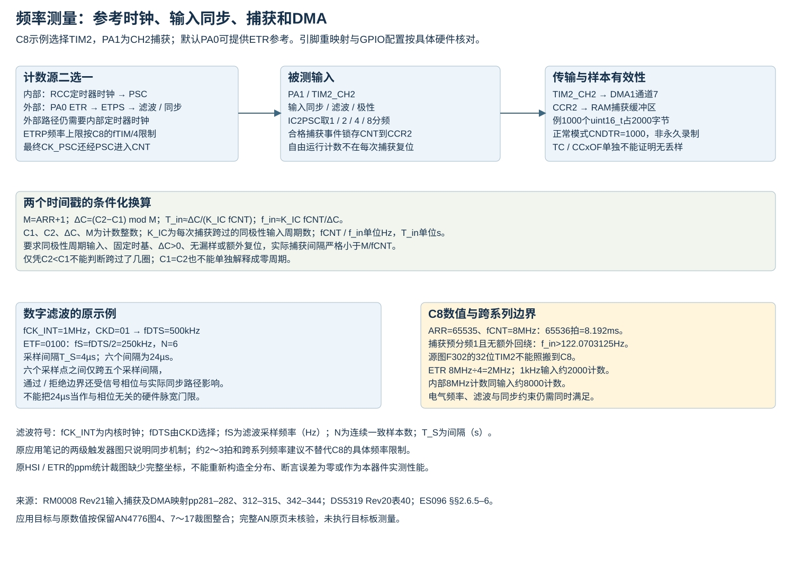

# TIM 输入滤波与频率测量的数值条件

STM32F103C8T6，固定来源整合参考。器件字段与限制以固定RM0008 Rev21、DS5319 Rev20及ES096 Rev15为依据。本文保留既有AN4776笔记中的参数与应用目标；其完整原PDF尚未完成全文复核，原平台和测量图不作为C8的实测证据。通路与字段见[时基](计数时基与更新.md)、[输入捕获](输入捕获与滤波.md)及[参数表](硬件参数表.md)。

## 1 六次一致采样的滤波例子

ETR用SMCR.ETF，TI输入用CCMR.ICxF；字段同时确定采样频率和连续一致样本数N。CKD确定fDTS；C8没有CKD2、FDTS2或新系列SETPS字段。

保留参数：fCK_INT=1MHz、CKD=01，因此fDTS=500kHz；ETF=0100，得到fS=fDTS/2=250kHz、N=6。

`T_S = 1/fS = 4µs`；`N T_S = 24µs`。

T_S为滤波采样间隔，单位s；fS为滤波采样频率，单位Hz；N是连续一致样本数，无量纲。fCK_INT为内核时钟频率，fDTS为CKD选定的滤波/死区时钟频率，单位Hz。24µs是六个采样间隔的换算值，不能直接解释为所有相位下统一的通过/拒绝分界。

对理想离散采样模型，若没有其它延迟且需要N个采样点落在新电平内，从信号边沿到第N次采样的等待受首采样相位影响。N个采样点之间只跨N−1个采样间隔；所以不能仅由N/fS宣称所有小于24µs的脉冲必被拒绝。实际输入还经过同步和电气路径，其最短有效脉宽须结合器件规格与滤波档位。保留图4在下降阶段把“Filter counter”连续标为0，但输出仍延后下降；这个局部计数标注不能证明低电平沿绕过滤波。滤波会延迟边沿，增加N或降低fS会影响可接受输入速率及脉宽测量。

来源：[RM0008 Rev21 ETF字段p342、p407](https://www.st.com/resource/en/reference_manual/cd00171190.pdf#page=407)、[ICxF字段p351](https://www.st.com/resource/en/reference_manual/cd00171190.pdf#page=351)。理想采样相位说明是按连续样本定义作的推导，不是测得的器件延迟界限。

## 2 外部计数与同步时钟约束

ETR/TI作为计数源时，定时器内部逻辑仍需要所在RCC时钟使能。保留AN笔记中的两级同步器示意，用于说明异步输入必须同步；其中约2～3个内核时钟的模型与fTIM≥3fIN条件属于跨系列说明，不能替代C8规格，也不能声称亚稳态概率为零。

C8的ETR分频后ETRP明确受fETRP≤fTIM/4约束；TI通道输入频率还要满足DS5319表40、引脚高低电平宽度与滤波条件。ETPS位于ETR同步/滤波之前，除数为1、2、4、8；ICxPSC位于捕获支路，不给TIxFPx触发支路分频。原例ETPS=10的四分频条件保留，具体计数频率还须除以PSC+1。

fTIM为定时器内核频率，fIN为异步输入频率，fETRP为ETPS之后的信号频率，单位均为Hz。外部计数速率、内部逻辑时钟、采样滤波时钟为不同量，不能互相替代。

来源：[RM0008 Rev21时钟路径pp308–311](https://www.st.com/resource/en/reference_manual/cd00171190.pdf#page=308)、[SMCR ETPS/ETF字段p342](https://www.st.com/resource/en/reference_manual/cd00171190.pdf#page=342)、[DS5319表40 p67](https://www.st.com/resource/en/datasheet/stm32f103c8.pdf#page=67)。

## 3 连续捕获的模差与频率

采用向上连续计数、ARR不变、同一极性捕获，测量区间内没有复位、门控、停钟或计数停止，并确保无漏捕获。令M=ARR+1，则：

`ΔC = (C2−C1) mod M`；`T_input ≈ ΔC/(K_IC fCNT)`；`f_input ≈ K_IC fCNT/ΔC`。

C1/C2为先后两个捕获计数值，ΔC为取模后的计数差，M为计数模数，均无量纲整数；K_IC为每次捕获间隔的有效输入边沿数，ICxPSC对应1、2、4、8；fCNT为PSC后的计数频率、f_input为输入频率，单位Hz；T_input为一个输入周期，单位s。这里同极性输入每周期贡献一个所选边沿。要求ΔC>0，实际两次捕获间隔严格小于M/fCNT；近似号包含整数计数量化及输入路径时序误差。

“最多越过一次零点”不足以保证模差可用：实际间隔若恰好一整圈，模差为零；大于一圈则丢失整圈数。需要更大测量范围时，应提高PSC或建立可靠的回绕计数与捕获边界配对，不能从两个16位值恢复未知圈数。

当被测输入本身是已知参考fREF，用同一条件反求计数时钟：

`fCNT_actual ≈ ΔC × fREF / K_IC`。

fCNT_actual为实际计数频率、fREF为已知输入参考频率，单位Hz；其它符号同上。反求PSC前时钟再乘PSC+1，反求ETR引脚频率还须乘ETPS除数。该式用于求计数基准；已知计数基准求未知输入频率使用前式，二者各有明确已知量。

有符号误差和误差幅值分别为：

`e_ppm = 10^6 (f_meas−f_nom)/f_nom`；`|e_ppm| = 10^6 |f_meas−f_nom|/f_nom`。

f_meas为测得频率，f_nom为非零标称频率，单位Hz；e_ppm为以百万分比表示的无量纲偏差，保留正负号时可区分偏高与偏低。

计数与捕获依据：[RM0008 Rev21 §§15.3.1–5，pp368–384](https://www.st.com/resource/en/reference_manual/cd00171190.pdf#page=368)。公式是由计数模数与捕获分频关系推导；仍受[ES096捕获标志竞争限制](https://www.st.com/resource/en/errata_sheet/es096-stm32f101x8b-stm32f102x8b-and-stm32f103x8b-mediumdensity-device-limitations-stmicroelectronics.pdf#page=15)影响。

## 4 原频率计目标在C8上的资源与量程

保留AN笔记记录的原平台为NUCLEO-F302R8，USB/ST-LINK、波形发生器，以及Keil/IAR/System Workbench工程；其CubeMX示例版本为4.10.1。这里只保留历史环境标识，不将它们推荐为当前工具版本。原例分别出现10MHz参考和8MHz参考/ETPS÷4，不能合成同一组配置。下表ETR计数复算均以PSC=0为条件，其他PSC值还须再除以PSC+1。

C8可采用未重映射TIM2_ETR/CH1=PA0、TIM2_CH2=PA1。CH2用于捕获可避开ETR与CH1在PA0共用引脚；输入电压、封装与AFIO状态仍需核对。TIM2在C8只有16位，无32位模数。

|条件|复算结果|限制|
|---|---|---|
|fCNT=8MHz、ARR=65535|一整圈8.192ms|PSC已包含在fCNT中|
|K_IC=1，不展开回绕|输入频率须严格大于122.0703125Hz|等于此值时恰一整圈，模差为0|
|1kHz输入，内部8MHz计数|约8000计数/周期|计数基准误差与量化误差分别核对|
|1kHz输入，ETR8MHz÷4|约2000计数/周期|ETRP=2MHz；fTIM=8MHz时为四分之一边界|
|1kHz输入，ETR10MHz÷4|约2500计数/周期|fTIM=8MHz时ETRP=2.5MHz超出C8限制，不作为可用配置|
|1kHz输入，ETR10MHz÷8|约1250计数/周期|ETRP=1.25MHz满足8MHz内核的上述频率不等式，其它电气/滤波条件仍须核对|

8MHz×8.192ms=65536；外部基准准确度更高并不消除较粗计数刻度带来的量化。原32位示例约0.002Hz的下限不能照搬到C8。SystemCoreClock也只有在实际TIM输入恰好相同时才能直接用作PSC公式的频率；ETR源须先考虑ETPS。

引脚与实例依据：[DS5319 Rev20表5](https://www.st.com/resource/en/datasheet/stm32f103c8.pdf#page=28)、[RM0008 TIM2～4资源与时钟选择](https://www.st.com/resource/en/reference_manual/cd00171190.pdf#page=365)。

## 5 TIM2_CH2采样与DMA边界

TIM2_CH2固定映射DMA1通道7。保留原目标1000次捕获：采用uint16_t数组及16位外设/内存宽度时，样本占2000字节；外设地址固定CCR2，内存递增，外设到内存，正常模式CNDTR=1000。C8没有DMA Stream、CHSEL或FIFO；原笔记记录的Stream6/Channel3文字不得混入通道7配置。

在时钟、引脚、缓冲区及独占资源条件确认后，配置意图按以下阶段安排：

1. 先使计数、CC2E、CC2DE和DMA通道静止，隔离相同实例其他用户、共享DMA请求以及可能接收UG/TRGO事件的下游外设。建立连续向上计数：退出编码器/门控/复位等从模式并选择CMS=00后再设置DIR=0，OPM=0；UDIS=0以允许后续UG装载PSC/ARR。内部独立计数选择SMS=000、ECE=0；本例ETR外部模式2使用SMS=000、ECE=1，并配置ETPS、ETF及极性。
2. 保持请求未开放时用UG装载时基，处理初始化标志；关闭CC2E时配置CC2S=01、上升沿及IC2PSC=DIV1，按输入条件设置滤波。显式选择CR2.CCDS=0，使CC2 DMA请求跟随捕获事件。CCDS=1选择更新事件，即使DMA外设地址仍是CCR2，也不能据搬运次数认定发生了同等数量的捕获。CCDS是整个实例共享位，修改前须协调其他通道。
3. DMA通道7配置CPAR=CCR2地址、CMAR=缓冲区、CNDTR=1000、MINC=1、DIR=0及匹配宽度，清旧DMA状态。
4. 先准备DMA接收，再打开TIM的CC2DE、CC2E和计数；并为无输入、DMA错误、超时和资源冲突提供处理路径。
5. TC只证明该DMA配置完成了相应搬运，不能独自证明样本无漏失或缓冲区已满足所有后续使用条件。停止外设请求、捕获及DMA后再确认完成/错误状态和数据配对；CC2OF的有无受ES096限制，不作为唯一完整性证明。

这里不能假定上次用途留下的OPM、UDIS或CCDS已由IC初始化恢复。固定HAL的相关初始化与启动路径范围见[捕获DMA请求选择](HAL生命周期与DMA.md#捕获dma的请求时机与旧配置)。CR1/CR2字段依据[RM0008 Rev21 pp404–406](https://www.st.com/resource/en/reference_manual/cd00171190.pdf#page=404)。

来源：[RM0008 DMA1请求映射表78，p282](https://www.st.com/resource/en/reference_manual/cd00171190.pdf#page=282)、[TIM2 DIER与CCR相关字段](https://www.st.com/resource/en/reference_manual/cd00171190.pdf#page=409)、[HAL停止与状态边界](HAL生命周期与DMA.md)。这是一组配置契约，未提供已编译或实测的完整工程。

## 6 原测量图的证据边界

既有笔记保留1000样本的HSI与外部基准ppm分布，以及接口和系统框图。部分裁剪缺少横轴、纵轴或存储缓冲区标签；不从这些局部图读取精确分箱、极值或“零误差”结论。制造偏差、温度/电压漂移、参考源误差、输入抖动、同步量化和显示精度均需分别评估。

原实验平台与C8器件不同，不能把其直方图当作C8的性能保证。完整AN原页未重核的状态与原图可见范围继续保留；本文可独立核算的数值、C8字段限制和源图身份分开表述。

应用笔记来源入口：[AN4776官方文件](https://www.st.com/resource/en/application_note/an4776-generalpurpose-timer-cookbook-for-stm32-microcontrollers-stmicroelectronics.pdf)。

[返回定时器主题](../../知识库/06_定时器PWM与同步.md) · [图形关系与来源](图形关系与来源.md)
