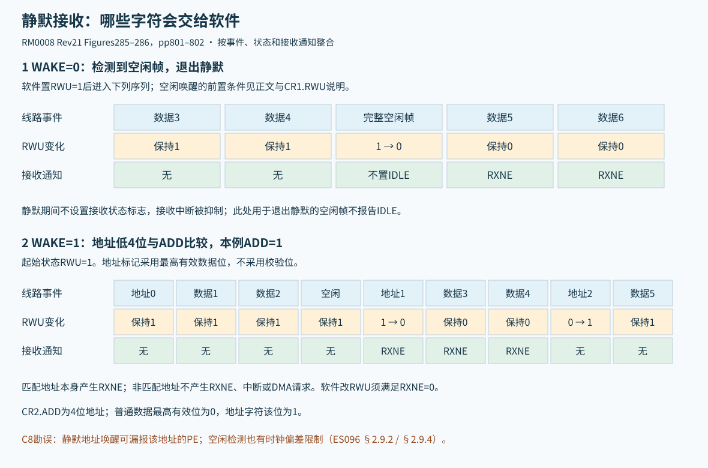
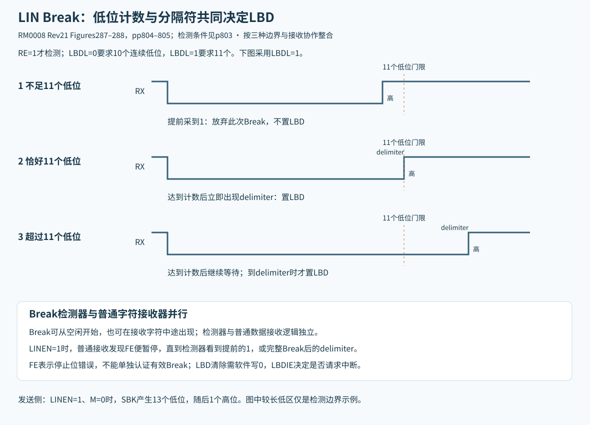
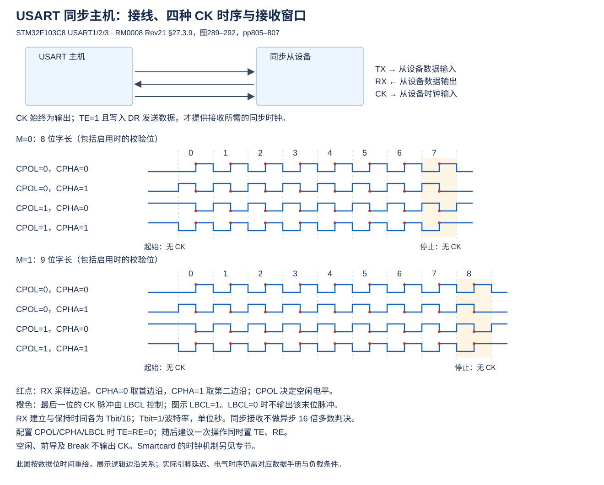
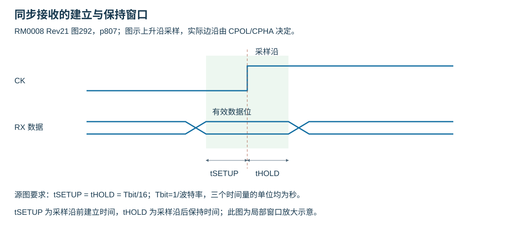
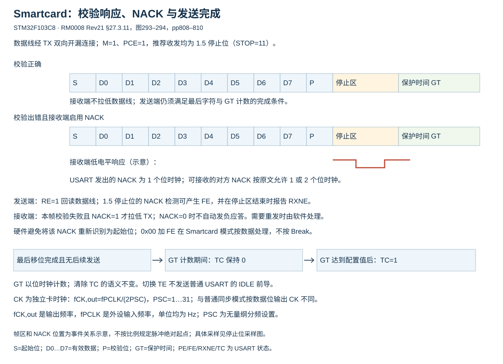
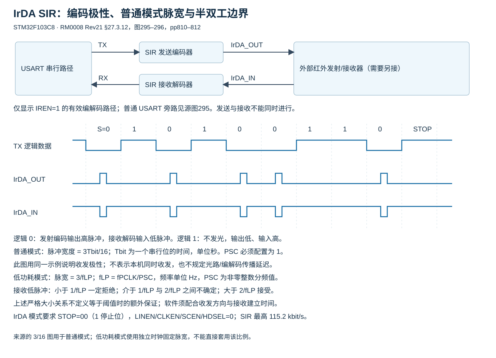
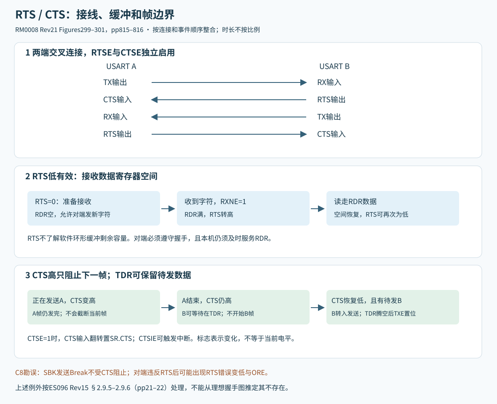
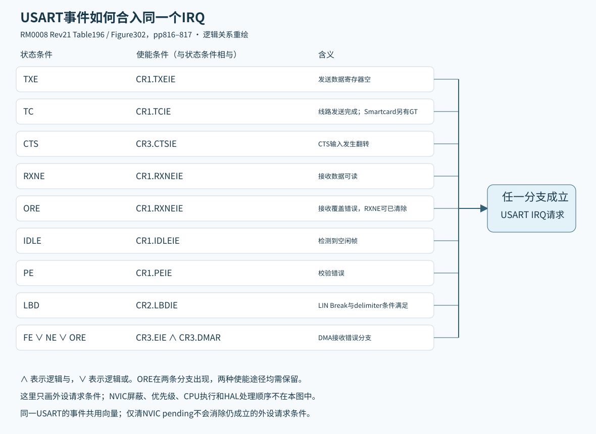

# USART工作模式、线路协作与中断

适用 STM32F103C8 的 USART1/2/3。硬件定义固定于 RM0008 Rev21；以下按模式整合，不代表所有引脚组合在C8封装均可使用。与各模式相关的芯片勘误仍须独立核对。图形整合及保留细节见[图形关系与来源](图形关系与来源.md)。

## 1 多处理器静默与地址过滤

多个从节点可共用主机发送线；回传线必须满足电气线与/驱动仲裁要求，不能把多个普通推挽TX直接并联。RWU=1为静默：接收状态不置位、接收中断被抑制。WAKE选择退出方式。

- WAKE=0：软件置RWU进入静默，检测空闲帧后硬件清RWU，但该次不置IDLE。软件也可清RWU退出。先前必须已收到至少一个数据字节，才能按原文要求使用空闲唤醒静默。
- WAKE=1：数据最高有效数据位=1表示地址字节，其低4位与CR2.ADD比较。不匹配则硬件RWU=1，不对该地址产生RXNE/中断/DMA；匹配则RWU=0，该匹配地址本身产生RXNE，随后正常收数。仅RXNE=0时软件可改RWU，否则写入忽略。

地址标记使用最高**数据**位，不是校验位。PCE=1使硬件发送计算的校验替代字长最高位；接收DR的该位仍为收到的校验位，软件应掩码得到有效数据。PS=0偶校验，让数据+校验的1个数为偶；PS=1奇校验。原例0x35有4个1，偶校验位0，奇校验位1。

来源：[RM0008 Rev21，第801页起](https://www.st.com/resource/en/reference_manual/cd00171190.pdf#page=801)。

## 2 LIN：Break检测与普通接收协作

LINEN=1，M=0，STOP=00；CLKEN、SCEN、HDSEL、IREN保持0。SBK产生13个低位的同步Break，后跟1个高位分隔。LIN报文其余字段、同步字节、PID、校验和等仍由软件协议层组织，USART不等于完整LIN控制器。

独立Break检测器可在空闲或正在接收字符时识别。LBDL=0要求10个连续低位，=1要求11个；还需随后高电平delimiter才置LBD。过早出现1则放弃此次Break识别，重新找起始。LBDIE使能中断，LBD写0清。

Break检测以RE=1为前提；起始识别与普通数据接收相同，随后每一位也在第8/9/10采样点判决。源图287的三种边界为：低电平不够长则丢弃、不置LBD；刚达到所选10/11位且立即出现delimiter则置LBD；低电平继续延长则等待delimiter到达后才置LBD。因而LBD不是在低位计数刚达门限时无条件提前置位。

LINEN=0时普通接收器按USART工作；LINEN=1时发现FE后暂停普通接收，直到Break检测器看见提前的1或完整Break的delimiter。不要仅凭FE就认定已收到合法LIN Break。

来源：[RM0008 Rev21，第803页起](https://www.st.com/resource/en/reference_manual/cd00171190.pdf#page=803)。

## 3 同步主机：时钟边沿与同时收发

CLKEN=1，LINEN、SCEN、HDSEL、IREN=0。CK只作为输出，USART不支持同步从机。CPOL/CPHA决定极性/采样边沿，LBCL决定是否输出最后有效数据位（第8或9位）的时钟。起始位、停止位、空闲前导与Break期间不输出CK脉冲。

发送仍按普通USART帧流程，CK只在TE=1且确有数据发送时产生；所以**同步接收必须同时发送数据**。RE=1时RX按CK边沿采样，不使用异步16倍多数判决；源文要求RX建立与保持时间各为1/16位时间；位时间为所选波特率的倒数。先在TE=RE=0时配置LBCL/CPOL/CPHA，再尽量同一次操作使能TE/RE，运行中不改这三位。

同步USART可连接合适的SPI类从设备，但其LSB先发、帧间起止位间隙、末位CK选项都须匹配设备协议，不能当作所有SPI模式的无条件替代。

来源：[RM0008 Rev21，第805页起](https://www.st.com/resource/en/reference_manual/cd00171190.pdf#page=805)。

## 4 单线半双工：引脚释放与方向协调

HDSEL=1，LINEN/CLKEN/SCEN/IREN=0。内部连接TX与RX路径，外部RX不使用；通过TX一根线收发。不发送时TX释放，应配置成合适的开漏输出/输入状态并提供上拉，不能让空闲推挽输出阻止对端发送。

除引脚合并外基本流程同普通USART。没有硬件总线冲突仲裁；TE=1时写DR就可能发送。软件必须协调角色、等待TC后交出总线，避免双方同时驱动。此模式与Smartcard虽然都是单线，却由不同使能位和协议控制，不能同时设HDSEL、SCEN。

来源：[RM0008 Rev21，第807页起](https://www.st.com/resource/en/reference_manual/cd00171190.pdf#page=807)。

## 5 Smartcard：校验、负应答和保护时间

SCEN=1，LINEN、HDSEL、IREN=0；可设CLKEN向卡提供CK。用于ISO7816-3异步协议：M=1、PCE=1（8位数据+校验），发送/接收推荐STOP=11（1.5位）；接收亦允许0.5位但不能检查FE。

TX是双向开漏数据线。使能RE用于回读自身发送及接收方NACK。Smartcard发送相对普通模式额外保证至少半个位时间的延迟。

接收校验错误且NACK=1时，USART在接收帧完成后拉低TX一个位时间通知卡重发；若NACK=0则不发送此负应答。发送方配置1.5停止位时，在该停止区中部检测到对方拉低，产生FE，同时RXNE在1.5停止区结束时可见。协议允许的对方NACK约1或2个位时间；硬件避免把此NACK当新起始位，重发动作由软件完成。

GT是保护时间，单位为波特率位时钟。最后发送结束后保护计数继续，TC在GT计满前保持0，计满才置1；TC的清除方式不变。Smartcard不把0x00+FE当普通Break，也不会因TE切换发普通IDLE帧。

Smartcard CK独立于每次数据发送，由PCLK预分频产生：

$$
f_{CK,out}=\frac{f_{PCLK}}{2PSC},\quad PSC=1\ldots31
$$

式中 $f_{CK,out}$ 为卡时钟输出频率（Hz），$f_{PCLK}$ 为所选USART外设时钟频率（Hz），$PSC$ 为无量纲整数预分频设置；下标CK,out表示输出时钟，PCLK表示外设时钟。

使用GTPR.PSC[4:0]，高3位无效；0为保留值，不得编程，不能用作关闭时钟的合法分频设置。故CK分频范围2～62，与普通同步模式“只在有效数据位输出时钟”不同。

来源：[RM0008 Rev21，第808页起](https://www.st.com/resource/en/reference_manual/cd00171190.pdf#page=808)。

## 6 IrDA：编码、滤波与转向

IREN=1；LINEN、CLKEN、SCEN、HDSEL=0；STOP=00（1停止位）。支持最高115.2 kbit/s的SIR编解码，仍需外部红外收发器。逻辑0编码为光脉冲，逻辑1无光脉冲；发送编码输出空闲低，接收解码输入空闲高，极性相反。

普通模式IRLP=0，发送脉宽为位时间3/16，GTPR.PSC必须1。低功耗IRLP=1，脉宽固定为预分频时钟3个周期：

$$
f_{LP}=\frac{f_{PCLK}}{PSC},\qquad t_{pulse}=\frac{3}{f_{LP}}
$$

式中 $f_{LP}$ 为IrDA低功耗分频时钟频率（Hz），$f_{PCLK}$ 为USART外设时钟频率（Hz），$PSC$ 为无量纲整数除数，$t_{pulse}$ 为发射脉冲宽度（s）；LP表示低功耗，pulse表示脉冲。

PSC使用8位、不得0。原文推荐低功耗时钟约1.8432 MHz，范围约1.42～2.12 MHz；原文把脉宽与“baud rate”相乘的表述量纲不严谨，上式按时钟周期明确含义。

接收滤波：小于1个PSC周期的低脉冲总被拒绝，1～2周期间可能接受也可能拒绝，大于2周期接受。IrDA规定需接受大于1.41 μs的有效脉冲，选PSC应同时满足滤波和脉宽条件。

IrDA为半双工：发送忙时忽略接收，接收忙时发送不能正常编码，软件必须避免同时收发并管理方向转换。原文要求发送与接收之间至少10 ms的接收建立/转向延迟；低功耗接收与普通接收类似，亦可接收低功耗发送器。

来源：[RM0008 Rev21，第810页起](https://www.st.com/resource/en/reference_manual/cd00171190.pdf#page=810)。

## 7 RTS/CTS：硬件缓冲与帧边界

RTSE与CTSE可独立启用，两者均低有效。RTS低表示本机RDR有接收空间，满后拉高，期待对端在当前字符结束后停止；CTS低才允许开始下一帧，若帧中CTS变高，当前帧发完再停。CTS高时写入TDR的数据保持等待，低后继续。

CTS输入翻转置SR.CTS，CTSIE可中断，写0清。该标志是“发生变化”，不是当前引脚电平。相连两端应TX↔RX、RTS↔CTS交叉。RTS反映硬件单字缓冲能力，不了解应用环形缓冲或解析器容量，软件仍须足够快地取数。

来源：[RM0008 Rev21，第815页起](https://www.st.com/resource/en/reference_manual/cd00171190.pdf#page=815)。

## 8 中断事件与使能条件

同一个USART的全部事件合入其单一IRQ，处理函数检查状态与使能。

|标志|使能|
|---|---|
|TXE|CR1.TXEIE|
|TC|CR1.TCIE|
|RXNE或ORE|CR1.RXNEIE|
|IDLE|CR1.IDLEIE|
|PE|CR1.PEIE|
|LBD|CR2.LBDIE|
|CTS|CR3.CTSIE|
|FE/NE/ORE的DMA接收错误|CR3.DMAR且CR3.EIE|

无数据待发时关闭TXEIE，否则TXE持续为1会不断请求中断。不能只清NVIC pending而不处理外设条件。

来源：[RM0008 Rev21，第816页起](https://www.st.com/resource/en/reference_manual/cd00171190.pdf#page=816)。

## 9 C8实例的模式能力

RM0008 Rev21 Table197（p817）对USART1、USART2、USART3给出相同的九项支持。这里按C8实际实例收敛，UART4/5列不属于本芯片。

|功能|USART1|USART2|USART3|
|---|---|---|---|
|异步模式|支持|支持|支持|
|RTS/CTS硬件流控|支持|支持|支持|
|DMA多缓冲通信|支持|支持|支持|
|多处理器通信|支持|支持|支持|
|同步主机|支持|支持|支持|
|Smartcard|支持|支持|支持|
|单线半双工|支持|支持|支持|
|IrDA|支持|支持|支持|
|LIN|支持|支持|支持|

表中的支持仅描述外设能力。复用引脚、封装引出、DMA通道冲突、时钟上限和硅勘误仍分别约束可用配置；同步模式仍只支持主机。

来源：[Table197，RM0008 Rev21 p817](https://www.st.com/resource/en/reference_manual/cd00171190.pdf#page=817)。
