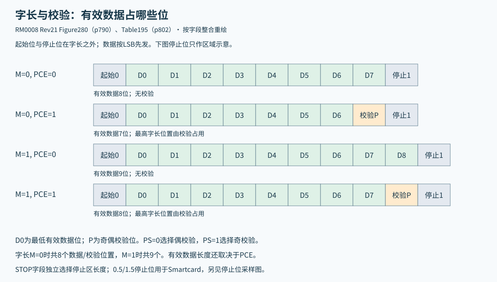
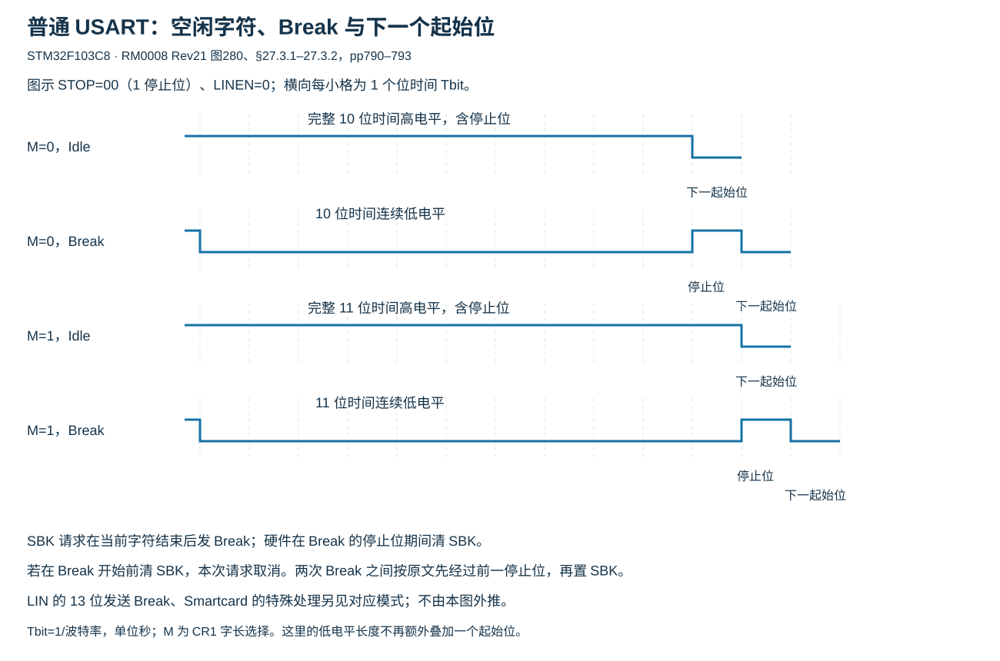
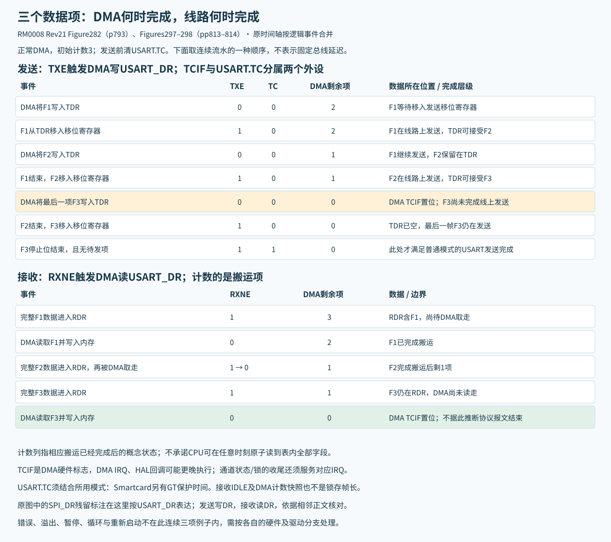
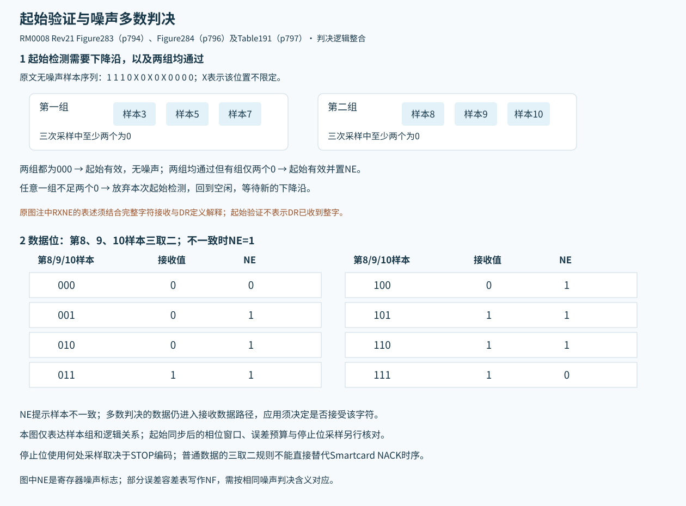
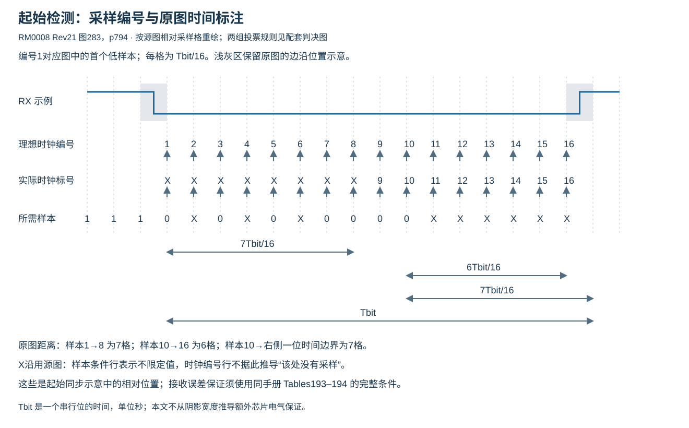
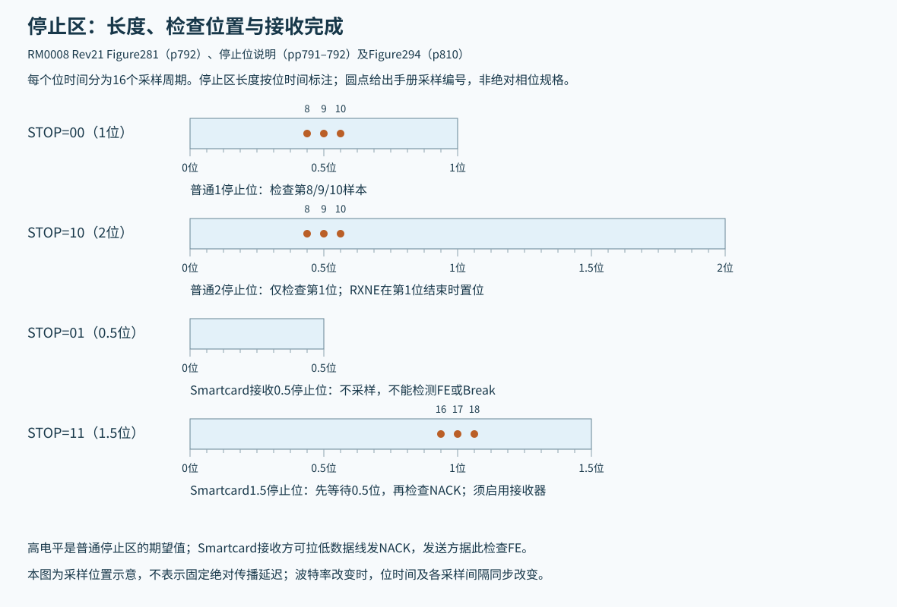

# USART 帧格式、波特率与接收错误

适用 STM32F103C8 的 USART1/2/3，固定 RM0008 Rev21。硬件帧、寄存器标志、DMA 完成与软件回调应按各自条件理解。本页的分频和容差数值不替代板卡时钟、线路及对端的验证。

## 1 数据寄存器与有效载荷



USART_DR 使用一个地址访问分离的发送缓冲 TDR 和接收缓冲 RDR：写入送向发送端，读取取自接收端。两侧还各有移位寄存器。CPU 与 DMA 都可能访问 DR，因此读 DR 及清标志责任必须统一；不能让两个消费者各自认为自己取得了唯一的一份接收数据。

普通串行字符以低电平起始位开始，数据最低有效位先传，最后为高电平停止位。CR1.M 选择的字长包含可选校验位。

|CR1.M|CR1.PCE|有效数据位数|校验位数|
|---:|---:|---:|---:|
|0|0|8|0|
|0|1|7|1|
|1|0|9|0|
|1|1|8|1|

CR2.STOP 的 00/01/10/11 编码依次表示 1/0.5/2/1.5 个停止位。普通 USART、单线半双工及流控场景使用 1 或 2 位；0.5 位用于 Smartcard 接收，1.5 位用于 Smartcard 收发。具体模式的配置还须满足该模式的其余条件。

来源：[RM0008 图279–281及§27.3.1–27.3.2，pp789–792](https://www.st.com/resource/en/reference_manual/cd00171190.pdf#page=789)、[Table195](https://www.st.com/resource/en/reference_manual/cd00171190.pdf#page=802)。

### 普通模式下的 Idle 与 Break



Idle 字符是一整个帧长度的高电平，长度包含所配置的停止位；下一数据帧用下降沿开始其起始位。置 TE 后会在首个数据帧前发送空闲前导。

普通模式（LINEN=0）的发送 Break 在 M=0 时为 10 个低电平位时间，M=1 时为 11 个，随后接配置的停止位高电平。这里低电平长度已包括普通帧的起始/数据/停止位置，不能再自行加上一个低电平起始位。LIN 模式的 13 位 Break 另按该模式说明，不能由普通模式数值推导。

SBK=1 请求在当前字符完成后发送 Break；硬件在 Break 的停止位期间清 SBK。若软件在 Break 开始前先清 SBK，本次 Break 不会发出。要发送两次连续 Break，原文要求在前一个 Break 停止位之后再次置 SBK，不能把反复写 1 当作无限长连续低电平保证。Smartcard 的 Break/Idle 解释另见模式专节。

来源：[RM0008 §27.3.1–27.3.2、图280，pp790–793](https://www.st.com/resource/en/reference_manual/cd00171190.pdf#page=790)。

## 2 发送完成层级



|条件|能确认的阶段|不能由此单独确认|
|---|---|---|
|TXE=1|TDR 可接收下一项数据|线路上的当前字符已结束|
|本次发送的 DMA TC|设定的最后一项已经搬到外设数据端|USART 最后停止位已发完|
|本次发送的 USART TC=1|最后帧已发送且 TXE=1，没有下一项等待发送|协议对端已经接收、校验或确认|

TDR 在当前帧仍发送时可以保存下一帧。最后写 DR 后，应等待对应本次发送的 TC，再关闭外设、切换需要释放线路的方向或进入会中断发送的低功耗。DMA 发送前清理旧 TC，避免把上次残留状态误作本次完成。

TC 可以由先读 SR 再写 DR 的序列清除，也可写 0 清除；原文把写 0 清除方式推荐用于多缓冲通信。TXE 由写 DR 清除，不能按一般写 0 清除位处理。需同时遵守 ES096 的全双工校验错误保存条件。

普通模式下，置 TE 会产生空闲前导。传输中清 TE 可能冻结计数器、破坏当前字符，不能把它作为无条件安全的暂停动作。Smartcard 的空闲前导行为另有条件。

来源：[RM0008 §27.3.2与图282，pp791–794](https://www.st.com/resource/en/reference_manual/cd00171190.pdf#page=791)。

## 3 起始位、噪声与停止位采样







异步接收采用 16 倍过采样。起始检测包含下降沿及两个三样本判决组：第3/5/7点和第8/9/10点，各组都须至少两个样本为0。两组均全0时没有该项噪声标志；任一有效组仅两个0时置NE；任一组不足两个0则放弃本次起始识别、回到空闲等待。原图样本模式为“1 1 1 0 X 0 X 0 X 0 0 0 0”，X为未规定固定值的采样位置。

图283下注释将起始验证与RXNE置位并列叙述。结合p795的接收过程，RXNE用于报告完成接收并送入RDR的数据，不能据那句注释把DR理解成在起始位就含有完整字符。本页保留这一原文表述差异，不将其作为ST正式勘误。

数据位在第8/9/10点多数判决，Table191的全部组合如下。NE=1表示检测到噪声；多数判决仍有输出，不构成数据可靠性保证。

|三个样本|NE|判决数据位|原表数据有效性|
|---|---:|---:|---|
|000|0|0|有效|
|001|1|0|无效|
|010|1|0|无效|
|011|1|1|无效|
|100|1|0|无效|
|101|1|1|无效|
|110|1|1|无效|
|111|0|1|有效|

停止位的接收检查条件分别为：

- 1位：在停止位第8/9/10采样点判断。
- 2位：只检查第一停止位，并在第一停止位结束时置RXNE；第二停止位不再检查帧错误。
- 0.5位：不采样停止位，因此该设置不能检测帧错误或Break。
- 1.5位Smartcard：先经过0.5位时间，再在整个停止区的第16/17/18点采样。发送方需RE=1来检测接收方拉低线路的NACK；此时FE与RXNE在1.5位结束时报告。

来源：[RM0008 图283–284与Table191，pp794–797](https://www.st.com/resource/en/reference_manual/cd00171190.pdf#page=794)、[停止位接收条件](https://www.st.com/resource/en/reference_manual/cd00171190.pdf#page=798)。上述16倍多数判决不直接套用于同步接收。

## 4 接收错误与读取副作用

|标志|事件及数据后果|处理边界|
|---|---|---|
|ORE|新字符到达时旧RDR尚未被取走，或DMA请求未及时服务；至少丢失一个数据项|旧RDR可能仍可读；若RXNE已为0，旧项可能刚被CPU/DMA取走，不能把下一次DR读当作恢复丢失的新项|
|NE|多数采样不一致，判决数据仍送入DR|按数据与协议策略处置，不把多数结果当作无错证明|
|FE|停止位在预期时刻未识别为高；可能来自失同步、噪声或普通模式Break|错误数据仍可能进入DR；Smartcard的NACK解释须按其模式处理|
|PE|校验检查失败|按ES096要求等待RXNE后再清；全双工发送可能影响错误保存|
|IDLE|检测到空闲帧|不是通用协议的唯一完整帧判据；清后还须发生新的RXNE才会再次报告IDLE|

这些相关状态通常通过先读SR再读DR清除。该序列可能同时清多个标志并取得或消耗接收数据，因此应先保存状态，统一CPU、DMA及调试器对DR的访问责任。清错误不恢复丢失的数据。FE与ORE同时出现的指定情形按原文只报告ORE。

ORE可由RXNEIE触发中断，也可在DMAR与EIE同时使能时触发错误中断。NE/FE的DMA错误中断同样依赖DMAR和EIE；单字模式通常随RXNE检查。中断使能位与状态位应分别检查，清NVIC挂起位不能替代处理外设事件。

来源：[RM0008 接收、ORE与噪声/帧错误，pp795–798](https://www.st.com/resource/en/reference_manual/cd00171190.pdf#page=795)、[SR定义，pp818–819](https://www.st.com/resource/en/reference_manual/cd00171190.pdf#page=818)。本页仍须与硅勘误及所选驱动版本的具体收尾分支一起使用。

## 5 波特率的寄存器解释

```math
\mathrm{USARTDIV}=M_D+\frac{F_D}{16}
```

USARTDIV为无量纲分频系数； $`M_D`$ 是BRR[15:4]的12位整数部分，范围0～4095； $`F_D`$ 是BRR[3:0]的4位分数编码，范围0～15。下标D表示分频字段，不是CR1.M字长位。

```math
B=\frac{f_P}{16M_D+F_D}
```

B为位率，单位bit/s； $`f_P`$ 为USART外设时钟，单位Hz。USART1使用PCLK2，USART2/3使用PCLK1。有效分频须满足USARTDIV≥1，即最终BRR整数不小于16；该范围还须与所用时钟、驱动的整数运算及器件规格共同检查。

原例BRR=0x1BC对应27.75；目标USARTDIV=25.62量化为25.625、BRR=0x19A；50.99的分数舍入至16后向整数进位，得到51、BRR=0x330。写BRR立即更新波特率计数器，不在通信中任意修改。

分频量化须以最终BRR复算。软件返回的整数位率可能截去小数；SUCCESS或非零GetBaudRate不能替代有效范围及目标误差检查，详见本主题LL固定实现边界。

来源：[RM0008 §27.3.4，pp798–799](https://www.st.com/resource/en/reference_manual/cd00171190.pdf#page=798)。


## 6 标准位率算例与总误差预算

下表整合RM0008 Table192，位率单位均为kbit/s。斜杠后为USARTDIV，不是直接写入BRR的整数；实际写值为该分频系数乘16。小数位率为显示近似值。

|目标位率|36 MHz：实际位率 / USARTDIV|72 MHz：实际位率 / USARTDIV|
|---:|---|---|
|2.4|2.4 / 937.5|2.4 / 1875|
|9.6|9.6 / 234.375|9.6 / 468.75|
|19.2|19.2 / 117.1875|19.2 / 234.375|
|57.6|57.6 / 39.0625|57.6 / 78.125|
|115.2|115.3846 / 19.5|115.2 / 39.0625|
|230.4|230.7692 / 9.75|230.7692 / 19.5|
|460.8|461.5385 / 4.875|461.5385 / 9.75|
|921.6|923.0769 / 2.4375|923.0769 / 4.875|
|2250|2250 / 1|2250 / 2|
|4500|不可用|4500 / 1|

```math
e_B=\frac{B_{\mathrm{actual}}-B_{\mathrm{target}}}{B_{\mathrm{target}}}
```

$`e_B`$ 为无量纲相对位率误差，乘100%表示百分比； $`B_{\mathrm{actual}}`$ 与 $`B_{\mathrm{target}}`$ 分别为按最终寄存器复算的位率和目标位率，单位均为bit/s或同时使用kbit/s。下标actual/target分别表示实际配置/目标。表中相等项误差为零，其余非零项按未截断频率复算均约为+0.160256%。原表将36 MHz、115.2 kbit/s一项列为0.15%，其余同类项列为0.16%；应保留该显示差异，不能据0.15%承诺更小误差。

表内4.5 Mbit/s和2.25 Mbit/s是指定外设时钟下的发生器边界，实际可靠通信仍受电气、线路及搬运条件影响。改变时钟后应重算，不将固定算例直接搬到其他PCLK。来源：[RM0008 Table192及脚注](https://www.st.com/resource/en/reference_manual/cd00171190.pdf#page=799)。

`D_TRA+D_QUANT+D_REC+D_TCL < D_tol`

各D均为无量纲偏差预算，也可全部一致地用百分比表示。TRA为发送端误差并包含其振荡器误差；QUANT为接收端波特率量化误差；REC为接收端振荡器误差；TCL为传输链路高低跃迁不对称造成的误差；tol为接收机可容许的总偏差。保守预算不能依靠未经保证的正负误差抵消，也不能将整个容差分别完整分给两端。

|BRR分数编码|CR1.M|将噪声标志作为错误|不要求噪声标志为零|
|---|---:|---:|---:|
|0|0|3.75%|4.375%|
|0|1|3.41%|3.97%|
|非0|0|3.33%|3.88%|
|非0|1|3.03%|3.53%|

原表将噪声标志写为NF，C8的USART_SR字段名为NE。这里的M是字长控制位，区别于分频整数 $`M_D`$ 。原表还指出：接收流中插入恰为10位时间（M=0）或11位时间（M=1）的空闲帧时，容差可能稍有变化。表值不解除ES096关于IDLE丢失的独立限制。来源：[RM0008 Tables193–194及脚注](https://www.st.com/resource/en/reference_manual/cd00171190.pdf#page=800)。
