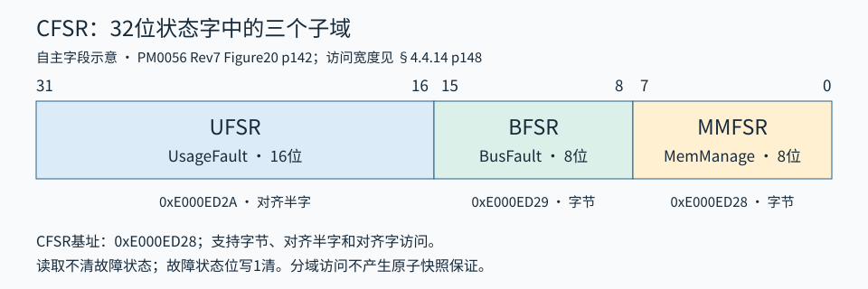

# 内核寄存器参数

下列中文标题用于检索；真实原厂位置见各来源记录，不能将中文重新分组编号当原厂章节。只覆盖本主题所引NVIC、向量、故障和SysTick部分。

## 4.3 NVIC

NVIC 提供外部中断使能、挂起、激活、动态优先级、抢占/子优先级分组、边沿/电平检测和尾链；NMI 为独立的不可屏蔽异常。异常入口硬件保存上下文，异常返回硬件恢复，相关栈帧和抢占规则见[处理器模型](异常与屏蔽参数.md)。

C8 每个可配置优先级实现 4 位，逻辑级别 0～15；数值越小优先级越高。优先级字节的高四位有效，低四位读 0、写忽略。

### 4.3.1 CMSIS 映射与索引

ISER、ICER、ISPR、ICPR、IABR 在 CMSIS 中各为 32 位数组。设 N 为外部 IRQ 编号（0～42），则寄存器数组下标 k=N DIV 32，字内位 b=N MOD 32；DIV 为整除，MOD 为余数，k、b、N 都是无量纲整数。

| IRQ | 数组元素 | 有效位 |
|---|---|---|
| 0～31 | ISER/ICER/ISPR/ICPR/IABR[0] | bit 0～31 |
| 32～42 | 对应数组[1] | bit 0～10 |
| 43 以后 | 不属于 C8 的有效外部 IRQ | 不配置、不触发 |

优先级 `NVIC->IP[N]` 是一个字节，不是第 N 个 32 位 IPR。第 m 个 32 位 IPR 包含 IRQ4m～IRQ4m+3 的四个优先级字节。原文把 IP 数组字节与 IPR 字编号混称，并混入其他系列 IRQ 数量，本文使用以下确定映射：

- m=N DIV 4；字内字节偏移 j=N MOD 4。
- 寄存器地址=0xE000E400+4m；单个优先级字节地址=0xE000E400+N。
- j=0/1/2/3 对应寄存器位[7:0]/[15:8]/[23:16]/[31:24]。
- C8 使用 IP[0]～IP[42]，对应 IPR0～IPR10；IPR10 只有前三个字节属于 IRQ40～42。

式中地址偏移单位为字节，4 表示每个 IPR 占四字节。原图 19 的通用布局已按上述中文表述重建，不将其中 IP[80] 当作 C8 实现。

### 4.3.2～6 使能、挂起和激活位图

以下所有有效位复位为 0，均为特权寄存器。各组 k 在 C8 取 0、1，仅按上表访问有效位。原文各小节重复写成局部偏移 0x00～0x0B，不可将它们都当成相对同一个 NVIC 基址；下表给出绝对地址消除歧义。

| 寄存器组 | 绝对地址 | 位字段 | 写 0 | 写 1 | 读取 |
|---|---|---|---|---|---|
| ISER[k] | 0xE000E100+4k | SETENA[31:0] | 无影响 | 使能对应 IRQ | 1=已使能，0=禁止 |
| ICER[k] | 0xE000E180+4k | CLRENA[31:0] | 无影响 | 禁止对应 IRQ | 1=已使能，0=禁止 |
| ISPR[k] | 0xE000E200+4k | SETPEND[31:0] | 无影响 | 置挂起 | 1=挂起，0=未挂起 |
| ICPR[k] | 0xE000E280+4k | CLRPEND[31:0] | 无影响 | 清除挂起 | 1=挂起，0=未挂起 |
| IABR[k] | 0xE000E300+4k | ACTIVE[31:0] | 只读 | 只读 | 1=激活或激活且再次挂起；0=未激活 |

- ISER 使能已经挂起的 IRQ 后，NVIC 按优先级和屏蔽条件决定何时激活。
- IRQ 禁止时请求仍可进入挂起，只是不能激活。禁止 IRQ 不自动清挂起。
- 对已挂起 IRQ 再写 ISPR=1 不增加排队次数；对禁止 IRQ 写 1 仍置挂起。
- 写 ICPR 清挂起不清激活，也不代替清外设源标志；电平源仍有效时可继续挂起。
- IABR 反映所有激活层，包括被更高优先级抢占的处理程序，不只是当前执行者。
- 写一位操作直接写掩码即可；不要为了清/置一个 IRQ 对这些寄存器做不必要的整字读改写。

### 4.3.7 优先级 IPR

IPR 的有效优先级字节读写，复位 0，特权访问，支持字节访问。每字节 bit[7:4] 为优先级，bit[3:0] 未实现，读 0、写忽略。直接寄存器写入值通常为逻辑级别左移 4 位；CMSIS `NVIC_SetPriority()` 的参数使用未左移的逻辑优先级，由函数按实现位数编码，不能重复左移。

例如逻辑优先级 5 对应字节 0x50。这不是不同的两个优先级值，而是应用接口与寄存器编码的区别。抢占由 PRIGROUP 分出的组优先级决定，子优先级只在不能相互抢占的待处理请求之间排序。

### 4.3.8 STIR 软件触发

地址 0xE000EF00，复位值 0；INTID[8:0] 只写，bits[31:9] 保留并写 0。写入 IRQ 编号使对应外部中断挂起，编号不加 16，例如写 3 对应 IRQ3，不是异常号 3 的 HardFault。

原文介绍架构允许 INTID=0～239；C8 只能使用实际 IRQ0～42。是否已使能不影响置挂起，是否立即执行还受 NVIC 使能和优先级屏蔽控制。默认仅特权软件可访问；CCR.USERSETMPEND=1 后允许非特权软件访问，由特权软件设置此权限。

**原文订正：**把 USERSETMPEND 所在寄存器写成 SCR，并把 INTID 漏写为 NTID；正确为 CCR.bit1 和 INTID[8:0]。

### 4.3.9 电平请求、脉冲请求及状态转换

电平请求由外设保持有效直到外设撤销，通常 ISR 清除产生请求的外设条件。脉冲请求在处理器时钟上升沿同步采样，需至少保持一个时钟周期以便 NVIC 检出并锁存。

IRQ 可因以下原因挂起：NVIC 检测到请求为高且该 IRQ 未激活；检测到请求上升沿；软件写 ISPR 或 STIR。挂起状态保持，直到进入对应 ISR 或软件清除挂起。

进入 ISR 时硬件去掉原挂起、置激活：

- 电平源在退出 ISR 前已撤销：退出后转为未激活；仍有效则再次挂起，可能立即重入。
- 脉冲源在 ISR 内又到达：成为激活且挂起，返回后剩下挂起，随后再次服务；未再次到达则返回后未激活。
- 软件清电平 IRQ 的挂起时，若源仍有效，不能据此长期清除请求；必须处理源。
- 软件清脉冲 IRQ 挂起时，单纯挂起变为未激活；激活且挂起变为仅激活。

单个挂起位不是事件计数器。外设在处理程序执行期间产生多少次事件，是否合并、是否丢失，还取决于外设标志和数据缓冲机制。

### 4.3.10 编程约束及 CMSIS 接口

NVIC 不支持非对齐访问。位图按对齐字访问，优先级可按字节访问。迁移 VTOR 前必须完成新表中 NMI、故障处理及所有已使能异常入口的初始化，避免在切换窗口进入未准备好的处理程序。

| CMSIS 接口 | 作用 |
|---|---|
| `void NVIC_SetPriorityGrouping(uint32_t priority_grouping)` | 写 PRIGROUP |
| `void NVIC_EnableIRQ(IRQn_Type IRQn)` | 使能外部 IRQ |
| `void NVIC_DisableIRQ(IRQn_Type IRQn)` | 禁止外部 IRQ |
| `uint32_t NVIC_GetPendingIRQ(IRQn_Type IRQn)` | 返回该 IRQ 是否挂起的状态，非返回 IRQ 编号 |
| `void NVIC_SetPendingIRQ(IRQn_Type IRQn)` | 置挂起 |
| `void NVIC_ClearPendingIRQ(IRQn_Type IRQn)` | 清挂起 |
| `uint32_t NVIC_GetActive(IRQn_Type IRQn)` | 返回该 IRQ 是否激活的状态，非返回当前 IRQ 编号 |
| `void NVIC_SetPriority(IRQn_Type IRQn,uint32_t priority)` | 设置实现范围内的逻辑优先级 |
| `uint32_t NVIC_GetPriority(IRQn_Type IRQn)` | 读取逻辑优先级 |
| `void NVIC_SystemReset(void)` | 发起系统复位 |

`__disable_irq()` / `__enable_irq()` 使用 PRIMASK 全局屏蔽/开放可配置异常，与 NVIC 单路使能不同。上述 GetPendingIRQ/GetActive 的原文说明将布尔状态误写成 IRQ number，已订正。用字节优先级接口避免普通整字读改写损坏同一 IPR 中其他 IRQ 的值；涉及动态分组和多步配置时仍需自行保证一致性。

### 4.3.11 C8 有效 NVIC 寄存器地址清单

| 组 | 第 0 字 | 第 1 字 | C8 有效位/字节 | 复位 |
|---|---|---|---|---|
| ISER | 0xE000E100 | 0xE000E104 | 第一字全部；第二字低 11 位 | 0 |
| ICER | 0xE000E180 | 0xE000E184 | 同上 | 0 |
| ISPR | 0xE000E200 | 0xE000E204 | 同上 | 0 |
| ICPR | 0xE000E280 | 0xE000E284 | 同上 | 0 |
| IABR | 0xE000E300 | 0xE000E304 | 同上 | 0 |
| IPR0～IPR10 | 0xE000E400 起，间隔 4 字节 | 末字 0xE000E428 | 单字节地址至 0xE000E42A；每字节高 4 位 | 0 |
| STIR | 0xE000EF00 | 不适用 | INTID[8:0]，实际编号 0～42 | 0 |

## 4.4 SCB 系统控制块

SCB 提供内核识别、向量表、异常状态、复位、低功耗及故障诊断。寄存器基址为 0xE000ED00。CMSIS 的 SHP 是 12 个字节，即 SHP[0]～SHP[11]；原文写到 SHP[12] 多算了一项。

### 4.4.3 ICSR 中断控制与状态

地址 0xE000ED04，原文复位 0。只读状态随执行环境立即变化，不能用复位表数值代替运行时状态。VECTACTIVE 是只读硬件状态，不能按原位图误标的 rw 直接改当前异常。

| 位 | 字段 | 访问及语义 |
|---|---|---|
| 31 | NMIPENDSET | 读为 NMI 是否挂起；写 1 置挂起，写 0 无影响 |
| 30:29 | 保留 | 写 0 |
| 28 | PENDSVSET | 读为 PendSV 是否挂起；写 1 置挂起，写 0 无影响 |
| 27 | PENDSVCLR | 只写；写 1 清 PendSV 挂起，写 0 无影响 |
| 26 | PENDSTSET | 读为 SysTick 是否挂起；写 1 置挂起，写 0 无影响 |
| 25 | PENDSTCLR | 只写；写 1 清 SysTick 挂起；读取值不能依赖 |
| 24 | 保留 | 写 0 |
| 23 | 调试相关状态 ISRPREEMPT | PM0056 将其保留供调试，非调试状态读 0；不作为应用可写控制 |
| 22 | ISRPENDING | 只读；有外部中断挂起时为 1，不含 NMI 和故障 |
| 21 | 保留 | 写 0，见下方原文订正 |
| 20:12 | VECTPENDING[8:0] | 只读；优先级最高的已使能挂起异常号，0 表示没有 |
| 11 | RETTOBASE（原文 RETOBASE） | 只读；0 表示还有被抢占的激活异常；1 表示没有激活异常或当前异常是唯一激活者 |
| 10:9 | 保留 | 写 0 |
| 8:0 | VECTACTIVE | 只读；0 表示 Thread，非零为当前异常号，与 IPSR[8:0] 一致 |

NMI 通常会在置挂起后立即进入处理程序，入口自动清其挂起位；NMI 处理中读到该位为 1 表明又有 NMI 请求。PendSV 通过软件写 PENDSVSET 置挂起。不能一次同时写 PENDSVSET/PENDSVCLR 为 1，也不能同时写 PENDSTSET/PENDSTCLR 为 1，否则行为不可预测。

VECTPENDING 的选择考虑 BASEPRI、FAULTMASK，但不考虑 PRIMASK。VECTACTIVE 是异常号，只有外部 IRQ 才可减 16 转成 NVIC 下标，不能对 NMI/故障等内核异常这样操作。

以下 CMSIS 补证使用的是较新的 CMSIS_5 `core_cm3.h`，用于核对 Cortex-M3 架构字段，不代表 UM1847 所述历史软件包已包含同一版本；VTOR 还按 `__CM3_REV < 0x0201` 区分旧核和 r2p1 以后实现。

**原文订正：**PM0056 把 VECTPENDING 写为 [21:12] 的十位字段；Cortex-M3 CMSIS 掩码为 `0x1FF << 12`，即 [20:12] 九位，bit 21 保留。VECTACTIVE 的图示访问属性也应为只读。[Arm 官方 Cortex-M3 CMSIS 定义](../来源/驱动实现.md#src-cmsis590-cm3)

### 4.4.4 VTOR 向量表偏移

地址 0xE000ED08，复位 0，读写。

| 位 | PM0056 的器件约定 | 使用要求 |
|---|---|---|
| 31:30 | 保留 | 写 0 |
| 29:9 | TBLOFF | 相对 0x00000000 的向量表偏移地址高位；bit 29 也称 TBLBASE，0 选 Code 区，1 选 SRAM 区 |
| 8:0 | 该手册规定保持 0 | 按 0x200 字节边界布置表 |

PM0056 采用最少 128 字（512 字节）的保守 STM32 向量表对齐约定。本参考按此约定使用 0x200 对齐，与 ST 常见启动代码一致。需要区分：Cortex-M3 架构的 VTOR 可写偏移最低位在 bit 7，表的实际最小对齐还随已实现向量数向上取 2 的幂；不能把原文 [29:9] 误认成所有 Cortex-M3 内核的通用位定义。对 C8 保持 512 字节对齐是满足要求的安全选择。[Arm 官方 VTOR 定义](../来源/驱动实现.md#src-cmsis590-cm3)

新表必须先完整写好再切换 VTOR，包括初始 MSP 和故障入口；切换后采用适当 DSB/ISB 保证后续异常使用预期上下文。写入地址必须确实落在 C8 有效 Flash/SRAM，VTOR 不会扩展实际容量。

### 4.4.5 AIRCR 应用中断及复位控制

地址 0xE000ED0C，读复位值 0xFA050000。任何有效写操作必须同时向 VECTKEY 写 0x05FA，否则整次写入被忽略。

| 位 | 字段 | 访问及含义 |
|---|---|---|
| 31:16 | VECTKEYSTAT / VECTKEY | 读得到 0xFA05；写必须为 0x05FA |
| 15 | ENDIANESS | 只读 0，小端 |
| 14:11 | 保留 | 写 0 |
| 10:8 | PRIGROUP | 读写；划分组优先级与子优先级 |
| 7:3 | 保留 | 写 0 |
| 2 | SYSRESETREQ | 写 1 请求系统复位；写 0 不请求；读 0 |
| 1 | VECTCLRACTIVE | 保留供调试；应用写 0，读 0 |
| 0 | VECTRESET | 保留供调试；应用写 0，读 0 |

SYSRESETREQ 请求复位主要系统组件，调试域不因此必然复位；它不是软件仅复位某个外设的接口。直接对 AIRCR 做普通 `|=` 会把读出的 0xFA05 回写成错误键，必须重建带 0x05FA 的写值并保持需要的 PRIGROUP。

C8 的 4 个实现优先级位按下表分组。组优先级决定抢占；子优先级只影响同组待处理请求的先后。

| PRIGROUP | 优先级字节高 4 位分配 | 抢占优先级位数/等级 | 子优先级位数/等级 |
|---|---|---|---|
| 0、1、2、3 | 全部为组优先级 | 4 位，16 级 | 0 位，1 种 |
| 4 | [7:5] 组，[4] 子 | 3 位，8 级 | 1 位，2 级 |
| 5 | [7:6] 组，[5:4] 子 | 2 位，4 级 | 2 位，4 级 |
| 6 | [7] 组，[6:4] 子 | 1 位，2 级 | 3 位，8 级 |
| 7 | 全部为子优先级 | 0 位，1 种 | 4 位，16 级 |

原表 45 从编码 3 开始列五种不同划分；0～2 在只实现高四位的 C8 上同样得到 4 个抢占位，并不是更多可用优先级位。库中“Group 0～4”的命名可能与 PRIGROUP 原始编码相反，必须查看宏实际值。

### 4.4.9 SHCSR 系统异常使能与状态

地址 0xE000ED24，复位 0。下面字段均可读写，但“可写激活状态”是操作系统上下文管理能力，不是普通应用取消异常的快捷方法。

| 位 | 字段 | 读写语义 |
|---|---|---|
| 18 | USGFAULTENA | 1 使能 UsageFault，0 禁止 |
| 17 | BUSFAULTENA | 1 使能 BusFault，0 禁止 |
| 16 | MEMFAULTENA | 1 使能 MemManage，0 禁止 |
| 15 | SVCALLPENDED | 1 表示 SVCall 挂起，可写改变状态 |
| 14 | BUSFAULTPENDED | BusFault 挂起 |
| 13 | MEMFAULTPENDED | MemManage 挂起 |
| 12 | USGFAULTPENDED | UsageFault 挂起 |
| 11 | SYSTICKACT | SysTick 激活 |
| 10 | PENDSVACT | PendSV 激活 |
| 8 | MONITORACT | DebugMonitor 激活 |
| 7 | SVCALLACT | SVCall 激活 |
| 3 | USGFAULTACT | UsageFault 激活 |
| 1 | BUSFAULTACT | BusFault 激活 |
| 0 | MEMFAULTACT | MemManage 激活 |

bits[31:19]、bit 9、bits[6:4]、bit 2 保留写 0。PENDED 状态为 0 表示未挂起；ACT 为 0 表示未激活。

未使能的可配置故障发生时，处理器按 HardFault 升级规则处理。若软件改激活位却没有同步维护异常栈和上下文，会造成新故障；修改前必须保存、随后正确恢复当前激活状态。已使能故障处理后更改单个位，使用保留其他可写位的读改写，但应考虑硬件并发状态变化，避免不加区分地覆写状态。

### 4.4.10 CFSR 可配置故障状态

地址 0xE000ED28，复位 0。故障状态为粘滞记录；对应有效位写 1 清除，写 0 不影响，不应按原图中低半字的笼统 rw 标注做普通赋值清零。先保存故障信息，再以需要清除的掩码写回。[Arm Cortex-M3 r1p1 故障状态定义](../来源/Arm_DDI0337E.md#src-arm-cm3-r1p1-fault-w1c)

| CFSR位范围 | 子寄存器 | 位宽 | 独立访问地址 |
|---|---|---|---|
| 31:16 | UFSR | 16位 | 0xE000ED2A（半字） |
| 15:8 | BFSR | 8位 | 0xE000ED29（字节） |
| 7:0 | MMFSR | 8位 | 0xE000ED28（字节） |

按PM0056 Figure20 p142自行整理字段布局。CFSR基址0xE000ED28，可对齐32位访问；子域不是独立清零机制。

图中高 16 位 UFSR 是用法故障状态，中间 8 位 BFSR 是总线故障状态，低 8 位 MMFSR 是存储器管理故障状态。中文访问表如下：

| 访问地址 | 宽度 | 覆盖 |
|---|---|---|
| 0xE000ED28 | 32 位字 | 完整 CFSR |
| 0xE000ED28 | 8 位字节 | MMFSR |
| 0xE000ED28 | 16 位半字 | MMFSR+BFSR |
| 0xE000ED29 | 8 位字节 | BFSR |
| 0xE000ED2A | 16 位半字 | UFSR |

以下位号均相对完整 CFSR，而不是子寄存器。未列出触发的正常值均为 0。

#### UFSR 用法故障

| CFSR 位 | 字段 | 为 1 的含义及上下文 |
|---|---|---|
| 25 | DIVBYZERO | SDIV/UDIV 除数为 0 且启用 DIV_0_TRP；压栈 PC 指向除零指令 |
| 24 | UNALIGNED | 非对齐访问触发；UNALIGN_TRP 控制可选择捕获的形式，LDM/STM/LDRD/STRD 非对齐始终故障 |
| 19 | NOCP | 尝试执行本处理器不支持的协处理器访问；C8 无硬件浮点协处理器 |
| 18 | INVPC | 异常返回上下文或 EXC_RETURN 非法；压栈 PC 指向尝试非法装入 PC 的指令 |
| 17 | INVSTATE | 指令非法使用 EPSR 执行状态；压栈 PC 指向该指令；不能解码的未定义指令按 UNDEFINSTR 分类 |
| 16 | UNDEFINSTR | 处理器无法解码指令；压栈 PC 指向未定义指令 |

bits[31:26]、[23:20] 保留。DIVBYZERO=0 可能表示未发生除零，也可能未开启除零捕获；同理不能仅凭 UNALIGNED=0 推断程序从未使用过非对齐访问。

#### BFSR 总线故障

| CFSR 位 | 字段 | 为 1 的含义及地址有效性 |
|---|---|---|
| 15 | BFARVALID | BFAR 中的地址有效；未置位时禁止把 BFAR 旧值当作本次故障地址 |
| 12 | STKERR | 异常入栈时总线故障；SP 已调整，但栈帧部分内容可能错误；不为此写 BFAR |
| 11 | UNSTKERR | 异常出栈时总线故障；原返回栈帧保留，失败返回不调整 SP、不新建保存帧、不为此写 BFAR |
| 10 | IMPRECISERR | 非精确数据总线故障；异步报告，压栈 PC 与真正出错指令不必相关，不为此写 BFAR |
| 9 | PRECISERR | 精确数据总线故障；压栈 PC 指向故障指令，故障地址写 BFAR |
| 8 | IBUSERR | 指令总线故障；预取可先检测，但只有真正尝试发出该指令才置位，不为此写 BFAR |

bits[14:13] 保留。非精确故障检测时若当前执行优先级高于 BusFault，它先挂起，等高优先级执行结束再激活；若进入前又发生精确故障，两类状态可同时为 1，不能强行只选一个。

BFARVALID 在已知地址的总线故障后置 1，也可能被后来故障清除。若 BusFault 因优先级升级为 HardFault，且覆盖了被挂起/被抢占的 BusFault 地址上下文，HardFault 处理必须按原文要求清对应有效位，避免返回旧处理程序后误用覆盖值。清有效位采用写 1 清除，不是向该位写 0。

#### MMFSR 存储器管理故障

| CFSR 位 | 字段 | 架构含义 |
|---|---|---|
| 7 | MMARVALID | MMFAR 地址有效 |
| 4 | MSTKERR | 异常入栈产生访问权限违例；SP 已调整，栈帧可能不完整；不为此写 MMFAR |
| 3 | MUNSTKERR | 异常出栈权限违例；原栈帧仍在，失败返回不调整 SP、不重新保存、不为此写 MMFAR |
| 1 | DACCVIOL | 数据装载/存储发生访问权限违例；压栈 PC 指故障指令，地址写 MMFAR |
| 0 | IACCVIOL | 从禁止执行区域取指；压栈 PC 指故障指令，不为此写 MMFAR |

bits[6:5]、bit 2 保留。**原文把 IACCVIOL 的位号重复写成 bit 1，应为 bit 0**，与同章位图及架构一致。MMAR 是原文对 MMFAR 的不一致缩写，本文统一用 MMFAR 表示地址寄存器。

C8 无可编程 MPU，因此不能用这些位实现任务区域权限保护。仍保留 IACCVIOL 等固定执行属性相关故障和全部状态字段定义，便于解析统一 Cortex-M3 故障快照。若 MemManage 升级为 HardFault 导致原地址上下文覆盖，需同样处理 MMARVALID，不能使用过期地址。

### 4.4.11 HFSR 硬故障状态

地址 0xE000ED2C，复位 0；有效故障位为读、写 1 清除。

| 位 | 字段 | 含义 |
|---|---|---|
| 31 | DEBUGEVT，原文 DEBUG_VT | 保留供调试事件使用；普通应用写 0，不作为可随意置位/清除的系统控制 |
| 30 | FORCED | 可配置优先级故障因被禁止或优先级原因不能正常处理而升级；必须继续检查 CFSR 查根因 |
| 29:2 | 保留 | 写 0 |
| 1 | VECTTBL | 异常向量读取发生总线故障，始终由 HardFault 处理；压栈 PC 指被该异常打断的指令，不是向量表中的地址 |
| 0 | 保留 | 写 0 |

HardFault 不等于“某条非法指令”。FORCED、VECTTBL 与 CFSR 的组合能区分升级、取向量失败和原始故障；若入栈本身坏了，不能无条件信任堆栈帧。

### 4.4.12 MMFAR 存储器管理故障地址

地址 0xE000ED34，复位值未定义，bits[31:0] 为读写地址字段。只有 MMFSR.MMARVALID=1 才有效。非对齐访问若拆成多个对齐事务，记录的是实际引发违例的地址，可能位于本次访问覆盖的任意字节范围内，而不一定等于指令请求的首地址。

### 4.4.13 BFAR 总线故障地址

地址 0xE000ED38，复位值未定义，bits[31:0] 为读写地址字段。只有 BFSR.BFARVALID=1 才有效。原文特别规定：非对齐访问发生总线故障时，BFAR 给出指令请求的地址，即使最终出错的拆分事务地址不同。不要把 BFAR 规则直接套到 MMFAR。

### 4.4.14 访问宽度与故障快照顺序

除 CFSR、SHPR1～SHPR3 支持字节/对齐半字/对齐字访问外，本章 SCB 寄存器使用对齐字访问；不支持非对齐 PPB 操作。

按原文处理可被更高优先级故障抢占的快照时：先读取并保存 MMFAR/BFAR，再读取相应有效位；只有有效位仍为 1 才采用已保存地址。原因是更高优先级处理可能更新地址或有效性，读取顺序错误可能把不同事件的字段拼在一起；该顺序不保证多寄存器快照的原子性，仍须协调可能改写状态的更高优先级处理程序。完整事故记录还应保存 CFSR、HFSR、SHCSR、活动栈选择及可验证的压栈帧，并在记录后才清状态。

## 4.5 SysTick 24 位系统定时器

SysTick 从 LOAD 指定值递减到 0，在下一个选定时钟边沿重装，然后继续递减。调试暂停时计数器停止；若低功耗关闭其时钟，计数也停止。它可用作 OS 节拍或简单计数，但不是独立低功耗 RTC。

四个寄存器以 0xE000E010 为基址，间隔 4 字节，均为特权、对齐字访问。

### 4.5.1 CTRL 控制及状态

地址 0xE000E010，复位 0。

| 位 | 字段 | 访问及功能 |
|---|---|---|
| 31:17 | 保留 | 写 0 |
| 16 | COUNTFLAG | 自上次读取 CTRL 以来曾从 1 数到 0 则为 1；读取 CTRL 清除该记录，写 VAL 也清除 |
| 15:3 | 保留 | 写 0 |
| 2 | CLKSOURCE | 读写；0=HCLK/8，1=处理器时钟 HCLK |
| 1 | TICKINT | 读写；0=计到零不请求 SysTick 异常，1=请求 |
| 0 | ENABLE | 读写；0=停止计数，1=使能计数 |

COUNTFLAG 的行为不是普通 rw，也不是软件写 1 清除。它表示至少发生过一次到零，不记录发生次数；读取它与清除 NVIC/ICSR 中的 SysTick 挂起不同。TICKINT=0 仍可计数并用 COUNTFLAG 轮询。

置 ENABLE 后按当前计数/重装状态开始工作；为明确第一次周期，初始化时先写 LOAD，再写 VAL 清当前值，最后写 CTRL。到零后置 COUNTFLAG，并由 TICKINT 决定是否请求异常；之后自动重装，不自动成为单次定时器。

### 4.5.2 LOAD 重装载值

地址 0xE000E014，原文复位 0；bits[23:0] RELOAD 读写，bits[31:24] 保留写 0。常规有效重装值为 1～0xFFFFFF；写 0 可以编码，但没有正常的 1→0 计数转换，不能用来产生周期节拍。

周期关系为：

$$T=\frac{R+1}{f_{tick}},\qquad R=f_{tick}T-1$$

其中 T 为重复周期，单位秒；R 为 RELOAD 的无量纲整数值；f_tick 为选定的 SysTick 输入时钟，单位 Hz（每秒周期数）。CLKSOURCE=1 时 f_tick=HCLK，=0 时 f_tick=HCLK/8。结果 R 必须落在允许范围，非整数周期需要舍入并评估误差。

若以每次重复周期的输入时钟数 N 表示，则 N=R+1，正常周期范围为 **2～0x1000000** 个时钟。能写入 LOAD=0，或某个软件接口接受 N=1，并不代表能产生1时钟周期节拍；动态改写LOAD也不会自动清掉已有COUNTFLAG或挂起异常，初始化仍须按下面顺序处理。

原文例子：每 100 个计数时钟产生一次节拍时，R=99。C8 在 HCLK=72 MHz 时，1 ms 周期选 HCLK 得 R=71999；选 HCLK/8=9 MHz 得 R=8999。更换 HCLK 后必须重新计算，不能继续假定 72 MHz。

原文还给出“单次延迟 N 个周期写 RELOAD=N”，例如 N=400 时写 400。这不能直接作为从清零后使能的通用 N 周期公式：硬件还有重装时钟，且 SysTick 自动重复。该说明应限定为对已经装入起始值到计至零的递减过程计时；需要严格的一次性延迟时，应明确起算边沿、初始 CURRENT、首个重装周期和关闭时机，按硬件计数序列验证，不把一次性与周期初始化公式混用。

### 4.5.3 VAL 当前计数

地址 0xE000E018，原文复位 0。bits[23:0] CURRENT 读取返回当前值；写入任意值都将它清零，同时清 CTRL.COUNTFLAG。不能通过向 VAL 写任意非零值直接装载当前计数。bits[31:24] 保留写 0。

写 VAL 不等同于在 ICSR 写 PENDSTCLR：清当前计数/COUNTFLAG 并不取消一个已挂起的 SysTick 异常。

### 4.5.4 CALIB 校准信息

地址 0xE000E01C，只读。

| 位 | 字段 | 定义和 C8 解释 |
|---|---|---|
| 31 | NOREF | 0 表示提供参考时钟；STM32 的所谓外部参考是内核外的 HCLK/8，不是独立晶振 |
| 30 | SKEW | 架构定义为0精确、1非精确；校准未知由TENMS=0表示；PM0056 对固定值的描述与其复位值矛盾，见下文 |
| 29:24 | 保留 | 不使用 |
| 23:0 | TENMS | 校准字段；对 C8 应按 RM0008 的器件定义解释，不能只按名称推断为 10 ms |

RM0008 §10.1.1 给出的 STM32F10xxx 校准计数为 9000（0x2328），在最大 HCLK/8=9 MHz 下对应约 1 ms 的计数尺度。它不跟踪你当前配置的 HCLK，也不会自动把 LOAD 改成合适值。周期寄存器仍应按 R=f_tick×T−1 设置。

**源文矛盾，保留可核验事实：**PM0056 §4.5.4 写复位值 0x00002328，却又写 SKEW 恒为 1；前者的 bit30 实际为 0，二者不能同时成立。该节又说 TENMS 未知，与 RM0008 明示 9000 不一致；汇总表 49 则将校准有效位画成全零。本文不凭这些互相矛盾的表述保证 CALIB 的整个字值或 SKEW 固定读值，保留 RM0008 的 9000 校准信息，工程程序读取实际标志并以已知 HCLK 计算周期。TENMS/SKEW 的通用位语义可核对 [Arm r1p1 CALIB通用位语义](../来源/Arm_DDI0337E.md#src-ddi0337e-calib-semantics)。

### 4.5.5～6 初始化约束和寄存器总表

推荐次序：关闭/规划现有节拍 → 写 LOAD → 写 VAL 清零 → 必要时清旧挂起 → 配置 SysTick 优先级 → 写 CTRL 使能。若系统已运行 RTOS/HAL 时间基准，先确认所有者，不能随意重配其计时器。

| 偏移 | 地址 | 寄存器 | 有效字段 | 源文复位信息 |
|---|---|---|---|---|
| 0x00 | 0xE000E010 | CTRL | COUNTFLAG[16]、CLKSOURCE[2]、TICKINT[1]、ENABLE[0] | 0 |
| 0x04 | 0xE000E014 | LOAD | RELOAD[23:0] | 0；初始化仍应显式写入 |
| 0x08 | 0xE000E018 | VAL | CURRENT[23:0] | 0；初始化仍应显式清零 |
| 0x0C | 0xE000E01C | CALIB | NOREF[31]、SKEW[30]、TENMS[23:0] | 9000 的低字段有 RM0008 依据；整个字/高位见上述矛盾说明 |

[PM0056 §4.3.2–4.3.6；§4.3.8–4.3.10，p120,121,122,123,124,126,127](../来源/PM0056.md#src-pm0056-r7-nvic-state)；[PM0056 §2.3.5–2.3.6；§4.3.7；§4.4.5，p35,36,125,134,135](../来源/PM0056.md#src-pm0056-r7-priority)；[PM0056 §2.1.3 Core registers；§3.9.2；§3.9.6–3.9.7，p19,20,21,98,99,100,101,102](../来源/PM0056.md#src-pm0056-r7-mask)；[PM0056 §2.2.4；§3.9.3–3.9.5，p26,27,99,100](../来源/PM0056.md#src-pm0056-r7-barriers)；[PM0056 §2.3.4；§4.3.10；§4.4.4，p35,127,133](../来源/PM0056.md#src-pm0056-r7-vtor)；[PM0056 §4.5–4.5.6；§4.4.3，p132,150,151,152,153,154](../来源/PM0056.md#src-pm0056-r7-systick)；[PM0056 §4.5.4；§4.5.6，p153,154](../来源/PM0056.md#src-pm0056-r7-calib-conflict)；[PM0056 §2.1.1–2.1.3；§2.3.7，p13,14,15,16,21,22,37,38,39](../来源/PM0056.md#src-pm0056-r7-exception-frame)；[PM0056 §2.4；§4.4.9–4.4.14，p39,40,41,139,140,141,142,143,144,145,146,147,148](../来源/PM0056.md#src-pm0056-r7-fault-evidence)；[ARM DDI0403E.b §B1.5.4 Exception priorities and preemption，pB1-583,B1-584,B1-585](../来源/Arm_DDI0403Eb.md#src-armv7m-eb-mask)；[Arm Cortex-M3 TRM DDI0337E §8.2.2 NVIC register descriptions / Configurable Fault Status Registers，p8-31](../来源/Arm_DDI0337E.md#src-arm-cm3-r1p1-fault-w1c)；[RM0008 §10.1.1 SysTick calibration value register，p197](../来源/RM0008.md#src-rm0008-r21-systick-calib)；[UM1850 §10.1.1；§10.1.4；§10.2.1，p114,115,117,119,120](../来源/UM1850.md#src-um1850-r3-cortex)；[core_cm3_cmsis590.h 对应来源副本行号](../来源/驱动实现.md#src-cmsis590-cm3)；[stm32f103xb.h 对应来源副本行号](../来源/驱动实现.md#src-stm32f103xb-core)；[stm32f1xx_hal_cortex.c 对应来源副本行号](../来源/驱动实现.md#src-hal-cortex-snapshot)；[stm32f1xx_hal_cortex.h 对应来源副本行号](../来源/驱动实现.md#src-hal-cortex-group-snapshot)；[ARM DDI0403E.b §B1.5.3 The vector table，pB1-581,B1-582](../来源/Arm_DDI0403Eb.md#src-armv7m-eb-vector)
