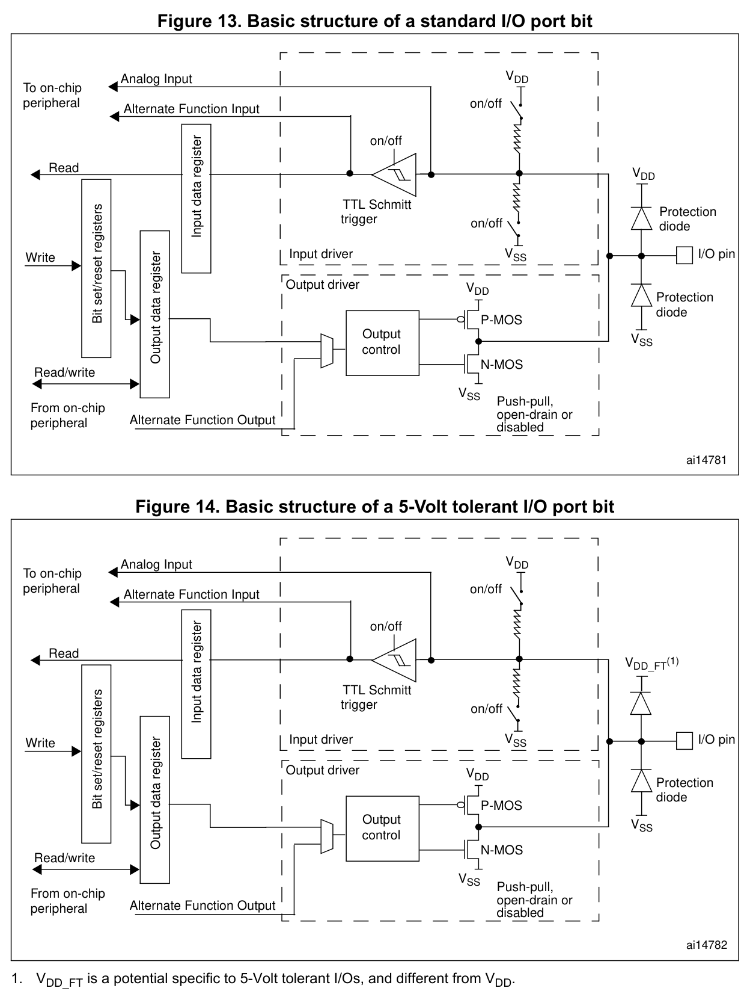
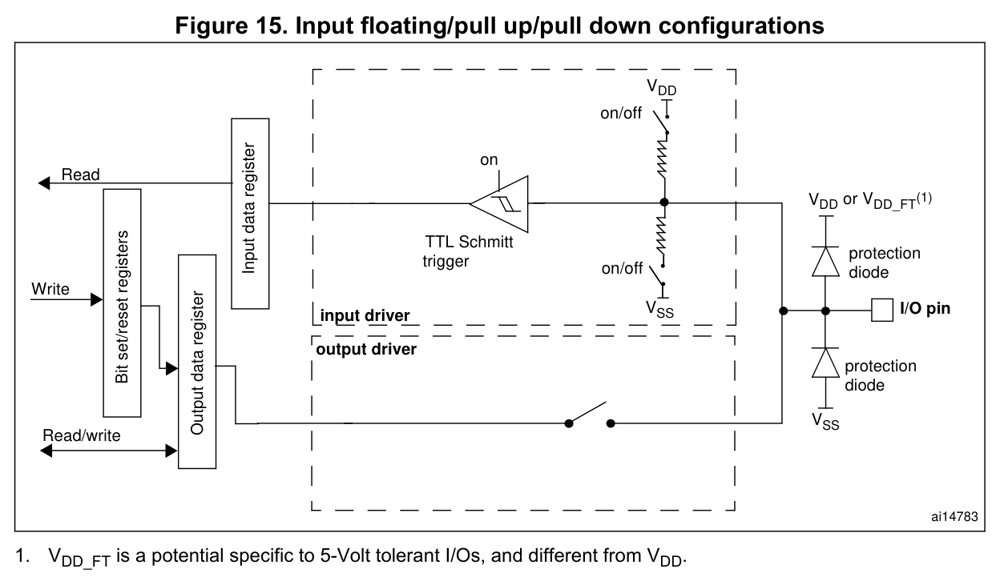
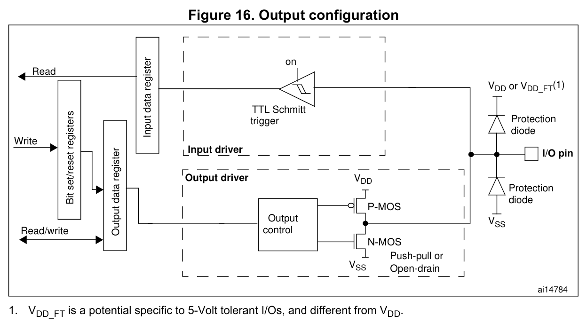
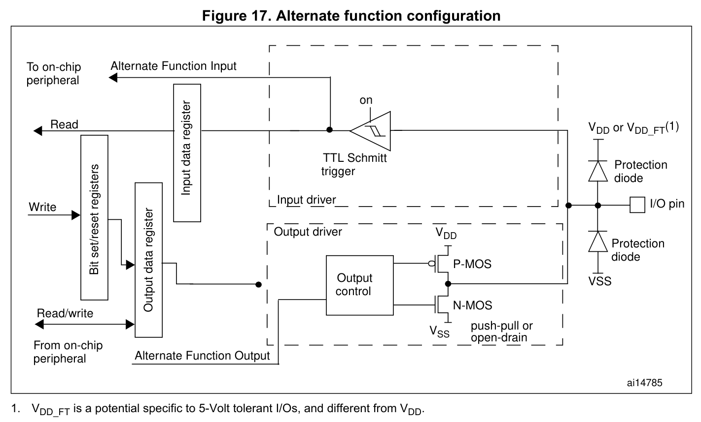
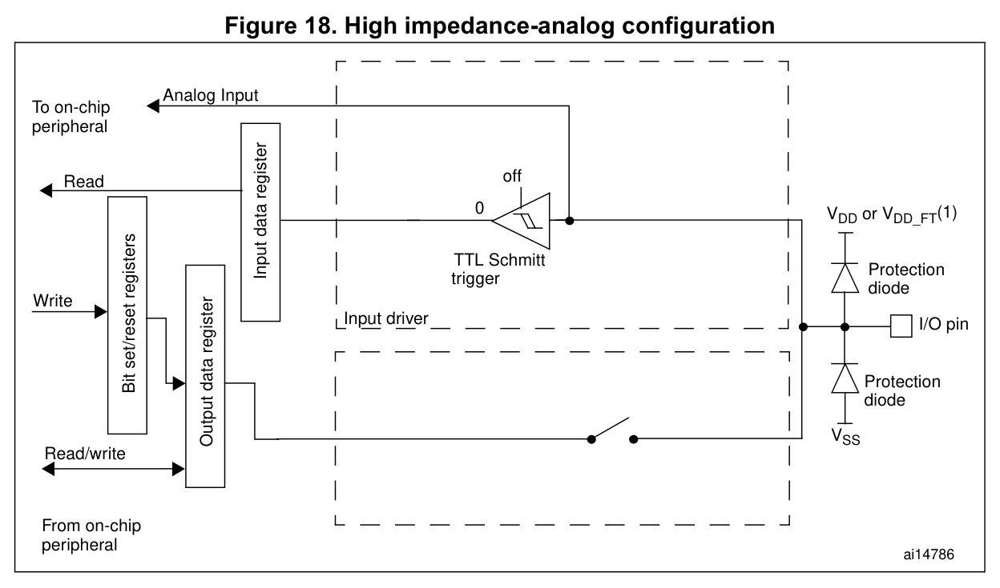

# 图表关系与覆盖范围

本页说明图示技术关系与仍须查阅原厂的内容。GPIO、EXTI结构图与调试连接图已改为手册原图裁切，保留原有连线、符号、图号及相关说明与脚注；仍保留的旧自绘图待逐批替换。图片均不构成电气容限或硅实测保证。以下图形仅覆盖明列技术关系，不代表整章全部内容。

## GPIO与EXTI结构

原厂位置为RM0008 Rev21。以下六组原图（Figures13–18、20）与模式/寄存器表互补：表格不能替代支路、断开点和门控先后关系。

| 原图主题 | 对应原厂图与页 | 关键关系及条件 |
|---|---|---|
| 标准与FT I/O | Figures13–14 p160 | 普通VDD与FT VDD_FT保护差异；模拟/AF输入/施密特/IDR分支；ODR/AF选择与P/N驱动；弱上下拉 |
| 输入 | Figure15 p163 | 施密特和IDR开启；ODR仅选上下拉；输出驱动断开；保护节点 |
| 输出 | Figure16 p164 | ODR锁存回读与外部脚经施密特回读IDR是两条路径；P/N输出控制；保护关系 |
| 复用 | Figure17 p165 | ODR控制断开；外设AF输出驱动；脚至AF输入和IDR分路；双向关系 |
| 模拟 | Figure18 p166 | 模拟通路至外设；数字缓冲关闭、IDR强制0；输出及弱上下拉关闭 |
| EXTI | Figure20 p207 | 边沿/软件请求汇合；IMR→PR→NVIC；EMR→事件脉冲支路；APB配置接口 |

### 标准与 FT 引脚结构



RM0008 p160、p163、p164、p165 的注1均说明：VDD_FT 是5 V容忍I/O专用的电位，且不同于VDD。普通图的上保护节点为VDD，FT图为VDD_FT；模式图用“VDD 或 VDD_FT(1)”保留类型条件。本组不据此承诺任意5 V电压、模拟模式5 V容忍或掉电容忍。

输入、普通输出、AF的数字引脚状态按每个APB2周期采样到IDR（§9.1.1 p161、§9.1.7–9.1.9 pp163–164）。读ODR返回寄存器内容，与读IDR分离；在AF模式，不得由读写ODR推导软件直接驱动脚。

### 输入模式



输入上/下拉模式由ODR选择：ODR=0为下拉，ODR=1为上拉（Table20 p161）；浮空时两条弱偏置支路均关闭。输入模式下输出缓冲器保持禁用。

GPIO输出/AF图中IDR回读存在，不代表输出模式符合EXTI使用配置。RM0008 §9.1.3 p162及Table33 p170明确要求GPIO配置为输入模式。

### 输出模式



普通输出开漏时，ODR=0导通N-MOS；ODR=1高阻，P-MOS从不被激活。推挽时0驱动N-MOS、1驱动P-MOS。图不包含输出速度/电流保证。

原图保留“Bit set/reset registers”标签；对应BSRR/BRR的具体说明见§9.1.2 pp161–162及§9.2.4–9.2.5 p173。BRR只负责复位；组合标签不表示BRR具备置位功能。

### 复用模式



AF输入用途应依§9.1.4配输入模式；AF输出及双向功能按对应外设要求配AF输出模式。Figure17 的原页注释保留在裁图中；双向能力须结合外设专门配置表使用。外设未激活时AF输出未规定。

### 模拟模式



模拟模式关闭施密特，并把其输出强制为0；输出驱动与弱上下拉关闭。关于施密特零消耗的原文不能扩大为整脚、模拟外设或整芯片零功耗。只有实际支持模拟输入的引脚才有对应模拟功能。

Figure18（p166）图内有 VDD_FT(1)，但本页没有对应脚注文字。本组明确指出注释解释来自p160/163–165，不伪造p166原注。

ADC模式补充依据是p169的ADC段落及Figure19；Table32是FSMC，不能用来证明C8 ADC配置。本组模拟结构图本身对应Figure18。

### EXTI 中断与事件路径


EXTI的硬件边沿检测输出与SWIER软件来源先OR汇合；中断经IMR后置PR再送NVIC；事件经EMR后产生脉冲，事件支路不置PR（§10.2.4）。IMR屏蔽不能与NVIC屏蔽混为一谈。

EXTI_PR写1清除；SWIER相应位由0写1触发软件请求，清PR会清相应SWIER（§10.3.5–10.3.6 p213）。具体中断发生还须IMR与NVIC等配置满足条件。

Figure20 表示 19 条 EXTI 线路：0～15 来自 GPIO 同号选择，16 为 PVD、17 为 RTC Alarm、18 为 USB Wakeup（§10.2.5 p210）。

GPIO同号来源还必须经过LQFP48实际引出集合、复用占用及PD0/1等条件筛选；本图不是完整EXTICR端口选择图，不复制Figure21的全部端口作为C8能力。

Figure20没有绘出EMR到外设接口的线；原图保持不变。EMR为软件可访问寄存器的依据另见§10.3.2 p211，不把文字补充画进原图。

Figure21 p210 的完整路由图尚未收录；同号端口多选一、AFIO 时钟与实际引脚条件见[EXTI寄存器与路由](EXTI寄存器与路由.md)与[引脚复用与AFIO](引脚复用与AFIO.md)。

## 符号与阅读边界

- 本组图片直接取自 ST RM0008 Rev21，只裁去图外无关内容并按原比例渲染；不重新排线、不增加颜色或门控支路、不翻译覆盖图内标签。
- 原图为功能结构表达，不提供制造级电路、器件尺寸或未标出的电气保证。I/O port bit 表示端口位，不是具体封装脚号。
- VDD_FT 与 VDD 的区别及原图脚注按原样保留，具体适用性还须核对数据手册。
- 图20中的19表示本器件有效 EXTI 线0–18；不代表寄存器访问宽度。
- 原图版权归 STMicroelectronics。来源：[RM0008 官方手册](https://www.st.com/resource/en/reference_manual/cd00171190.pdf)；版本、页码及图号见上表。原图未绘出的信息在正文单独说明，不补画进原图。

## 完整脚注与易误读条件

各图的脚注与使用条件已就近放在图下：

- [标准与 FT 引脚结构](#标准与-ft-引脚结构)：保护节点、输入与输出读回。
- [输入模式](#输入模式)：上下拉选择和 EXTI 配置要求。
- [输出模式](#输出模式)：推挽、开漏与置位复位寄存器。
- [复用模式](#复用模式)：外设控制及配置条件。
- [模拟模式](#模拟模式)：数字路径关闭及原图脚注出处。
- [EXTI 中断与事件路径](#exti-中断与事件路径)：掩码、挂起、软件触发和有效线路。

## 保留的原文差异

§9.1.4 p162的“软件仿真AF输入”说明与同节“AF输出断开ODR”陈述存在解释冲突。本页保留Figure17原图及明确断开说明，不输出“在AF模式写ODR就能驱动脚”的操作建议。EXTI_PR复位值在§10.3.6与汇总表也存在差异；本图不声称其复位为0，也不将其作为初始化依据。


## 内核字段、表与公式

[内核寄存器参数](内核寄存器参数.md)用字段与访问表说明 CFSR 三个子域（依据 PM0056 Figure20 p142）：UFSR 为 31:16，BFSR 为 15:8，MMFSR 为 7:0。原自绘布局图已从正文撤下；表中保留完整寄存器、子域和组合访问的地址与宽度。PM0056通用Figure12向量概念、Figure19优先级示意的C8适用关系由完整IRQ表、4位优先级/分组表保留，图中IRQ67、IP80不作为C8资源。未宣称复制这些原图全部通用元素。

Table17三个EXC_RETURN值和栈/模式、Table42中断状态、Table45分组、Table49 SysTick复位及CALIB冲突分别保留在正文/参数页。SysTick关系为：

```math
T=\frac{R+1}{f_{\mathrm{ST}}},\qquad R=f_{\mathrm{ST}}T-1
```

$`T`$ 为周期，单位s； $`f_{\mathrm{ST}}`$ 为SysTick输入频率，单位Hz； $`R`$ 为LOAD中的重装值，无量纲。持续周期范围及72MHz例值仍保留。HAL参数 $`N`$ 为传入的时钟周期数，无量纲，与寄存器关系 `LOAD=R` 不混用。

## 调试图、表与原厂依赖

[调试寄存器与协议](调试寄存器与协议.md)已采用RM0008 Rev21的两张原图裁切：Figure 362（p1081）说明SWJ共享引脚、方向选择及上电复位连接；Figure 363（p1086）说明单颗STM32 MCU内部的双TAP串链及控制关系。两图保留原标签、边框、支路、箭头和图号，未重画连线、改色或覆盖翻译。原图版权归STMicroelectronics。裁切坐标和校验见[调试原图来源](../assets/manual/rm0008-r21/调试原图来源.md)。

**SWJ端口原图（Figure362）**

[Figure362原图及图后说明](../assets/manual/rm0008-r21/p1081-fig362.png)

来源：[RM0008 Rev21 §31.3 Figure 362，p1081](https://www.st.com/resource/en/reference_manual/cd00171190.pdf#page=1081)。裁切包含完整图框及原图后的异步Trace说明：TRACESWO与TDO复用，所以异步Trace只可配SW-DP。SWD/JTAG选择与AFIO_MAPR.SWJ_CFG引脚释放是不同步骤；映射与释放条件仍见Tables219–220及§31.4。

### 图示符号与边界

图中保留两处或门、DBGDOEN/SWDOEN三态输出使能、选择逻辑及未命名连接。箭头表示信号方向，或门表示逻辑OR；不替未命名信号造名或补充极性。右侧“From power-on reset”经nPOTRST连接JTAG-DP.nPOTRST与SW-DP.DBGRESETn；不把它改写成系统NRST。NJTRST/nTRST同样不是系统NRST。系统复位下连接与字段复位差异见调试参数页§31.10～31.11，不能由此图推定全部字段的复位范围相同。

此图不证明STM32F103C8内部ETM可用或可经SWO输出。STM32F103C8T6的LQFP48封装未引出PE2–PE6并行Trace引脚；PB3引出JTDO/TRACESWO，封装依据另见[DS5319 §3 Table5，pp28、32](../来源/DS5319.md#src-ds5319-r20-debug-package)。

**单颗MCU内部JTAG链原图（Figure363）**

[Figure363原图](../assets/manual/rm0008-r21/p1086-fig363.png)

来源：[RM0008 Rev21 §31.5 Figure 363，p1086](https://www.st.com/resource/en/reference_manual/cd00171190.pdf#page=1086)；扫描长度及SW-DP条件见[§31.5，p1085](https://www.st.com/resource/en/reference_manual/cd00171190.pdf#page=1085)。两TAP位于同一STM32 MCU内部，数据路径为JTDI→边界扫描TAP→Cortex-M3 TAP→JTDO。IR分别为5位和4位，每次IR扫描共9位；未用TAP置BYPASS后，每次DR数据扫描额外增加1位。

### 图示符号与边界

TAP=测试访问端口；IR=指令寄存器；TDI/TDO=测试数据输入/输出；nTRST为低有效测试复位。箭头表示数据或控制传递方向。

SW-DP被选中后，边界扫描TAP的TMS强制为高并自动禁用。保留原图门控形状，不据图形额外推导极性或真值表。NJTRST共接两TAP的nTRST；图中未画JTCK不表示无需时钟，箭头不定义指令加载的时间位序。

边界扫描Capture-IR输出还受[ES096 Rev15 §2.2.10，p10](../来源/ES096.md#src-es096-r15-revision-matrix)限制：低两位可能为前次IR值，不能仅靠XXX01判断扫描链。该勘误与BYPASS、9位IR和单颗MCU边界均保留在调试参数页，不由原图替代。

Tables219–220的引脚、SWJ分配与释放关系；Tables223–226的SWD请求/ACK与寄存器地址；Tables228–230的ITM字段；Tables231–235的TPIU字段、格式器/同步及封装限制，按C8适用技术信息保留在调试参数页。不是每个通用字段的完整硬件保证，尤其ETM/TPR冲突未消解。

以下内容仍须查阅原厂原图，本参考未完整表达其全部图形细节：
- RM0008 Figures361 p1080、364 p1104：通用CoreSight/Trace体系，不代表C8有完整外接ETM路径。
- Arm IHI0031A Figures5-1–5-4、5-6–5-7（印刷5-7～5-9、5-13）：ACK/数据驱动方、turnaround和ORUNDETECT条件保留在协议文本；本参考未完整表达原操作图的全部波形，且它们不是电气setup/hold规格。

原厂直达页：[RM p1080](https://www.st.com/resource/en/reference_manual/cd00171190.pdf#page=1080)、[RM p1104](https://www.st.com/resource/en/reference_manual/cd00171190.pdf#page=1104)、[Arm IHI0031A 文件p91](https://documentation-service.arm.com/static/5f900a61f86e16515cdc0610#page=91)、[文件p97](https://documentation-service.arm.com/static/5f900a61f86e16515cdc0610#page=97)。

[硅修订矩阵](硅修订矩阵.md)保留ES096 Tables1–4的本器件身份、58行×8列状态、图例与文档勘误分类；行按条款号组织，不能称为原表版式逐字复刻。未在本主题重新核验其他外设每条规避全文。
