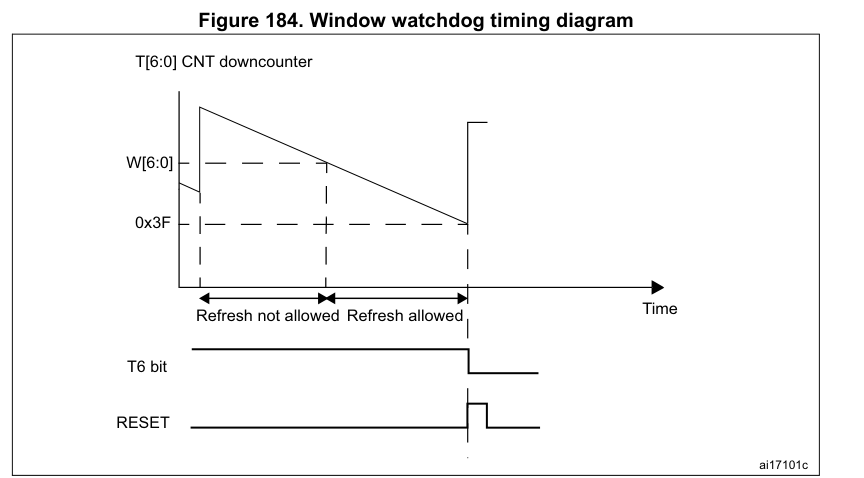

# 看门狗启动、刷新与时间预算

[返回 RTC 与看门狗](../../知识库/11_RTC看门狗与可靠运行.md)

硬件依据 RM0008 Rev21、DS5319 Rev20、ES096 Rev15；HAL 结论限定于 STM32CubeF1 v1.8.6 配套的 HAL v1.1.10，固定提交为 77fbb30b7a1d02533980400083e48c559aae5a4f。以下描述操作语义，不提供启动或刷新看门狗的可执行例程。

## 1 IWDG：启动、配置与返回值

独立看门狗 IWDG 由 LSI 供时。硬件选项启用时，上电就进入看门狗预算；软件启动后也只能由复位停止。三种键值作用不同：

| 写入 IWDG_KR 的键值 | 作用 |
|---|---|
| 0xCCCC | 启动；从复位计数值 0xFFF 开始递减 |
| 0x5555 | 解除 PR、RLR 的写保护 |
| 0xAAAA | 把 RLR 重装值装入计数器；同时重新保护 PR、RLR |

PR 是预分频寄存器，RLR 是重装值寄存器。修改 PR 前须确认 PVU=0，修改 RLR 前须确认 RVU=0；只有相应更新标志为 0，读回值才可用。运行中的参数更新不能只看软件已完成赋值。依据：[RM0008 IWDG 启动与寄存器语义](../../来源/RM0008.md#src-rm0008-r21-watchdog-start-window)。

固定版本的 HAL_IWDG_Init 顺序为：启动 IWDG → 解除写保护 → 写 PR、RLR → 等待更新标志清零 → 刷新并返回 HAL_OK。**等待超时返回 HAL_TIMEOUT 时，前面的启动已经执行，函数没有撤销看门狗。** 它也没有在这两次配置写入之前等待旧 PVU/RVU 清零；不能把重复 Init 当作无条件安全的运行中改参流程。

HAL_IWDG_Init 的软件超时依赖 HAL_GetTick；时基不推进时，返回等待未必有界，而已经运行的 IWDG 仍可能产生硬件复位。HAL_IWDG_Refresh 只写重装键并返回 HAL_OK，不检查应用是否取得进展，也不保证此前参数更新已正确完成。[固定 HAL IWDG 实现](../../来源/驱动实现.md#src-hal-v1110-iwdg-start-refresh)

LSIRDY 后的额外稳定等待、IWDG/LSI 不能软件关闭、Stop/Standby 继续运行，见[供时条件](../../知识库/02_时钟复位与低功耗.md#14-rtc-与看门狗供时)。低 APB 频率与 Stop 更新勘误，直接遵守[Stop 入口条件](../../知识库/02_时钟复位与低功耗.md#42-stop)；不能用 HAL_OK 或“最多几个 LSI 周期”代替这些硬件前提。

## 2 IWDG：用 LSI 范围核算超时

参数已经生效并完成重装后，名义超时为：

$$
t_{\mathrm{IWDG}}=\frac{(RL+1)P}{f_{\mathrm{LSI}}}
$$

其中， $`t_{\mathrm{IWDG}}`$ 单位为 s； $`RL`$ 是 RLR 的 12 位数值，取 0～4095； $`P`$ 是分频倍数，取 4、8、16、32、64、128、256； $`f_{\mathrm{LSI}}`$ 是预分频前的 LSI 频率，单位为 Hz。

DS5319 Table25 给出 30/40/60 kHz 的最小/典型/最大频率。取 P=256、RL=4095，计算结果如下：

| LSI 频率 | 名义超时 |
|---|---:|
| 30 kHz | 34.952533 s |
| 40 kHz | 26.214400 s |
| 60 kHz | 17.476267 s |

刷新预算应从高频端的较早超时出发，并为执行延迟、配置和刷新时点留余量；故障检测期限还要考虑低频端的较晚超时。不能把典型 40 kHz 或表中的计算值当作每颗芯片的精确实测时间。Table25 的条件为 VDD=3 V、环境温度 −40～105°C，频率项来自特性评估，除另有规定外不作生产测试；实际使用仍须满足器件额定工作条件。[RM0008 Table96](../../来源/RM0008.md#src-rm0008-r21-watchdog-start-window)、[DS5319 时钟电气条件](../../来源/DS5319.md#src-ds5319-r20-clock-electrical)

## 3 WWDG：当前窗口先于新配置生效

窗口看门狗 WWDG 由 PCLK1 经固定 4096 和可选分频供时。启用后，计数值 T 从 0x40 减到 0x3F 会产生复位；过早写控制寄存器 CR 刷新也会复位。窗口寄存器 W 比较的是刷新前的当前 T，不是准备重装的新值。WDGA 启动位置 1 后只能由复位清除；重装计数值的 bit6 必须为 1。

RM0008 的硬件描述写 T>W 时触发过早复位，操作文字要求 T<W。工程调度采用严格范围 **0x40≤当前 T<W**，并给两端留余量；不把恰好 T=W 当作可靠调度目标，也不把这一保守选择写成原厂已经澄清了等值边界。[硬件窗口与原文差异](../../来源/RM0008.md#src-rm0008-r21-watchdog-start-window)

图：RM0008 Rev21 Figure 184，印刷/PDF p502。W[6:0] 是窗口阈值，T[6:0] 是当前递减计数；Refresh not allowed / Refresh allowed 分别标出过早区与刷新窗口。右端 T6 清零和 RESET 脉冲对应超时复位，不能把右端上跳解释为一次安全刷新。[官方原图](https://www.st.com/resource/en/reference_manual/cd00171190.pdf#page=502) · [原图来源记录](../../assets/manual/rtc-watchdog/README.md)

W 处的窗口箭头不消解上述等值边界差异，调度仍采用严格范围并留余量。图中未单独画出 EWI 波形，图形长度也不提供精确截止时刻；预分频相位、时钟变化和 EWI 剩余时间仍按第 4 节核算。

固定 HAL 的 Window、Counter 参数断言范围均为 0x40～0x7F，但这不保证窗口适合调度。按上述严格范围，W=0x40 没有可用刷新区间；W>0x40 只是存在区间的必要条件，还须为实际执行延迟留余量。参数断言也不能代替运行中的窗口检查。

固定 HAL_WWDG_Init 在 MSP 钩子之后，**先写 CR 启动/重装，再写 CFR 配置分频、窗口与 EWI**：

- 首次启动且 CFR 仍为复位值时，两次写之间使用旧的 /1 分频；若 MSP 已配置 CFR，则以其实际值为准。
- 已运行时再次 Init，第一次 CR 写仍受旧窗口约束。新窗口要到下一次 CFR 写才生效，不能挽救已经发生的过早刷新。例如当前 T=0x60、旧 W=0x50，即使目标 W=0x7F，先写 CR 仍违反旧窗口。
- 两次寄存器写之间的抢占延迟须按实际旧分频核算。普通紧邻写入不等于必然失败，但 HAL_OK 也没有验证这些时序条件。

HAL_WWDG_Refresh 直接把句柄中的 Counter 写入 CR 后返回 HAL_OK，不在软件中检查当前窗口。不要把 Init/Refresh 的返回值解释为窗口条件已被验证。[固定 HAL WWDG 实现](../../来源/驱动实现.md#src-hal-v1110-wwdg-start-refresh)

## 4 WWDG：计数周期、相位与 EWI

递减周期和重装后的名义超时为：

$$
\tau=\frac{4096\times2^{WDGTB}}{f_{\mathrm{PCLK1}}},\qquad
t_{\mathrm{WWDG}}=\tau\,(T_{\mathrm{low}}+1)
$$

 $`\tau`$ 和 $`t_{\mathrm{WWDG}}`$ 的单位为 s； $`f_{\mathrm{PCLK1}}`$ 单位为 Hz；WDGTB 是 CFR 中取 0～3 的分频编码，对应 1、2、4、8； $`T_{\mathrm{low}}`$ 是所写 T 的低 6 位，取 0～63。公式要求写入 T 的 bit6=1，且刷新本身满足窗口条件。

写 CR 时预分频相位未知，实际超时存在一个递减周期内的不确定性，不能把名义计算的最后一刻当作安全截止。PCLK1 改变后，递减周期和窗口的实际时间都会改变。

取 WDGTB=3、T_low=63：PCLK1=36 MHz 时名义超时约 58.254222 ms；PCLK1=24 MHz 时约 87.381333 ms。RM0008 Rev21 p503 的后一算例印为 21.85 ms，与同处公式不符；这里保留差异并按公式复算，不将其表述为 ST 已发布的更正。[RM0008 公式、算例与相位条件](../../来源/RM0008.md#src-rm0008-r21-watchdog-start-window)

T=0x40 时置 EWIF 标志，即使 EWI 未使能也会置位；只有 EWI 使能且看门狗已经启动，才产生提前唤醒中断请求。此时到下一递减复位只有有限时间，服务延迟还会消耗这个间隔；不能承诺有足够时间完成 Flash 擦写或其他长操作。清 EWIF 只清标志，不重装计数。固定 HAL IRQ 处理函数检查 EWI 使能和 EWIF 后清标志并调用回调，默认弱回调不刷新。[固定 IRQ 与回调](../../来源/驱动实现.md#src-hal-v1110-wwdg-start-refresh)

不能在 EWI 中无条件刷新，否则主任务停滞而中断仍运行时，可能持续掩盖故障。刷新决策须先满足应用自己的进展判据、窗口和剩余时限；本页不规定完整任务监控策略。WWDG 的硬件倒计时要求 PCLK1 持续且未被调试冻结，不能覆盖 Stop 停 APB 时钟期间的超时；[调试冻结](../调试寄存器与协议.md#外设冻结和trace字段)也不代表脱机生产行为。

以上均为固定手册、源码和公式核对，没有进行看门狗启动、复位注入、固件运行或板端计时验证。
