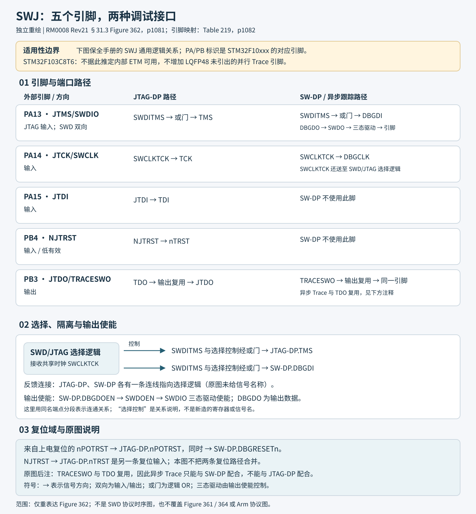
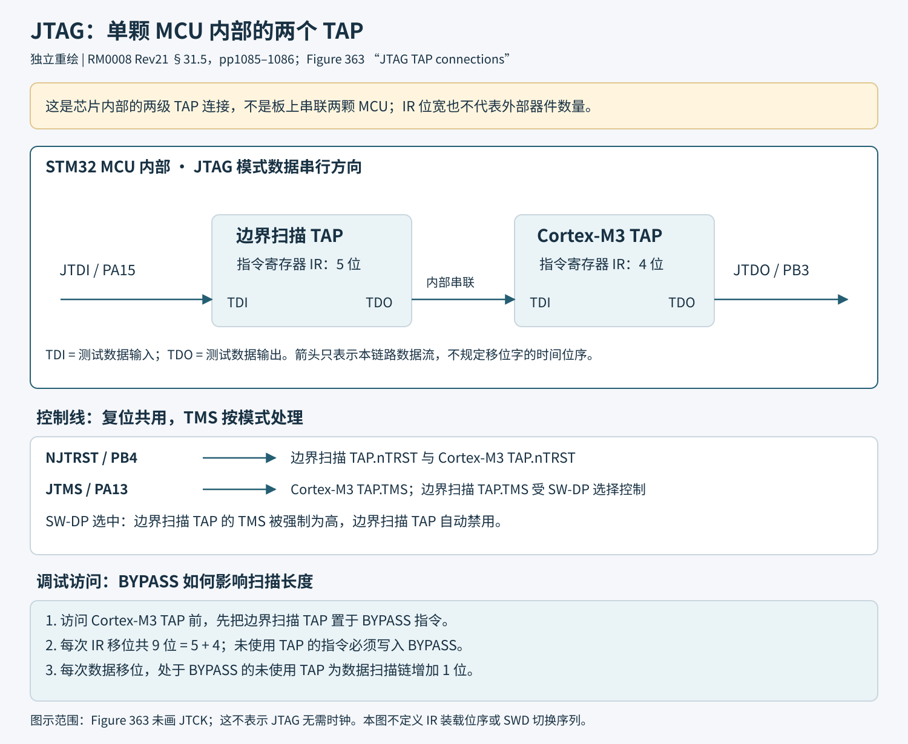

# 调试寄存器与协议

本页供调试连接、故障观察和探针实现时查阅。应用开发优先看引脚、复位下连接、断点和外设冻结；编写调试探针时，再查 JTAG-DP、SW-DP 和 AHB-AP 协议细节。

- 调试连接：[SWJ 引脚与释放](#314-引脚释放和复位状态)、[复位下连接](#31103111-内核调试与复位下连接)、[断点和观察点](#3112-fpb和3113-dwt)。
- 追踪与运行状态：[ITM](#3114-itm)、[低功耗与冻结](#3116-dbgmcu控制)、[异步 SWO](#3117-c8的tpiu与异步swo)。
- 探针传输：[JTAG-DP](#317-jtag-dp传输)、[SW-DP](#318-sw-dp协议)、[AHB-AP](#319-ahb-ap)。

各节保留 RM0008 第 31 章编号方便定位。图形收录范围见[图表关系与覆盖范围](图表关系与覆盖范围.md)。

## 31.1～31.2 调试体系

Cortex-M3可以在取指处触发断点、在数据访问处触发观察点，停核后检查内核/系统状态再恢复执行。调试入口有JTAG和SWD，经过SWJ-DP与AHB-AP访问内核和系统。组件包括FPB硬件断点/补丁、DWT观察点和性能计数、ITM软件/硬件追踪、TPIU追踪输出以及STM32专用DBGMCU。

调试连接采用 SWD 或 JTAG；PB3 的异步 SWO 与 JTDO 共用引脚，使用 SWO 时选择 SWD。内核寄存器编程另见[PM0056](../来源/PM0056.md)与[Arm Cortex-M3 技术参考](../来源/Arm_DDI0337E.md)。

## 31.3 SWJ端口选择

SWJ-DP组合五线JTAG-DP和两线SW-DP，共用部分引脚。默认JTAG端口有效。主机只用TMS/SWDIO与TCK/SWCLK即可发送转换序列：

1. TMS/SWDIO保持1，发送超过50个时钟。
2. 发送16位序列0111100111100111，按此串从左至右（手册称MSB先发）。等效常用LSB先发数值为0xE79E，不能将两种表示顺序混用。
3. 再保持1发送超过50个时钟。

该序列禁用JTAG-DP并启用SW-DP。异步TRACESWO与JTDO共PB3，所以SWO仅可配SWD，不能同时JTAG。

### SWJ两种调试入口

上部JTAG-DP、下部SW-DP共享SWDIO/TMS与SWCLK/TCK；选择逻辑切换入口，TRACESWO与JTDO复用。System/power-on reset分别表示系统与上电复位路径，不能将全部调试组件等同普通外设复位。

## 31.4 引脚、释放和复位状态

|引脚|JTAG|SWD/Trace|默认输入偏置|
|---|---|---|---|
|PA13|JTMS输入|SWDIO双向|上拉|
|PA14|JTCK输入|SWCLK输入|下拉|
|PA15|JTDI输入|可释放GPIO|上拉|
|PB3|JTDO输出|TRACESWO输出或GPIO|调试输出可三态|
|PB4|NJTRST输入|可释放GPIO|上拉|

SYSRESET/上电复位后五脚立即分配给SWJ；Trace默认不分配。调试引脚直接驱动调试逻辑，不得悬浮，特别是TCK/SWCLK；芯片已提供对应弱上/下拉。原手册SW协议部分另引用Arm推荐板级约100 kΩ SWDIO上拉，实际板级方案应结合调试器、电容、走线和已有内部上拉。

AFIO_MAPR位26:24 SWJ_CFG控制分配：000完整SWJ；001不用NJTRST；010只保留SWD；100全部关闭。其他组合禁止使用，最多只置这三位中的一个。该字段只写、读值未定义，不能靠普通读改写保留它。系统复位恢复000。AFIO_MAPR位于0x40010004，读通常无等待，桥写缓冲满时写额外等待一个APB周期。

释放分两阶段保证信号清洁：第一周期把内核nTRST/TDI/TMS固定1、TCK固定0；第二周期GPIO接管方向、上下拉和施密特输入。软件释放前引脚仍保持调试偏置/三态，外围电路必须容忍这段复位窗口。调试/Trace已映射时，改GPIO配置无效。

常见做法是启动软件置SWJ_CFG=010，释放PA15/PB4以及未用SWO的PB3。调试主机在NRST保持期间切SWD、设置复位向量捕获，再释放复位停核，之后通过SWD继续；应用才可重新分配其他JTAG脚。不要把NJTRST当成芯片系统NRST。

## 31.5 JTAG链

[ES096原厂来源](../来源/ES096.md#src-es096-r15-revision-matrix) §2.2.10补充：边界扫描TAP经过Capture-IR后移出的低两位不保证标准的01，而可能是上次IR值。工具应按勘误处理/忽略该捕获输出，并检查整个IR，不能仅凭低两位XXX01判定扫描链。

芯片内部串联边界扫描TAP和Cortex-M3 TAP，IR分别5位和4位。调试Cortex-M3时先让边界扫描TAP进入BYPASS；每次IR扫描共9位，并给不用的TAP移入BYPASS；每次DR扫描，BYPASS TAP多占1位。选SWD后边界扫描TAP自动禁用（JTMS强制高）。

### JTAG双TAP串链

JTDI先经5位IR的Boundary scan TAP，再经4位IR的Cortex-M3 TAP输出JTDO；SW-DP selected时关闭边界扫描。调试内核时另一TAP置BYPASS，数据链因此多1位。

本节来源：

- [RM0008 §31.3–§31.4.4；§31.5](../来源/RM0008.md#src-rm0008-r21-debug-pins)

## 31.6 标识码和工具匹配

### DBGMCU_IDCODE

地址0xE0042000，只读且仅32位访问，即使系统复位期间也可由JTAG/SWD读取，RM的一般描述允许用户CPU读取，但 **C8受[ES096原厂来源](../来源/ES096.md#src-es096-r15-revision-matrix) §2.2.2限制，DBGMCU_IDCODE和DBGMCU_CR仅在调试模式可访问，用户软件读回0x00；没有规避方法**。因此不能在脱离调试的产品固件中依赖该读值识别器件，应用读0不表示DEV_ID或REV_ID确实为0。

bits11:0 DEV_ID是工具用于芯片类别匹配的字段，C8中容量为0x410；bits15:12保留；bits31:16 REV_ID为修订号，不要把不同修订误识别成不同目标系列。

|中容量REV_ID|原手册修订对应|
|---|---|
|0x0000|A|
|0x2000|B|
|0x2001|Z|
|0x2003|1、2、3、X或Y|

修订相关限制应交叉查[ES096原厂来源](../来源/ES096.md#src-es096-r15-revision-matrix)及封装标记。DBGMCU_IDCODE的工厂值不是统一复位零值。

### 其他ID

- 中容量边界扫描TAP JTAG ID：0x06410041对应A，0x16410041对应B/Z/Y（原手册所列对应）。
- Cortex-M3 TAP JTAG ID为0x3BA00477，标识Arm Cortex-M3 r1p1而不是STM32型号。
- SW-DP ID为0x1BA01477，亦是Arm端口标识，不是ST的DEV_ID。
- Cortex-M3 JEDEC-106标识在内部PPB的4 KiB ROM表0xE00FF000～0xE00FFFFF，可由JTAG/SWD或CPU读。

ST建议工具用DBGMCU.DEV_ID锁定目标类别，而非只见Arm TAP ID就认为所有Flash算法相同。

本节来源：

- [RM0008 §31.6.1–§31.6.4](../来源/RM0008.md#src-rm0008-r21-debug-id)
- [ES096 首页Applicability及Tables1–2；§1 Tables3–4](../来源/ES096.md#src-es096-r15-revision-matrix)

## 31.7 JTAG-DP传输

Cortex-M3 TAP有4位IR和以下数据寄存器。标准JTAG状态机移入指令选择数据路径。

|IR|寄存器/位宽|含义|
|---|---|---|
|1111|BYPASS，1位|旁路|
|1110|IDCODE，32位|0x3BA00477|
|1010|DPACC，35位|访问DP寄存器|
|1011|APACC，35位|访问AP寄存器|
|1000|ABORT，35位扫描路径|有效DAPABORT控制位0写1中止DAP；其余控制位按该接口定义保留|

ABORT行的DAPABORT“位0”是目标寄存器内部编号。按 [Arm ADIv5 IHI0031A §4.4.4、p4-21](https://documentation-service.arm.com/static/5f900a61f86e16515cdc0610)，35位ABORT扫描链须移入数值 `0x0000008`：低3位为写方向及地址00，DAPABORT置于扫描bit3；不能把寄存器位号直接当成整条扫描链位号。该版本明确将其他扫描值列为不可预测。

DPACC/APACC移入bits34:3为32位DATA，bits2:1为地址A[3:2]，bit0 RnW=1读、0写；移出bits34:3为前次读结果，bits2:0 ACK：010为OK/FAULT，001为WAIT，其余保留。不能把JTAG的ACK编码直接用于SWD。AP目标完整地址结合DP SELECT与A[3:2]。

|A[3:2]/偏移|JTAG-DP寄存器|
|---|---|
|00 / 0x0|保留；不要访问。RM摘要写保持复位值；Arm规范访问列与说明有差异，不能据此探测读写|
|01 / 0x4|CTRL/STAT：请求系统/调试上电，配置AP传输、pushed compare/verify，读overrun和上电确认|
|10 / 0x8|SELECT：bits31:24 APSEL选AP；bits7:4 APBANKSEL选4字寄存器窗口；23:8、3:0保留|
|11 / 0xC|RDBUFF：自身RAZ/WI；插入此无副作用DP读扫描，可移出前一操作的最终结果与ACK，不发起新的AP访问|

JTAG-DP与SW-DP的RDBUFF实现不同。JTAG流水扫描在移入下一请求时移出前一结果；RDBUFF自身读零、写忽略，不能把返回前次结果误写成它具有SW-DP结果缓冲的读语义。

IHI0031A Table6-2对保留地址0x0同时列RAZ/WI与读写UNPREDICTABLE，并明确主机不得访问；本表采用“不访问”的边界。依据：[IHI0031A §6.1.2–§6.1.3；§6.2.1；§6.2.3–§6.2.7](../来源/IHI0031A.md#src-ihi0031a-dp-registers)。

本节来源：

- [Arm JTAG扫描定义](../来源/IHI0031A.md#src-ihi0031a-jtag-scan)

## 31.8 SW-DP协议

SWCLK由主机输出，SWDIO双向；数据位LSB先发。方向切换时插入turnaround，默认1位时间，此时双方均不驱动。不要在此阶段让推挽驱动器争用。

### 请求、ACK和数据

|请求bit|字段|值/含义|
|---|---|---|
|0|Start|1|
|1|APnDP|0访问DP；1访问AP|
|2|RnW|0写；1读|
|4:3|A[3:2]|寄存器地址|
|5|Parity|对APnDP、RnW、A2、A3这四位做偶校验，不包括Start/Stop/Park|
|6|Stop|0|
|7|Park|目标必须读1；主机驱动方式的版本差异见下文|

请求后turnaround，目标发送3位ACK；正常OK响应再按读写方向传32位数据加1位偶校验，数据校验只覆盖32个数据位、不包括ACK。RM表224将按发送时间展开的三位序列列为：001=FAULT、010=WAIT、100=OK。由于SWD是LSB先发，按数值bit2:0表达则为100=FAULT、010=WAIT、001=OK。编写探针时必须明确“发送序列”和“位域数值”。

WAIT/FAULT不能无条件套用正常OK的33位数据阶段。Arm ADIv5原始规范IHI0031A §5.2/§5.4.5规定：ORUNDETECT=0时这些响应没有数据阶段；为1时仍保留该阶段，但读数据不可采用、写数据被忽略。[Arm ADIv5 IHI0031A](https://documentation-service.arm.com/static/5f900a61f86e16515cdc0610)

**Park位源文差异：**RM0008 Rev21表223与IHI0031A §5.3.1说主机不驱动、由上拉得到1；后续ADIv5.0～5.2规范IHI0031D §B4.2明确要求主机先主动驱高Park，再在turnaround释放，以免弱上拉来不及建立高电平。实现新探针按后者处理并遵守总线方向转换；这项补正不是将ADIv6多点功能套入C8。

[Arm ADIv5 IHI0031D](https://documentation-service.arm.com/static/5f900abff86e16515cdc063b)

turnaround应发生在SWDIO驱动方向实际变化处：读请求后目标继续送ACK和读数据，数据后再交还主机；写请求的ACK之后由目标交还主机，再由主机送写数据。WAIT/FAULT结束也要交还主机。RM31.8.2有关ACK后READ/WRITE的个别文字不应机械照搬成无方向意义的延迟；这里保留Arm协议的驱动方与方向转换关系；这些操作图不是电气setup/hold时序规格。

### 状态机和访问延迟

上电、由JTAG切到SWD或线高超过50周期使SW-DP进入RESET；之后线低至少2周期进入IDLE。**必须先进入IDLE，再读DP IDCODE**，否则其他事务可能返回FAULT。读出的SW-DP ID为0x1BA01477。

DP读不是posted，可立即OK或WAIT。AP读是posted：结果在后续传输返回；若下一步不继续AP读，需读DP.RDBUFF取最后结果。CTRL/STAT.READOK在每次AP读或RDBUFF读时更新，指示前次AP读取成功情况。

DP/AP写有缓冲，满时返回WAIT；IDCODE读、CTRL/STAT读和ABORT写即使缓冲满仍可接受。SWCLK和HCLK异步，写数据奇偶位后还要提供至少2个SWCLK，线路驱低保持IDLE，写才可内部生效；特别是CTRL/STAT请求上电后不能紧接着发送依赖上电已完成的操作而省去这些周期。

这两个空闲时钟用于写入跨时钟域同步，不能代替上电确认。普通系统内存调试连接应保持 CTRL/STAT.CDBGPWRUPREQ（bit28）和 CSYSPWRUPREQ（bit30），读取并等待对应 CDBGPWRUPACK（bit29）与 CSYSPWRUPACK（bit31）确认后，再发起依赖这些域的 AP/内存访问；调试器应设置超时与错误恢复。

仅写请求或仅收到该次 SWD 事务的 OK，应答层次都不同于域已就绪。[Arm ADIv5 IHI0031A §3.4.1～2](https://documentation-service.arm.com/static/5f900a61f86e16515cdc0610)

### SW-DP寄存器映射（APnDP=0）

|A[3:2]|方向/条件|寄存器|作用|
|---|---|---|---|
|00|读|IDCODE|SW-DP ID|
|00|写|ABORT|中止/错误恢复控制|
|01|读写，SELECT.CTRLSEL=0|CTRL/STAT|调试/系统上电和传输控制、状态|
|01|读写，CTRLSEL=1|WIRE CONTROL|物理串行参数，如turnaround|
|10|读|READ RESEND|重取损坏传输的数据，不重做原AP访问|
|10|写|SELECT|选择AP和4字窗口|
|11|读（RDBUFF只读）|READ BUFFER/RDBUFF|取前一次AP读取结果，不发起新的AP事务；有效结果读取后被消费|

RM Table226把地址11列作读写；IHI0031A区分该地址读操作RDBUFF与写方向保留用途，不能据RM摘要写RDBUFF。按该Arm版本，读完后内容不再有效；没有新的AP读结果时第二次读取结果为UNPREDICTABLE。需要重发刚发送但校验损坏的数据应使用RESEND，不能用重复读RDBUFF代替。依据：[IHI0031A §6.1.2–§6.1.3；§6.2.1；§6.2.3–§6.2.7](../来源/IHI0031A.md#src-ihi0031a-dp-registers)。

CTRL/STAT是混合控制/状态寄存器。JTAG的STICKYERR[5]/STICKYCMP[4]/STICKYORUN[1]在CTRL/STAT写1清；SWD通过ABORT.STKERRCLR[2]/STKCMPCLR[1]/ORUNERRCLR[4]写1清，WDATAERR经WDERRCLR[3]清。ABORT.DAPABORT[0]中止AP事务，不会自动清全部错误；它丢弃待处理事务并使AP状态未知，限长期WAIT等恢复场景（IHI0031A pp6-6–7、6-15）。

APnDP=1时访问AP寄存器，其地址由SELECT.APBANKSEL和A[3:2]组成。以上表不等于授权任意写只读数据结果寄存器，完整访问类型以Arm寄存器定义为准。

本节来源：

- [RM0008 §31.8.1–§31.8.5；§31.7–§31.9](../来源/RM0008.md#src-rm0008-r21-swd-protocol)
- [IHI0031A §5.2–§5.4.5](../来源/IHI0031A.md#src-ihi0031a-swd-protocol)
- [IHI0031D §B4.2，pB4-110](../来源/IHI0031D.md#src-ihi0031d-swd-park)
- [IHI0031A §3.4.1–§3.4.2](../来源/IHI0031A.md#src-ihi0031a-power-ack)
- [Arm DP访问类型与副作用](../来源/IHI0031A.md#src-ihi0031a-dp-registers)

## 31.9 AHB-AP

AHB-AP是总线矩阵主设备，访问不依赖CPU运行状态；JTAG-DP与SW-DP都通过它访问DCode、System、内部/外部PPB数据路径，而不是ICode。支持位带事务；其事务绕过FPB，因此调试器内存读取不一定看到CPU经FPB补丁后的同一内容。

寄存器为32位，最多64字/256字节地址空间；有效地址bits7:4来自SELECT.APBANKSEL，bits3:2来自请求A[3:2]。

|偏移|寄存器|作用|
|---|---|---|
|0x00|CSW，Control/Status Word|访问大小、HPROT、当前传输状态、地址自增类型|
|0x04|TAR，Transfer Address|目标地址|
|0x0C|DRW，Data Read/Write|目标数据|
|0x10/14/18/1C|Banked Data0/1/2/3|直接映射4个对齐数据字，省去反复改TAR|
|0xF8|Debug ROM Address|调试ROM基地址|
|0xFC|ID Register|AP标识|

BD0–3使用TAR的16字节对齐窗口，地址分别为(TAR & ~0xF)+0/4/8/0xC；仅word transfer，无自动地址递增。F8返回值包含低位属性，不能把整个值直接当ROM地址。

BASEADDR[31:12]是基址高位，地址低12位为0；bit1为Format，bit0为Entry present。依据：[IHI0031A §11.2.6 Debug Base Address Register](../来源/IHI0031A.md#src-ihi0031a-mem-ap-base)。

依据：[DDI0337E §11.7.2](../来源/Arm_DDI0337E.md#src-ddi0337e-ahb-ap)。

RM只给这些寄存器功能摘要，没有给全部位复位表；不能把未提供的Arm字段复位值编造为0。

本节来源：

- [Arm AHB-AP定义](../来源/Arm_DDI0337E.md#src-ddi0337e-ahb-ap)

## 31.10～31.11 内核调试与复位下连接

|内核寄存器|宽度/用途|
|---|---|
|DHCSR|32位，内核调试使能、停核、单步和状态|
|DCRSR|RM摘要称17位寄存器，Arm文档规定只写；寄存器选择与传输方向是不同字段，按32位字写入|
|DCRDR|32位，所选内核寄存器的数据|
|DEMCR|32位，向量捕获、DebugMonitor、TRCENA追踪使能|

DCRSR的实现字段宽度与总线访问宽度须分别理解。所引 [Arm Cortex-M3 r1p1 TRM DDI0337E](https://documentation-service.arm.com/static/6036810d5319e554d4ba108e) §10.2.2、pp10-6～10-7将选择域列为REGSEL[4:0]、方向列为REGWnR[16]，并要求word写；“17位”不能解释成连续17位寄存器选择值。此细分绑定所引内核版本，不替代实际芯片/调试实现核对。

这些寄存器位于独立调试域，主机经AHB-AP访问，CPU经内部PPB访问。复位即停需DEMCR.VC_CORERESET(bit0)=1和DHCSR.C_DEBUGEN(bit0)=1，并遵守DHCSR写钥匙规则。

**复位范围订正：**RM0008 §31.10“仅上电复位”的总括不能理解成所有字段均跨系统复位保留。匹配C8内核版本的Arm DDI0337E（r1p1）表10-1及§10.2明确：DHCSR.C_HALT(bit1)还由系统/内核复位清除；DEMCR的MON_EN、MON_PEND、MON_STEP、MON_REQ（bits16～19）也由SYSRESETn清除。

应按字段判断，不能在系统复位后假定DebugMonitor仍然使能。[Arm Cortex-M3 r1p1 TRM](https://documentation-service.arm.com/static/6036810d5319e554d4ba108e)

同一TRM还明确DHCSR的S_RESET_ST(bit25)、S_RETIRE_ST(bit24)为读清粘滞状态；持续处于复位时S_RESET_ST连续读仍可为1，反复用调试窗口读取会改变观察结果；DHCSR按32位写入且高半字必须为0xA05F，C_DEBUGEN只能由AHB-AP写。CPU能访问此寄存器，不代表CPU能自行使能停核调试。

STM32将调试复位PORRESETn与系统复位SYSRESETn分离，因此主机可在NRST保持期间连接、设置调试资源/复位捕获，再释放NRST，内核在执行第一条应用指令前停下。原手册强烈推荐这种connect-under-reset流程，尤其适合应用很快关闭SWD或进入低功耗的情况；这不是绕过读保护的方法。

本节来源：

- [RM0008 §31.10–§31.11](../来源/RM0008.md#src-rm0008-r21-debug-reset)
- [DDI0337E §10.1 Table10-1；§10.2.1；§10.2.4；§10.2.2](../来源/Arm_DDI0337E.md#src-ddi0337e-debug-state)

## 31.12 FPB和31.13 DWT

FPB实现硬件断点，以及将代码空间指令/常量重映射到系统空间以修补代码。补丁和硬件断点使用同一资源，相应比较器的两种用途互斥。共有2个literal比较器，用于代码空间常量加载匹配/重映射；6个指令比较器，用于指令地址匹配、重映射或产生断点指令。

DWT 有 4 个比较器，可配置硬件观察点、PC 采样或数据地址采样。性能计数包括时钟周期、折叠指令、LSU 操作、Sleep 周期、CPI 和中断开销。使用追踪资源前应启用 DEMCR.TRCENA。

本节来源：

- [RM0008 §31.12–§31.14.4](../来源/RM0008.md#src-rm0008-r21-debug-fpb-dwt-itm)

## 31.14 ITM

ITM提供类似printf的低侵入软件事件追踪；写stimulus端口产生软件包，DWT产生硬件包，21位时间戳计数器生成相对时间戳，可由CPU时钟或SWV位时钟驱动，并可预分频。每发时间戳包计数器复位。包送至TPIU，TPIU可加源ID和格式信息后送到主机。

ITM同步包6字节为00 00 00 00 00 80（低有效字节先发，对应0x800000000000）。DWT.CYCCNTENA(bit0)启用且ITM.SYNCENA(bit2)使能时，DWT触发ITM同步；SYNCENA未设则TPIU可能只输出自身同步包，而无ITM同步包。FIFO满时仍写数据会产生溢出包，主机应知道追踪已丢数据。

### RM列出的主要ITM寄存器

|地址|寄存器|字段/语义|
|---|---|---|
|0xE0000FB0|Lock Access|只写；特权写0xC5ACCE55解锁ITM控制寄存器区（偏移0xE00～0xFFC）的写访问；其他值重新锁定|
|0xE0000E80|Trace Control/TCR|见下表|
|0xE0000E40|Trace Privilege/TPR|bits3/2/1/0分别控制端口31:24/23:16/15:8/7:0组的访问权限掩码|
|0xE0000E00|Trace Enable/TER|每位使能一个stimulus端口追踪|
|0xE0000000+4n，n=0～31|Stimulus Port|32个端口，范围至0xE000007C，写入待追踪数据|

|TCR位|含义|
|---|---|
|31:24|恒0|
|23|Busy状态|
|22:16|7位ATB源ID，配置非0源ID|
|15:10|恒0|
|9:8|TSPrescale，时间戳分频；00/01/10/11分别1/4/16/64|
|7:5|保留|
|4|SWOENA，使能SWV行为，用SWV时钟驱动时间戳|
|3|DWTENA，使能DWT stimulus|
|2|SYNCENA，使能ITM同步|
|1|TSENA，时间戳使能|
|0|ITMENA，总使能|

RM的“其他ITM寄存器”是摘要；LAR限定控制区0xE0000E00～0xE0000FFC，不能把刺激端口偏移0x000～0x07C说成受同一锁覆盖。解锁不把原本只读字段变为可写。刺激端口读取返回FIFO状态bit0：0满、1未满，不是读回最后数据；轮询再写不是原子操作。依据：[DDI0337E §11.6.1 ITM Stimulus Ports 0–31及TPR；§11.6.1](../来源/Arm_DDI0337E.md#src-ddi0337e-itm-fifo)。

原ITM演示步骤：先配TPIU和DBGMCU的Trace引脚，写解锁钥匙，TCR=0x00010005（ID=1、ITM和SYNC开启），TER=1使能端口0，按原示例TPR=1配置端口组，向stimulus0写数据。权限寄存器与端口使能不是同一件事，TPR并非替代TER。实际驱动还需判断端口/FIFO是否可写，避免在调试器未连接时无限阻塞应用。

**TPR非特权访问的源文冲突：**DDI0337E的11-30页写对应TPR位为1才接受用户写，11-32页又写权限掩码应清零。本文保留RM的特权配置示例，不据这组矛盾保证非特权访问极性；若需开放非特权Trace，必须另行核实。[Arm r1p1原文](https://documentation-service.arm.com/static/6036810d5319e554d4ba108e)

本节来源：

- [DDI0337E §11.6.1 ITM Stimulus Ports 0–31及TPR；§11.6.1](../来源/Arm_DDI0337E.md#src-ddi0337e-itm-fifo)

## 31.16 DBGMCU控制

DBGMCU_CR地址0xE0042004，仅32位访问；上电复位0，不由系统复位清除，复位期间调试主机可写。RM还给出应用软件可写的一般说明，但C8必须同时遵守前述ES096 §2.2.2的调试模式访问限制；不能将普通运行时的CPU读回值用于验证配置。IDCODE在基址+0，CR在+4，即RM的DBG寄存器映射。

### 低功耗调试位

|位|字段|0|1|
|---|---|---|---|
|0|DBG_SLEEP|FCLK保留、HCLK停止；唤醒无需重建原RCC配置|HCLK也由原系统时钟驱动，保持调试连接|
|1|DBG_STOP|FCLK/HCLK均停止；退出仍需重建HSE/PLL|HSI继续给FCLK/HCLK供时，保持调试；退出仍需重建HSE/PLL|
|2|DBG_STANDBY|数字域掉电，退出从复位向量启动|数字域不掉电、HSI继续供FCLK/HCLK；待机过程产生系统复位以保持退出语义|

这些位改变低功耗模式真实行为和功耗。带调试器测得的电流不可直接当生产待机功耗；DBG_CR又不随普通系统复位清零，排查功耗时须检查其残留设置。

**C8 Stop调试勘误：**[ES096原厂来源](../来源/ES096.md#src-es096-r15-revision-matrix) §2.2.3要求调试Stop时关闭SysTick中断，否则它会把系统唤醒。§2.2.4要求WFE进入Stop的调试场景把WFE放在独立函数中，在WFE与BX LR之间插入一条NOP，避免唤醒后顺序指令被跳过；此要求针对DBG_STOP=1的调试场景。

### 外设冻结和Trace字段

|位|字段|字段值及行为（冻结位仅在停核期间）|
|---|---|---|
|5|TRACE_IOEN|分配Trace引脚；0为默认不分配|
|7:6|TRACE_MODE|配置为 00，使用异步输出|
|8|DBG_IWDG_STOP|冻结IWDG计数时钟|
|9|DBG_WWDG_STOP|冻结WWDG计数时钟|
|10|DBG_TIM1_STOP|冻结TIM1计数|
|11|DBG_TIM2_STOP|冻结TIM2计数|
|12|DBG_TIM3_STOP|冻结TIM3计数|
|13|DBG_TIM4_STOP|冻结TIM4计数|
|14|DBG_CAN1_STOP（单CAN）|冻结CAN接收寄存器更新|
|15|DBG_I2C1_SMBUS_TIMEOUT|冻结I2C1 SMBus超时|
|16|DBG_I2C2_SMBUS_TIMEOUT|冻结I2C2 SMBus超时|

DBGMCU_CR上表所有实现的控制字段均为rw。外设冻结位0则保持正常运行。bit4:3和C8不具备的bits31:17保持复位值。RM位描述“Bits12:11”覆盖TIM1～4是印刷错误，按位图正确位置10～13逐一列出。

对带互补输出的TIM1，冻结计数时输出会为安全关闭，如同MOE清除；这会改变电机/PWM实验行为。普通定时器的停止计数和引脚电平也应结合各自输出模式理解，不应假定整个外设掉电。CAN仅冻结所述接收更新，不等同完全停止物理总线。

本节来源：

- [RM0008 §31.16.2–§31.16.3；§31.18](../来源/RM0008.md#src-rm0008-r21-debug-freeze)
- [ES096 §2.2.2–§2.2.4；§1 Table3](../来源/ES096.md#src-es096-r15-debug-access)

## 31.17 C8的TPIU与异步SWO

TPIU把ITM等追踪源打包并加入源ID，供追踪分析器解码。C8使用PB3/TRACESWO，只能SWD模式；带宽有限。TRACE_IOEN=0默认不分配，=1且TRACE_MODE=00分配异步引脚。

TRACECLKIN默认接地，置TRACE_IOEN后两个时钟周期接HCLK。异步输出需要稳定HCLK：NRZ/UART方式要求约5%频率精度，Manchester可容忍约10%。系统复位保持期间HSI校准使用默认值，释放复位后再装工厂校准，位时间可能改变；因此不要在系统复位仍保持时启Trace，让第一同步包以另一波特率发出。

### 格式器与同步

格式器输出16字节帧，含7个普通数据字节、8个混合字节、1个辅助位字节。混合字节LSB=0表示数据，=1表示源ID改变，其余7位是数据高7位或ID；辅助字节的8个位补回对应数据的bit0，或指示源ID改变生效时点。

全字同步0x7FFFFFFF，线上字节FF FF FF 7F；不要使用源ID=0x7F，否则可能与同步模式冲突。它周期性出现在帧间，分析器找到同步后应丢弃同步包本身。连续模式的半字同步0x7FFF，线上FF 7F，可在帧内/帧间出现，表示空闲，应丢弃。

该TPIU无同步计数寄存器，同步触发来自DWT，相关配置为DWT_CTRL.SYNCTAP[11:10]和周期计数/PC采样资源。Trace复位释放、接入TRACECLKIN时会发送一个全字同步但不紧跟格式数据；每次DWT触发也发同步。ITM.SYNCENA=0时只有TPIU同步；=1时还跟随经格式化且带源ID的ITM同步包。

### 主要TPIU寄存器

访问前必须DEMCR.TRCENA=1，否则时钟未开，寄存器读0。RM未给出其他Arm字段的完整复位细节，本表只保留其明示内容。

|地址|寄存器|字段及复位|
|---|---|---|
|0xE0040004|Current Port Size|复位为 1；异步输出保持 1|
|0xE00400F0|Selected Pin Protocol|bits1:0：01 为 Manchester（默认），10 为 NRZ；使用对应异步协议编码|
|0xE0040304|Formatter and Flush Control|默认0x102；bit8 TrigIn恒1，bit1 EnFCont在异步模式可选格式器连续启用；31:9、7:2、0恒0；同步模式强制bit1为1|
|0xE0040300|Formatter and Flush Status|该Cortex-M3中不使用，恒读0x00000008|

### RM异步输出配置顺序

1. 置DEMCR.TRCENA。
2. Current Port Size按所需设置（C8示例1）。
3. Formatter/Flush Control写0x102。
4. Selected Pin Protocol写2选择NRZ（或1选Manchester）。
5. 保留其他调试配置，设置DBGMCU_CR.TRACE_IOEN=1、TRACE_MODE=00；原示例整寄存器0x20会清其他冻结位，实际项目不应无意覆盖。
6. 配ITM并写stimulus输出，此时已发TPIU同步FF FF FF 7F。

实际SWO波特率还需调试器与TPIU的异步分频相符，HCLK变化后重新配置；RM这段示例没有列出分频寄存器，不能仅靠“选NRZ”推断捕获工具会自动跟随。

本节来源：

- [RM0008 §31.1；§31.4；§31.15；§31.17.2；§31.17.7–§31.17.9；§31.17](../来源/RM0008.md#src-rm0008-r21-debug-trace)
- [DS5319 §3 Table5](../来源/DS5319.md#src-ds5319-r20-debug-package)
- [DDI0337E §11.5.1；§13.2.2；§13.2.2](../来源/Arm_DDI0337E.md#src-ddi0337e-trace-boundary)

## 同源复位总括差异

DDI0337E p10-3的DHCSR总括须与p10-6并列：后者明确DHCSR不由system reset复位、仅POR，但C_HALT始终在系统复位清除。DEMCR p10-9 MON_PEND处的整寄存器总括也须与Table10-1/10-4字段脚注并列；不把通用核心说明提升为C8硅实测保证。
