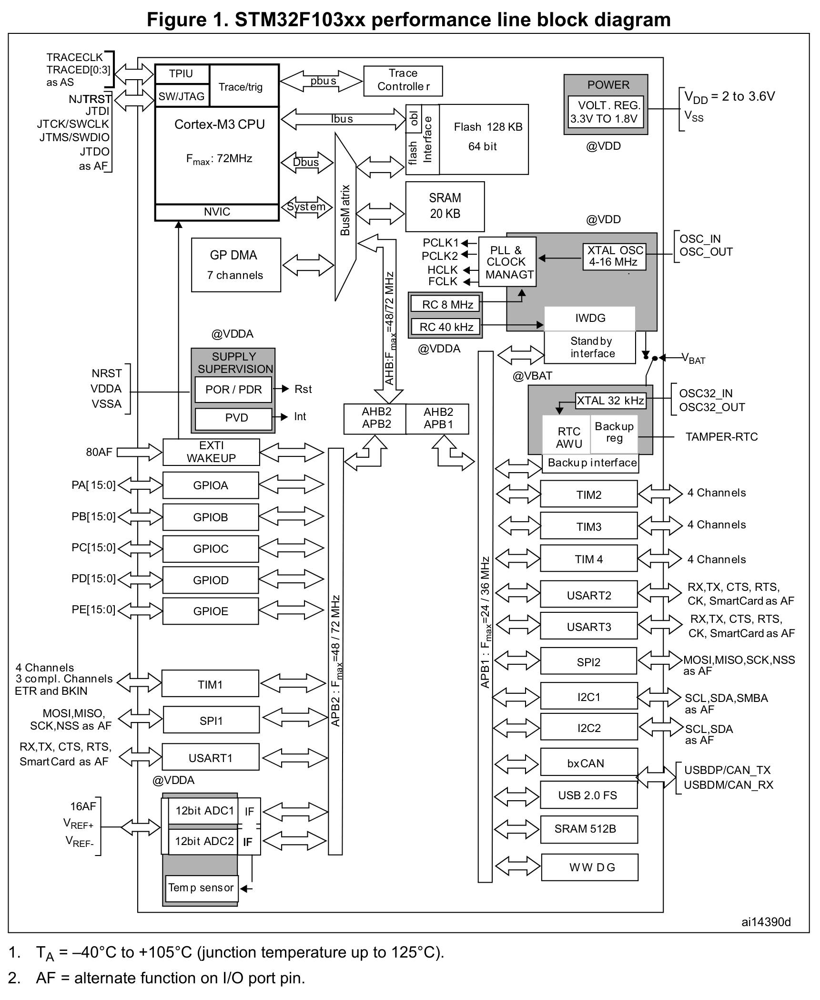
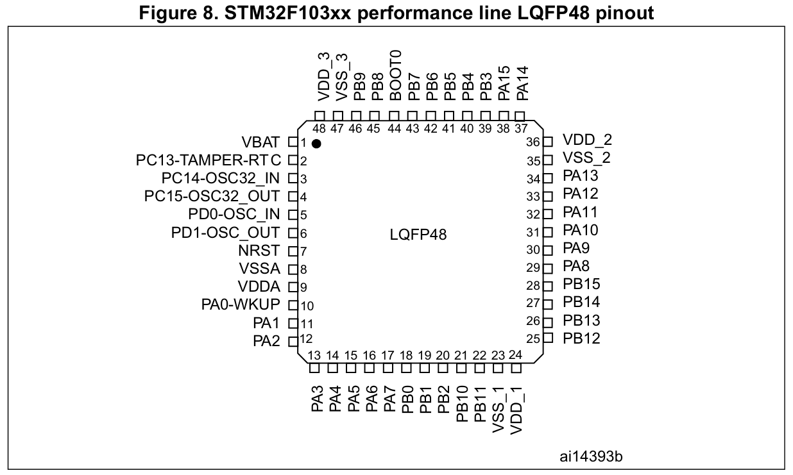
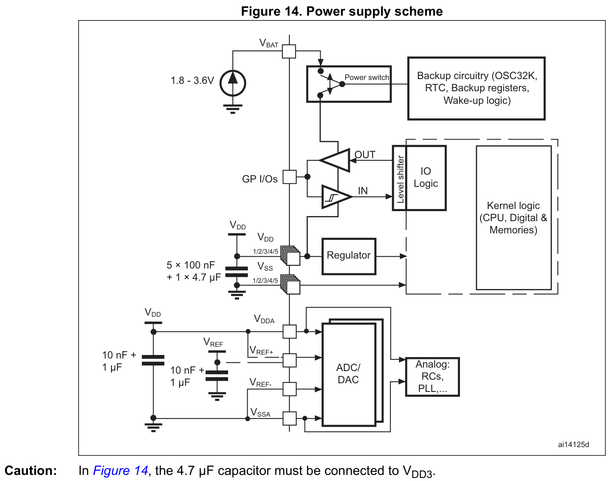
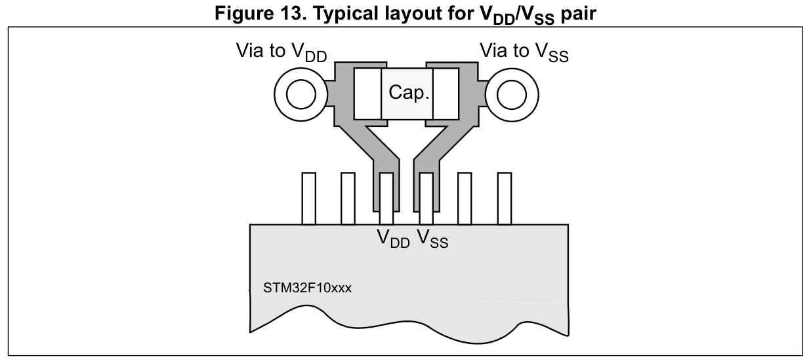
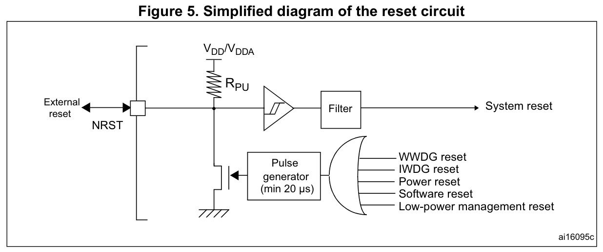
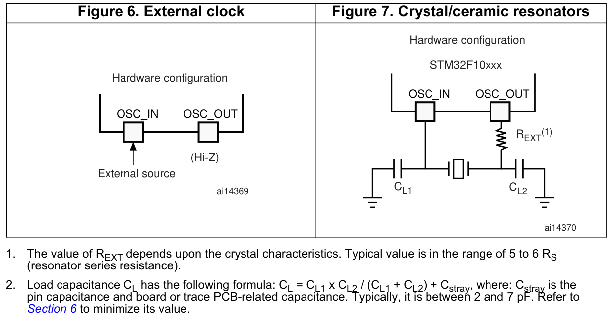
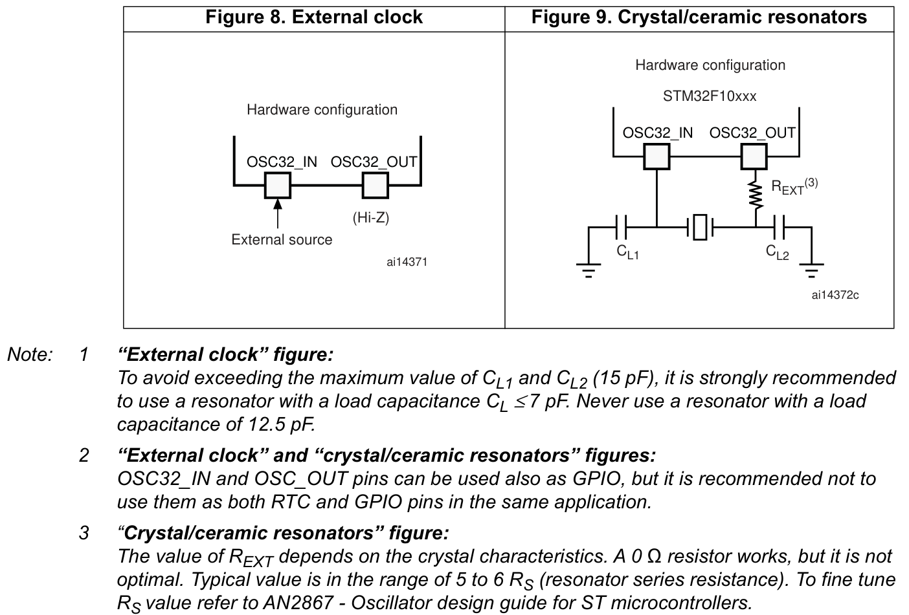

# 器件边界与硬件设计

[返回总目录](../README.md)

本章用于原理图、引脚分配和 PCB（印制电路板）设计时查阅。MCU 指微控制器。

**阅读导航**

1. [器件资源与引脚](#1-器件能力与资源约束)
2. [供电与去耦](#2-供电网络与封装条件)
3. [电气限值与热设计](#3-输入输出电气与热约束)
4. [启动与调试](#4-启动与调试接口)
5. [晶体与振荡器](#5-振荡器负载起振与驱动)
6. [PCB 与测量](#6-pcb与测量影响)

原图版权归 STMicroelectronics；图号、版本和适用条件随图标注。

## 1 器件能力与资源约束

### 1.1 核心资源

| 资源 | 规格 |
|---|---|
| CPU（中央处理器） | Arm Cortex-M3，最高 72 MHz |
| Flash（非易失闪存） | 64 KiB |
| SRAM（静态随机存储器） | 20 KiB |
| I/O（输入/输出） | 最多 37 个；包含晶体、调试等共享引脚 |
| ADC（模数转换器） | ADC1、ADC2；共享 10 个外部模拟输入 |
| TIM（定时器） | TIM1、TIM2、TIM3、TIM4 |
| DMA（直接存储器访问） | DMA1，7 个通道 |
| 封装 | LQFP48，48 引脚薄型四边扁平封装 |
| 温度等级 | 等级 6；常规最大功耗环境为 −40～+85 °C |

1 KiB = 1024 字节。可能读出的额外 Flash 空间不属于保证容量。低功耗下的扩展温度条件见第 3 节，不能直接套用到最大功耗运行。

依据：[DS5319 器件与资源](../来源/DS5319.md#src-ds5319-r20-device)、[DS5319 封装与复用](../来源/DS5319.md#src-ds5319-r20-pin)、[RM0008 共享资源约束](../来源/RM0008.md#src-rm0008-r21-resource-conflict)。

#### 1.1.1 系统架构与外设总线挂接



图 1，DS5319 Rev20，印刷/PDF 第 11 页。原图中的 AHB 是高级高性能总线，APB 是高级外设总线；两座 AHB/APB 桥把外设寄存器接到系统访问路径。找外设时，沿图中左右两条 APB 总线查对应模块：

下表摘出开发时常查的挂接关系，不作为完整外设清单。

| 总线或访问路径 | 常查模块与关系 |
|---|---|
| APB2 | GPIO、TIM1、SPI1、USART1、ADC1/2 |
| APB1 | TIM2/3/4、USART2/3、SPI2、I2C1/2、CAN、USB、窗口看门狗 WWDG 及备份接口 |
| DMA1 的 AHB 路径 | 访问存储器，或经桥访问外设 |

CPU 与 DMA 的具体竞争路径见[原厂总线矩阵图](04_DMA与缓冲区协作.md#41-找出竞争发生的位置)。

**挂接在哪条总线，不等于功能核就直接使用该总线频率。** 例如 TIM2 的寄存器接口属于 APB1，定时器核却可能使用 2×PCLK1；ADC1/2 经 APB2 访问，转换时钟还要经过 ADCPRE 分频；USB 经 APB1 访问，功能时钟来自 PLL 的 48 MHz 支路。分频、门控和独立供时路径见[原厂时钟树](02_时钟复位与低功耗.md#11-频率与分频)。

原图覆盖多个容量及封装，未删改其中的 Flash 128 KB、完整 GPIO 端口、16 路模拟输入或外部 VREF 标签；本器件仍按 §1.1 核心资源表的 64 KiB Flash 和本章 LQFP48 引脚图使用，不会因原图出现标签而增加可用引脚。图内 AHB/APB2 的 48/72 MHz、APB1 的 24/36 MHz 为系列并列标注，本器件上限分别为 72/72/36 MHz。原注 1 的 +105°C 不能替代等级 6 的常规满功耗温度范围；扩展温度条件见第 3 节。原注 2 中 AF 表示引脚复用功能。

来源：[DS5319 Rev20 Figure1 p11](https://www.st.com/resource/en/datasheet/stm32f103c8.pdf#page=11)；[裁图坐标与固定副本校验值](../assets/manual/system-architecture/README.md)。

### 1.2 引脚图与复用限制



图 8，DS5319 Rev20，印刷 p26：LQFP48 引脚分布。

分配引脚时，先按上图确认封装脚位，再同时检查共享资源、内部复用和上电状态。运行、低功耗和调试期间的用途也必须相容：

- USB（通用串行总线）与 CAN（控制器局域网）共享专用 SRAM，无法同时工作；串口、定时器、晶体和调试脚另有内部复用约束。
- 将 `OSC_IN/OSC_OUT` 重映射为 `PD0/PD1` 时，必须不使用 HSE（外部高速振荡源）。这两脚作输出时只能选择 50 MHz 输出模式；该模式名不保证实际波形能达到 50 MHz。
- 引脚表中 `PC13/PC14/PC15` 的“复位功能”指备份域首次上电时的功能。后续主复位不清除备份寄存器，因此不能一律按首次上电状态判断。

来源：[DS5319 Table 5 注 5–7](../来源/DS5319.md#src-ds5319-r20-pin)、[RM0008 §9.3.2 及 AFIO（复用功能 I/O）映射条件](../来源/RM0008.md#src-rm0008-r21-resource-conflict)。

### 1.3 硅修订识别

硅修订应由封装标记与调试器读数共同确认。`DBGMCU_IDCODE` 是 MCU 器件标识码寄存器（MCU device ID code），其中 `REV_ID` 是硅修订编号字段。使用该字段时须区分两种限制：

- 调试器读到 `REV_ID = 0x2003`，仍无法区分封装标记 Y、X、1、2、3。
- 应用程序脱离调试器读取 `DBGMCU_IDCODE` 得到 0，不能据此判为 A 版；用户软件访问该调试寄存器的限制见 ES096。

量产更换芯片批次或重新编译代码时，应按[ES096 硅标记与逐项矩阵](../来源/ES096.md#src-es096-r15-revision)逐项核查。“新标记”不代表历史限制均已消失。

## 2 供电网络与封装条件

### 2.1 电源连接速查

数字供电使用 `VDD/VSS`，模拟供电使用 `VDDA/VSSA`，备份供电使用 `VBAT`。下表中的  $`V_{DD}`$ 、 $`V_{DDA}`$ 、 $`V_{BAT}`$  分别表示这三路电源的电压。

| 网络 | 原理图基准 | 必须一起满足的条件 |
|---|---|---|
| 数字电源与地 `VDD/VSS` | 三组全部连接，每组就近 100 nF；4.7 µF 接 `VDD_3`，即 48 脚 |  $`V_{DD}=2.0\sim3.6\,\mathrm{V}`$ ；不能只接一组电源 |
| 模拟电源与地 `VDDA/VSSA` | 分别连接 `VDD/VSS`；数据手册基准为 10 nF + 1 µF | 不用 ADC 也必须接；使用 ADC 时  $`V_{DDA}\geq2.4\,\mathrm{V}`$  |
| 备份电源 `VBAT` |  $`V_{BAT}=1.8\sim3.6\,\mathrm{V}`$ ；不用电池时接 `VDD` 并就近 100 nF | 只维持备份域，不保持 CPU 或普通 SRAM |
| ADC 参考 | 芯片内部接 `VDDA/VSSA` | 不能照搬大封装外部 `VREF` 参考引脚的电路 |

### 2.2 原厂供电图与去耦数值



图 14 是系列通用图，保留了五组 `VDD/VSS`、外部 `VREF` 及 ADC 与 DAC（数模转换器）等标签。**实际接线按三组 `VDD/VSS` 和内部 `VDDA/VSSA` 参考连接处理；忽略图中的外部 `VREF` 支路及 DAC 标签。** 图下 4.7 µF 接 `VDD3` 的原注完整保留。

DS5319 与 AN2586 的去耦建议如下。原理图采用器件数据手册的数值；通用应用笔记用于理解布局和选材。

| 项目 | DS5319 器件基准 | AN2586 通用建议 |
|---|---|---|
| 每组数字供电 | 就近 100 nF | 100 nF 陶瓷电容 |
| 数字侧储能 | 4.7 µF，接 `VDD_3`（48 脚） | 最小 4.7 µF、典型 10 µF；钽或陶瓷电容 |
| 模拟侧去耦 | 10 nF + 1 µF | 100 nF 陶瓷电容 + 1 µF 钽或陶瓷电容 |

选材和板级优化还需考虑电源阻抗，并通过实测验证。通用建议不改变 4.7 µF 接 `VDD_3` 的连接要求。

来源：[DS5319 供电方案](../来源/DS5319.md#src-ds5319-r20-power)、[DS5319 引脚定义](../来源/DS5319.md#src-ds5319-r20-pin)、[AN2586 §2.2](../来源/AN2586.md#src-an2586-r8-power)。

### 2.3 去耦电容的局部布局



图 13，AN2586 Rev8，p22：VDD/VSS 引脚对的典型局部布局。

图中电容跨接局部电源与地：`VDD` 引脚、电容一端及 `VDD` 过孔属于同一局部电源网络；`VSS` 引脚、电容另一端及 `VSS` 过孔属于同一局部地网络。布板时应同时满足：

- 电容尽量靠近对应引脚，或放在对应引脚的 PCB 背面。
- 引脚、焊盘、走线和过孔形成低阻抗连接，并尽量减小局部回路面积。
- 三组 `VDD/VSS` 都连接并配置局部去耦。图中只画了一对电源脚，不能据此减少连接。

远处的同值电容不能替代对应引脚处的去耦，应沿引脚、电容与地连接检查完整短回路。这是对布局目的的工程说明；原厂图不规定本板实际尺寸、板层或电容值。

依据：[AN2586 Rev8 §6.3–6.4（p21）及 Figure 13（p22）](../来源/AN2586.md#src-an2586-r8-pcb)。

### 2.4 电源时序与 VBAT 注入风险

主电源与模拟电源应保持同电位：上电和运行期间， $`V_{DD}`$  与  $`V_{DDA}`$  的差值最多为 300 mV。采用磁珠或分别放置电容时，要核查压降及两侧瞬态不同步，而不只检查稳态电压。

备份电源还要检查快速上电时的注入路径。复位延时期间，备份域电源开关仍连接 `VBAT`；若  $`V_{DD}`$  上升较快并超过  $`V_{BAT}+0.6\,\mathrm{V}`$ ，内部二极管可能向 `VBAT` 注入电流。电池或备份电源若不能吸收这股电流，应按原说明用外部低压降二极管隔离。

来源：[DS5319 工作条件与适用限制](../来源/DS5319.md#src-ds5319-r20-operating)、[RM0008 VBAT 切换及供电](../来源/RM0008.md#src-rm0008-r21-vbat)。

### 2.5 仅由 VBAT 供电时的引脚功能

检测到 PDR（掉电复位，power-down reset）后，备份域电源开关也仍连接 `VBAT`。备份域的供电来源决定 `PC13/PC14/PC15` 可用的功能：

| 备份域供电来源 | `PC14/PC15` | `PC13` |
|---|---|---|
| `VDD` | GPIO（通用输入/输出）或 LSE（外部低速振荡源） | GPIO、TAMPER（入侵检测）及相应 RTC（实时时钟）输出 |
| 仅 `VBAT` | 仅 LSE | TAMPER、RTC 闹钟或秒输出 |

因此，仅由 `VBAT` 供电时不能把这些引脚当普通 GPIO 使用。来源：[RM0008 §5.1.2](../来源/RM0008.md#src-rm0008-r21-vbat)。

## 3 输入输出电气与热约束

### 3.1 FT 输入电压与供电条件

FT（five-volt tolerant）表示 5 V 容忍输入类型，必须按引脚表逐脚确认，并用于允许的模式。下表列出**芯片已上电时**的输入工作范围； $`V_{IN}`$  是输入脚电压， $`V_{SS}`$  是数字地电位，表中电压均参考  $`V_{SS}`$ 。

| 输入类型与供电条件 |  $`V_{IN}`$  工作范围 |
|---|---|
| FT， $`V_{DD}=2.0\,\mathrm{V}`$  | −0.3～5.2 V |
| FT， $`2.0\,\mathrm{V}<V_{DD}\leq3.6\,\mathrm{V}`$  | −0.3～5.5 V |
| 普通 I/O |  $`-0.3\,\mathrm{V}\sim V_{DD}+0.3\,\mathrm{V}`$  |

使用 FT 输入仍须满足两个独立条件：输入高于  $`V_{DD}+0.3\,\mathrm{V}`$  时关闭内部上下拉；上述工作范围不能外推至  $`V_{DD}=0`$ 。因此，不能仅凭“5 V 容忍”就让外部 5 V 信号在 MCU 掉电时继续驱动。上电和复位期间的默认上下拉另见第 3.3 节。

**BOOT0 按本机电源电平设计。** 原厂资料对此脚存在冲突：工作条件表写 0～5.5 V，引脚表未标 FT，绝对最大应力表对“其他引脚”给出 4.0 V 上限且未给 BOOT0 例外。本章不据这些互相冲突的条目认定更高输入电平安全；保守设计将其拉向本机 `VDD/VSS`，确需更高电平时应先取得 ST 确认。

来源：[DS5319 Table 9 及注 3、工作条件](../来源/DS5319.md#src-ds5319-r20-operating)、[BOOT0 原文冲突](../来源/DS5319.md#src-ds5319-r20-boot0-conflict)、[绝对最大应力范围](../来源/DS5319.md#src-ds5319-r20-stress)。

### 3.2 GPIO 内部弱上下拉

GPIO 内部弱上下拉的典型等效电阻为 40 kΩ，电平与容差计算应使用下表的最小、最大值及相应测试条件。

| 参数 | 含义 | 测试条件 | 最小 | 典型 | 最大 | 单位 |
|---|---|---|---:|---:|---:|---|
|  $`R_{PU}`$  | GPIO 弱上拉等效电阻 |  $`V_{IN}=V_{SS}`$  | 30 | 40 | 50 | kΩ |
|  $`R_{PD}`$  | GPIO 弱下拉等效电阻 |  $`V_{IN}=V_{DD}`$  | 30 | 40 | 50 | kΩ |

 $`R_{PU}`$ 、 $`R_{PD}`$  的下标 PU、PD 分别表示 pull-up（上拉）、pull-down（下拉）； $`V_{IN}`$ 、 $`V_{DD}`$ 、 $`V_{SS}`$  分别是输入脚电压、数字电源电压和数字地电位，均以 V 计。

除另有说明外，表中参数采用 DS5319 Table 9 的一般工作条件。DS5319 §5.1.2（印刷 p35）规定，未另注明的典型值基于  $`T_A=25\,{}^\circ\mathrm{C}`$ 、 $`V_{DD}=3.3\,\mathrm{V}`$ ，仅供设计指导且不经测试； $`T_A`$  为环境温度。

Table 36 注 7 说明，这一电路由实际电阻与可切换的 PMOS/NMOS（P 沟道/N 沟道 MOS 晶体管）串联构成，MOS 器件对串联电阻的贡献约为 10%。这些阻值不解除第 3.1 节的 FT 输入条件：输入高于  $`V_{DD}+0.3\,\mathrm{V}`$  时仍须禁用内部上下拉。

来源：[DS5319 Rev20 §5.3.13，Table 36（p61）及续于 p62 的注 7](../来源/DS5319.md#src-ds5319-r20-io-pull-values)。

### 3.3 调试脚的上电与复位窗口

外部 5 V 输入的兼容性必须覆盖应用程序尚未接管引脚的窗口。调试脚的默认偏置如下：

| 调试引脚 | 上电/复位默认偏置 |
|---|---|
| `PA13/JTMS`、`PA15/JTDI`、`PB4/NJTRST` | 上拉 |
| `PA14/JTCK` | 下拉 |

调试映射未释放时，GPIO 配置不生效。因此，即使这些脚标为 FT，也不能只靠应用初始化关闭上下拉，来保证整个上电和复位过程都满足输入条件。

若外部信号在该窗口可能高于  $`V_{DD}+0.3\,\mathrm{V}`$ ，应选择复位默认无拉电阻、功能分配合适且电气条件合规的其他输入脚，或用经验证的电平转换/隔离覆盖整个时序。

依据：DS5319 Rev20 p61 Table 36 注 3 与 RM0008 Rev21 p1085 §31.4，见[FT 输入条件](../来源/DS5319.md#src-ds5319-r20-io-ft-pull)、[调试脚复位状态](../来源/RM0008.md#src-rm0008-r21-swj-reset-pull)。

### 3.4 输出驱动与电流预算

输出负载应按电平保证条件设计。 $`V_{OL}`$  是输出低电平电压， $`V_{OH}`$  是输出高电平电压；两者必须在对应供电电压、负载和同时驱动引脚数下评估。

- 单脚 ±25 mA、电源/地总电流 150 mA 是绝对最大应力边界，不能作为输出电平的保证条件。总电流预算还须计入芯片自身运行电流。
- 多脚注入电流按各脚瞬时电流的绝对值求和，不能用正负抵消。
- `PC13/PC14/PC15` 受 3 mA 内部开关、2 MHz、30 pF 及不得作为电流源的限制，不能按普通 GPIO 驱动 LED 高端。
- 50 MHz 输出档位不保证任意电源和负载下都能输出 50 MHz。

[必要电气参数](../参数/01_硬件电气参数.md)列有注入电流限值、8 脚同时输出的电平条件、MODE（输出模式字段）档位速度及相应脚注。使用这些附带条件的电气参数，不能以单脚应力上限代替。

依据：[DS5319 Table 7 电流应力极限](../来源/DS5319.md#src-ds5319-r20-stress)、[引脚专有限制](../来源/DS5319.md#src-ds5319-r20-pin)、[Tables 37–38 输出电平与速度](../来源/DS5319.md#src-ds5319-r20-io-output)。

### 3.5 热设计

热设计采用：

```math
T_{J,\max}=T_{A,\max}+P_{D,\max}\,\Theta_{JA}
```

-  $`T_{J,\max}`$ ：最坏结温，°C
-  $`T_{A,\max}`$ ：最大环境温度，°C
-  $`P_{D,\max}`$ ：内部与 I/O 的最坏总耗散，W
-  $`\Theta_{JA}`$ ：结到环境热阻，°C/W

下标 J 表示结，A 表示环境，D 表示耗散，max 表示最大值。

功耗分为芯片内部耗散和输出驱动耗散：

```math
P_{D,\max}=P_{INT,\max}+P_{I/O,\max}
```

 $`P_{INT,\max}`$  为内部最坏功耗； $`P_{I/O,\max}`$  为 I/O 最坏功耗，单位均为 W。

```math
P_{INT,\max}=I_{DD,\max}\,V_{DD}
```

 $`I_{DD,\max}`$  为对应运行条件下最大内部电源电流，A； $`V_{DD}`$  为数字供电电压，V。

```math
P_{I/O,\max}=\sum(V_{OL}I_{OL})+\sum[(V_{DD}-V_{OH})|I_{OH}|]
```

-  $`V_{OL}`$ ：输出低电平电压，V
-  $`I_{OL}`$ ：输出低电平灌电流，A
-  $`V_{OH}`$ ：输出高电平电压，V
-  $`|I_{OH}|`$ ：输出高电平源电流幅值，A
-  $`V_{DD}`$ ：数字供电电压，V

各项按参与输出的引脚求和，结果为 W。使用实际负载下的  $`V_{OL}`$  /  $`V_{OH}`$ ；高电平项取电流幅值是使耗散为正的符号约定澄清，原式写  $`I_{OH}`$ 。不将芯片外部负载全部功率直接算作芯片内部耗散。该热阻表引用 JESD51-2 的自然对流、静止空气环境，未给出本应用 PCB 的实测热阻。

LQFP48 的资料热阻值为 55 °C/W，使用时不能忽略板层、气流等适用条件。等级 6 的正常工作结温上限为 105 °C，150 °C 是绝对最大应力值。若在低功耗条件下使用至 105 °C 环境温度，仍须满足结温要求，不能将其提升为全功耗环境等级。

来源：[DS5319 §6.10 功耗公式与热阻](../来源/DS5319.md#src-ds5319-r20-thermal)、[工作温度与供电条件](../来源/DS5319.md#src-ds5319-r20-operating)。

## 4 启动与调试接口

### 4.1 启动源与采样时刻

| BOOT0 | BOOT1 | 启动源 |
|---:|---:|---|
| 0 | 任意 | 用户 Flash |
| 1 | 0 | 系统存储器 |
| 1 | 1 | SRAM |

启动引脚在复位后第 4 个 SYSCLK（系统时钟）上升沿锁存，工程上应在释放复位前使其稳定；退出 Standby（待机模式）时会重新采样。`BOOT0` 位于 44 脚，`PB2/BOOT1` 位于 20 脚。若启动后把 `PB2` 用作 GPIO，还要检查外部启动偏置对运行功能的影响。

系统存储器中的 ROM Bootloader（固化的启动加载程序）使用 USART1（通用同步/异步收发器 1）。接线、串口格式和握手见[ROM 串口连接与识别](../参数/启动/ROM串口连接与识别.md)。

依据：[AN2586 启动与救援接口](../来源/AN2586.md#src-an2586-r8-boot)、[DS5319 封装引脚](../来源/DS5319.md#src-ds5319-r20-pin)。

### 4.2 调试接口与 NRST



图 5，AN2586 Rev8，p11：复位电路。图中 min 20 µs 是**内部脉冲发生器**的标注，不能作为任意外部 NRST 脉冲的识别条件。

建议保留 SWD（串行线调试）的 `SWDIO` 数据线、`SWCLK` 时钟线、地和 `NRST` 复位引脚的可达连接。需要串口救援时，同时留出 BOOT 操作和 USART1 接口。

`NRST` 内部已有上拉和复位逻辑，且不是 FT 引脚。外部复位电路应满足以下条件：

- 拉低电压必须低于 0.8 V；100～300 ns 的外部脉冲没有必定滤除或必定识别的保证。
- 常用 0.1 µF 电容用于抗扰。电容过大可能妨碍调试器驱动，允许值须服从所用调试器的电气能力；数据手册未给通用上限。
- 内部上拉等效电阻  $`R_{PU}`$  在  $`V_{IN}=V_{SS}`$  时为 30/40/50 kΩ（最小/典型/最大）。其余输入阈值、滞回、脉宽和设计保证脚注见[NRST 参数](../参数/01_硬件电气参数.md#nrst输入参数)。

RM0008 所述 20 µs 是内部脉冲发生器对各复位源形成的最短复位脉冲，不取代 DS5319 Table 39 的外部输入滤波条件。外接电容对调试器的影响属于充放电和驱动能力的工程约束，不能当作数据手册已给定的电容额定上限。

来源：[RM0008 §7.1.2 与 Figure 7](../来源/RM0008.md#src-rm0008-r21-reset-pulse)、[DS5319 NRST 电气边界](../来源/DS5319.md#src-ds5319-r20-nrst)。

## 5 振荡器负载、起振与驱动

### 5.1 频率与晶体选型

HSE 是外部高速振荡源，LSE 是外部低速振荡源。两者都要先区分**无源晶体电路**与**外部时钟旁路输入**，再选择频率和外围器件。



图 6–7，AN2586 Rev8，p12：HSE 旁路输入与无源晶体电路，保留原脚注。

HSE 无源晶体的频率范围为 4～16 MHz；旁路输入最高 25 MHz，属于另一种工作模式。图中串联电阻的通用经验值还须按第 5.5 节核查。



图 8–9，AN2586 Rev8，p14：LSE 旁路输入与无源晶体电路，保留三条原注。

LSE 通常使用 32.768 kHz 晶体。 $`C_L`$  表示晶体要求的等效负载电容， $`C_{L1}`$ 、 $`C_{L2}`$  是晶体两侧外接的负载电容。选型须一起满足：

- 数据手册建议  $`C_L\leq7\,\mathrm{pF}`$ ，不选 12.5 pF 负载晶体，以避免两侧外接电容超过 15 pF。
-  $`C_{L1}`$ 、 $`C_{L2}`$  建议使用 5～15 pF 的高质量陶瓷电容；具体计算见第 5.2 节。

AN2586 p14 把负载电容注释挂在“External clock”图名下，但实际含两侧负载电容的是无源晶体电路。该注释应结合电路理解，不能据此给旁路输入照加负载电容。

对于本节的 HSE/LSE 无源晶体电路，按 Pierce 电路验证的晶体应为基频模式设计，不能仅凭标称频率相同就换成泛音模式晶体。

外部时钟并非上电运行的无条件必需品；USB 与准确的掉电计时则各有时钟条件，应按具体功能选择时钟源。

来源：[AN2867 晶体选型流程](../来源/AN2867.md#src-an2867-r24-selection)、[AN2867 驱动与安全系数](../来源/AN2867.md#src-an2867-r24-safety-drive)、[DS5319 振荡器条件](../来源/DS5319.md#src-ds5319-r20-clock)、[AN2586 LSE 选型限制](../来源/AN2586.md#src-an2586-r8-clock)。

### 5.2 负载电容

晶体负载采用下列等效模型：

```math
C_L=\frac{C_{L1}C_{L2}}{C_{L1}+C_{L2}}+C_s
```

-  $`C_L`$ ：晶体看到的等效负载电容，pF
-  $`C_{L1}`$ 、 $`C_{L2}`$ ：晶体两侧各自的外接电容，pF
-  $`C_s`$ ：本模型中的等效寄生电容，pF

当两侧电容相等且  $`C_L>C_s`$  时，每颗电容的初值为：

```math
C_{L1}=C_{L2}=2(C_L-C_s)
```

这里的  $`C_s`$  是模型中的等效量，不能把所有引脚对地电容不加区分地相加。计算结果只是选值起点，还应以已知标准晶体实测，将振荡频率调至目标值；不能用“两颗常见的 22 pF”代替计算。

来源：[AN2867 负载模型](../来源/AN2867.md#src-an2867-r24-load)。

### 5.3 标准晶体频偏与原文公式差异

校准负载电容时，目标应是标准晶体在标称负载下的**已知实际频率**，包含厂家表征的带符号频偏，而不只是标称频率。令：

-  $`F_{\mathrm{nominal}}`$ ：标称频率，Hz
-  $`F_{\mathrm{standard}}`$ ：标准样品的实际频率，Hz
-  $`\Delta F`$ ：实际频率相对标称频率的带符号偏差，Hz
-  $`\mathrm{PPM}_{\mathrm{standard}}`$ ：厂家表征的带符号 ppm 数值，ppm 表示百万分之一

按这些变量的定义，有：

```math
\Delta F=F_{\mathrm{nominal}}\frac{\mathrm{PPM}_{\mathrm{standard}}}{10^6}
```

```math
F_{\mathrm{standard}}=F_{\mathrm{nominal}}+\Delta F
=F_{\mathrm{nominal}}\left(1+\frac{\mathrm{PPM}_{\mathrm{standard}}}{10^6}\right)
```

**原文差异。** AN2867 Rev24 p26 印刷式为：

```math
F_{\mathrm{standard}}=F_{\mathrm{nominal}}\frac{\mathrm{PPM}_{\mathrm{standard}}}{10^6}
```

该式右侧按同页变量定义给出的是频偏  $`\Delta F`$ ，不是实际振荡频率。上面的“加 1”表达式是基于定义和代数关系的工程澄清，并非 ST 正式勘误。两式都能具有 Hz 单位，单靠量纲检查无法发现这一缺项。

实际调校应保留标准晶体本身已知的频偏，避免把它错误抵消。来源：[AN2867 §4.2 p26–27](../来源/AN2867.md#src-an2867-r24-selection)；负载模型另见[AN2867 §3.3](../来源/AN2867.md#src-an2867-r24-load)。

### 5.4 临界跨导与起振裕量

先用跨导模型筛选晶体，再通过板级测试确认起振裕量。等负载且与标称负载匹配时，临界跨导为：

```math
g_{m,\mathrm{crit}}=4\,\mathrm{ESR}\,(2\pi F)^2(C_0+C_L)^2
```

-  $`g_{m,\mathrm{crit}}`$ ：小信号起振模型的临界跨导，A/V，即西门子 S；crit 表示临界值
-  $`\mathrm{ESR}`$ ：晶体等效串联电阻，Ω
-  $`F`$ ：振荡频率，Hz
-  $`C_0`$ ：晶体静态并联电容，代入单位为法拉 F
-  $`C_L`$ ：晶体标称负载电容，代入单位为法拉 F

频率符号  $`F`$  与电容单位 F 含义不同；MHz 和 pF 分别换算为  $`10^6`$  Hz 和  $`10^{-12}`$  F 后代入。

**按数据手册所给指标选择比较方式。**  $`g_m`$  为振荡器自身跨导， $`G_{m,\mathrm{crit,max}}`$  为最大允许临界跨导，两者单位均为 A/V。

| 数据手册提供的量 | 选型判据 | 裕量含义 |
|---|---|---|
| 振荡器自身跨导  $`g_m`$  |  $`g_m/g_{m,\mathrm{crit}}>5`$  | 比值为无量纲起振裕量 |
| 最大允许临界跨导  $`G_{m,\mathrm{crit,max}}`$  |  $`g_{m,\mathrm{crit}}<G_{m,\mathrm{crit,max}}`$  | 上限已含相应裕量，不再除以 5 |

上述公式依赖等负载和标称负载匹配，不能替代温度、电压与物料容差下的起振测试。来源：[AN2867 起振裕量](../来源/AN2867.md#src-an2867-r24-gm)。

**实测负阻安全系数是另一个指标。** AN2867 p18 定义：

```math
S_f=\frac{R_{\mathrm{ADD}}+\mathrm{ESR}}{\mathrm{ESR}}
```

 $`S_f`$  是无量纲安全系数； $`R_{\mathrm{ADD}}`$  是测量时附加的串联电阻， $`\mathrm{ESR}`$  是晶体等效串联电阻，两者均用 Ω。AN2867 Table 4 的等级要求为 HSE  $`S_f\geq5`$ 、LSE  $`S_f\geq3`$ ；LSE 达到  $`S_f\geq5`$  时具有更高裕量，不能将其与前述跨导初筛混为同一指标。

原文 p19 又把刚能阻止起振的附加串阻  $`R_{\mathrm{ADD}}`$  直接称为振荡器负阻，与 p18 公式存在定义差异。因此，不能无条件把附加串阻与负阻等同；临界测量必须说明采用的定义，不能仅凭这处有歧义的叙述认证板级裕量。

来源：[AN2867 §3.8](../来源/AN2867.md#src-an2867-r24-safety-drive)。

### 5.5 驱动功率与串联电阻

晶体实际驱动功率必须低于厂商额定。若需要加入串联限流电阻  $`R_{\mathrm{Ext}}`$ （单位 Ω），应在第 5.4 节跨导计算中用  $`\mathrm{ESR}+R_{\mathrm{Ext}}`$  替换  $`\mathrm{ESR}`$ ，然后重新计算，并确认仍满足起振裕量要求。

串阻过小可能无法限制晶体功耗，过大则可能阻止起振。因此，不能只凭任一室温样品启动就判定全条件合格，也不能把 AN2586 所述约 5～6 倍  $`\mathrm{ESR}`$  的通用经验值直接当作所有晶体的必选串阻。

这一串联电阻与 LSE 漏电勘误中的 16～22 MΩ 电阻作用不同：后者是跨晶体的**并联反馈电阻**，连接条件见第 5.6 节。

来源：[AN2867 驱动功率与串阻](../来源/AN2867.md#src-an2867-r24-safety-drive)、[AN2586 振荡器电路](../来源/AN2586.md#src-an2586-r8-clock)。

### 5.6 LSE 漏电勘误

无涂覆电路在潮湿、凝霜等环境下的微小漏电，可能使 LSE 只在备份域首次上电时表现为不起振。ES096 Table 3 对列出的全部硅修订均标为 A，表示限制存在且有规避方法。

勘误中的 16～22 MΩ 反馈电阻跨接 `OSC32_IN/OSC32_OUT`，与晶体并联；它不能代替负载电容，也不是第 5.5 节的串联限流电阻。来源：[ES096 LSE 漏电限制](../来源/ES096.md#src-es096-r15-lse)。

## 6 PCB与测量影响

### 6.1 回流、局部地与晶体外壳

PCB 布局应优先控制回流和敏感回路：去耦电容就近放置，晶体走线尽量短，高速及高电流信号远离振荡节点。局部地须接到合理的 MCU 参考点，不能机械割裂地面或做悬空铜岛。

AN2867 给出的具体场景是：振荡器下方的局部地层接最近的 MCU 地；若晶体采用金属封装，不把外壳接到这里所述的振荡器局部地。外壳或焊盘仍须遵循具体晶体的封装定义和实际地网络，不能概括成“全部接地”或“全部悬空”。

该局部地条件与其他笔记的一般接地建议不能脱离场景直接合并。尤其是与 AN2834 相关建议的跨文档比较尚未完成核实，本章不以该差异作接地设计定论，也不将其视为已确认的统一规则。

依据：[AN2586 PCB 回流与去耦](../来源/AN2586.md#src-an2586-r8-pcb)、[AN2867 局部地与金属外壳条件](../来源/AN2867.md#src-an2867-r24-layout)。

### 6.2 排查与测量记录

| 现象 | 优先取证 | 不应直接得出的结论 |
|---|---|---|
| 完全不启动或调试不可达 | 全部供电、`VDDA`、`NRST`、BOOT、SWD 占用；先确认 HSI（内部高速 RC 振荡器）路径 | 立即判定外部晶体损坏 |
| LSE 偶发不起振 | 冷启动、温压、 $`\mathrm{ESR}`$  与负载、焊接污染、潮湿/涂覆 | 只加长等待就已解决量产风险 |
| 接探头后起振或频偏变化 | 探头电容和临时地线，比较无探头状态 | 测量波形等于未扰动运行状态 |
| GPIO 活动引起 RTC 漂移 | `PC13` 是否输出 LED/校准信号，电源和邻近走线 | 低频切换一定没有耦合 |

上表为工程综合排查线索，不是原厂逐项诊断表，也不构成现象与原因的一一对应。

相关物理约束依据[AN2867 故障方向与验收](../来源/AN2867.md#src-an2867-r24-selection)、[AN2867 布局与测量条件](../来源/AN2867.md#src-an2867-r24-layout)、[AN2867 PC13 活动影响](../来源/AN2867.md#src-an2867-r24-pc13)。

比较不同测量结果需明确芯片/晶体完整型号、硅标记、PCB 与工艺版本、负载模型、起振时间、驱动功率、频率误差和工作条件。

### 6.3 频率误差预算

将晶体初始误差与负载偏差分别取界限，可写出简化的保守预算：

```math
\mathrm{PPM}_{\mathrm{budget}}=
\mathrm{PPM}_{\mathrm{crystal}}+
\left|\mathrm{Deviation}(C_L)\right|\left|P_{\mathrm{crystal}}\right|
```

-  $`\mathrm{PPM}_{\mathrm{budget}}`$ ：本简化模型给出的频率误差界限，ppm
-  $`\mathrm{PPM}_{\mathrm{crystal}}`$ ：非负的晶体初始频率误差界限，ppm
-  $`\mathrm{Deviation}(C_L)`$ ：负载电容相对目标值的偏差，pF
-  $`P_{\mathrm{crystal}}`$ ：晶体频率对负载电容的牵引率，ppm/pF

初始误差和负载偏差均应按所需界限取值。式中对独立最坏误差取幅值，是本章采用的保守预算说明；AN2867 原式写相应项相加。

AN2867 p28 明确这项预算未计入温度。温度曲线、老化、装配和测量影响还须另行计入，不能将此简式当作全温、全寿命精度保证。来源：[AN2867 §4.2 p27–28](../来源/AN2867.md#src-an2867-r24-selection)。
