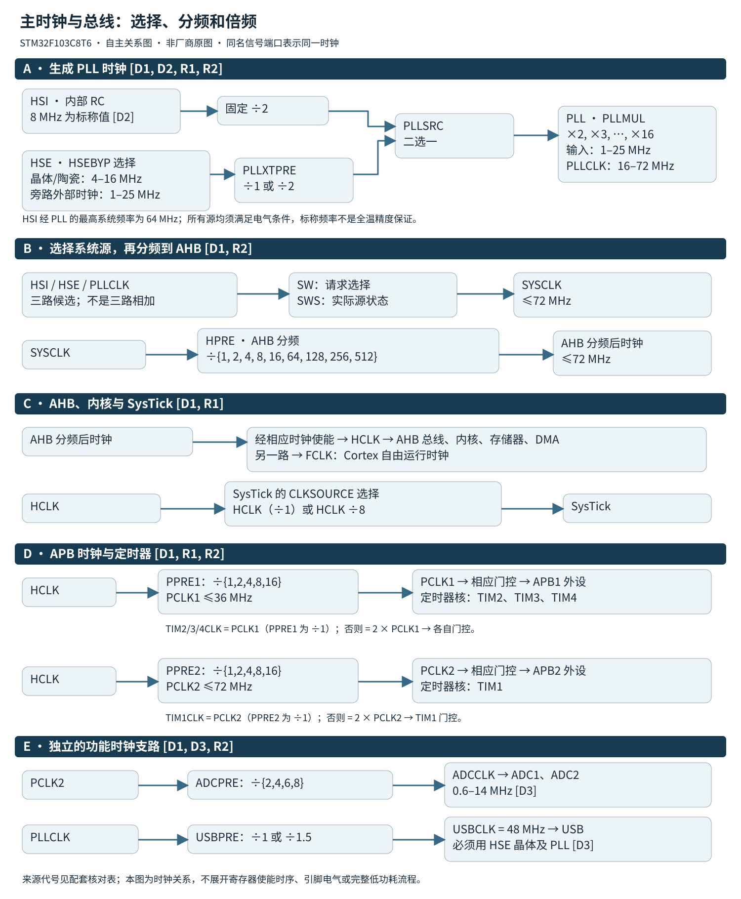
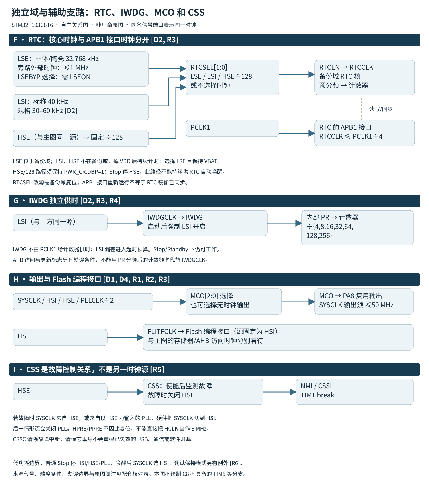

# 时钟复位与低功耗

[返回总目录](../README.md)

本篇把RCC、Flash等待周期、PWR、RTC异步接口和低功耗勘误放在同一运行状态模型中。对象为STM32F103C8T6；依据固定版本的RM0008 Rev 21、DS5319 Rev 20、PM0075 Rev 2、PM0056 Rev 7、ES096 Rev 15及UM1850 Rev 3。状态转换约束：硬件切换完成、软件频率变量更新、外设恢复与唤醒事件处理必须分别验证，调用成功不能代替整条链路的验收。

两幅自主时钟关系图须与配套参数、关系表和条件说明一起阅读。范围、未展开内容及原文差异见[范围与已知限制](../已知限制.md)。

## 1 从外设要求反推整个时钟树

| 时钟 | C8边界 | 易错点 |
|---|---|---|
| SYSCLK / HCLK | 最高72 MHz；复位HSI标称8 MHz | HSI/2进入PLL最高64 MHz |
| PCLK1 / PCLK2 | 分别最高36 / 72 MHz | 升主频前先设置分频 |
| TIM2/3/4、TIM1 | 对应APB分频为1时等于PCLK，否则为2×PCLK | APB1=36 MHz不代表TIM2只有36 MHz |
| ADC | PCLK2经/2、/4、/6、/8，最高14 MHz | PCLK2=72 MHz时/4超限，/6得到12 MHz |
| USB | PLL /1或/1.5得到48 MHz | 数据手册要求HSE晶体及PLL；不是任意RC组合均可替代 |
| RTC / IWDG | RTC选LSE、LSI、HSE/128；IWDG使用LSI | 掉VDD后持续RTC计时需LSE及VBAT |

依据：[RM0008 时钟树与分频](../来源/RM0008.md#src-rm0008-r21-clock-tree)、[RM0008 RTC供时与接口条件](../来源/RM0008.md#src-rm0008-r21-rtc-clock)、[DS5319 器件时钟边界](../来源/DS5319.md#src-ds5319-r20-clock-device)、[DS5319 电源与温度前提](../来源/DS5319.md#src-ds5319-r20-power-precondition)。PLL输入范围、晶体/旁路条件和RC偏差还须查[DS5319 时钟电气特性](../来源/DS5319.md#src-ds5319-r20-clock-electrical)，只把乘除结果算到72 MHz并不足够。

**图A 主时钟与总线。** 自主编排的STM32F103C8T6时钟关系图，不是ST原图或原图描摹。HSI经固定÷2，或HSE经PLLXTPRE的÷1/÷2，由PLLSRC选择后进入PLL；PLLMUL可选整数×2至×16。SW请求在HSI、HSE、PLLCLK之间选SYSCLK，实际源由SWS读取。SYSCLK经HPRE得到AHB分频后时钟，分别供HCLK及Cortex自由运行FCLK；HCLK供内核、AHB、存储器和DMA。SysTick在HCLK和HCLK÷8中选择。HCLK经PPRE1/2形成PCLK1/2，相应定时器核在APB分频为1时取PCLK，否则取2×PCLK。ADC1/2由PCLK2经ADCPRE供时；USB功能时钟由PLLCLK经USBPRE供时。图中的重复同名端口是同一信号，并非额外振荡器。各功能还须满足时钟使能、频率、电源、温度和Flash访问条件。

**图B 独立域与辅助支路。** RTCSEL在LSE、LSI、HSE÷128之间选择RTC源，并由RTCEN使能。RTCCLK供备份域RTC核，PCLK1单独供RTC的APB1接口；RTCCLK须≤PCLK1÷4。金色虚线仅表示RTC接口与核的读写/同步关系，不是时钟线。LSE在备份域，HSE、LSI不在；掉VDD后计时保证需选择LSE并保持VBAT。IWDG由LSI独立供时，启动后强制LSI。MCO可选SYSCLK、HSI、HSE、PLLCLK÷2到PA8，HSI另供FLITFCLK。CSS框内箭头表示监测和故障事件，不是CSS产生时钟；当HSE直接或经PLL供SYSCLK时，HSE故障触发SYSCLK切HSI。图中仅保留C8资源。

HSI的8 MHz、LSI的40 kHz和LSE晶体的32.768 kHz不能理解成无误差、全温保证。允许的PLL倍数并不自动保证输入/输出电气合规。USB必须使用HSE晶体及PLL并得到48 MHz；HSE旁路能力不等于本图承诺USB可用任意外部源。ADC的0.6–14 MHz范围不是任意采样时间下都能保证1 μs转换。图的简化门控不替代寄存器级控制模型。

图中D1–D4、R1–R6代号及完整节点条件见[时钟图关系与固定来源](../参数/时钟图关系与来源.md)。两幅图须与该页共同使用。

原DS5319 Rev20 Figure2 p12图注1（HSI作为PLL输入时系统频率最高64 MHz）及图注2（HSE和PLL使能、USBCLK=48 MHz）已保留。图注3的14/28/56 MHz和1 µs关系存在来源差异，详见下段。

ADC图注边界：DS5319 Rev20 Figure2 note3 p12列APB2为14、28或56 MHz可实现1 µs ADC转换；同一DS §5.3.18 Table47 p74给最短采样1.5周期、总转换14 ADC周期，1 µs条件为ADCCLK=14 MHz，而RM0008 §7.3.2 p102仅允许ADCPRE=/2、/4、/6、/8。因此PCLK2=14 MHz时最高ADCCLK为7 MHz，最短转换2 µs，与原图注该项不相容。若只按fADC=14 MHz、PCLK2≤72 MHz及这些分频推导，可选PCLK2=28 MHz（/2）或56 MHz（/4），还须满足1.5周期采样、输入/模拟供电等条件；这不是ST正式更正。外部触发延迟另列，不能把1 µs转换扩大成任意触发到结果的端到端保证。 [原图注与详细规格](../来源/DS5319.md#src-ds5319-r20-clock-device)。

HSI/HSE为高速源，LSI/LSE为低速源；SYSCLK经AHB、APB分频形成HCLK及PCLK，定时器倍频、ADC和USB分频须沿各自支路核对。图中的路径能力不解除C8的频率和电气限制。

HSE作为PLL源时：`fPLL = fHSE ÷ D × M`；HSI路径为`fPLL = fHSI ÷ 2 × M`。fPLL为PLL输出频率，fHSE、fHSI分别为HSE、HSI源频率，三者单位均为Hz；D为HSE预分频整数1或2，M为PLL倍频整数2～16，两者无量纲。总线关系为`fHCLK = fSYSCLK ÷ A`、`fPCLKx = fHCLK ÷ Px`；fSYSCLK、fHCLK、fPCLKx均为Hz，A及Px是所选无量纲分频系数，x表示APB1或APB2；A可选{1,2,4,8,16,64,128,256,512}，Px可选{1,2,4,8,16}。PLL实际输入还须为1～25 MHz，输出为16～72 MHz（[DS5319 PLL参数与脚注](../来源/DS5319.md#src-ds5319-r20-pll)）；仅满足整数倍频编码仍可能落到电气范围外。定时器在Px≠1时的倍频不提高其器件允许上限。

72 MHz等上限以器件电源和温度条件为前提：DS5319 Rev20 Table9要求VDD=2.0–3.6 V；VDDA与VDD同电位，允许上电/运行中最多300 mV差异。ADC使用时VDDA为2.4–3.6 V；VBAT为1.8–3.6 V。PLL的模拟部分也使用VDDA，不能因不使用ADC而省略模拟供电。Flash等待周期仍按本篇第2节处理。

HSE晶体/陶瓷谐振器范围4–16 MHz，旁路外部输入范围1–25 MHz；两者不是同一规格。旁路必须先关HSE再改HSEBYP，外部信号送OSC_IN，OSC_OUT保持高阻。Table20另要求高电平≥0.7VDD且≤VDD、低电平≥VSS且≤0.3VDD，占空比45–55%，高/低时间各≥5 ns，上升/下降各≤20 ns；高低时间、边沿项是设计保证、非生产测试。外部时钟输入的幅度和时序不能只用频率范围代替。

PLL输入占空比40–60%；tLOCK最大200 µs、周期到周期抖动最大300 ps。Table27注1说明这些Min/Max来自特性评估、非生产测试（除另有规定），注2要求同时满足输入和输出范围；不能把200 µs锁定上界与HSE晶体起振时间合并成一个保证。Table22的HSE 2 ms为稳定VDD下、标准8 MHz晶体的典型起振时间，随晶体制造商可显著变化；应用超时还须覆盖实际晶体/负载/温度条件。

LSI在Table25条件VDD=3 V、TA=−40～105°C下，频率Min/Typ/Max为30/40/60 kHz，频率项为特性评估、非生产测试（除另有规定）；LSIRDY之后另需ES096的100 µs稳定等待。HSI的8 MHz是典型值：Table24工厂校准误差在25°C为−1.1～+1.8%，−40～105°C为−2～+2.5%，默认VDD=3.3 V；不能把RM中25°C约±1%叙述当成DS全温保证。

RTC接口需RTCCLK≤PCLK1/4，降APB1时仍须满足。只有LSE位于备份域；以LSE作RTC源并保持VBAT，才能在VDD关闭后保证继续计时。LSI路径不提供掉VDD保持保证。HSE/128作RTC源时PWR_CR.DBP必须保持1；HSE在Stop/Standby停止，因此此源不能用于这些模式下的RTC自动唤醒。IWDG一旦启动会强制LSI开启，软件不能再关闭LSI，IWDG只能由复位停止。功耗和超时预算均须计入仍运行的IWDG/LSI。

依据：[DS5319 电源与温度前提](../来源/DS5319.md#src-ds5319-r20-power-precondition)、[DS5319 时钟电气特性](../来源/DS5319.md#src-ds5319-r20-clock-electrical)、[DS5319 PLL参数与脚注](../来源/DS5319.md#src-ds5319-r20-pll)、[RM0008 电源与低功耗模式](../来源/RM0008.md#src-rm0008-r21-power-modes)、[RM0008 RTC供时与接口条件](../来源/RM0008.md#src-rm0008-r21-rtc-clock)、[ES096 LSI稳定等待](../来源/ES096.md#src-es096-r15-lsi-stable)。

各时钟源的完整参数小表、脚注与量纲见[时钟电气与低功耗参数](../参数/时钟电气与低功耗.md#外部时钟与pll)。

## 2 改频顺序需要同时保护Flash和总线

以下以复位后的HSI 8 MHz、AHB/APB均未分频、PLL关闭为初态，以8 MHz HSE建立72 MHz：

1. 保持可用HSI。仅在允许条件下处理Flash预取，先将LATENCY设为2。
2. 先设AHB=/1、APB1=/2、APB2=/1、ADC=/6，避免切换瞬间越限。
3. 开HSE并等HSERDY；PLL关闭时选择HSE、/1、×9，再开PLL等PLLRDY。
4. 需要USB时，在USBEN前配置PLL/1.5；请求SW=PLL后，读SWS确认实际切换完成。
5. 更新软件时钟认知与时间基准，再按用途重核UART、定时器等时序。HSI若关闭，Flash擦写前必须恢复。

运行中重配PLL时，先确认HSI就绪并将SW切到HSI，等待SWS确认；随后关PLL并确认PLLRDY清零，才修改PLL源、预分频和倍频。受影响的USB及其他通信应先停止或完成受控交接。已有AHB分频时也须先满足下述预取条件，不能原样从示例第1步硬套。所有ready/SWS等待都应有使用当前有效时基的超时和失败路径；失败后保留已确认可用的时钟与安全分频，按实际频率恢复软件时基。

降频按相反的保护原则：先降时钟，再减少等待周期。LATENCY按底本的SYSCLK区间为≤24 MHz取0、>24且≤48 MHz取1、>48且≤72 MHz取2。预取开关只允许在SYSCLK<24 MHz且SYSCLK=HCLK时切换；AHB非1分频必须保持预取。半周期访问的恰好8 MHz条件在PM0075 Rev 2和RM0008 Rev 21存在“低于”与“至多”的版本差异，本篇不统一该边界。依据：[RM0008 Flash及切源条件](../来源/RM0008.md#src-rm0008-r21-flash-clock)、[RM0008 复位域及初态](../来源/RM0008.md#src-rm0008-r21-reset-domains)、[PM0075 预取与等待周期](../来源/PM0075.md#src-pm0075-r2-flash-access)。

HAL路径应检查OscConfig和ClockConfig返回。ClockConfig走到末尾才更新SystemCoreClock并调用HAL_InitTick；已核查HAL驱动v1.1.4/v1.1.10均忽略InitTick返回，因此HAL_OK仍不能证明时基重配成功，须另验毫秒计数和实际计时正确。失败可能留下部分寄存器改动而尚未更新软件变量；GetHCLKFreq只读SystemCoreClock，不能自动重测硬件。裸寄存器或LL改频也不能假定维护了该变量。GetSysClockFreq以寄存器和HSE_VALUE/HSI_VALUE计算，并非实测；错误常量会传递到波特率。门控也有生效延迟，UM1850 §30.2.2说明HAL使能宏包含dummy read，不应删掉后立刻访问外设。依据：[UM1850 RCC接口与门控延迟](../来源/UM1850.md#src-um1850-r3-rcc-api)、[HAL v1.1.4 RCC固定实现](../来源/驱动实现.md#src-hal-rcc-v114)、[HAL v1.1.10 RCC固定实现](../来源/驱动实现.md#src-hal-rcc-v1110)、[ES096 LSI稳定等待](../来源/ES096.md#src-es096-r15-lsi-stable)。

HAL_RCC_ClockConfig只在ClockType包含HCLK时，对本次同时选择的APB域暂设/16，再修改AHB/SYSCLK，最后设置目标APB分频。因此必须逐一保证中间频率合法，不能只核对目标频率。其等待采用HAL_GetTick；时基在改频过渡中必须继续推进且对应有效时间尺度，否则软件timeout不构成真实毫秒截止保证。LSI ready后的RCC_Delay是按SystemCoreClock估算的忙循环，不属于GetTick等待。

具体失败位置决定留下的状态：ClockConfig可先改变LATENCY/HPRE/APB分频，再因目标源未就绪而返回ERROR；SWS超时也不撤销SW请求。OscConfig在DBP/LSE等待超时可跳过临时PWR时钟关闭，已完成的源设置或已置成功的DBP不回滚。失败后按硬件源、分频、LATENCY、PWREN/DBP和实际时基重建状态。

UM1850 Rev3 §30.2.2 p355规定外设门控使能至生效有延迟，并说明CLK_ENABLE宏加入dummy read；GetHCLKFreq“更新SystemCoreClock”的手册说明不适用于已核对的v1.1.4/v1.1.10函数体，两者仅返回变量。固定源码才是本篇实现结论的依据。

来源：[HAL v1.1.4 RCC固定实现](../来源/驱动实现.md#src-hal-rcc-v114)、[HAL v1.1.10 RCC固定实现](../来源/驱动实现.md#src-hal-rcc-v1110)、[UM1850 RCC接口与门控延迟](../来源/UM1850.md#src-um1850-r3-rcc-api)。这里保留实现版本边界，不推广至任意HAL版本或用户覆盖函数。

## 3 复位范围应作为持久状态的一部分

| 动作 | 结果边界 | 启动代码的责任 |
|---|---|---|
| NRST、看门狗、SYSRESETREQ等系统复位 | 大部分寄存器复位，备份域和复位原因等例外 | 先读RCC_CSR原因，再清RMVF |
| POR/PDR或Standby退出 | 按电源复位路径启动，备份域有保留规则 | 同时读取SBF等待机证据并重建普通状态 |
| BDRST | 整个备份域复位，RTC配置/时间和BKP数据丢失 | 仅在确需重建备份域时使用 |
| BKPRST | 备份APB接口复位 | 不能代替修改RTCSEL所需的备份域复位 |

复位原因可保留历史信息，不能把每个置位都看作一次独立新故障。RCC_CSR规定用RMVF清原因，不是向单个原因位写0。RTCSEL一旦选源，改变需要备份域复位；“每次启动完整初始化”若无条件写BDRST会破坏掉电计时。nRST_STOP/nRST_STDBY是选项字节，值为0可让低功耗进入序列改为复位，并非普通PWR模式位。依据：[RM0008 复位域及初态](../来源/RM0008.md#src-rm0008-r21-reset-domains)、[RM0008 PWR控制及状态](../来源/RM0008.md#src-rm0008-r21-pwr-registers)、[RM0008 复位原因标志](../来源/RM0008.md#src-rm0008-r21-reset-flags)、[RM0008 备份接口与备份域复位](../来源/RM0008.md#src-rm0008-r21-backup-reset)。

作为第2节配置序列初态，RCC_CR复位值为0x0000XX83（XX为未定义/校准字段），RCC_CFGR为0，故HSI开启、HSE/PLL关闭、AHB/APB不分频；FLASH_ACR为0x30，LATENCY=0、预取开启。Stop退出仅强制系统源为HSI，不是对RCC_CFGR所有分频字段执行复位；需按保留HPRE/PPRE计算HCLK/PCLK。

PWR_CR在Standby唤醒复位，PWR_CSR不整体复位：EWUP由系统复位清，SBF仅POR/PDR或写CSBF清；WUF的清除另按系统复位/CWUF规则。不要因PWR_CSR有保留性就推断其所有字段永久保留，也不要先清标志再尝试识别此前待机。

来源：[RM0008 复位域及初态](../来源/RM0008.md#src-rm0008-r21-reset-domains)、[PM0075 预取与等待周期](../来源/PM0075.md#src-pm0075-r2-flash-access)、[RM0008 PWR控制及状态](../来源/RM0008.md#src-rm0008-r21-pwr-registers)。

## 4 低功耗选择由状态保持和唤醒源决定

| 模式 | 保留与恢复 | 合适的进入依据 |
|---|---|---|
| Sleep | CPU停止，外设可继续；无需重建原时钟 | SLEEPDEEP=0，按中断/事件选择WFI/WFE |
| Stop | SRAM/寄存器保持，HSI/HSE/PLL停止；醒后SYSCLK为HSI | SLEEPDEEP=1、PDDS=0，LPDS决定稳压器功耗/延迟 |
| Standby | 普通SRAM/寄存器丢失；备份域及待机电路例外 | SLEEPDEEP=1、PDDS=1；醒后走复位并重新采样BOOT |

[RM0008 电源与低功耗模式](../来源/RM0008.md#src-rm0008-r21-power-modes)、[RM0008 PWR控制及状态](../来源/RM0008.md#src-rm0008-r21-pwr-registers)、[RM0008 RTC供时与接口条件](../来源/RM0008.md#src-rm0008-r21-rtc-clock)定位相应模式的原厂条件；本节保留必要进入/退出边界。WFI“退出等待”不必等于立即进ISR：PM0056允许PRIMASK=1、FAULTMASK=0时由符合条件的已使能中断唤醒，软件先恢复再解除屏蔽；不能用它绕过NVIC单路禁止。WFE依赖事件寄存器，SEVONPEND由pending变化生成事件，单个pending不是事件计数器。依据：[PM0056 WFI/WFE及唤醒](../来源/PM0056.md#src-pm0056-r7-sleep-event)。

**Sleep入口：** Flash预取开启且LATENCY=2时保留FLITFEN=1，避免极短Sleep取指损坏。WFE前中断可能未留下事件，不能宣称SEVONPEND无竞态；可按勘误改用EXTI纯事件路径。但PVD/EXTI16和USB Wakeup/EXTI18不能作为C8的WFE事件源，必须走中断配WFI。SLEEPONEXIT的仅一条返回指令ISR另有冻结角落条件，空ISR应在BX/BLX返回指令前加入NOP或另一条指令；其条件与规避来自ES096 §2.1.6 p6–7。依据：[ES096 短Sleep取指勘误](../来源/ES096.md#src-es096-r15-sleep-flash)、[ES096 SLEEPONEXIT单指令ISR](../来源/ES096.md#src-es096-r15-sleeponexit)、[ES096 WFE事件竞态](../来源/ES096.md#src-es096-r15-wfe-race)、[ES096 EXTI16/18唤醒例外](../来源/ES096.md#src-es096-r15-pvd-usb-wfe)。

**Stop入口：** 先完成外设收尾和相应事件处理，清遗留EXTI、外设pending及RTC Alarm标志，再配置深睡眠。WFI路径要使能对应EXTI中断和NVIC向量，WFE路径配置EXTI事件。若IWDG更新过PR/RLR，必须等PVU/RVU均清零再Stop；其APB时钟还必须高于IWDG时钟的2倍，不能拿预分频后的超时计数频率代替比较。ADC不用时清ADON；硬件虽然会等待未完Flash/APB操作，仍不替代这些软件条件。Stop退出的HSI选择不把HPRE/PPRE1/PPRE2等分频恢复为复位值，因此醒后的HCLK/PCLK须按保留分频计算。恢复期间暂停依赖旧频率的业务，按第2节重建HSE/PLL及软件时基，见[ES096 IWDG低APB及Stop勘误](../来源/ES096.md#src-es096-r15-iwdg-stop)、[RM0008 IWDG异步更新](../来源/RM0008.md#src-rm0008-r21-iwdg-update)、[RM0008 电源与低功耗模式](../来源/RM0008.md#src-rm0008-r21-power-modes)。

**Stop不代替PWM关断。**RM0008 Rev21 p74规定Stop保持进入前I/O状态；若在PWM有效电平时直接停钟，该电平可能持续保持。应在进入前完成系统已设计并验证的驱动关断，再停时钟；输出低、高或释放哪一种才安全，由外部驱动极性和偏置决定，不能一律视为两端低。TIM1及外部驱动的停机状态必须覆盖实际输出引脚；仅停止计数/时钟不能证明驱动已关闭。定时器的MOE/AOE、主/互补输出、OSSI/OIS及停止函数边界见[输出级与保护](../参数/TIM/输出级与保护.md#4-停止参考清除与自动恢复)和[HAL生命周期](../参数/TIM/HAL生命周期与DMA.md)。具体功率级的完整停机设计仍需按板卡验证；本段保留进入低功耗前必须满足的关断原则。依据：[RM0008 电源与低功耗模式](../来源/RM0008.md#src-rm0008-r21-power-modes)。

Stop的I/O保持规则见RM0008 §5.3.4 p74。若要移除外部HSE时钟，应先安全切到HSI并关闭HSE；如果进入Stop时仍保持HSEON且移除外部源，RM要求CSS开启以检测故障，避免异常进入。

IWDG的两个条件要分别引用：ES096 §2.7.1/2 p16要求APB高于2×IWDG时钟；§2.7.3 p17要求写PR/RLR后等PVU/RVU清零再进Stop。后者覆盖RM0008 §19.4.4 p498通用Note中“低功耗入口不需等待”的说法。适用矩阵见ES096 p3，三个IWDG限制在A/B/Z/1/Y/2/3/X列均为A。

来源：[RM0008 电源与低功耗模式](../来源/RM0008.md#src-rm0008-r21-power-modes)、[ES096 IWDG低APB及Stop勘误](../来源/ES096.md#src-es096-r15-iwdg-stop)、[RM0008 IWDG异步更新](../来源/RM0008.md#src-rm0008-r21-iwdg-update)。

**Standby入口：** 进入前还须确保没有阻止所选WFI/WFE入口的待处理中断或事件；清WUF并不清除CPU事件寄存器或NVIC状态。多源先OR再检上升沿。按“禁用所有实际使用的源→清相关标志→重新使能→进入”执行；源持续高时可能立即唤醒并复位，不能只反复清WUF。CWUF清除要两个系统时钟周期；EWUP使PA0强制下拉输入，高电平时使能本身会置WUF。依据：[ES096 Standby多源唤醒](../来源/ES096.md#src-es096-r15-standby-wake)、[RM0008 PWR控制及状态](../来源/RM0008.md#src-rm0008-r21-pwr-registers)。

Standby普通I/O为高阻，例外为NRST、启用的WKUP，以及配置为防篡改或校准输出的TAMPER脚。高阻也不等于系统安全电平；驱动使能状态仍由外部偏置和驱动电路决定。IWDG/RTC/LSI/LSE可按控制位继续运行，不能把进入低功耗等同这些功能已停止。

依据：[RM0008 电源与低功耗模式](../来源/RM0008.md#src-rm0008-r21-power-modes)。

## 5 RTC运行不代表APB读数已经同步

Stop/Standby、系统复位或接口停钟后，RTC核可能仍运行，而APB镜像尚未有效。重新开启接口后先清RSF并等待置1，再读计数器；32位CNT分两个16位寄存器，采用高—低—高并比较的方法可避免进位拼接错误，但不能代替RSF同步。修改配置按RTOFF=1→CNF=1→写目标→CNF=0→再等RTOFF。RTOFF=0期间禁止新RTC写，包括控制寄存器。依据：[RM0008 RTC供时与接口条件](../来源/RM0008.md#src-rm0008-r21-rtc-clock)、[RM0008 RTC读同步与写配置](../来源/RM0008.md#src-rm0008-r21-rtc-sync)。

这里与EXTI清标志方向相反：RTC_CRL的RSF/OWF/ALRF/SECF是写0清，保留其他这类标志应写1；CNF却是普通读写控制位，不能把整字简单取反写回。清标志与其他RTC配置不能并发改变CNF。Stop闹钟唤醒需EXTI17上升沿；Standby闹钟唤醒不需EXTI17。RTC全局闹钟与EXTI17还能分别触发两个向量，处理时要理解两条路径。依据：[RM0008 RTC标志访问语义](../来源/RM0008.md#src-rm0008-r21-rtc-flags)、[RM0008 RTC供时与接口条件](../来源/RM0008.md#src-rm0008-r21-rtc-clock)。

访问备份控制之前使能相应PWR/BKP APB接口时钟；写RTC/BKP及RCC_BDCR备份控制字段之前置DBP解除写保护。写配置完成需至少3个RTCCLK周期；这与读取RSF同步、32位CNT一致性读取是三个独立条件。APB1停钟时OWF/ALRF/SECF/RSF不更新，但不能据此推断RTC核心和Standby闹钟路径已停止。

来源：[RM0008 RTC供时与接口条件](../来源/RM0008.md#src-rm0008-r21-rtc-clock)、[RM0008 RTC读同步与写配置](../来源/RM0008.md#src-rm0008-r21-rtc-sync)、[RM0008 RTC标志访问语义](../来源/RM0008.md#src-rm0008-r21-rtc-flags)。

## 6 故障切源与欠压应有明确降级路径

CSS仅在软件CSSON开启且HSE完成启动后开始检测；HSE停止时不检测。故障后硬件关闭HSE检测器，并自动禁用HSE振荡器。切HSI的条件是HSE当时直接或经PLL供SYSCLK；只有后一情况同时关闭PLL。HPRE/PPRE不被此故障恢复成复位值，软件降级不能假定醒后/故障后HCLK必为8 MHz。

来源：[RM0008 CSS故障及切源](../来源/RM0008.md#src-rm0008-r21-css)、[RM0008 时钟树与分频](../来源/RM0008.md#src-rm0008-r21-clock-tree)。

CSS故障走NMI并送TIM1刹车；若HSE直接或经PLL供SYSCLK，会切到HSI，后一情况PLL也被关闭。必须写CSSC清CSSF，否则反复进NMI；还要处理已失效的USB48 MHz、通信和定时时基。RCC_CIR混合中断使能和只写清除位，构造清除写值时保留需要的使能配置。依据：[RM0008 CSS故障及切源](../来源/RM0008.md#src-rm0008-r21-css)、[RM0008 RCC_CIR混合字段](../来源/RM0008.md#src-rm0008-r21-rcc-cir)。

LSIRDY=1还不保证频率进入规格，应再等100 µs，延时基准不得取自尚未稳定的LSI。LSI精度应按数据手册范围预算；C8没有TIM5，不能移植TIM5_CH4内部映射测LSI方案。依据：[ES096 LSI稳定等待](../来源/ES096.md#src-es096-r15-lsi-stable)、[DS5319 时钟电气特性](../来源/DS5319.md#src-ds5319-r20-clock-electrical)、[RM0008 时钟树与分频](../来源/RM0008.md#src-rm0008-r21-clock-tree)、[DS5319 器件时钟边界](../来源/DS5319.md#src-ds5319-r20-clock-device)。

PVD的PVDO=1表示电压低，因此EXTI16上升沿对应电压下降越过阈值。阈值设定的名义值、迟滞示意和实际Min/Max不能互换。PVD只能预警，不能保证供电还足够完成Flash保存；能否保存需另有储能、负载及写入时限设计。依据：[RM0008 PVD极性](../来源/RM0008.md#src-rm0008-r21-pvd)、[DS5319 PVD及复位阈值](../来源/DS5319.md#src-ds5319-r20-pvd-threshold)和[AN2586 PVD应急处理边界](../来源/AN2586.md#src-an2586-r8-pvd-boundary)。

阈值对照：以下为DS5319 Rev20 §5.3.3 Table11，单位V，每格按Min/Typ/Max排列；上升/下降指VDD/VDDA方向，而非PVDO方向。

|PLS[2:0]|电源上升阈值|电源下降阈值|
|---|---|---|
|000|2.10 / 2.18 / 2.26|2.00 / 2.08 / 2.16|
|001|2.19 / 2.28 / 2.37|2.09 / 2.18 / 2.27|
|010|2.28 / 2.38 / 2.48|2.18 / 2.28 / 2.38|
|011|2.38 / 2.48 / 2.58|2.28 / 2.38 / 2.48|
|100|2.47 / 2.58 / 2.69|2.37 / 2.48 / 2.59|
|101|2.57 / 2.68 / 2.79|2.47 / 2.58 / 2.69|
|110|2.66 / 2.78 / 2.90|2.56 / 2.68 / 2.80|
|111|2.76 / 2.88 / 3.00|2.66 / 2.78 / 2.90|

表11还列：PVD迟滞典型100 mV；POR/PDR下降阈值1.80/1.88/1.96 V、上升1.84/1.92/2.00 V；PDR迟滞典型40 mV；复位释放延时1.0/2.5/4.5 ms。迟滞和释放延时按注2为设计保证、非生产测试；注1说明器件行为设计规格延伸至最小VPOR/PDR，不能把1.80 V变成通常2.0 V工作电压的替代下限。表11条件追溯表9；PVDO仅PVDE=1时有效，Standby后/复位后到再次使能PVDE前为0。

来源：[DS5319 PVD及复位阈值](../来源/DS5319.md#src-ds5319-r20-pvd-threshold)、[RM0008 PVD极性](../来源/RM0008.md#src-rm0008-r21-pvd)。掉电保存所需能量/时限仍是工程验证责任，不由PVD表提供保证。

### TIM1刹车的自动恢复边界

CSS送出的TIM1系统刹车不能单独证明PWM持续锁停。ES096 Rev15 §2.6.1指出：系统刹车输入未锁存，若TIM1_BDTR.AOE=1，输出可在后续计数周期重新使能；故障后的定时频率可能已经变化。原厂建议将刹车用于内部/外部故障保护并令AOE=0；逐周期电流控制优先考虑OCxCE输出清除功能，其自身模式和勘误限制仍须另核。

AOE为自动输出使能位；MOE为主输出使能位；OCxCE为相应通道的输出清除使能位，x为通道编号；LOCK为BDTR的写保护等级字段。按RM0008 p359，AOE=0时MOE只能由软件重新置位，AOE=1时还允许在刹车不再有效的下一个更新事件自动置位。AOE和LOCK均不提供跨系统复位的故障记忆，实际功率级的禁用、重新武装及复位期间输入电平仍由系统设计保证。不能仅清CSSF便把时钟、波形和采样链视为已恢复。

[系统刹车勘误与条件](../来源/ES096.md#src-es096-r15-css-tim1-aoe) · [RM0008 Rev21 BDTR，p359](https://www.st.com/resource/en/reference_manual/cd00171190.pdf#page=359)

## 7 用可观察证据定位状态转换故障

| 现象 | 优先检查 |
|---|---|
| 唤醒后串口变慢、定时异常 | SWS是否仍HSI，PLL是否重启，SystemCoreClock和外设分频是否仍是旧值 |
| 进入Stop无效果 | 旧pending/Alarm、IWDG更新状态、选项字节、调试器和SysTick |
| Standby立即醒或后续叫不醒 | 源是否持续高、WUF清除顺序、PA0使能时电平和多源OR条件 |
| RTC醒后读0或时间跳变 | RSF同步、BDRST误用、CNT半字一致性及VBAT/LSE |
| 功耗高于预期 | DBGMCU残留、ADC ADON、仍运行IWDG/RTC/低速源及I/O负载 |

C8的ES096 §2.2.2说明用户运行模式读取DBGMCU_IDCODE/CR返回0，不能用这样的读回断言调试配置已清除。低功耗调试位的确认须结合调试器可访问状态；普通系统复位不清DBGMCU_CR。该限制与本节WFE独立汇编函数规避同时适用。依据：[ES096 C8调试勘误](../来源/ES096.md#src-es096-r15-debug-stop)。

DBG_STOP会保留HSI给调试供时；此时SysTick中断可能唤醒Stop，应关闭。DBG_STOP=1且WFE的规避序列必须在独立汇编函数中真实形成WFE、NOP、BX LR，不能只凭C层插NOP认定合格。调试位还可能跨普通系统复位保留，带调试器的电流不代表生产模式。依据：[RM0008 低功耗调试](../来源/RM0008.md#src-rm0008-r21-debug-lowpower)、[ES096 C8调试勘误](../来源/ES096.md#src-es096-r15-debug-stop)。最终功耗与唤醒延迟按[DS5319 低功耗电流与唤醒时间](../来源/DS5319.md#src-ds5319-r20-lowpower-current)及对应时钟/稳压器/温度条件验收，不从一个典型数字推广到全部模式。

功耗与唤醒时间的条件表见[低功耗电流与唤醒指标](../参数/时钟电气与低功耗.md#低功耗电流与唤醒指标)。Table16典型电流在TA=25°C测量，必须区分稳压器/LSI/IWDG/RTC状态。Table26的1.8/3.6/5.4/50 µs均为典型值，计时终点为应用读取第一条指令，不含此后的HSE/PLL及业务恢复；不能将RM所称无额外启动延迟解读为实测端到端时间为0。

## 8 本篇符号与术语速查

| 符号或术语 | 含义与阅读约定 |
|---|---|
| ADC、USB、UART、TIM | 模数转换器、通用串行总线、通用异步收发器、定时器 |
| RCC、PWR、BKP | 复位与时钟控制、电源控制、备份寄存器模块 |
| HSI/HSE、LSI/LSE、PLL | 内部/外部高速源、内部/外部低速源、锁相环；HSERDY/PLLRDY/LSIRDY等为对应源的就绪标志 |
| SYSCLK、HCLK、PCLK1/PCLK2、AHB/APB | 系统时钟、AHB时钟、两路APB外设时钟，以及高级高性能/高级外设总线 |
| HPRE、PPRE1/2、ADCPRE、USBPRE | AHB、APB1/2、ADC、USB预分频配置字段；USBEN为USB外设时钟使能 |
| SW、SWS、LATENCY、FLITFEN | 系统时钟切换请求、实际系统时钟状态、Flash等待周期数、Flash接口时钟使能 |
| HAL、LL、SystemCoreClock | 硬件抽象层、低层驱动，以及保存HCLK频率的软件变量；HSE_VALUE/HSI_VALUE为计算所用频率常量（Hz） |
| NRST、POR/PDR、SYSRESETREQ | 外部低有效复位、上电/掉电复位、内核系统复位请求 |
| RCC_CSR、RMVF、BDRST、BKPRST | RCC控制/状态寄存器、清复位原因命令、整个备份域复位、BKP接口复位 |
| SLEEPDEEP、SLEEPONEXIT、PDDS、LPDS | 深睡眠选择、异常返回后睡眠、Standby选择、Stop低功耗稳压器选择 |
| WFI、WFE、SEVONPEND、ISR | 等待中断指令、等待事件指令、挂起变化产生事件的配置、中断服务程序 |
| PRIMASK、FAULTMASK、NVIC、NMI | 中断屏蔽寄存器、故障屏蔽寄存器、嵌套向量中断控制器、不可屏蔽中断 |
| SBF、WUF、CWUF、EWUP | Standby标志、唤醒标志、清唤醒标志命令、PA0唤醒脚使能 |
| RTC、RSF、RTOFF、CNF、CNT、CRL | 实时时钟、寄存器同步标志、上次写完成标志、配置模式位、计数器、RTC低控制寄存器 |
| OWF、ALRF、SECF、EXTI17 | RTC溢出/闹钟/秒标志，及RTC闹钟使用的外部中断/事件线17 |
| IWDG、PR/RLR、PVU/RVU | 独立看门狗、其预分频/重装寄存器，以及相应“更新中”标志；这里PR不同于EXTI的挂起寄存器 |
| CSS、CSSF、CSSC、RCC_CIR | 时钟安全系统、故障标志、清故障命令、RCC时钟中断寄存器 |
| PVD、PVDO、ADON、DBG_STOP | 可编程电压检测器及低压状态输出、ADC使能位、Stop调试保持位 |
| NOP、BX LR、Min/Max | 空操作指令、跳转至链接寄存器所给地址的指令、规格最小/最大值 |

f开头的公式量表示频率（Hz）；各分频系数无量纲。符号的访问及清除规则仍按本篇链接的寄存器定义执行。
