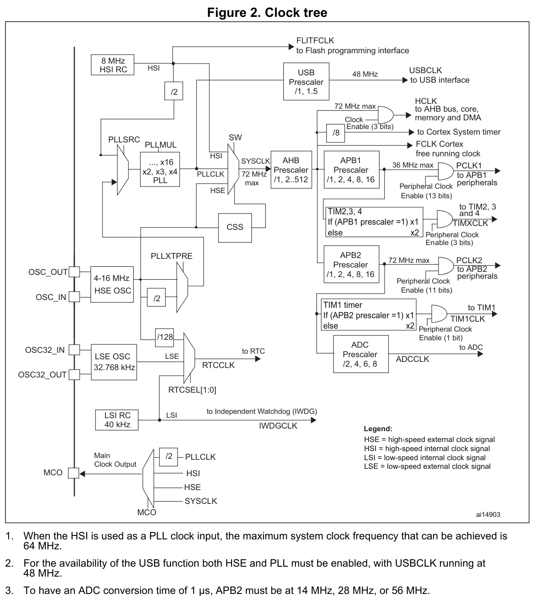

# 时钟复位与低功耗

[返回总目录](../README.md)

时钟配置决定内核和外设的运行速度，也决定改频、复位与低功耗恢复时哪些状态仍然有效。设计时应先从外设要求确定各支路频率，再安排 Flash 等待周期、切源顺序和唤醒后的恢复流程。对于脉宽调制（PWM）或外部驱动，还必须在停钟前建立安全输出状态。

本章按这一顺序说明复位与时钟控制（RCC）、Flash 存储器、电源控制（PWR）和实时时钟（RTC）的协作。硬件切源、软件频率更新、外设恢复和唤醒事件处理各有独立的完成条件，不能用其中一个成功标志代替其余步骤。文档依据为 RM0008 Rev21、DS5319 Rev20、PM0075 Rev2、PM0056 Rev7、ES096 Rev15 和 UM1850 Rev3；适用范围及原文差异见[范围与已知限制](../已知限制.md)。

- [1 时钟树与外设频率](#1-时钟树与外设频率)
- [2 改频顺序与 Flash 等待周期](#2-改频顺序与-flash-等待周期)
- [3 复位源与状态保持](#3-复位源与状态保持)
- [4 低功耗模式与唤醒](#4-低功耗模式与唤醒)
- [5 RTC 同步与读写](#5-rtc-同步与读写)
- [6 时钟故障与欠压处理](#6-时钟故障与欠压处理)
- [7 状态转换故障排查](#7-状态转换故障排查)

## 1 时钟树与外设频率

### 1.1 频率与分频

内部高速 RC 时钟 HSI 和外部高速时钟 HSE 可直接提供系统时钟，也可通过锁相环（PLL）倍频。内部低速 RC 时钟 LSI、外部低速时钟 LSE 则供给低速功能。

系统时钟 SYSCLK 经高级高性能总线（AHB）分频得到 HCLK，再经高级外设总线（APB）分频得到 PCLK1、PCLK2。定时器、模数转换器（ADC）、通用串行总线（USB）和 RTC 各有自己的供时路径。读图时应沿使用中的支路核对来源、分频和使能条件，再核对电气规格。

**图注 3 存在原文差异：PCLK2=14 MHz 无法满足 1 µs ADC 转换条件。** 配置时应按[本节的详细规格与推导](#adc-图注的适用边界)核对。

原图为 DS5319 Rev20 Figure2 p12，保留图注 1–3。图注 1 规定 HSI 作为 PLL 输入时系统频率最高为 64 MHz；图注 2 要求 HSE、PLL 使能且 USBCLK=48 MHz。图中路径仍受器件频率、电源、温度和 Flash 访问条件约束。

| 时钟 | 频率边界或计算关系 | 配置要点 |
|---|---|---|
| SYSCLK / HCLK | 最高 72 MHz；复位源为标称 8 MHz HSI | HSI/2 输入 PLL 时系统频率最高 64 MHz |
| PCLK1 / PCLK2 | 分别最高 36 / 72 MHz | 升主频前先设置安全分频 |
| TIM2/3/4、TIM1 | APB 分频为 1 时等于 PCLK，否则为 2×PCLK | APB1=36 MHz 时，TIM2 时钟可为 72 MHz |
| ADC1/2 | PCLK2 经 /2、/4、/6、/8；ADCCLK 为 0.6–14 MHz | PCLK2=72 MHz 时 /4 超限，/6 得到 12 MHz |
| USB | PLLCLK 经 /1 或 /1.5 得到 48 MHz | 需要 HSE 晶体及 PLL |
| RTC / 独立看门狗 IWDG | RTC 可选 LSE、LSI、HSE/128；IWDG 使用 LSI | 主电源 VDD 关闭后持续计时，需要 LSE 和备份电源 VBAT |

主时钟路径中，HSI 先固定 ÷2；HSE 则由 PLLXTPRE 预分频字段选择 ÷1 或 ÷2。PLLSRC 选择 PLL 输入路径，PLLMUL 选择整数 ×2 至 ×16 的倍频。系统时钟切换字段 SW 在 HSI、HSE、PLLCLK 中请求选择 SYSCLK，状态字段 SWS 才表示实际采用的源；这些字段均位于时钟配置寄存器 RCC_CFGR。

RCC_CFGR 的 AHB 预分频字段 HPRE 将 SYSCLK 分频后供给 HCLK 和 Cortex 自由运行时钟 FCLK。HCLK 供内核、AHB、存储器和直接存储器访问（DMA）；内核系统定时器 SysTick 可选 HCLK 或 HCLK÷8。APB 预分频字段 PPRE1/2 再由 HCLK 产生 PCLK1/2：对应 APB 分频为 1 时，定时器核使用 PCLK；否则使用 2×PCLK，倍频后仍不得超过器件频率上限。ADC1/2 由 PCLK2 经 ADC 预分频字段 ADCPRE 供时，USB 功能时钟则由 PLLCLK 经 USB 预分频字段 USBPRE 供时。

辅助支路中，微控制器时钟输出 MCO 可把 SYSCLK、HSI、HSE 或 PLLCLK÷2 输出到 PA8，HSI 还供给 Flash 编程接口时钟 FLITFCLK。时钟安全系统 CSS 监测 HSE 并产生故障事件，本身不产生时钟；故障切源及 TIM1 刹车见第 6 节。RTC 和 IWDG 的独立供时条件见第 1.4 节。

HSI 的 8 MHz、LSI 的 40 kHz 和 LSE 晶体的 32.768 kHz 都不表示无误差或全温保证。USB 必须满足数据手册的 HSE 晶体及 PLL 要求，不能用任意 RC 组合或 HSE 旁路能力代替。ADC 的频率范围也不能保证任意采样时间下都有 1 µs 转换。时钟树用于理解路径，具体操作仍须遵守寄存器定义和电气条件。

依据：[RM0008 时钟树与分频](../来源/RM0008.md#src-rm0008-r21-clock-tree)、[DS5319 器件时钟边界](../来源/DS5319.md#src-ds5319-r20-clock-device)、[DS5319 电源与温度前提](../来源/DS5319.md#src-ds5319-r20-power-precondition)。控制位、完整支路关系及来源定位见[时钟图关系与来源](../参数/时钟图关系与来源.md)。

#### ADC 图注的适用边界

DS5319 Rev20 Figure2 note3 p12 列出 APB2 为 14、28 或 56 MHz；但同一数据手册 §5.3.18 Table47 p74 规定，最短采样为 1.5 周期、总转换为 14 个 ADC 周期，1 µs 转换要求 ADC 时钟 ADCCLK=14 MHz。RM0008 §7.3.2 p102 规定，时钟配置寄存器 RCC_CFGR 的 ADC 预分频字段 ADCPRE 仅提供 /2、/4、/6、/8，因此 PCLK2=14 MHz 时最高只能得到 ADCCLK=7 MHz，最短转换为 2 µs，与原图注该项不相容。

按 ADCCLK=14 MHz、PCLK2≤72 MHz 及上述分频推导，PCLK2 可取 28 MHz（/2）或 56 MHz（/4）；仍须满足 1.5 周期采样、输入和模拟供电等条件。这是依据详细规格的推导，不是 ST 正式更正。外部触发延迟另计，1 µs 转换也不等于任意触发到结果的端到端保证。详见[ADC 原图注差异](../参数/时钟图关系与来源.md#adc原图注差异)及[原图注与详细规格](../来源/DS5319.md#src-ds5319-r20-clock-device)。

### 1.2 频率计算

HSE 输入 PLL 时，输出频率由预分频系数  $`D`$  和倍频系数  $`M`$  决定：

$$
f_{\mathrm{PLL}}=\frac{f_{\mathrm{HSE}}}{D}M
$$

其中  $`f_{\mathrm{HSE}}`$ 、 $`f_{\mathrm{PLL}}`$  分别为 HSE 和 PLL 输出频率，单位为 Hz； $`D`$  取 1 或 2， $`M`$  取整数 2～16，二者无量纲。HSI 路径的预分频固定为 2，因此：

$$
f_{\mathrm{PLL}}=\frac{f_{\mathrm{HSI}}}{2}M
$$

这里  $`f_{\mathrm{HSI}}`$  为 HSI 频率，单位为 Hz。无论选择哪条路径，PLL 输入须在 1～25 MHz、输出须在 16～72 MHz 范围内，并同时满足相应电气条件；仅把乘除结果算到 72 MHz 并不足够。参见 [DS5319 PLL 参数与脚注](../来源/DS5319.md#src-ds5319-r20-pll)。

系统时钟经 AHB 分频系数  $`A`$  和 APB 分频系数  $`P_x`$  得到总线频率：

$$
f_{\mathrm{HCLK}}=\frac{f_{\mathrm{SYSCLK}}}{A},\qquad
f_{\mathrm{PCLK}x}=\frac{f_{\mathrm{HCLK}}}{P_x}
$$

 $`f_{\mathrm{SYSCLK}}`$ 、 $`f_{\mathrm{HCLK}}`$ 、 $`f_{\mathrm{PCLK}x}`$  分别为系统、AHB 和 APB 外设时钟频率，单位为 Hz； $`x`$  表示 APB1 或 APB2。无量纲系数  $`A`$  可取 1、2、4、8、16、64、128、256、512， $`P_x`$  可取 1、2、4、8、16。计算定时器核时钟时，还要应用  $`P_x\ne1`$  时的 2 倍关系，不能直接把 PCLK 当作定时器频率。

### 1.3 电源与振荡器电气条件

**供电是频率上限的前提。** DS5319 Rev20 Table9 规定 VDD=2.0–3.6 V；模拟电源 VDDA 与 VDD 同电位，上电和运行期间允许的差异最多为 300 mV。使用 ADC 时 VDDA=2.4–3.6 V。VBAT 的供电范围为 1.8–3.6 V。PLL 的模拟部分也使用 VDDA，即使不用 ADC，仍需正确供给模拟电源。72 MHz 等上限还受器件温度条件约束，Flash 等待周期则按第 2 节设置。

**HSE 晶体与旁路输入采用不同规格。** 晶体或陶瓷谐振器范围为 4–16 MHz，旁路外部输入范围为 1–25 MHz。修改 RCC 控制寄存器 RCC_CR 的 HSE 旁路位 HSEBYP 前，必须关闭 HSE；旁路信号送入 OSC_IN，OSC_OUT 保持高阻。Table20 还要求：

- 高电平为 0.7VDD～VDD，低电平为地电位 VSS～0.3VDD。
- 占空比为 45–55%，高、低电平持续时间各至少 5 ns。
- 上升、下降时间各不超过 20 ns；高低电平时间和边沿时间由设计保证，不作生产测试。

因此，外部输入只满足频率范围还不够，幅度和时序也必须合规。

**PLL 锁定与晶体起振应分别安排等待。** PLL 输入占空比为 40–60%，锁定时间  $`t_{\mathrm{LOCK}}`$  最大为 200 µs，周期到周期抖动最大为 300 ps。Table27 注 1 说明这些 Min/Max 来自特性评估，除另有规定外不作生产测试；注 2 要求同时满足输入和输出范围。200 µs 不能作为 HSE 起振加 PLL 锁定的总等待保证。Table22 给出的 HSE 2 ms 是 VDD 稳定后、标准 8 MHz 晶体的典型起振时间，可能随晶体制造商显著变化；应用超时还须覆盖实际晶体、负载和温度条件。

**内部 RC 的名义频率不能直接用于精确计时。** Table24 中 HSI 的 8 MHz 为典型值，默认 VDD=3.3 V；出厂校准误差在 25°C 为 −1.1～+1.8%，在 −40～105°C 为 −2～+2.5%。RM 中 25°C 约 ±1% 的概述不能代替 DS 的全温规格。Table25 在 VDD=3 V、环境温度  $`T_A`$  为 −40～105°C 下给出 LSI 的 Min/Typ/Max 为 30/40/60 kHz；频率项来自特性评估，除另有规定外不作生产测试。LSI 就绪标志 LSIRDY 置位后的额外稳定等待见下一节。

依据：[DS5319 电源与温度前提](../来源/DS5319.md#src-ds5319-r20-power-precondition)、[DS5319 时钟电气特性](../来源/DS5319.md#src-ds5319-r20-clock-electrical)、[DS5319 PLL 参数与脚注](../来源/DS5319.md#src-ds5319-r20-pll)。各时钟源的参数、脚注和单位见[时钟电气与低功耗参数](../参数/时钟电气与低功耗.md#外部时钟与pll)。

### 1.4 RTC 与看门狗供时

备份域控制寄存器 RCC_BDCR 的 RTCSEL 字段在 LSE、LSI、HSE÷128 中选择 RTC 源，RTCEN 位控制使能。选出的 RTC 时钟 RTCCLK 供给备份域内的 RTC 核，PCLK1 单独供给其 APB1 接口；两者须满足 RTCCLK≤PCLK1/4，降低 APB1 频率时也必须检查这一条件。接口与计数核处在不同的时钟域，读写同步按第 5 节处理。

只有 LSE 位于备份域。要在 VDD 关闭后保证 RTC 继续计时，必须选择 LSE 并保持 VBAT；LSI 和 HSE 路径不提供这一保证。使用 HSE/128 时，电源控制寄存器 PWR_CR 的备份域写保护解除位 DBP 必须保持为 1，而 HSE 会在停止（Stop）、待机（Standby）模式中停止，因此该源不能用于这两种模式下的 RTC 自动唤醒。

IWDG 由 LSI 独立供时。一旦启动 IWDG，硬件就强制开启 LSI，软件不能再关闭它，IWDG 本身也只能由复位停止。功耗和超时预算须计入仍在运行的 IWDG/LSI，并按 LSI 的实际精度范围计算。

RCC 控制/状态寄存器 RCC_CSR 中的 LSI 就绪标志 LSIRDY=1，尚不保证频率进入规格。按 ES096，还需额外等待 100 µs，且这段延时不能使用尚未稳定的 LSI 作为基准。

依据：[RM0008 RTC 供时与接口条件](../来源/RM0008.md#src-rm0008-r21-rtc-clock)、[RM0008 电源与低功耗模式](../来源/RM0008.md#src-rm0008-r21-power-modes)、[ES096 LSI 稳定等待](../来源/ES096.md#src-es096-r15-lsi-stable)。

## 2 改频顺序与 Flash 等待周期

改频要同时保护 Flash 访问和各条总线，且每个中间状态都必须合法。升频前先增加等待周期并设置安全分频；降频后才能减少等待周期。切源请求发出后，应读取实际状态，而不是仅检查请求位。

### 2.1 从复位状态配置 72 MHz

以下示例从 HSI 8 MHz、AHB/APB 不分频、PLL 关闭的复位状态出发，使用 8 MHz HSE 建立 72 MHz 系统时钟：

1. 保持 HSI 可用，先把 Flash 访问控制寄存器 FLASH_ACR 的等待周期字段 LATENCY 设为 2；若要调整预取，须满足下一节的切换条件。
2. 设置 AHB=/1、APB1=/2、APB2=/1、ADC=/6，避免切换瞬间出现总线或 ADC 超频。
3. 开启 HSE 并等待 RCC_CR 的 HSE 就绪标志 HSERDY；在 PLL 关闭时选择 HSE、/1、×9，然后开启 PLL 并等待 PLL 就绪标志 PLLRDY。
4. 需要 USB 时，在 USB 时钟使能位 USBEN 置位之前配置 PLL/1.5。请求 SW=PLL，再读取 SWS，确认 SYSCLK 已实际切换。
5. 更新软件频率变量和时间基准，重新核对通用异步收发器（UART）、定时器等外设时序。若随后关闭 HSI，Flash 擦写前必须重新开启它。

这一过程的初始寄存器状态见第 3 节。已有 AHB 分频的运行中系统不满足相同初态，不能直接照搬第 1 步。

### 2.2 运行中改频

运行中重配 PLL 前，先停止受影响的 USB、其他通信，或完成受控交接。确认 HSI 就绪后请求 SW=HSI，等待 SWS 确认，再关闭 PLL 并等待 PLLRDY 清零。只有此后才能修改 PLL 源、预分频和倍频。

所有 ready、SWS 等待都应有超时和失败路径。超时必须使用当前仍有效的时基；失败时保留已确认可用的时钟和安全分频，并按实际频率恢复软件时基。

Flash LATENCY 按本章所据文档的 SYSCLK 区间设置：

| SYSCLK | LATENCY |
|---|---:|
| ≤24 MHz | 0 |
| >24 MHz 且 ≤48 MHz | 1 |
| >48 MHz 且 ≤72 MHz | 2 |

降频时先降低时钟，再减少 LATENCY。预取开关仅允许在 SYSCLK<24 MHz 且 SYSCLK=HCLK 时切换；AHB 分频不为 1 时，必须保持预取开启。

半周期访问在恰好 8 MHz 时存在版本文字差异：PM0075 Rev2 与 RM0008 Rev21 分别使用“低于”和“至多”的边界表述，不能将这一点统一解释为同一条件。

依据：[RM0008 Flash 及切源条件](../来源/RM0008.md#src-rm0008-r21-flash-clock)、[PM0075 预取与等待周期](../来源/PM0075.md#src-pm0075-r2-flash-access)、[RM0008 复位域及初态](../来源/RM0008.md#src-rm0008-r21-reset-domains)。

### 2.3 HAL 返回值与部分失败

使用硬件抽象层（HAL）时，应分别检查 HAL_RCC_OscConfig 和 HAL_RCC_ClockConfig 的返回值，并检查失败后的硬件状态。这些函数不提供整组配置的事务式回滚。

HAL_RCC_ClockConfig 仅在 ClockType 包含 HCLK 时，把本次同时选择的 APB 域暂设为 /16，然后修改 AHB/SYSCLK，最后设置目标 APB 分频。调用者仍须逐一检查中间频率，不能只验证目标配置。

HAL_RCC_OscConfig 与 HAL_RCC_ClockConfig 的等待路径使用不同的时间依据：

- 两个函数内部的超时等待使用 HAL_GetTick。改频期间若时基不再推进，或毫秒尺度已变化，软件超时就不能保证真实的截止时间。
- HAL_RCC_OscConfig 在 LSI ready 后调用的 RCC_Delay 使用按 SystemCoreClock 估算的忙循环，不属于 HAL_GetTick 等待。

ClockConfig 走到末尾才更新记录内核频率的软件变量 SystemCoreClock，并调用 HAL_InitTick 重新初始化时基。HAL 驱动 v1.1.4 和 v1.1.10 均忽略 HAL_InitTick 的返回值，所以 HAL_OK 仍不足以证明时基重配成功；还须确认毫秒计数在推进且实际计时正确。

软件频率查询也有明确边界：

- 这两个版本的 HAL_RCC_GetHCLKFreq 仅返回 SystemCoreClock。UM1850 关于该函数“更新 SystemCoreClock”的说明不符合这两个函数体，不能据此假定查询会刷新变量。
- HAL_RCC_GetSysClockFreq 根据寄存器与 HSE_VALUE、HSI_VALUE 计算频率，并非实测；错误常量会继续传递到波特率等计算。
- 裸寄存器或底层驱动（LL）改频同样不能假定已经维护 SystemCoreClock。

失败恢复应先辨认停在哪条路径：

- HAL_RCC_ClockConfig 可能已改变 LATENCY、HPRE 或 APB 分频，却因目标源未就绪返回 ERROR；SWS 超时也不会撤销 SW 请求。
- HAL_RCC_OscConfig 若在 DBP/LSE 等待中超时，可能跳过临时 PWR 接口时钟的关闭；已经完成的源设置和已成功置位的 DBP 也不会回滚。

恢复时读取实际时钟源、分频、LATENCY、PWR 接口时钟使能位 PWREN 和 DBP，再据此重建软件频率和有效时基。

外设门控还有使能到生效的延迟。UM1850 Rev3 §30.2.2 p355 说明 HAL 的 CLK_ENABLE 宏包含 dummy read；不要删掉该读操作后立即访问外设。

固定 v1.1.10 的 GPIOA、DMA1、PWR 三组门控宏已按官方配套头文件核对：

- 使能：先对相应时钟使能寄存器读改写置位，再读取同一使能位到 volatile 临时变量，保留使能后的读回步骤。
- 关闭：只作读改写清位，没有使能路径的附加读回。

读回不是就绪轮询，也不提供并发互斥。若主流程与中断等上下文同时修改同一个使能寄存器，不同位的读改写也可能因交错而丢失更新，应在工程中统一管理或保护这些修改。

该结论只覆盖上述三组宏，不据此给出固定等待周期或关闭后的硬件完成保证。见[匹配来源与展开范围](../来源/驱动实现.md#src-hal-rcc-v1110-gate-macros)。

上述实现结论限定于列明的驱动版本，不推广至任意 HAL 版本或用户覆盖函数。依据：[HAL v1.1.4 RCC 实现](../来源/驱动实现.md#src-hal-rcc-v114)、[HAL v1.1.10 RCC 实现](../来源/驱动实现.md#src-hal-rcc-v1110)、[UM1850 RCC 接口与门控延迟](../来源/UM1850.md#src-um1850-r3-rcc-api)、[ES096 LSI 稳定等待](../来源/ES096.md#src-es096-r15-lsi-stable)。

### 2.4 RCC 整组复位宏的版本差异

调用 `__HAL_RCC_APB1_FORCE_RESET` 前须检查所用头文件。固定 HAL v1.1.4 的[宏定义 L617](https://github.com/STMicroelectronics/stm32f1xx-hal-driver/blob/de129f1c0af55ea4b2cfa8ba5686af54b7a51cf9/Inc/stm32f1xx_hal_rcc.h#L617)实际执行 `RCC->APB2RSTR = 0xFFFFFFFFU`，写入的是 APB2 复位寄存器，与宏名中的 APB1 不符；固定 v1.1.10 的[对应定义 L615](https://github.com/STMicroelectronics/stm32f1xx-hal-driver/blob/77fbb30b7a1d02533980400083e48c559aae5a4f/Inc/stm32f1xx_hal_rcc.h#L615)已改为 `RCC->APB1RSTR = 0xFFFFFFFFU`。不能仅凭宏名判断复位目标，也不能把整组复位宏当成单个外设复位。

这项差异只说明两份固定宏定义的写入目标，不说明具体工程调用过该宏、已经复现硬件故障，或哪一版首次修正。源码身份及未闭合的依赖范围见[RCC 复位宏来源](../来源/驱动实现.md#src-hal-rcc-reset-macro-versions)。

## 3 复位源与状态保持

启动代码应先识别复位原因和保留状态，再决定需要重建哪些配置。无条件执行同一套“完整初始化”，可能破坏本应保留的 RTC 时间或故障证据。

| 动作 | 状态变化 | 启动时的处理 |
|---|---|---|
| 外部复位 NRST、看门狗、软件系统复位请求 SYSRESETREQ 等 | 大部分寄存器复位，备份域和复位原因等例外 | 先读取 RCC_CSR 原因，再用复位标志清除位 RMVF 清除 |
| 上电/掉电复位（POR/PDR）或 Standby 退出 | 按电源复位路径启动，备份域另有保留规则 | 同时读取待机标志 SBF 等证据，重建普通状态 |
| RCC_BDCR 的 BDRST | 整个备份域复位，RTC 配置、时间和备份寄存器（BKP）数据丢失 | 仅在确需重建备份域时使用 |
| APB1 外设复位寄存器 RCC_APB1RSTR 的 BKPRST | 复位备份 APB 接口 | 不能代替修改 RTCSEL 所需的备份域复位 |

复位原因可能保留历史信息，每个置位不一定代表一次独立的新故障。RCC_CSR 通过 RMVF 清除原因，不能向单个原因位写 0 来清除。RTCSEL 一旦选源，改变它需要备份域复位；因此不应每次启动都无条件写 BDRST。

nRST_STOP、nRST_STDBY 是选项字节，值为 0 时可把低功耗进入序列改为复位，不是普通 PWR 模式控制位。依据：[RM0008 复位域及初态](../来源/RM0008.md#src-rm0008-r21-reset-domains)、[RM0008 复位原因标志](../来源/RM0008.md#src-rm0008-r21-reset-flags)、[RM0008 备份接口与备份域复位](../来源/RM0008.md#src-rm0008-r21-backup-reset)。

第 2.1 节使用的复位初态来自以下寄存器：RCC_CR=0x0000XX83，其中 XX 为未定义或校准字段；RCC_CFGR=0，因此 HSI 开启、HSE/PLL 关闭、AHB/APB 不分频。FLASH_ACR=0x30，表示 LATENCY=0、预取开启。Stop 退出则只强制系统源为 HSI，不会把 RCC_CFGR 的所有分频字段复位，醒后的 HCLK/PCLK 仍取决于保留的 HPRE/PPRE。

Standby 唤醒会复位 PWR_CR，但不会整体复位电源控制/状态寄存器 PWR_CSR。其字段须分别处理：唤醒引脚使能位 EWUP 由系统复位清除；SBF 仅由 POR/PDR 或写待机标志清除位 CSBF 清除；唤醒标志 WUF 按系统复位或唤醒标志清除位 CWUF 的规则清除。识别待机经历应在清标志之前完成，也不能因为部分状态可保留，就把整个 PWR_CSR 当作永久状态。

依据：[RM0008 复位域及初态](../来源/RM0008.md#src-rm0008-r21-reset-domains)、[PM0075 预取与等待周期](../来源/PM0075.md#src-pm0075-r2-flash-access)、[RM0008 PWR 控制及状态](../来源/RM0008.md#src-rm0008-r21-pwr-registers)。

## 4 低功耗模式与唤醒

选择低功耗模式时，先确定必须保留的状态、可用的唤醒源和允许的恢复时间，再安排进入序列。内核系统控制寄存器 SCB_SCR 的 SLEEPDEEP 位选择是否深睡眠，PWR_CR 的 PDDS 位再区分 Stop 与 Standby；LPDS 位选择 Stop 中的稳压器模式。进入指令 WFI（等待中断）或 WFE（等待事件）须与唤醒路径配套选择。

| 模式 | 保留与恢复 | 进入控制 |
|---|---|---|
| 睡眠（Sleep） | CPU 停止，外设可继续；无需重建原时钟 | SLEEPDEEP=0，按中断或事件选择 WFI/WFE |
| Stop | 静态随机存取存储器（SRAM）、寄存器保持；HSI/HSE/PLL 停止，醒后 SYSCLK 为 HSI | SLEEPDEEP=1、PDDS=0；LPDS 决定稳压器功耗与延迟 |
| Standby | 普通 SRAM、寄存器丢失，备份域及待机电路例外；醒后复位并重新采样启动选择引脚 BOOT | SLEEPDEEP=1、PDDS=1 |

模式条件见 [RM0008 电源与低功耗模式](../来源/RM0008.md#src-rm0008-r21-power-modes)、[PWR 控制及状态](../来源/RM0008.md#src-rm0008-r21-pwr-registers)和 [RTC 供时与接口条件](../来源/RM0008.md#src-rm0008-r21-rtc-clock)。

WFI 退出等待不一定立即进入中断服务程序（ISR）。PM0056 允许在中断屏蔽寄存器 PRIMASK=1、故障屏蔽寄存器 FAULTMASK=0 时，由符合条件的已使能中断唤醒，使软件有机会先恢复状态再解除屏蔽；这不能绕过嵌套向量中断控制器（NVIC）对单路中断的禁止。WFE 则依赖事件寄存器；SCB_SCR 的 SEVONPEND 位根据中断待处理状态（pending）的变化生成事件，单个 pending 位不是事件计数器。参见 [PM0056 WFI/WFE 及唤醒](../来源/PM0056.md#src-pm0056-r7-sleep-event)。

### 4.1 Sleep

Flash 预取开启且 LATENCY=2 时，应保持 AHB 外设时钟使能寄存器 RCC_AHBENR 中的 Flash 接口时钟使能位 FLITFEN=1，避免极短 Sleep 导致取指损坏。

选择 WFE 时要考虑事件竞态：进入 WFE 前发生的中断可能未留下事件，不能把 SEVONPEND 当作无竞态保证。可按勘误采用外部中断/事件控制器（EXTI）的纯事件路径，但可编程电压检测器（PVD）/EXTI16 和 USB 唤醒（USB Wakeup）/EXTI18 不能作为本器件的 WFE 事件源，必须使用中断配合 WFI。

SCB_SCR 的 SLEEPONEXIT 位可让处理器在退出异常时入睡，但存在仅含一条返回指令的 ISR 导致冻结的条件。空 ISR 应在 BX/BLX 返回指令前加入 NOP 或另一条指令；具体条件和规避见 ES096 §2.1.6 pp6–7。

依据：[ES096 短 Sleep 取指勘误](../来源/ES096.md#src-es096-r15-sleep-flash)、[ES096 WFE 事件竞态](../来源/ES096.md#src-es096-r15-wfe-race)、[ES096 EXTI16/18 唤醒例外](../来源/ES096.md#src-es096-r15-pvd-usb-wfe)、[ES096 SLEEPONEXIT 单指令 ISR](../来源/ES096.md#src-es096-r15-sleeponexit)。

### 4.2 Stop

Stop 保留 I/O 的进入前状态，因此应先完成输出关断和外设收尾，再停止时钟。若直接在 PWM 有效电平时停钟，该电平可能持续保持。安全状态应按外部驱动极性和偏置确定，可能是低、高或释放，不能一律假定为两端低。

进入前可按以下顺序核对：

1. 完成系统已设计并验证的驱动关断，确认实际输出引脚已经进入安全状态。TIM1 和外部驱动均须覆盖，停止计数或时钟本身不足以证明关断完成。
2. 完成外设收尾及相应事件处理，清除遗留的 EXTI、外设 pending 和 RTC Alarm 标志。WFI 路径使能对应 EXTI 中断及 NVIC 向量，WFE 路径配置 EXTI 事件。
3. 不使用 ADC 时，清除 ADC 控制寄存器 2（ADC_CR2）的使能位 ADON。
4. 若更新过 IWDG 预分频寄存器 IWDG_PR 或重装载寄存器 IWDG_RLR，进入 Stop 前应等待状态寄存器 IWDG_SR 中的预分频更新标志 PVU、重装载更新标志 RVU 均清零。更新及等待清零期间，APB 时钟必须高于 LSI 供给的 IWDG 时钟的 2 倍；比较对象是预分频前的时钟，不是超时计数频率。该比例用于避免更新标志无法清零，不要求在 Stop 内维持 APB 时钟。
5. 配置深睡眠并进入 Stop。硬件会等待未完成的 Flash/APB 操作，但这种等待不能替代上述软件条件。

TIM1 的主输出使能 MOE、自动输出使能 AOE、主/互补输出，以及空闲模式关闭状态选择 OSSI、输出空闲状态 OIS 和停止函数的边界，见[输出级与保护](../参数/TIM/输出级与保护.md#4-停止参考清除与自动恢复)和 [HAL 生命周期](../参数/TIM/HAL生命周期与DMA.md)。具体功率级的停机状态仍须在实际板卡上验证。I/O 保持规则见 RM0008 Rev21 §5.3.4 p74。

步骤 4 的时钟比例与更新等待分别来自 ES096 §2.7.1/2（p16）和 §2.7.3（p17）。更新等待要求优先于 RM0008 §19.4.4（p498）通用 Note 中“低功耗入口不需等待”的说法；ES096 p3 适用矩阵中，这三个限制在 A/B/Z/1/Y/2/3/X 列均为 A。

若准备移除外部 HSE 时钟，应先安全切到 HSI 并关闭 HSE。如果进入 Stop 时仍保持 RCC_CR 的 HSE 使能位 HSEON，且在进入 Stop 时移除外部源，RM 要求开启 CSS 检测故障，以避免异常进入。

唤醒后 SYSCLK 选择 HSI，但 HPRE、PPRE1、PPRE2 等分频保持原值，所以 HCLK/PCLK 不一定为 8 MHz。恢复期间暂停依赖旧频率的业务，按第 2 节重新建立 HSE/PLL、软件频率和时间基准，然后恢复外设。

依据：[RM0008 电源与低功耗模式](../来源/RM0008.md#src-rm0008-r21-power-modes)、[ES096 IWDG 低 APB 及 Stop 勘误](../来源/ES096.md#src-es096-r15-iwdg-stop)、[RM0008 IWDG 异步更新](../来源/RM0008.md#src-rm0008-r21-iwdg-update)。

### 4.3 Standby

Standby 唤醒源先经过 OR，再检测上升沿。进入前按“禁用所有实际使用的源 → 清相关标志 → 重新使能 → 进入”的顺序处理；同时确认没有阻止所选 WFI/WFE 入口的待处理中断或事件。清 WUF 不会清除 CPU 事件寄存器或 NVIC 状态。

持续为高的源可能导致立即唤醒并复位，反复清 WUF 无法解决。CWUF 清除需要两个系统时钟周期；使能 EWUP 会把唤醒引脚 PA0 强制设为下拉输入，若此时引脚为高，使能动作本身就会置 WUF。依据：[ES096 Standby 多源唤醒](../来源/ES096.md#src-es096-r15-standby-wake)、[RM0008 PWR 控制及状态](../来源/RM0008.md#src-rm0008-r21-pwr-registers)。

Standby 中普通 I/O 为高阻，例外是 NRST、启用的 WKUP，以及配置为防篡改或校准输出的 TAMPER 引脚。高阻不自动构成安全电平，驱动是否禁用仍取决于外部偏置和驱动电路。IWDG、RTC、LSI、LSE 可按控制位继续运行，不能因进入 Standby 就把它们从功耗预算中删除。参见 [RM0008 电源与低功耗模式](../来源/RM0008.md#src-rm0008-r21-power-modes)。

## 5 RTC 同步与读写

RTC 计数核继续运行，并不表示 APB 接口中的读数已经可用。访问时要分别完成接口同步、跨半字一致性读取和配置写入等待。

### 5.1 读数同步与配置写入

访问备份控制前，先使能所需的 PWR/BKP APB 接口时钟；写 RTC、BKP 或 RCC_BDCR 备份控制字段前，再置 DBP 解除写保护。

Stop、Standby、系统复位或接口停钟后，RTC 核可能仍在运行，而 APB 镜像尚未有效。重新开启接口后，应清 RTC 控制寄存器低位 RTC_CRL 的寄存器同步标志 RSF，并等待它置 1，再读取计数器。32 位计数器 CNT 分布在计数器高位寄存器 RTC_CNTH、低位寄存器 RTC_CNTL 两个 16 位寄存器中，可按“高 → 低 → 高”读取并比较两次高半字，避免进位时拼出错误数值；这一操作不能代替 RSF 同步。

配置写入通过 RTC_CRL 的写操作完成标志 RTOFF 和配置模式位 CNF 协调：等待 RTOFF=1 → 置 CNF=1 → 写目标寄存器 → 清 CNF=0 → 再次等待 RTOFF。写配置完成需要至少 3 个 RTCCLK 周期；RTOFF=0 期间禁止新的 RTC 写入，包括控制寄存器。配置完成等待、RSF 读同步和 CNT 一致性读取是三个独立条件。

依据：[RM0008 RTC 供时与接口条件](../来源/RM0008.md#src-rm0008-r21-rtc-clock)、[RM0008 RTC 读同步与写配置](../来源/RM0008.md#src-rm0008-r21-rtc-sync)。

### 5.2 标志清除与闹钟路径

RTC_CRL 中的 RSF、溢出标志 OWF、闹钟标志 ALRF 和秒标志 SECF 采用写 0 清除语义；要保留其他同类标志，应向相应位写 1。CNF 却是普通读写控制位，因此不能把整字简单取反写回。清标志与其他配置操作也不能并发改变 CNF。

Stop 的 RTC 闹钟唤醒需要 EXTI17 上升沿，Standby 的闹钟唤醒则不需要 EXTI17。RTC 全局闹钟和 EXTI17 还可分别触发两个向量，处理时应区分两条路径。APB1 停钟期间，OWF、ALRF、SECF、RSF 不更新，但这不表示 RTC 核或 Standby 闹钟路径已停止。

依据：[RM0008 RTC 标志访问语义](../来源/RM0008.md#src-rm0008-r21-rtc-flags)、[RM0008 RTC 供时与接口条件](../来源/RM0008.md#src-rm0008-r21-rtc-clock)。

## 6 时钟故障与欠压处理

故障处理首先要建立可持续的运行与输出状态，再恢复通信、计时或数据。硬件自动切源和保护事件提供了处理入口，软件仍需完成后续降级与重新使能。

### 6.1 HSE 故障与 CSS

CSS 只有在软件置 RCC_CR 的时钟安全系统使能位 CSSON 且 HSE 完成启动后才开始检测；HSE 停止时不检测。发现故障后，硬件关闭 HSE 故障检测器并自动禁用 HSE 振荡器，同时产生不可屏蔽中断（NMI）和 TIM1 系统刹车事件。

自动切源取决于当时的 SYSCLK 来源：HSE 直接供 SYSCLK，或以 HSE 输入的 PLL 供 SYSCLK 时，系统切至 HSI；仅后一情况同时关闭 PLL。HPRE/PPRE 不因此恢复为复位值，所以故障后不能假定 HCLK 必为 8 MHz。

NMI 处理中必须向时钟中断寄存器 RCC_CIR 的 CSS 中断清除位 CSSC 写入清除命令，清掉 CSS 中断标志 CSSF，否则会反复进入 NMI。RCC_CIR 混合了中断使能位和只写清除位，构造写值时应保留仍需要的中断使能配置。随后还须处理失去有效 48 MHz 时钟的 USB，以及原有通信和定时时基；清 CSSF 不代表这些业务已经恢复。

依据：[RM0008 CSS 故障及切源](../来源/RM0008.md#src-rm0008-r21-css)、[RM0008 RCC_CIR 混合字段](../来源/RM0008.md#src-rm0008-r21-rcc-cir)、[RM0008 时钟树与分频](../来源/RM0008.md#src-rm0008-r21-clock-tree)。

#### TIM1 刹车与重新使能

CSS 送出的系统刹车不能单独保证 PWM 持续锁停。ES096 Rev15 §2.6.1 指出，该系统刹车输入未锁存；如果 TIM1 刹车和死区寄存器 TIM1_BDTR 的 AOE 为 1，输出可在后续计数周期重新使能，而此时定时器频率可能已经变化。

按 RM0008 p359，AOE=0 时，MOE 只能由软件重新置位；AOE=1 时，刹车不再有效后的下一个更新事件也可自动置位 MOE。原厂建议用刹车处理内部或外部故障保护时令 AOE=0；逐周期电流控制优先考虑 OCxCE，即通道 x 的输出清除使能，其模式和勘误限制仍须核对。

AOE 和 BDTR 的写保护等级字段 LOCK 都不提供跨系统复位的故障记忆。功率级禁用、故障后重新武装、复位期间的输入电平仍须由系统设计保证；恢复时钟后，也应确认波形和采样链已重新建立。

依据：[系统刹车勘误与条件](../来源/ES096.md#src-es096-r15-css-tim1-aoe)、[RM0008 Rev21 BDTR](https://www.st.com/resource/en/reference_manual/cd00171190.pdf#page=359)。

### 6.2 欠压预警与阈值

PVD 的输出状态 PVDO=1 表示电压低，所以 EXTI16 上升沿对应电压下降越过阈值。PVDO 仅在 PWR_CR 的 PVD 使能位 PVDE=1 时有效；Standby 后或复位后，到再次使能 PVDE 前，PVDO 为 0。

通过 PWR_CR 的检测电平选择字段 PLS[2:0] 设置阈值时，应区分名义值、迟滞示意和实际 Min/Max。下表取自 DS5319 Rev20 §5.3.3 Table11，单位为 V，每格按 Min/Typ/Max 排列；上升、下降指 VDD/VDDA 的变化方向，不是 PVDO 的变化方向。

| PLS[2:0] | 电源上升阈值 | 电源下降阈值 |
|---|---|---|
| 000 | 2.10 / 2.18 / 2.26 | 2.00 / 2.08 / 2.16 |
| 001 | 2.19 / 2.28 / 2.37 | 2.09 / 2.18 / 2.27 |
| 010 | 2.28 / 2.38 / 2.48 | 2.18 / 2.28 / 2.38 |
| 011 | 2.38 / 2.48 / 2.58 | 2.28 / 2.38 / 2.48 |
| 100 | 2.47 / 2.58 / 2.69 | 2.37 / 2.48 / 2.59 |
| 101 | 2.57 / 2.68 / 2.79 | 2.47 / 2.58 / 2.69 |
| 110 | 2.66 / 2.78 / 2.90 | 2.56 / 2.68 / 2.80 |
| 111 | 2.76 / 2.88 / 3.00 | 2.66 / 2.78 / 2.90 |

Table11 还给出：PVD 迟滞典型值为 100 mV；POR/PDR 下降阈值为 1.80/1.88/1.96 V，上升阈值为 1.84/1.92/2.00 V；PDR 迟滞典型值为 40 mV；复位释放延时为 1.0/2.5/4.5 ms。迟滞和释放延时按注 2 由设计保证，不作生产测试。表的工作条件追溯 Table9；注 1 所述器件行为设计规格延伸至最小 VPOR/PDR，不能把 1.80 V 当作通常 2.0 V 工作电压的替代下限。

PVD 只能提供预警，不能保证剩余供电足够完成 Flash 保存。是否能够保存，应结合储能、负载和写入时限单独设计并验证。

依据：[RM0008 PVD 极性](../来源/RM0008.md#src-rm0008-r21-pvd)、[DS5319 PVD 及复位阈值](../来源/DS5319.md#src-ds5319-r20-pvd-threshold)、[AN2586 PVD 应急处理边界](../来源/AN2586.md#src-an2586-r8-pvd-boundary)。

## 7 状态转换故障排查

排查应从可读出的硬件状态和可测量的时间、电平开始，避免只依据初始化函数已返回或某个标志已清除来判断恢复完成。

| 现象 | 优先检查 |
|---|---|
| 唤醒后串口变慢、定时异常 | SWS 是否仍为 HSI；PLL 是否重启；SystemCoreClock 和外设分频是否仍是旧值 |
| 进入 Stop 无效果 | 遗留 pending/Alarm、IWDG 更新状态、选项字节、调试器、SysTick |
| Standby 立即醒或之后无法唤醒 | 源是否持续高、WUF 清除顺序、PA0 使能时的电平、多源 OR 条件 |
| RTC 醒后读 0 或时间跳变 | RSF 同步、BDRST 误用、CNT 半字一致性、VBAT/LSE |
| 功耗高于预期 | 调试模块 DBGMCU 配置残留、ADC ADON、仍运行的 IWDG/RTC/低速源、I/O 负载 |

调试状态会改变低功耗行为。调试控制寄存器 DBGMCU_CR 的 DBG_STOP 位会保留 HSI 供调试使用，此时 SysTick 中断可能唤醒 Stop，应关闭。DBG_STOP=1 且使用 WFE 时，勘误要求在独立汇编函数中形成 WFE、NOP、BX LR 序列；不能仅在 C 层插入 NOP 就认定满足条件。

确认调试配置还需注意读取限制。ES096 §2.2.2 规定，用户运行模式读取调试器件 ID 寄存器 DBGMCU_IDCODE 或 DBGMCU_CR 返回 0，因此这样的读回不能证明调试配置已清除；应结合调试器可访问的状态确认。普通系统复位不清 DBGMCU_CR，调试位可能继续保留。这一限制与上述 WFE 汇编规避同时适用，带调试器时测得的电流也不能直接代表生产运行状态。

依据：[RM0008 低功耗调试](../来源/RM0008.md#src-rm0008-r21-debug-lowpower)、[ES096 调试勘误](../来源/ES096.md#src-es096-r15-debug-stop)。

功耗和唤醒延迟应按各自的测量条件验收。Table16 的典型电流在环境温度  $`T_A=25`$ °C 测量，比较时须区分稳压器、LSI、IWDG、RTC 状态，并结合时钟、温度和 I/O 负载条件。Table26 的典型唤醒时间分别为 Sleep 1.8 µs、Stop 稳压器运行模式 3.6 µs、Stop 稳压器低功耗模式 5.4 µs、Standby 50 µs。它们的终点是应用读取第一条指令，不包括此后重建 HSE/PLL 和恢复业务的时间；RM 所述无额外源启动延迟也不表示端到端实测时间为 0。

参数条件见[低功耗电流与唤醒指标](../参数/时钟电气与低功耗.md#低功耗电流与唤醒指标)及 [DS5319 低功耗电流与唤醒时间](../来源/DS5319.md#src-ds5319-r20-lowpower-current)。典型数字不能替代对目标模式和实际硬件的验证。
