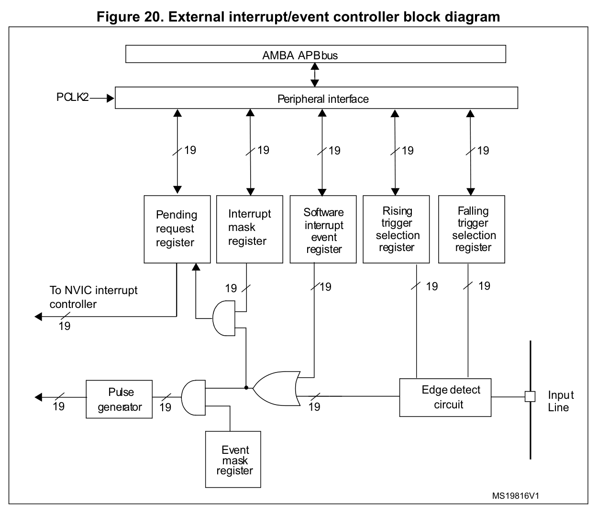

# GPIO中断与内核调试

[返回总目录](../README.md)

引脚电平变化到中断处理函数执行，中间要经过几层独立配置：通用输入/输出（GPIO）决定引脚的数据通路，复用功能 I/O（AFIO）选择映射，外部中断/事件控制器（EXTI）检测边沿并产生请求，嵌套向量中断控制器（NVIC）决定请求何时进入内核。排查时应沿这条路径逐层取证，不能只凭某一个使能位判断整条链路已经工作。

本章先讲引脚和中断链路，再说明系统滴答定时器 SysTick、异常现场和调试观察。依据为 RM0008 Rev21、PM0056 Rev7、DS5319 Rev20、ES096 Rev15 及 UM1850 Rev3；原图范围见[图表关系与覆盖范围](../参数/图表关系与覆盖范围.md)。

- [1 GPIO 模式与数据通路](#1-gpio-模式与数据通路)
- [2 AFIO 映射与复用冲突](#2-afio-映射与复用冲突)
- [3 EXTI 路由与挂起处理](#3-exti-路由与挂起处理)
- [4 NVIC 优先级与临界区](#4-nvic-优先级与临界区)
- [5 SysTick 配置与访问副作用](#5-systick-配置与访问副作用)
- [6 故障现场记录与清除](#6-故障现场记录与清除)
- [7 调试连接与观察副作用](#7-调试连接与观察副作用)
- [8 分层故障排查](#8-分层故障排查)

## 1 GPIO 模式与数据通路

配置一个引脚，先确定谁负责驱动它，再确定软件从哪里读回状态。GPIO 端口配置低寄存器、端口配置高寄存器（GPIOx_CRL、GPIOx_CRH）中的模式字段 MODE 和配置字段 CNF 共同选择模式与输出速度；只看其中一个字段不足以判断引脚行为。

下文无前缀的成组 0/1 编码按二进制读，带 0x 前缀的数值按十六进制读。同名字段应连同寄存器前缀检索。

### 1.1 模式与读回

GPIO 端口输出数据寄存器（GPIOx_ODR）保存输出锁存值，端口输入数据寄存器（GPIOx_IDR）用于读取数字输入路径。两者回答的问题不同：ODR 表示软件最后锁存了什么，IDR 才用于检查引脚的实际数字电平。

| 用途 | 配置与数据通路 |
|---|---|
| 上拉/下拉输入 | MODE=00、CNF=10；ODR=1 选上拉，ODR=0 选下拉 |
| 通用推挽/开漏输出 | ODR 控制输出锁存；开漏写 1 只是进入高阻态，需要外部上拉 |
| 复用推挽/开漏输出 | 外设控制输出，ODR 不能控制该脚；外设未启动时，输出不保证 |
| 模拟输入 | 数字输入缓冲、输出及上下拉关闭，IDR 读 0 |

因此，ODR 与目标值相同并不证明引脚已经达到目标电平；模拟输入模式下，也不能用 IDR 判断模拟电压。

MODE 的输出编码 01、10、11 分别对应 10、2、50 MHz，编码大小与速度并不顺序对应。速度档位表示驱动能力条件，不会生成相应频率；PC13/14/15 等特殊引脚仍受各自电气限制。

依据：[RM0008 §9.1；§9.1.1；§9.1.7–§9.1.10；§9.2.1–§9.2.3](../来源/RM0008.md#src-rm0008-r21-gpio-mode)。完整模式、寄存器访问属性及备份域条件见[GPIO 模式与寄存器](../参数/GPIO模式与寄存器.md)。

### 1.2 配置顺序

模式切换会改变输出控制权。为使切换过程可控，可按以下顺序组织初始化：

1. 确认实际引脚和外设映射，检查晶振、调试接口是否仍占用目标脚。
2. 开启 GPIO、AFIO 及所需外设时钟。
3. 提前准备目标输出锁存值，或完成将接管引脚的外设配置。
4. 设置路由和 GPIO 模式。
5. 使能功能，结合 IDR 和外部波形确认结果。

这是根据数据通路安排的工程顺序，并不保证任意板级条件下都无毛刺。使用 HAL 时，输出初值也要由应用另行设置；HAL_GPIO_Init 的初始化字段不包含初始输出电平。

GPIO 模式应由具体用途决定：EXTI 的 GPIO 来源使用浮空、上拉或下拉输入；I²C（Inter-Integrated Circuit，集成电路间总线）使用复用开漏；ADC（模数转换器）使用模拟输入；SPI（串行外设接口）则要按主从、单双线及 NSS（从机选择）方案分别配置，不能套用一组通用设置。

依据：[RM0008 §9.1.3～§9.1.5、§9.1.9、§9.1.11](../来源/RM0008.md#src-rm0008-r21-gpio-af-input)，其中 EXTI 输入要求见 p162、Table33 p170；[HAL 初始化字段及硬件边界](../参数/HAL_GPIO与EXTI调用边界.md#初始化字段及硬件边界)。

### 1.3 原子置位与配置锁

GPIO 和 AFIO 寄存器仅允许 32 位访问。修改输出位时，优先使用端口位置位/复位寄存器（GPIOx_BSRR）一次写入目标掩码，避免主循环与中断服务程序（ISR）对 ODR 做读改写时丢失彼此的更新。

BSRR 的低 16 位置位对应 ODR 位，高 16 位复位对应 ODR 位；同一引脚的置位和复位位同时写 1 时，置位优先。BSRR 应直接写入，不能先读再改。一次位操作的原子性也不等于多寄存器初始化整体原子：CRL/CRH 的共享配置、AFIO 映射的软件影子和锁定序列，仍需协调配置所有者。

端口配置锁寄存器（GPIOx_LCKR）解决的是防误改配置问题。它锁定选中引脚的 CRL/CRH 配置，不锁 ODR，也不能代替任务间同步。锁定时保持低 16 位选择掩码不变，按锁键位 LCKK 的顺序执行：写 1 → 写 0 → 写 1 → 读 0 → 可选再读 1 确认。序列完成后，直到复位都不能更改锁定选择集合。

依据：[RM0008 §9.1.2；§9.2；§9.2.4–§9.2.6](../来源/RM0008.md#src-rm0008-r21-gpio-atomic)；[RM0008 §9.1.6；§9.2.7](../来源/RM0008.md#src-rm0008-r21-gpio-lock)。

HAL 只完成其接口约定的那一部分配置。固定版本 HAL_GPIO_Init 不清除 EXTI 挂起，也不配置 NVIC；共享 IRQ 的 HAL 处理函数不会自动把复合掩码逐位分发。应用仍需完成后文的路由、清理和分发工作，详见[GPIO 与 EXTI 调用边界](../参数/HAL_GPIO与EXTI调用边界.md)。

## 2 AFIO 映射与复用冲突

把外设映射到一个引脚之前，要分别回答三个问题：该脚是否在 LQFP48 封装引出，调试或晶振功能是否已经释放它，以及 ES096 是否限制了当前外设组合。重映射只改变映射关系，不能自动解决后两类占用。

PD0/PD1 可以在 HSE 关闭后借用 OSC_IN/OSC_OUT，但没有对应的 EXTI 能力。用作输出时，DS5319 引脚表脚注还要求选择 50 MHz 输出模式（MODE=11），不能套用普通 GPIO 的 2/10 MHz 档位；该要求也不保证实际负载下能产生 50 MHz 波形。

SPI1 映射到 PA15/PB3/PB4/PB5 时，必须同时处理相关 JTAG 引脚的释放。外设角色、可用映射及 AFIO 字段见[引脚复用与 AFIO](../参数/引脚复用与AFIO.md)。

依据：[RM0008 §9.3.1–§9.3.3；§9.4.2](../来源/RM0008.md#src-rm0008-r21-gpio-pd01)；[RM0008 §9.3.6–§9.3.10；§9.4.2](../来源/RM0008.md#src-rm0008-r21-gpio-remap)；[DS5319 §3 Pinouts and pin description](../来源/DS5319.md#src-ds5319-r20-gpio-pin)。

### 2.1 调试引脚的释放

复用重映射和调试 I/O 配置寄存器（AFIO_MAPR）中的 SWJ_CFG 字段选择串行线/JTAG 调试接口（SWJ）的引脚配置。这个字段只写，读值未定义；普通整字读改写可能把已有的调试选择破坏掉。

应由一个配置所有者维护 AFIO_MAPR 的软件影子，或在每次写入时明确给出期望的 SWJ_CFG，同时保留其他所需位。不同编码释放的引脚并不相同：

| SWJ_CFG | 调试功能与引脚占用 |
|---|---|
| 001 | 保留完整 JTAG 和串行线调试（SWD），仅禁用 NJTRST、释放 PB4；PA13、PA14、PA15、PB3 仍由调试口占用 |
| 010 | 关闭 JTAG，保留 PA13/PA14 上的 SWD，释放 PA15、PB4；PB3 仅在不用异步串行线输出（SWO）时释放 |
| 100 | 关闭全部 SWJ |

编码和释放条件见 RM0008 Rev21 §9.3.5 Table37 及 note 1，p177；字段只写语义见 §9.4.2 p184。

依据：[RM0008 §9.3.5；§9.4.2](../来源/RM0008.md#src-rm0008-r21-gpio-swj)；[RM0008 §9.4；§9.4.1–§9.4.6](../来源/RM0008.md#src-rm0008-r21-gpio-afio)。

### 2.2 内部复用冲突

即使引脚模式和重映射都正确，内部复用仍可能使另一个已开启时钟的外设影响输出。下面几种组合尤其容易被“没有使用那项功能”的判断漏掉：

| 外设组合或状态 | 必须处理的限制 |
|---|---|
| I²C1 与重映射 SPI1 主机同时有时钟 | PB5 受到 SMBus 告警（SMBA）内部输出干扰，即使应用没有使用告警；只改 GPIO 配置不能消除 |
| I²C1 与重映射 TIM3_CH2 并用 | PB5 不能作该 PWM 输出；勘误只允许相应输入组合 |
| USART 只接收，发送器使能位 TE=0 | 内部 TX 仍可能保持高电平，不能据此把 TX 复用脚交给另一输出 |
| USART1 与 TIM1_CH2 涉及 PA9 | TIM1 部分重映射仍使用 PA9，不能靠该配置解除冲突 |

USART1_RTS/CAN 冲突有一项专门规避：当 CAN 不使用时，ES096 允许采用 CAN_REMAP=01 这一未用配置。它不是一般 CAN 功能映射的合法选项，也不能推广为尝试其他保留编码的依据。

PA9 条款的标题与正文还存在表述差异，原修订矩阵也漏列了该条，不能据此自行补出“所有版本已修复”或“所有版本未修复”的结论。十条内部冲突的完整前提见[GPIO 内部复用冲突](../参数/GPIO内部复用冲突.md)，原文见[ES096 §2.3.1–§2.3.10](../来源/ES096.md#src-es096-r15-gpio-conflicts)。

## 3 EXTI 路由与挂起处理

EXTI 把选定来源的边沿转换成中断请求或事件。它有 19 条线，即 EXTI0～18：0～15 各从同号 GPIO 中选择一个来源，16、17、18 分别固定接电源电压检测器（PVD）、RTC Alarm 和 USB Wakeup。

因此，PA0 与 PB0 不能各自独占一条 EXTI0。对本器件的封装，PC 仅有 13～15 可选，PD0/PD1 不可用。EXTI5～9 共用一个 NVIC 入口，EXTI10～15 共用另一个；共享入口的 ISR 必须区分所有可能来源。

依据：[RM0008 §10.2；§10.2.2–§10.2.5；§9.3.2；§9.4.3–§9.4.6](../来源/RM0008.md#src-rm0008-r21-exti-route)；[RM0008 §10.1](../来源/RM0008.md#src-rm0008-r21-exti-vector)。六个 EXTI 寄存器及各条线的边界见[EXTI 寄存器与路由](../参数/EXTI寄存器与路由.md)；IRQ0～42 的入口见[C8 完整外部向量表](../参数/C8外部向量表.md)。

来源：ST RM0008 Rev21 Figure20，p207；原图裁切，未改动连线或补画寄存器接口。

图中上支路先经过 Interrupt mask，再到 Pending request register；下支路经 Event mask 产生事件脉冲。对应的中断屏蔽寄存器（EXTI_IMR）和事件屏蔽寄存器（EXTI_EMR）独立控制两条路径。纯事件方式需要 EMR=1、IMR=0；两者都开时可以同时产生事件和中断，不能继续使用“事件无需清 pending”的简化处理。

### 3.1 初始化顺序

先建立来源和边沿条件，再开放请求，可以使初始化的职责更清楚：

1. 配置输入模式和 AFIO 路由。
2. 用上升沿触发选择寄存器（EXTI_RTSR）、下降沿触发选择寄存器（EXTI_FTSR）选择需要的边沿。
3. 清除挂起寄存器（EXTI_PR）中的目标遗留位。
4. 按所需路径放行 IMR 或 EMR。
5. 若使用中断，再设置并使能相应 NVIC 入口。

EXTI_PR 的复位值在手册细节定义和汇总表中存在矛盾，因此初始化时保守地显式清除目标位。边沿配置也存在窗口：RTSR 写入期间到达的上升沿、FTSR 写入期间到达的下降沿可能丢失，不能靠反复动态改边沿实现无损计数。

### 3.2 挂起标志的清除

EXTI_PR 使用写 1 清除（W1C）语义：直接写入要清除的位掩码。不要对 PR 做读改写，否则读到的其他 1 也会被写回并清除；在共享 IRQ 中，这可能把另一个来源的证据一起丢掉。

屏蔽请求和清除挂起是不同动作，而且屏蔽的位置也有区别：

- IMR 位于新边沿的中断锁存路径上，不能假定被屏蔽期间的所有边沿都会排队；已经存在的 PR 也不会因修改掩码而自动清除。
- 只在 NVIC 禁止 IRQ，仍可保留请求挂起，不能把它等同于 EXTI 的 IMR 屏蔽。
- 用软件中断事件寄存器（EXTI_SWIER）重复产生软件请求前，也要清 PR，使 SWIER 回到 0。

初始化窗口、挂起及软件请求的依据：[RM0008 §10.3–§10.3.7](../来源/RM0008.md#src-rm0008-r21-exti-reg)。

低功耗唤醒还要叠加 ES096 的限制：PVD 和 USB Wakeup 不能采用等待事件（WFE）方式唤醒，WFE 前的中断也存在事件寄存器竞态。具体入口和清理顺序见[时钟复位与低功耗](https://github.com/Bit-Walker/stm32f103c8-knowledge-base/blob/main/知识库/02_时钟复位与低功耗.md#4-低功耗选择由状态保持和唤醒源决定)，不能仅凭通用 EXTI 图选择唤醒方案。

## 4 NVIC 优先级与临界区

请求到达 NVIC 后，还要经过使能、优先级和异常屏蔽的判断，才能进入处理函数。先分清编号与状态，随后再讨论优先级，能避免把不同层的问题混在一起。

本器件有 43 个外部 IRQ，编号 0～42；对应的异常号为 IRQ 编号加 16。向量表首项是初始主栈指针（MSP），不是中断入口。软件触发中断寄存器（NVIC_STIR）写入外部 IRQ 编号，不加 16；系统异常也不能套用外部 IRQ 接口。

挂起（pending）表示有请求等待处理；活动（active）表示已进入处理但尚未完成，包括正在执行和被更高优先级异常抢占的情况。单个 pending 位不会累计请求次数，清 NVIC pending 不会清 active，更不替代撤销外设中断源。读取外设数据能否自动清标志，必须按对应外设的语义处理，不能给所有 ISR 套同一个清理模板。

依据：[RM0008 §10.1](../来源/RM0008.md#src-rm0008-r21-exti-vector)；[PM0056 §4.3.2–4.3.6；§4.3.8–4.3.10](../来源/PM0056.md#src-pm0056-r7-nvic-state)。字段布局见[内核寄存器参数](../参数/内核寄存器参数.md)和[异常与屏蔽参数](../参数/异常与屏蔽参数.md)。

### 4.1 优先级分组

优先级逻辑值为 0～15，数值越小越紧急。寄存器中的优先级使用字节高 4 位，而 Cortex 微控制器软件接口标准（CMSIS）的 SetPriority 参数使用未左移的逻辑值；调用接口前再左移一次，会配置错误。

应用中断和复位控制寄存器（SCB_AIRCR）的 PRIGROUP 字段决定这 4 个实现位怎样分配。应先确定分组，再编码各 IRQ 的优先级，最后使能。抢占优先级决定能否打断另一个异常；子优先级只排序同组中等待处理的请求。

| HAL 分组名 | PRIGROUP 原始值 | 抢占位数/级数 | 子优先级位数/级数 |
|---|---|---|---|
| GROUP_0 | 7 | 0/1 | 4/16 |
| GROUP_1 | 6 | 1/2 | 3/8 |
| GROUP_2 | 5 | 2/4 | 2/4 |
| GROUP_3 | 4 | 3/8 | 1/2 |
| GROUP_4 | 3 | 4/16 | 0/1 |

HAL 的 GROUP 名称不是 PRIGROUP 的原始数值。表中“0 位、1 种编码”表示没有可区分的该类优先级，不代表仍然实现了一位。

依据：[PM0056 §2.3.5–2.3.6；§4.3.7；§4.4.5，含 Table45](../来源/PM0056.md#src-pm0056-r7-priority)；UM1850 Rev3 §10.1.4；[CMSIS core_cm3_cmsis590.h 固定来源](../来源/驱动实现.md#src-cmsis590-cm3)；[stm32f103xb.h 内核定义](../来源/驱动实现.md#src-stm32f103xb-core)；[HAL 分组宏快照](../来源/驱动实现.md#src-hal-cortex-group-snapshot)。

### 4.2 屏蔽与临界区

临界区的目标是限制哪些异常可以打断当前操作，选用的屏蔽机制必须与这个目标相符。

| 屏蔽机制 | 能力和边界 |
|---|---|
| NVIC 单路禁止 | 阻止该 IRQ 激活，不自动清挂起 |
| 优先级屏蔽寄存器 PRIMASK | 阻止可配置异常激活，不屏蔽 NMI（不可屏蔽中断）或 HardFault（硬故障） |
| 基础优先级屏蔽寄存器 BASEPRI | 非零值按组优先级阈值屏蔽；0 表示不施加该屏蔽，不能按同组子优先级细分 |
| 故障屏蔽寄存器 FAULTMASK | 除 NMI 外均可屏蔽，但有额外上下文约束，不作为普通临界区工具 |

进入临界区时保存原屏蔽状态，退出时恢复，不能无条件开中断。嵌套临界区也不能把已有 BASEPRI 改为更弱的屏蔽；若入口只允许增强屏蔽，可依据 BASEPRI_MAX 的语义设计，再在退出时恢复保存值。这是工程建议，需要结合实时操作系统（RTOS）和特权上下文核验。

BASEPRI 的写值使用寄存器编码，阈值的子优先级部分宜为 0。屏蔽异常之外，还要考虑内存访问顺序：volatile 既不能使多次访问成为原子操作，也不能代替内存屏障。数据存储器屏障 DMB 约束操作顺序，数据同步屏障 DSB 等待先前操作完成，指令同步屏障 ISB 刷新后续执行上下文，三者不能互换。

依据：[PM0056 §2.1.3 Core registers；§3.9.2；§3.9.6–3.9.7](../来源/PM0056.md#src-pm0056-r7-mask)；[Arm DDI0403E.b §B1.5.4 Exception priorities and preemption，pB1-583、B1-584、B1-585](../来源/Arm_DDI0403Eb.md#src-armv7m-eb-mask)；[PM0056 §2.2.4；§3.9.3–3.9.5](../来源/PM0056.md#src-pm0056-r7-barriers)。

### 4.3 向量表迁移

迁移向量表时，先完整准备初始 MSP、NMI、故障以及所有已启用异常的入口，确认所用地址落在实际 Flash/SRAM 中，再更新向量表偏移寄存器（SCB_VTOR）。本库沿用 PM0056 的 0x200 字节保守对齐约定，并处理 DSB/ISB；这不表示所有 Cortex-M3 架构实现都只能按 512 字节对齐。

异常入口地址的最低位必须为 1，以指示 Thumb 状态。若同时写 AIRCR 设置分组或发起复位，还必须带写入钥匙 0x05FA，不能把读回的 0xFA05 通过普通读改写送回。

依据：[PM0056 §2.3.4；§4.3.10；§4.4.4](../来源/PM0056.md#src-pm0056-r7-vtor)；[PM0056 §2.2.4；§3.9.3–3.9.5](../来源/PM0056.md#src-pm0056-r7-barriers)；[Arm DDI0403E.b §B1.5.3 The vector table，pB1-581、B1-582](../来源/Arm_DDI0403Eb.md#src-armv7m-eb-vector)；[PM0056 §2.3.5–2.3.6；§4.3.7；§4.4.5](../来源/PM0056.md#src-pm0056-r7-priority)；[HAL 分组宏快照](../来源/驱动实现.md#src-hal-cortex-group-snapshot)。

## 5 SysTick 配置与访问副作用

SysTick 的配置需要同时解决时钟来源、周期和时基所有权。周期计算正确，也不意味着可以覆盖 HAL 或 RTOS 已经使用的配置。

SysTick 重装载值寄存器（SysTick_LOAD，以下简称 LOAD）与周期的关系为：

$$
T=\frac{R+1}{f_{\mathrm{ST}}},\qquad R=f_{\mathrm{ST}}T-1
$$

 $`T`$  为重复周期，单位 s； $`R`$  为 LOAD 中的无量纲整数； $`f_{\mathrm{ST}}`$  为 SysTick 时钟频率，单位 Hz，可来自 HCLK 或 HCLK/8，下标 ST 表示 SysTick。

持续周期计数要求  $`R`$  在 1～0xFFFFFF 范围内。LOAD=0 没有正常的 1→0 转换，不能当作正常重复周期使用。生成 1 ms 周期时：

- 采用 72 MHz HCLK， $`R=71999`$ 。
- 采用 HCLK/8， $`R=8999`$ 。

依据：[PM0056 §4.5–4.5.6；§4.4.3](../来源/PM0056.md#src-pm0056-r7-systick)。

初始化或重配置前，先协调时基所有者。为避免一次计数横跨新旧配置，可先停止 SysTick，再依次写 LOAD、写当前值寄存器（SysTick_VAL）清当前计数、按需清旧挂起、配置优先级，最后写控制和状态寄存器（SysTick_CTRL）启用。

HAL_SYSTICK_Config 接收的是周期时钟数  $`R+1`$ ，不能直接传 LOAD 值。固定实现还会选择 HCLK、设置最低优先级等；HAL 或 RTOS 已占用时，不能另行随意重配。UM1850 的参数文字与固定 CMSIS 实现差异见[SysTick 接口参数](../参数/SysTick接口参数.md)。

依据：[UM1850 §10.1.1；§10.1.4；§10.2.1](../来源/UM1850.md#src-um1850-r3-cortex)；[CMSIS core_cm3_cmsis590.h 固定来源](../来源/驱动实现.md#src-cmsis590-cm3)；[stm32f103xb.h 内核定义](../来源/驱动实现.md#src-stm32f103xb-core)；[HAL Cortex C 固定实现](../来源/驱动实现.md#src-hal-cortex-snapshot)。

### 5.1 读取和写入的副作用

SysTick 的计数标志 COUNTFLAG 与 SysTick 异常的 pending 状态是两件事。读取 CTRL 会清 COUNTFLAG；向 VAL 写任意值会清当前计数及 COUNTFLAG。这两种操作都不会清除已挂起的 SysTick 异常，因此调试器实时查看 CTRL 也可能改变软件随后读到的计数证据。

| 对象 | 对齐/访问宽度 | 读操作 | 写操作及边界 |
|---|---|---|---|
| SysTick_CTRL | 对齐 32 位 | 清 COUNTFLAG | 设置控制字段，不能靠此清异常 pending |
| SysTick_VAL | 对齐 32 位 | 读取当前计数 | 任意值清当前计数和 COUNTFLAG，不清异常 pending |
| 中断控制和状态寄存器 SCB_ICSR 的 PENDSTCLR 位 | ICSR 对齐 32 位 | 该位只写，读值未知 | 写 1 清 SysTick pending；直接写目标动作位掩码 |

校准值寄存器（SysTick_CALIB）中的 9000 来自最大 HCLK/8=9 MHz 时约 1 ms 的尺度。它不会自动跟随当前时钟，也不能仅凭字段名 TENMS 就当作 10 ms。源文对 SKEW 和复位字值存在冲突；实际配置应按已知时钟计算周期，并核验实际标志。

依据：[PM0056 §4.5–4.5.6；§4.4.3](../来源/PM0056.md#src-pm0056-r7-systick)；[PM0056 §4.5.4；§4.5.6](../来源/PM0056.md#src-pm0056-r7-calib-conflict)；[RM0008 §10.1.1 SysTick calibration value register](../来源/RM0008.md#src-rm0008-r21-systick-calib)。

接口调用也可能间接触发这些副作用。与官方提交 77fbb30b7a1d02533980400083e48c559aae5a4f 逐字节相同的 HAL Cortex C 文件中，HAL_SYSTICK_CLKSourceConfig 对 CTRL 做读改写。由该实现和寄存器读清语义可推得，调用会消耗 COUNTFLAG；这不是对所有 HAL 版本逐版验证后的结论。修改时钟源后，也必须重新核对 LOAD 与期望周期。

实现依据：[HAL Cortex C 固定实现](../来源/驱动实现.md#src-hal-cortex-snapshot)。

## 6 故障现场记录与清除

异常现场的价值取决于取证顺序。先确定硬件把现场压在哪个栈上，再记录故障状态与有效地址，最后决定是否清除；若先清标志或先信任一个旧地址，根因可能就此丢失。

硬件异常帧保存 R0～R3、R12、链接寄存器 LR、程序计数器 PC 和程序状态寄存器 xPSR，共 8 字，R4～R11 不在其中。Handler 模式使用 MSP，但被中断线程的帧可能位于进程栈指针 PSP 所指的栈。入口 LR 中的异常返回值 EXC_RETURN 用于区分返回目标：

| EXC_RETURN | 返回模式与栈 |
|---|---|
| 0xFFFFFFF1 | Handler / MSP |
| 0xFFFFFFF9 | Thread / MSP |
| 0xFFFFFFFD | Thread / PSP |

定位原始帧时还要考虑对齐填充与入栈故障，不能一律把当前 C 函数的栈指针 SP 当成原始硬件帧地址。

依据：[PM0056 §2.1.1–2.1.3；§2.3.7](../来源/PM0056.md#src-pm0056-r7-exception-frame)。

### 6.1 故障状态判读

硬故障状态寄存器（SCB_HFSR）说明 HardFault 的类型，可配置故障状态寄存器（SCB_CFSR）则提供进一步根因。地址证据来自存储器管理故障地址寄存器（SCB_MMFAR）和总线故障地址寄存器（SCB_BFAR），但只有对应有效位成立时才能采用。

| 证据 | 解释边界 |
|---|---|
| HFSR.FORCED | 可配置故障升级，继续查 CFSR 根因 |
| HFSR.VECTTBL | 取向量失败；压栈 PC 是被打断的位置，不是损坏向量的地址 |
| CFSR 的 PRECISERR / IMPRECISERR | 精确错误可用压栈 PC 定位；非精确错误异步报告，PC 不必指向出错的写操作 |
| CFSR 的 BFARVALID / MMARVALID | 地址有效的前提；未置位时不能采用地址寄存器旧值 |
| CFSR 的 STKERR / UNSTKERR 等 | 入栈/出栈失败，不能无条件信任完整帧 |

按 PM0056 §4.4.14，先保存 MMFAR/BFAR，再读取对应有效位；有效位为 1 才采用地址。这是原厂针对抢占风险给出的取证顺序，却不保证 CFSR、HFSR、地址和栈帧构成不可分割的同一时刻快照，仍要协调会改写这些状态的更高优先级故障处理程序。

保存地址证据后，还应记录 CFSR、HFSR、系统处理程序控制和状态寄存器（SCB_SHCSR）、栈选择以及可验证的帧，再按下表的访问语义清除目标状态位。

| 对象 | 对齐/访问宽度 | 读操作 | 写操作及边界 |
|---|---|---|---|
| SCB_CFSR | 字节、对齐 16/32 位 | 不清故障位 | 故障状态写 1 清除，保留位写 0 |
| SCB_HFSR | 对齐 32 位 | 不清故障位 | 仅对目标故障状态写 1 清除，DEBUG_VT 及保留位保持 0 |
| SCB_MMFAR / SCB_BFAR | 对齐 32 位 | 取地址后再检查对应 VALID 位 | 不是清故障状态的接口 |

CFSR 的三个子寄存器还可单独访问：在 0xE000ED28 读字节取得存储器管理故障状态寄存器 MMFSR，在 0xE000ED29 读字节取得总线故障状态寄存器 BFSR，在 0xE000ED2A 读半字取得用法故障状态寄存器 UFSR。

本器件没有可编程存储器保护单元（MPU）和硬件浮点协处理器，但仍有固定的执行与特权限制。出现无协处理器故障 NOCP 或看到 MemManage 字段，不能据此认定相应硬件存在。

依据：[PM0056 §2.4；§4.4.9–4.4.14](../来源/PM0056.md#src-pm0056-r7-fault-evidence)；[Arm Cortex-M3 TRM DDI0337E §8.2.2 NVIC register descriptions / Configurable Fault Status Registers](../来源/Arm_DDI0337E.md#src-arm-cm3-r1p1-fault-w1c)；[stm32f103xb.h 内核定义](../来源/驱动实现.md#src-stm32f103xb-core)。

## 7 调试连接与观察副作用

调试设计要同时考虑能否重新接管目标，以及观察是否改变目标行为。复位后，五个 SWJ 引脚立即交给调试逻辑；在应用释放它们之前，外部电路必须容忍其偏置或三态。

若固件很快关闭 SWD 或进入低功耗，可连接 NRST，采用复位下连接，并在释放复位前设置复位捕获。这个流程用于获得调试窗口，不是绕过读保护的方法。调试组件也并非所有字段都只受上电复位影响：调试停机控制和状态寄存器（DHCSR）的 C_HALT 位，以及调试异常和监视器控制寄存器（DEMCR）的部分位，另有系统复位规则。

依据：[RM0008 §31.3–§31.4.4](../来源/RM0008.md#src-rm0008-r21-debug-pins)；[RM0008 §31.10–§31.11](../来源/RM0008.md#src-rm0008-r21-debug-reset)；[DDI0337E §10.1 Table10-1；§10.2.1；§10.2.4](../来源/Arm_DDI0337E.md#src-ddi0337e-debug-state)。

Flash 补丁与断点单元（FPB）提供 6 个指令比较器和 2 个 literal（常量）比较器，断点与补丁共用这些资源；数据观察点与跟踪单元（DWT）有 4 个比较器。PB3 的异步 SWO 需要 SWD 模式。使用仪器化跟踪宏单元（ITM）输出时，要处理输出满和调试器不在的情况，避免让应用无限等待。

依据：[RM0008 §31.12–§31.14.4](../来源/RM0008.md#src-rm0008-r21-debug-fpb-dwt-itm)；[DDI0337E §11.6.1 ITM Stimulus Ports 0–31 及 TPR](../来源/Arm_DDI0337E.md#src-ddi0337e-itm-fifo)；[RM0008 §31.1；§31.4；§31.15；§31.17.2；§31.17.7–§31.17.9](../来源/RM0008.md#src-rm0008-r21-debug-trace)；[DS5319 §3 Table5](../来源/DS5319.md#src-ds5319-r20-debug-package)；[DDI0337E §11.5.1；§13.2.2](../来源/Arm_DDI0337E.md#src-ddi0337e-trace-boundary)。

停核不意味着所有外设都停止。应按观察目的配置定时器、看门狗、CAN 接收更新等冻结位；TIM1 冻结时输出有安全关断行为，会改变 PWM 实验的结果。DHCSR 的 S_RESET_ST 和 S_RETIRE_ST 是读清粘滞位，反复观察会消耗证据；若目标持续处于复位，S_RESET_ST 连续读取仍可能为 1。

调试 MCU 标识码寄存器（DBGMCU_IDCODE）和控制寄存器（DBGMCU_CR）的脱机 CPU 访问还受 C8 勘误限制，读到 0 不能诊断为芯片型号 0。涉及这些行为时，要连同实际硅修订检查适用条件。

依据：[RM0008 §31.16.2–§31.16.3；§31.18](../来源/RM0008.md#src-rm0008-r21-debug-freeze)；[ES096 §2.2.2–§2.2.4；§1 Table3](../来源/ES096.md#src-es096-r15-debug-access)；[RM0008 §31.10–§31.11](../来源/RM0008.md#src-rm0008-r21-debug-reset)；[DDI0337E §10.1 Table10-1；§10.2.1；§10.2.4](../来源/Arm_DDI0337E.md#src-ddi0337e-debug-state)；[RM0008 §31.6.1–§31.6.4](../来源/RM0008.md#src-rm0008-r21-debug-id)；[ES096 首页 Applicability 及 Tables1–2；§1 Tables3–4](../来源/ES096.md#src-es096-r15-revision-matrix)。

调试引脚、标识、传输、跟踪与冻结字段的具体定义见[调试寄存器与协议](../参数/调试寄存器与协议.md)。

### 7.1 调试探针的协议约束

若开发的是调试探针，还要区分 SWD 事务完成与目标内部操作完成。访问端口（AP）的读采用 posted read 方式，末次结果通过读缓冲寄存器（RDBUFF）取得；WAIT（等待）/FAULT（故障）响应的数据阶段有条件限制，写后至少需要两个空闲时钟。上电还要确认 ACK，总线事务返回 OK 不等于电源域已经就绪。

Park 位在原 RM 与后续 ADIv5 规范间存在差异。实现应沿用以下来源的版本辨析，不得自行拼接不同规范的时序：[RM0008 §31.8.1–§31.8.5](../来源/RM0008.md#src-rm0008-r21-swd-protocol)；[IHI0031A §5.2–§5.4.5](../来源/IHI0031A.md#src-ihi0031a-swd-protocol)；[IHI0031D §B4.2，pB4-110](../来源/IHI0031D.md#src-ihi0031d-swd-park)；[IHI0031A §3.4.1–§3.4.2](../来源/IHI0031A.md#src-ihi0031a-power-ack)。

## 8 分层故障排查

排查时先确定最早出现不一致的层，再修改配置；同时改动路由、模式、优先级和清标志方式，往往会掩盖真正的原因。涉及硅限制时，可用[硅修订矩阵](../参数/硅修订矩阵.md)核对 ES096 Tables1–4 的状态与缺项。

### 8.1 引脚没有预期输出

先检查电源和实际接线，在适用的数字路径上核对 IDR，再检查 GPIO 模式与输出控制权。如果配置看似正确，继续查 SWJ 或晶振占用、MAPR 写入是否保留了期望值，以及 ES096 的内部复用冲突。ODR 正确只能说明锁存值正确，不能跳过引脚侧的检查。

### 8.2 中断处理函数没有执行

沿请求传播方向逐层检查：

1. 外设或输入端是否确实产生了请求条件。
2. 使用 EXTI 时，来源、边沿和掩码是否正确。
3. EXTI 的 PR 是否挂起。
4. NVIC 是否使能，是否存在挂起。
5. 优先级和异常屏蔽是否允许执行。
6. 向量入口是否正确。

如果现象是反复进入 ISR，首先确认请求源是否真正撤销，而不是只反复清 NVIC pending。

### 8.3 仅连接调试器时表现异常

检查寄存器读清副作用、外设冻结、低功耗调试位及复位窗口，尤其注意“加一个实时观察窗口”本身也可能改变证据。需要采用硅规避措施时，回查[ES096 首页 Applicability 及 Tables1–2；§1 Tables3–4](../来源/ES096.md#src-es096-r15-revision-matrix)，按实际版本保留适用条件，避免把摘要当成无条件保证。
