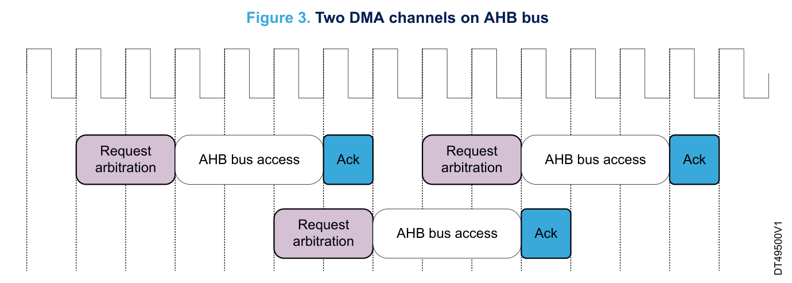

# DMA 与缓冲区协作

DMA（Direct memory access，直接存储器访问）负责在外设与内存之间、内存与内存之间搬运数据，应用仍须安排数据的生产、消费和异常恢复。一条可靠的数据流，需要先确定请求源与通道，再确定每项数据的宽度和缓冲区布局，最后为 DMA 搬运和中央处理器（CPU）的处理分别留出时间。

本章按这条顺序展开。理解半缓冲协作时，始终关注两个问题：DMA 现在访问哪一段内存，CPU 最迟何时必须交还这一段。软件调用以硬件抽象层 HAL（Hardware abstraction layer）为主要入口；完整的请求表、寄存器字段和 HAL 接口见[DMA参数与HAL接口](../参数/DMA参数与HAL接口.md)。

- [1 DMA1资源、通道和数据项](#1-dma1资源通道和数据项)
- [2 启停与HAL生命周期](#2-启停与hal生命周期)
- [3 循环 DMA 与半缓冲处理](#3-循环-dma-与半缓冲处理)
- [4 吞吐量与最坏服务延迟](#4-吞吐量与最坏服务延迟)
- [5 ADC 与定时器 DMA](#5-adc-与定时器-dma)
- [6 错误状态与所有权恢复](#6-错误状态与所有权恢复)

## 1 DMA1资源、通道和数据项

### 1.1 先分配请求源，再配置通道

DMA1 有 7 个固定映射通道。一个通道连接的多个外设请求在进入 DMA 前以逻辑“或”汇合，请求中没有来源标签。因此，每个通道在同一时刻只能开放一个实际请求源；配置一个外设地址并不能替 DMA 筛选请求。

例如，模数转换器 ADC1、定时器 TIM2 的捕获比较通道 3（TIM2_CH3）和 TIM4 的捕获比较通道 1（TIM4_CH1）共用 DMA 通道 1；通用同步/异步收发器 USART1 的接收请求（USART1_RX）与 TIM1 的更新请求（TIM1_UP）共用 DMA 通道 5。

如果两项并发需求落在同一通道，应调整外设或事件分配，或改用其他搬运方式。提高其中一项的优先级无法解决这一冲突，因为优先级仲裁发生在通道之间。

依据：[DS5319 Rev 20，§2.1 Device overview](https://www.st.com/resource/en/datasheet/stm32f103c8.pdf#page=10)；[RM0008 Rev 21，§13.3.7 DMA request mapping](https://www.st.com/resource/en/reference_manual/cd00171190.pdf#page=281)。

### 1.2 区分寄存器访问宽度与数据宽度

配置 DMA 时涉及三种宽度，应分别确定：

- CPU 读写 DMA 控制寄存器的访问宽度。
- PSIZE（Peripheral size）：每次搬运在外设端访问的数据宽度。
- MSIZE（Memory size）：每次搬运在内存端访问的数据宽度。

ES096 要求 CPU 对 DMA 寄存器使用对齐的 32 位 word（字）访问，搬运的数据项则仍可选择 8、16 或 32 位。通道数据数量寄存器 CNDTR（DMA channel x number of data register）的有效计数虽然只有 16 位，也不能将它强转为半字指针后写入。[ES096 Rev 15，§2.4.2 Byte and half-word accesses not supported](https://www.st.com/resource/en/errata_sheet/es096-stm32f101x8b-stm32f102x8b-and-stm32f103x8b-mediumdensity-device-limitations-stmicroelectronics.pdf#page=13)

两端地址分别按 PSIZE、MSIZE 对齐。外设端是否递增由 PINC（Peripheral increment，外设地址递增使能位）控制，内存端由 MINC（Memory increment，内存地址递增使能位）控制。开启后，对应地址按本端宽度每项增加 1、2 或 4 B。

两端宽度不同时，DMA 仍逐项读写：窄源写宽目的时高位补零，宽源写窄目的时截去高位。例如，8→32 会将每个字节扩为一个字，不会将四个字节拼成一字。

外设端还要核对寄存器允许的访问宽度。APB（Advanced peripheral bus，先进外设总线）的窄写会把数据复制到整个字总线，不能仅因有效数据只有 8 位或 16 位，就选择同样宽度的外设访问。[RM0008 Rev 21，§13.3.3 DMA channels；§13.3.4 Programmable data width, data alignment and endians](https://www.st.com/resource/en/reference_manual/cd00171190.pdf#page=277)

### 1.3 用数据项计算长度和容量

`CNDTR=N` 表示搬运  $`N`$  个数据项，合法启动长度为 1～65535。只有在 MINC=1、内存项连续排列且该数组由本次传输独占时，所需数据区大小才可按下式计算：

$$
B=N W_{\mathrm{m}}
$$

其中， $`B`$  是缓冲区容量，单位为 byte（字节）； $`N`$  是项数； $`W_{\mathrm{m}}`$  是每个内存项的字节数，按 MSIZE 取 1、2 或 4，下标 m 表示内存端。

例如，128 个连续半字占 256 B，CNDTR 仍填 128。若 MINC=0，DMA 会反复访问同一个内存项， $`N`$  不再代表被依次填充的  $`N`$  个数组元素；后文的前后半区消费模型也不适用。

## 2 启停与HAL生命周期

启动的关键是先准备接收数据的一端，再放行生产数据的一端。对于外设请求驱动的传输，可按以下顺序安排：

1. 开启 DMA1、外设和通用输入/输出端口（GPIO）所需时钟，保持实际生产源停止，例如暂不释放定时触发。
2. 停用目标 DMA 通道，确认通道使能位 EN=0，并处理旧标志。将外设地址写入通道外设地址寄存器 CPAR（DMA channel x peripheral address register），将内存地址写入通道内存地址寄存器 CMAR（DMA channel x memory address register），再装载 CNDTR。
3. 配置方向、PSIZE/MSIZE、PINC/MINC、普通或循环模式以及通道优先级。存储器到存储器模式 MEM2MEM 不能与循环模式 CIRC 同时开启。
4. 配置半传输（HT）、传输完成（TC）和传输错误（TE）中断，在嵌套向量中断控制器（NVIC）中使能对应中断，并接好实际中断请求（IRQ）的处理入口。使用 HAL 时，先完成 DMA 与父外设句柄的关联。
5. 使能 DMA 通道，开放外设 DMA 请求，最后释放定时触发或其他实际生产源。

停止时先阻止新请求，再停用通道并确认它已不再访问缓冲区，之后才能重新装载配置或释放内存。清 EN 不会复位 CPAR、CMAR，也不会复位通道配置寄存器 CCR（DMA channel x configuration register）；普通模式的计数归零也不意味着外设已经停止产生数据。[RM0008 Rev 21，§13.3.1 DMA transactions；§13.3.3 DMA channels；§13.3.5 Error management；§13.4 DMA registers](https://www.st.com/resource/en/reference_manual/cd00171190.pdf#page=276)

HAL 把上述过程拆在 DMA 驱动和外设驱动之间。调用 `Init` 不能安全终止旧传输，`Start` 或 `Start_IT` 返回也只说明启动调用结束。异步传输还要求：

- DMA 句柄及缓冲区在整个传输期间有效。句柄的 Parent 成员指向所属外设的父句柄，该对象也须保持有效；不能传入随后离开作用域的局部数组。
- 实际 DMA IRQ 调用对应的 `HAL_DMA_IRQHandler`，否则已发生的搬运事件无法沿 HAL 路径分发。
- 保留外设 HAL 安装的内部 DMA 回调，运行中不替换这些回调，以免破坏外设状态更新。

本章涉及的 HAL 实现固定为提交 `bd368aa335c529641d2e567574885e02deacc64a`。上面的启动顺序是应用应满足的生命周期约束，不能据此假定每个 HAL 函数都按同样的寄存器指令顺序执行。`HAL_ADC_Start_DMA` 的具体顺序与返回值限制见[ADC 启动与结果确认](#52-adc-启动与结果确认)；调用前仍应控制住实际生产源。

依据：[UM1850 Rev 3，§3.9 HAL common resources；§14 HAL DMA Generic Driver（§14.1–14.3）](https://www.st.com/resource/en/user_manual/um1850-description-of-stm32f1-hal-and-lowlayer-drivers-stmicroelectronics.pdf#page=148)；[固定版本 DMA 驱动](https://github.com/STMicroelectronics/stm32f1xx-hal-driver/blob/bd368aa335c529641d2e567574885e02deacc64a/Src/stm32f1xx_hal_dma.c)；[固定版本 ADC 驱动，L1553–1678](https://github.com/STMicroelectronics/stm32f1xx-hal-driver/blob/bd368aa335c529641d2e567574885e02deacc64a/Src/stm32f1xx_hal_adc.c#L1553-L1678)。

### 2.1 超时后的软件状态与硬件状态

超时路径中，软件状态与硬件停止状态可能不同步。在上述固定版本中，`HAL_DMA_PollForTransfer` 超时后设置错误码，将句柄软件状态 State 改为就绪状态 READY 并解锁，却不清 EN。紧接着调用 `HAL_DMA_Abort`，又可能因为句柄不处于忙状态 BUSY 而返回 HAL_ERROR，并将错误位图 ErrorCode 置为 HAL_DMA_ERROR_NO_XFER，仍没有停用通道。

因此，恢复时应分别确认函数返回值、HAL State 和硬件 EN，不能把 READY 或 HAL_OK 当作硬件静止的证据。应先保存原错误和硬件状态，再走当前事务明确拥有的停止路径；具体恢复顺序见[保存错误与收回所有权](#62-保存错误与收回所有权)。[Poll 超时分支，L557–570](https://github.com/STMicroelectronics/stm32f1xx-hal-driver/blob/bd368aa335c529641d2e567574885e02deacc64a/Src/stm32f1xx_hal_dma.c#L557-L570)

## 3 循环 DMA 与半缓冲处理

循环 DMA 在计数归零后自动重装计数和内部地址，可以连续使用同一块缓冲区。要把数组划为前、后半区与 CPU 交替协作，须满足三个条件：MINC=1，长度  $`N`$  为正偶数，数组按 MSIZE 连续排列。

对于外设→存储器的循环接收，HT 表示前半区已经填好，DMA 接着写后半区；TC 表示后半区已经填好，DMA 随即回到前半区。CPU 每次只处理当前未被 DMA 写入的半区，并在 DMA 下次返回该半区前完成。HT 或 TC 都不会使整块数组停止变化。

对于存储器→外设的循环发送，方向相反：HT/TC 表示相应源半区已经被 DMA 读走，CPU 可在下一轮读取前重填。这里的完成只到 DMA 取走源数据为止，外设移位寄存器或物理线路可能仍在发送。例如 USART 必须另行判断线路 TC，不能用 DMA 完成替代。[RM0008 Rev 21，§27.3.2 Transmitter；§27.6.1 Status register (USART_SR)](https://www.st.com/resource/en/reference_manual/cd00171190.pdf#page=791)

### 3.1 覆盖期限与处理预算

先以稳定数据项速率估算半缓冲的名义填充时间：

$$
T_{\mathrm{half}}=\frac{N}{2R_{\mathrm{item}}}
$$

 $`N`$  是正偶数个 DMA 项， $`R_{\mathrm{item}}`$  是流入数组的数据项速率，单位为项/s； $`T_{\mathrm{half}}`$  的单位为 s，下标 half、item 分别表示半区和数据项。这是由循环 DMA 和速率定义推导的预算公式，并非 AN2548 Rev 9 的原文公式。

等间隔到达时，可据此保守安排 CPU 的处理窗口。预算必须包含中断响应、任务排队和实际处理的总时间，而不仅是处理函数自身的耗时。对于突发输入、触发抖动或可变序列，应直接求出“本半区完成通知到本半区最早被重写”的最短间隔，长期平均速率不足以证明能及时交还缓冲区。

HT/TC 状态位也不是事件队列。若处理延迟跨过多轮，一次置位无法说明期间发生了多少次半传输或全传输。增大  $`N`$  可以扩大窗口，同时增加延迟；它不能补偿长期消费速度不足，也无法挽回在 DMA 读取前就被外设覆盖的数据。[RM0008 Rev 21，§13.3.3 DMA channels；§13.3.6 Interrupts；§13.4.1/4](https://www.st.com/resource/en/reference_manual/cd00171190.pdf#page=278)

### 3.2 四通道 ADC 算例

设一个规则序列包含 4 个 ADC rank，即 4 个按顺序转换的位置，每秒触发 10 000 个完整序列。每次序列产生 4 项数据，因此  $`R_{\mathrm{item}}=40\,000`$  项/s。采用 256 个半字的循环数组时：

- 整个数组为 512 B。
- 每半区为 128 项，即 32 个完整序列帧。
- 名义半区时长为  $`128/40\,000=3.2`$  ms。

这个结果是预算算例，不是实测性能保证。首先要确认 ADC 能在两次触发之间的 100 µs 内完成一组转换；其次，序列内部的多个结果是突发写入，还要结合实际触发和转换时序验证最早覆盖时间。

为了让半区边界恰好落在帧边界， $`N/2`$  宜取 rank 数的整数倍。它是便于软件组织数据的约定，DMA 硬件并不要求这样分组。若有注入转换抢占，也不能再仅凭规则数组的下标推断样本严格等时距。[RM0008 Rev 21，§11.3.8 Scan mode；§11.3.9 Injected channel management；§11.8 DMA request；§11.9.2 Regular simultaneous mode；§11.12.14 ADC regular data register](https://www.st.com/resource/en/reference_manual/cd00171190.pdf#page=221)

## 4 吞吐量与最坏服务延迟

半缓冲预算解决的是 CPU 能否及时消费已进入内存的数据。在此之前，DMA 还必须及时从外设取走每一项结果。因此，要分别验证单项搬运的最坏时延、持续吞吐量和 CPU 的半区处理期限；任何一项满足，都不能代替另外两项。

### 4.1 找出竞争发生的位置

CPU 的指令端口 ICode 连接 Flash（闪存）的指令接口；代码区数据端口 DCode、系统端口 System 与 DMA1 的 AHB 主端口参与总线矩阵访问。AHB（Advanced high-performance bus，先进高性能总线）承载这些主设备对共享资源的访问。

Flash 数据接口、静态随机存储器（SRAM）以及通往 APB1/APB2 的系统路径有各自的资源约束。分析一次传输时，应沿源地址和目的地址找到实际访问路径，具体关系见[总线与仲裁](../参数/DMA图关系与来源.md#总线与仲裁示意图)。

这条路径上有三类仲裁：

- Flash 接口内，取指与数据访问竞争 Flash 资源。
- 总线矩阵中，多个主设备访问同一从端口时采用轮转仲裁。
- DMA1 内部，各通道按软件优先级选择请求；同级时小编号优先。

连续的高优先级 DMA 请求可能使低优先级通道长期等待。通道优先级字段 PL（Priority level）决定 DMA 内部的搬运调度，NVIC 优先级决定 CPU 何时处理通知，二者解决的问题不同。提高 NVIC 优先级并不能缩短一个尚未获准搬运的数据项的等待时间。

依据：[RM0008 Rev 21，§3.1、§3.3.3、§13.3](https://www.st.com/resource/en/reference_manual/cd00171190.pdf#page=47)；[AN2548 Rev 9，§2 Bus bandwidth；§4 DMA controller；§5.3 Sharing the bus matrix with CPU；§6 Insufficient resources threats](https://www.st.com/resource/en/application_note/an2548-introduction-to-dma-controller-for-stm32-mcus-stmicroelectronics.pdf#page=3)；[RM0008 Rev 21，§13.3.1、§13.3.3、§13.3.5、§13.4](https://www.st.com/resource/en/reference_manual/cd00171190.pdf#page=276)。

### 4.2 从一次服务看总线开销

AN2548 将一次服务分为仲裁与地址计算、源读取和目的写入；连续请求还需计入应答握手：

$$
t_{\mathrm{S}}=t_{\mathrm{A}}+t_{\mathrm{RD}}+t_{\mathrm{WR}}
$$

$$
t_{\mathrm{TS}}=t_{\mathrm{S}}+t_{\mathrm{Ack}}
$$

式中各时间的单位均为 s。 $`t_{\mathrm{A}}`$  是仲裁与地址计算时间， $`t_{\mathrm{RD}}`$ 、 $`t_{\mathrm{WR}}`$  分别是读、写时间， $`t_{\mathrm{Ack}}`$  是附加应答握手时间； $`t_{\mathrm{S}}`$  表示单次服务时间， $`t_{\mathrm{TS}}`$  表示含握手的总服务时间。下标 A、RD、WR、Ack 分别对应 arbitration、read、write、acknowledge，S、TS 对应 service、total service。

把周期数换成时间时，AHB 和 APB 必须分别使用各自的频率，还要区分串行阶段与可交叠阶段。原文给出的理想下限不能作为满负载下的最坏值。ADC1 经 APB2 访问，不能套用其他系列 AHB ADC 的周期数；72 MHz 的 TIM 时钟也不意味着 APB 搬运频率翻倍。[AN2548 Rev 9，§5.1 DMA transfer timing；§5.1.1 AHB peripheral and system volatile memory；§5.1.2 APB peripheral and system volatile memory；§5.2 Total service time and parallelism；§5.4 Impact of APB；§7 DMA overview](https://www.st.com/resource/en/application_note/an2548-introduction-to-dma-controller-for-stm32-mcus-stmicroelectronics.pdf#page=7)

图出自 AN2548 Rev 9，Figure 3（DT49500V1），印刷页与 PDF 页码均为第 8 页。两个上行服务块、一个下行服务块及原有时钟格线，展示了不同通道的仲裁阶段与前一通道服务末段交叠的关系。

读图时需保留一处图文差异：§5.2 正文称另一通道仲裁可与前一通道 AHB 访问的末尾两个周期重叠；图中首次交叠跨越上行末一访问格与随后的 Ack，第二次交叠才落在下行末两访问格。这一差异不构成 ST 正式勘误，也不能据图中格数保证 F103 的精确时序。原图没有 t0…t15 标签；[图关系与来源](../参数/DMA图关系与来源.md#两通道阶段交叠)使用的相对格线编号仅用于对照阅读。

### 4.3 用最短覆盖期限检验预算

防止源数据丢失的实际截止点，是下一次更新覆盖旧数据之前完成旧数据的源读取。目的写入稍后才完成，并不必然意味着源数据已丢失。

对于没有额外接收缓冲、请求等间隔到达且每个请求对应一次数据更新的模型，可以进一步要求整项搬运在下次请求前完成，作为保守的充分服务预算条件：

$$
t_{\mathrm{complete,worst}}<T_{\mathrm{request}}=\frac{1}{R_{\mathrm{request}}}
$$

 $`t_{\mathrm{complete,worst}}`$  从请求发生起计时，到该项数据的目的写入完成为止，表示最坏条件下的整项完成时间； $`T_{\mathrm{request}}`$  是相邻请求间隔，两者单位均为 s。 $`R_{\mathrm{request}}`$  是请求速率，单位为请求/s。下标 complete、worst、request 分别表示整项完成、最坏条件和请求。

这一不等式是工程推导，并非 AN2548 原文公式。输入不均匀时，应改用最短实际覆盖期限，不能只代入长期平均请求速率。即使每项都满足服务期限，还应核对持续吞吐量与整个系统的实时性。

AN2548 建议可用服务能力达到预计负载的 1.5 倍，二者必须使用同一统计口径。这个余量有助于安排负载，但平均余量本身不能证明上述截止期限。[AN2548 Rev 9，§6 Insufficient resources threats](https://www.st.com/resource/en/application_note/an2548-introduction-to-dma-controller-for-stm32-mcus-stmicroelectronics.pdf#page=10)

## 5 ADC 与定时器 DMA

### 5.1 ADC 数据项与组合字

ADC1 使用 DMA1_Channel1，普通规则结果通常按半字搬运。独立 ADC2 没有自己的 DMA 请求。使用规则组双 ADC 的相应 DMA 模式时，则从 ADC1 规则数据寄存器 ADC1_DR（ADC regular data register）读取 32 位组合字：高半字为 ADC2 结果，低半字为 ADC1 结果。此时长度按组合字数填写，若仍用 16 位搬运，就会丢掉 ADC2 部分。

注入结果保存在注入数据寄存器 JDRx（ADC injected data register x），不产生规则 DMA 请求。因此，应先确定转换模式和结果寄存器，再选择 DMA 数据项宽度与数组布局。[RM0008 Rev 21，§11.3.8、§11.3.9、§11.8、§11.9.2、§11.12.14](https://www.st.com/resource/en/reference_manual/cd00171190.pdf#page=221)；[RM0008 Rev 21，§13.3.7 DMA request mapping](https://www.st.com/resource/en/reference_manual/cd00171190.pdf#page=281)

### 5.2 ADC 启动与结果确认

固定版本的 `HAL_ADC_Start_DMA` 依次安装内部 DMA 回调（L1627–1633），设置 ADC 控制寄存器 2 CR2（ADC control register 2）中的 DMA 请求使能位（L1645），调用 `HAL_DMA_Start_IT`（L1648），最后开放规则转换触发（L1654–1662）。其中，外层函数没有检查 `HAL_DMA_Start_IT` 的返回值。[ADC 启动实现，L1553–1678](https://github.com/STMicroelectronics/stm32f1xx-hal-driver/blob/bd368aa335c529641d2e567574885e02deacc64a/Src/stm32f1xx_hal_adc.c#L1553-L1678)

这意味着 DMA 忙时，外层仍可能返回 HAL_OK 并继续开放 ADC。启动前应独占正确通道，检查句柄关联、数据宽度和缓冲区配置，并保持实际生产源受控。启动后再结合 CNDTR 的变化以及预期的 HT/TC 事件确认数据流已经建立，不能只依据外层返回值。

### 5.3 定时器 DMA burst

定时器 DMA burst（突发传输）把一个事件展开为多次 DMA 请求。DMA1 本身没有 burst 引擎或先进先出缓冲（FIFO），连续寄存器更新由定时器提供的访问机制完成。

配置时，将 CPAR 固定指向 TIM 的全传输 DMA 地址寄存器 DMAR（DMA address for full transfer），并设置 PINC=0。TIM 的 DMA 控制寄存器 DCR（DMA control register）指定这次连续访问的范围：DBA 字段选择首寄存器，DBL 字段填写项数减一。

例如，TIM1 连续更新自动重装载寄存器 ARR（Auto-reload register）、重复计数寄存器 RCR（Repetition counter register）和捕获比较寄存器 1 CCR1（Capture/compare register 1）时，会经历三个请求应答过程。

这三个写入不是一次原子总线操作，须结合寄存器预装载和下次装载期限安排数据更新。TIM2～4 没有 RCR，不能直接沿用 TIM1 的这一组三字段表。[RM0008 Rev 21，§14.4.19 TIM1 and TIM8 DMA control register；§14.4.20 TIM1 and TIM8 DMA address for full transfer；§15.4.17/18；§15.4.19 TIMx register map](https://www.st.com/resource/en/reference_manual/cd00171190.pdf#page=361)

## 6 错误状态与所有权恢复

发生异常时，首先要区分搬运链路没有建立、通知没有到达，以及数据在链路中已被覆盖。TE 只能反映传输错误；出现 TE 或没有 TE，都不能替代对外设丢样的判断。ADC 尤其没有可作为兜底的硬件溢出标志 OVR（Overrun）。

### 6.1 按现象定位

| 现象 | 优先检查 |
|---|---|
| 没有搬运 | 固定映射、EN、外设 DMA 请求使能和实际触发 |
| 搬运完成但没有回调 | NVIC、IRQ 分发和回调关联 |
| 元素错位 | PSIZE/MSIZE、地址步长和帧边界 |
| 长时间运行后失真 | 半区覆盖期限、多通道竞争和持续消费能力 |

联调时，应分别施加 CPU 高频 SRAM 访问、APB 访问和其他 DMA 流，观察竞争下的数据是否仍正确。同时记录时钟配置、通道 PL、CNDTR、外设状态和处理时间，才能将“偶发失真”追到具体的搬运或消费期限。

### 6.2 保存错误与收回所有权

恢复前先保存原始诊断。固定 HAL 实现的检查顺序会影响此时能看到的结果：轮询在目标完成标志已置位时，会跳过等待循环中的 TE 检查；IRQ 按 HT→TC→TE 的分支顺序处理，也不保证错误回调先于半完成回调。后续恢复调用还可能覆盖 ErrorCode，例如超时置 READY 后再调用 Abort，原 TIMEOUT 可能被 NO_XFER 替换。详细分支见[检查顺序与错误保存](../参数/DMA参数与HAL接口.md#完成标志与错误分支的检查顺序)。

处理标志时还须遵守 ES096 的限制。活动通道应通过中断标志清除寄存器 IFCR（DMA interrupt flag clear register）中的 CHTIF、CTCIF、CTEIF 位，分别清除半传输、传输完成和传输错误标志，不使用全局清除位 CGIF。

全局清除若与传输错误同周期发生，可能漏掉传输错误标志 TEIF，并阻止通道自动禁用。CGIF 应留到通道已停用后的清理阶段。[ES096 Rev 15，§2.4.1 DMA disable failure and error flag omission upon simultaneous transfer error and global flag clear](https://www.st.com/resource/en/errata_sheet/es096-stm32f101x8b-stm32f102x8b-and-stm32f103x8b-mediumdensity-device-limitations-stmicroelectronics.pdf#page=3)

完整恢复应依次完成以下工作：

1. 保存错误码、请求状态、通道状态和缓冲区处理位置。
2. 阻止生产端继续提出请求，明确停用通道，确认 DMA 已不再访问缓冲区。
3. 清理残余状态，确定应丢弃哪一段不完整帧，重新建立帧边界与处理位置。
4. 按启动流程重新配置并释放生产源，再检查计数和预期事件。

不要仅把 HAL State 改为 READY 就重新使用仍受硬件访问的缓冲区。切换到低层驱动 LL（Low-layer），或由 LL 切回 HAL 时，同样要先收回外设、IRQ 和缓冲区的所有权，避免两条控制路径同时操作一笔传输。[UM1850 Rev 3，§5 Cohabiting of HAL and LL](https://www.st.com/resource/en/user_manual/um1850-description-of-stm32f1-hal-and-lowlayer-drivers-stmicroelectronics.pdf#page=46)

## 查阅配套资料

- [DMA参数与HAL接口](../参数/DMA参数与HAL接口.md)
- [DMA图关系与来源](../参数/DMA图关系与来源.md)
- [来源目录](../来源/README.md#dma与缓冲区协作来源)
