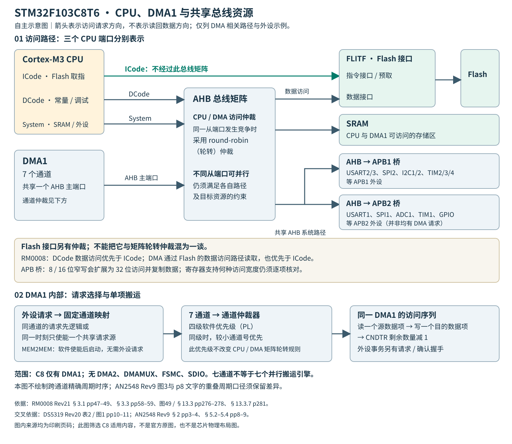
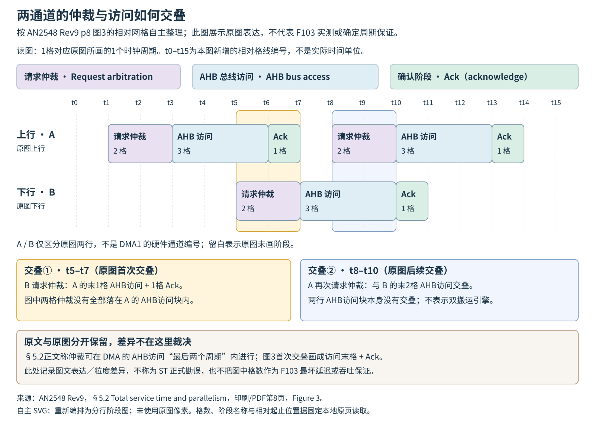

# DMA 与缓冲区协作

适用STM32F103C8T6。以下合并DMA1寄存器、总线竞争、ADC/TIM请求与固定HAL生命周期；完整映射、宽度组合及寄存器表见[DMA参数与HAL接口](../参数/DMA参数与HAL接口.md)。

## 1 DMA1资源、通道和数据项

STM32F103C8T6 只有 DMA1 的 7 个固定映射通道，没有 DMA2、DMAMUX、Stream、FIFO 或独立硬件双缓冲。同一通道的多个请求源以逻辑“或”汇合，DMA 不携带来源标签。例：ADC1、TIM2_CH3、TIM4_CH1 共用通道 1；USART1_RX 与 TIM1_UP 共用通道 5。并发需求撞通道时，应改外设/事件分配或改搬运方式，不能靠优先级区分两个源。[DS5319 Rev 20，§2.1 Device overview，印刷页 10,11](https://www.st.com/resource/en/datasheet/stm32f103c8.pdf#page=10)；[RM0008 Rev 21，§13.3.7 DMA request mapping，印刷页 281,282](https://www.st.com/resource/en/reference_manual/cd00171190.pdf#page=281)

必须分别写下三个宽度：**CPU 访问 DMA 寄存器的宽度、DMA 外设端宽度 PSIZE、内存端宽度 MSIZE**。ES096 要求 DMA 寄存器采用对齐的 32 位 word 访问；搬运的数据项仍可为 8/16/32 位。将 CNDTR 强转成半字指针写入并不因其有效计数只有 16 位而合法。[ES096 Rev 15，§2.4.2 Byte and half-word accesses not supported，印刷页 13](https://www.st.com/resource/en/errata_sheet/es096-stm32f101x8b-stm32f102x8b-and-stm32f103x8b-mediumdensity-device-limitations-stmicroelectronics.pdf#page=13)

`CNDTR=N` 表示 N 项，合法启动长度为 1～65535。在 MINC=1、连续排列且为本次传输独占的内存数组中，所需数据区大小为 `B=N×Wm`：B 为缓冲区容量，单位 byte（字节，避免与变量 B 混淆）；N 为项数；Wm 为每个内存项的字节数，只取 1、2、4，下标 m 表示 memory（内存端）。128 个连续半字占 256 B，计数仍填 128。若 MINC=0，DMA 重复访问同一个内存项，不能把该配置解释成填满 N 项数组，也不能套用前后半区消费模型。地址按各端宽度对齐，PINC/MINC 各自按 1/2/4 B 递增。窄源到宽目的逐项补零，宽源到窄目的逐项截断；8→32 不是四个字节拼成一字。APB 窄写还有复制到整个字总线的效应，目标寄存器能否使用该宽度必须单独核查。[RM0008 Rev 21，§13.3.3 DMA channels; §13.3.4 Programmable data width, data alignment and endians，印刷页 277,278,279,280,287,288](https://www.st.com/resource/en/reference_manual/cd00171190.pdf#page=277)

## 2 启停与HAL生命周期

建议按以下顺序建立一次传输：

1. 准备 DMA1、外设、GPIO 时钟，先阻止数据源产生请求。
2. 停用目标通道，确认 EN=0；处理旧标志，再配置 CPAR、CMAR、CNDTR。
3. 设置方向、PSIZE/MSIZE、地址递增、普通/循环模式、通道优先级。MEM2MEM 不得与 CIRC 同开。
4. 配好 HT/TC/TE、NVIC 和实际 IRQ 分发；HAL 路径先完成父句柄关联。
5. 先使能 DMA 通道，再开放外设 DMA 请求，最后释放定时触发或其他实际生产源。

停止时反向收拢生产端：停止新请求，明确停用通道并确认它不再访问缓冲区，再清理残余状态、重新装载或释放内存。清 EN 不会复位 CPAR/CMAR/CCR；正常模式计数归零，也不说明外设已经停止产生数据。[RM0008 Rev 21，§13.3.1 DMA transactions; §13.3.3 DMA channels; §13.3.5 Error management; §13.4 DMA registers，印刷页 276,277,278,279,280,284,285,286,287,288,289,290,291](https://www.st.com/resource/en/reference_manual/cd00171190.pdf#page=276)

上述顺序是寄存器级生命周期约束，不是HAL内部指令顺序保证。所核HAL_ADC_Start_DMA先置CR2.DMA，再调用HAL_DMA_Start_IT，最后开放规则转换触发，因此调用前仍须停止实际生产源。具体固定源码位置：ADC内部回调在1627–1633行，CR2.DMA在1645行，未检查返回的Start_IT调用在1648行，触发在1654–1662行。HAL 的 Init 不是安全终止旧传输的接口，Start/Start_IT 的返回也不是完成通知。外设 HAL 通常会安装内部 DMA 回调，不能在运行中替换它们；真正的 DMA IRQ 要调用对应 `HAL_DMA_IRQHandler`。句柄、Parent、缓冲区必须覆盖整个异步生命周期，不能传入已离开作用域的局部数组。[UM1850 Rev 3，§3.9 HAL common resources；§14 HAL DMA Generic Driver（§14.1–14.3），印刷页 25,148,149,150,151,152,153,154,155,156,157,158,159](https://www.st.com/resource/en/user_manual/um1850-description-of-stm32f1-hal-and-lowlayer-drivers-stmicroelectronics.pdf#page=148)；[stm32f1xx_hal_dma.c @ bd368aa335c529641d2e567574885e02deacc64a](https://github.com/STMicroelectronics/stm32f1xx-hal-driver/blob/bd368aa335c529641d2e567574885e02deacc64a/Src/stm32f1xx_hal_dma.c)；[stm32f1xx_hal_adc.c @ bd368aa335c529641d2e567574885e02deacc64a](https://github.com/STMicroelectronics/stm32f1xx-hal-driver/blob/bd368aa335c529641d2e567574885e02deacc64a/Src/stm32f1xx_hal_adc.c#L1553-L1678)

尤其要审查超时路径：本次复核的 [stm32f1xx_hal_dma.c @ bd368aa335c529641d2e567574885e02deacc64a](https://github.com/STMicroelectronics/stm32f1xx-hal-driver/blob/bd368aa335c529641d2e567574885e02deacc64a/Src/stm32f1xx_hal_dma.c) 中，PollForTransfer 超时会把软件状态改为 READY，却不清 EN；此时直接 Abort 又可能因不处于 BUSY 而只报告 NO_XFER。[Poll超时557–570行](https://github.com/STMicroelectronics/stm32f1xx-hal-driver/blob/bd368aa335c529641d2e567574885e02deacc64a/Src/stm32f1xx_hal_dma.c#L557-L570)只改变错误码/软件状态并解锁，READY、HAL_OK 和硬件静止是三个不同判断；应按固定驱动版本检查实际停止路径。[stm32f1xx_hal_dma.c @ bd368aa335c529641d2e567574885e02deacc64a](https://github.com/STMicroelectronics/stm32f1xx-hal-driver/blob/bd368aa335c529641d2e567574885e02deacc64a/Src/stm32f1xx_hal_dma.c)

## 3 半缓冲通知意味着有限的处理窗口

以下前后半区模型要求 MINC=1、正偶数长度 N，且缓冲区按对应 MSIZE 连续排列。循环 DMA 自动重装计数和内部地址。对外设→存储器的循环接收，HT 表示前半区已经填好，TC 表示后半区已经填好；DMA 随即写另一半，绝不是整块数组停止变化。CPU 只处理当前不被 DMA 写入的半区，并在下一次覆盖前结束。对存储器→外设的循环发送，HT/TC 表示相应源半区已被 DMA 读走，CPU 可在下轮读取前重填；它不表示外设移位寄存器或物理线路已发送完毕，例如 USART 还须区分 DMA 完成与线路 TC。[RM0008 Rev 21，§27.3.2 Transmitter; §27.6.1 Status register (USART_SR)，印刷页 791,792,793,818](https://www.st.com/resource/en/reference_manual/cd00171190.pdf#page=791)

下式由循环DMA及速率定义推导，非AN2548 Rev 9原文公式：

`T_half = N / (2 R_item)`

T_half 是按稳定数据项速率计算的半缓冲名义填充时间，单位 s，下标 half 表示半区；N 是正偶数个 DMA 项；R_item 是流入数组的数据项速率，单位 项/s，下标 item 表示数据项。等间隔到达时可据此保守安排处理预算；突发到达、触发抖动或可变序列不能仅以长期平均 R_item 证明截止时间，必须核对“本半区完成通知至本半区最早被重写”的最短间隔。CPU 的中断响应、排队和实际处理总时间都要计入这段预算；HT/TC 状态位不是事件队列，延迟跨越多轮时不能靠一个置位标志恢复轮数。增大 N 增加窗口和延迟，不能补救长期消费速度不足，也不能挽回 DMA 读取之前已被外设覆盖的结果。[RM0008 Rev 21，§13.3.3 DMA channels; §13.3.6 Interrupts; §13.4.1/4，印刷页 278,280,284,287](https://www.st.com/resource/en/reference_manual/cd00171190.pdf#page=278)

**算例，非实测保证：**4 个 ADC rank，每秒触发 10 000 个完整序列，则 R_item=40 000 项/s。若采用 256 个半字，整个数组 512 B，每半区 128 项、32 帧，名义半区时长为 3.2 ms。每个 ADC 序列内部是突发写入，应再按实际触发/转换时序验证最早覆盖时间；此例还须先确认 ADC 每组能在 100 µs 内完成。为避免半区跨帧，N/2 宜为 rank 数的整数倍；这是软件数据组织约定，不是 DMA 硬件限制。注入抢占后不能再由数组下标推断规则样本严格等时距。[RM0008 Rev 21，§11.3.8 Scan mode; §11.3.9 Injected channel management; §11.8 DMA request; §11.9.2 Regular simultaneous mode; §11.12.14 ADC regular data register，印刷页 221,227,228,230,237,242,251](https://www.st.com/resource/en/reference_manual/cd00171190.pdf#page=221)

## 4 吞吐量与最坏服务延迟

原厂拓扑依据：[RM0008 Rev21 §3.1 System architecture，pp47–49；§3.3.3 Embedded Flash memory，pp58–59；图49及§13.3，pp276–278](https://www.st.com/resource/en/reference_manual/cd00171190.pdf#page=47)。图仅保留C8相关路径及外设示例，不把七通道画成七个独立搬运引擎。

图依据RM0008 Rev21图49及总线章节、DS5319 Rev20 C8资源自主绘制。ICode、DCode、System分别表示，ICode取指支路不经过图中矩阵；Flash接口仲裁与矩阵轮转仲裁、DMA内部通道仲裁分别说明。箭头表示访问请求方向，不表示读回数据方向。图中 CPU/DMA 主端口竞争与 DMA 内部通道竞争属于两层仲裁。总线矩阵采用轮转；DMA 通道按软件优先级选择，同级小编号优先，高优先级连续请求可使低优先级长期等待。提升 DMA 通道 PL 与提升 NVIC 优先级不是同一件事；前者影响搬运调度，后者影响 CPU 消费通知。[AN2548 Rev 9，§2 Bus bandwidth; §4 DMA controller; §5.3 Sharing the bus matrix with CPU; §6 Insufficient resources threats，印刷页 3,6,9,10](https://www.st.com/resource/en/application_note/an2548-introduction-to-dma-controller-for-stm32-mcus-stmicroelectronics.pdf#page=3)；[RM0008 Rev 21，§13.3.1 DMA transactions; §13.3.3 DMA channels; §13.3.5 Error management; §13.4 DMA registers，印刷页 276,277,278,279,280,284,285,286,287,288,289,290,291](https://www.st.com/resource/en/reference_manual/cd00171190.pdf#page=276)

单次服务可拆成 `tS=tA+tRD+tWR`；连续请求还须计入握手 `tTS=tS+tAck`。tS/tTS 分别为单次/连续总服务时间，tA 为仲裁与地址计算、tRD 为源读取、tWR 为目的写入、tAck 为附加握手，全部单位 s；下标 S/TS 表示 service/total service（服务/含握手的总服务），A 表示 arbitration（仲裁），RD/WR 表示 read/write（读/写），Ack 表示 acknowledge（应答）。AHB 和 APB 周期必须按各自频率换算；原文给出的理想下限不是满负载最坏值。C8 的 ADC1 经 APB2，不能套其他系列 AHB ADC 的周期数。[AN2548 Rev 9，§5.1 DMA transfer timing; §5.1.1 AHB peripheral and system volatile memory; §5.1.2 APB peripheral and system volatile memory; §5.2 Total service time and parallelism; §5.4 Impact of APB; §7 DMA overview，印刷页 7,8,9,11](https://www.st.com/resource/en/application_note/an2548-introduction-to-dma-controller-for-stm32-mcus-stmicroelectronics.pdf#page=7)

依据AN2548 Rev9 p8 Figure3自主整理，保留两上行服务块、一下行服务块及相对格线。首次交叠覆盖上行末一访问格与Ack，后续交叠位于下行末两访问格；原正文措辞另列，图中格数不是F103确定时序保证。具体关系见[图关系与来源](../参数/DMA图关系与来源.md#两通道阶段交叠)。

对无额外接收缓冲、等间隔请求且每次请求对应一次数据更新的模型，可用 `t_complete,worst < T_request = 1/R_request` 作为保守的充分服务预算条件。t_complete,worst 从请求发生起计至该数据项的目的写入完成，单位 s；下标 complete 表示整项搬运完成，worst 表示最坏条件。T_request 为相邻请求间隔，单位 s；R_request 为请求速率，单位 请求/s，request 表示请求。真正防止源数据覆盖的截止是：下一次数据更新前完成旧数据的源读取；目的写稍后完成并不必然表示源数据已丢失。该式是工程推导，不是AN2548原文公式，也不替代持续吞吐量与整个系统实时性检查。非均匀输入须用最短实际覆盖期限，不能仅用长期平均请求速率。AN2548 建议服务能力达到预计同口径负载的 1.5 倍，但平均余量不证明上述时限。72 MHz TIM 时钟也不意味着 APB 搬运频率翻倍。[AN2548 Rev 9，§6 Insufficient resources threats，印刷页 10](https://www.st.com/resource/en/application_note/an2548-introduction-to-dma-controller-for-stm32-mcus-stmicroelectronics.pdf#page=10)

## 5 ADC 与定时器的两种特殊契约

- **单 ADC 规则采集：**ADC1→DMA1_Channel1，通常用半字结果；独立 ADC2 没有自己的 DMA 请求。规则组双 ADC 的相应DMA模式从 ADC1_DR 搬 32 位字，高半字 ADC2、低半字 ADC1，长度按组合字数填；16 位搬运会丢 ADC2。注入结果在 JDRx，不产生规则 DMA 请求。[RM0008 Rev 21，§11.3.8 Scan mode; §11.3.9 Injected channel management; §11.8 DMA request; §11.9.2 Regular simultaneous mode; §11.12.14 ADC regular data register，印刷页 221,227,228,230,237,242,251](https://www.st.com/resource/en/reference_manual/cd00171190.pdf#page=221)；[RM0008 Rev 21，§13.3.7 DMA request mapping，印刷页 281,282](https://www.st.com/resource/en/reference_manual/cd00171190.pdf#page=281)
- **ADC HAL 启动：**已核对版本的 `HAL_ADC_Start_DMA` 不检查底层 `HAL_DMA_Start_IT` 返回。DMA 忙时外层仍可能返回 HAL_OK 并继续开放 ADC。启动前必须独占正确通道，验证句柄及配置；运行后观察 CNDTR 与预期半满/全满事件，不能只信外层返回值。[stm32f1xx_hal_adc.c @ bd368aa335c529641d2e567574885e02deacc64a](https://github.com/STMicroelectronics/stm32f1xx-hal-driver/blob/bd368aa335c529641d2e567574885e02deacc64a/Src/stm32f1xx_hal_adc.c#L1553-L1678)
- **TIM DMA burst：**DMA 本身没有 burst/FIFO，但 TIM 可把一个事件展开为多次请求。CPAR 固定为 DMAR、PINC=0，DCR.DBA 选首寄存器，DBL 是项数减一。TIM1 的 ARR/RCR/CCR1 连写是三个应答过程，不是原子总线写；需结合预装载和下次装载期限设计。TIM2～4 没有 RCR，不能照搬三字段表。[RM0008 Rev 21，§14.4.19 TIM1 and TIM8 DMA control register; §14.4.20 TIM1 and TIM8 DMA address for full transfer; §15.4.17/18; §15.4.19 TIMx register map，印刷页 361,362,364,421,422,423,424](https://www.st.com/resource/en/reference_manual/cd00171190.pdf#page=361)

## 6 错误状态与所有权恢复

活动通道只写 CHTIF、CTCIF、CTEIF 清具体标志，不能用 CGIF 全清。它与传输错误同周期发生时，可能漏 TEIF 并阻止自动禁用。全局清除留在通道停用后。[ES096 Rev 15，§2.4.1 DMA disable failure and error flag omission upon simultaneous transfer error and global flag clear，印刷页 3,13](https://www.st.com/resource/en/errata_sheet/es096-stm32f101x8b-stm32f102x8b-and-stm32f103x8b-mediumdensity-device-limitations-stmicroelectronics.pdf#page=3)

无搬运先查固定映射、EN、外设请求使能和实际触发；搬运完成却无回调查 NVIC、IRQ、回调关联；元素错位查两端宽度/地址步长和帧边界；长时间后失真查半区覆盖及多通道竞争。TE 与“没有 TE”都不能替代外设丢样判断，ADC 尤其没有可兜底的硬件 OVR 标志。

联调至少分别施加 CPU 高频 SRAM 访问、APB 访问和其他 DMA 流，记录时钟、通道 PL、CNDTR、外设状态及处理时间。故障后明确丢弃哪一段不完整帧，再按启动流程重建；不要在仍活动的硬件上仅把 HAL State 改成 READY。HAL/LL 切换同样需先收回外设、IRQ 和缓冲区所有权。[UM1850 Rev 3，§5 Cohabiting of HAL and LL，印刷页 46](https://www.st.com/resource/en/user_manual/um1850-description-of-stm32f1-hal-and-lowlayer-drivers-stmicroelectronics.pdf#page=46)

## 查阅配套资料

- [DMA参数与HAL接口](../参数/DMA参数与HAL接口.md)
- [DMA图关系与来源](../参数/DMA图关系与来源.md)
- [来源目录](../来源/README.md#dma与缓冲区协作来源)
