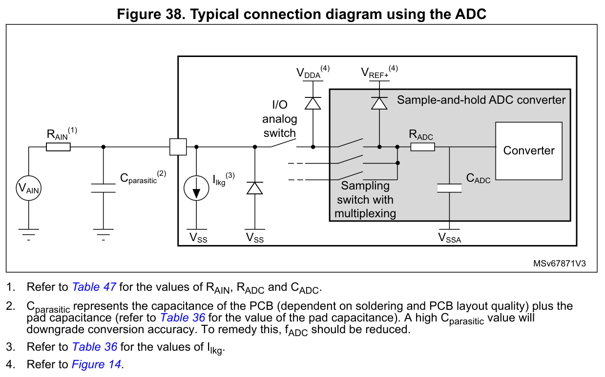

# ADC 采集与精度

[返回总目录](../README.md)

模数转换器（ADC）的采集过程需要把模拟输入、采样时刻和最终码值连接起来。前端必须在采样窗口内建立；按固定周期触发时，一轮转换应在下一次触发前完成；结果还必须及时搬入可安全读取的缓冲区。任何一环失配，都可能得到连续变化、却不能用于测量或控制的数据。

设计时应先确定输入与参考电压，再根据源阻抗选择采样时间，随后安排触发、校准和结果读取。每个样本都应能追溯到具体通道与采样时刻；电压换算和精度判断也应保留各自的适用条件。

- [1 ADC 通道与电气条件](#1-adc-通道与电气条件)
- [2 源阻抗与采样窗口](#2-源阻抗与采样窗口)
- [3 转换时间与数据率](#3-转换时间与数据率)
- [4 初始化校准与触发](#4-初始化校准与触发)
- [5 完成标志与结果读取](#5-完成标志与结果读取)
  - [停止采集与错误恢复](#dma停止和错误恢复的版本边界)
- [6 双 ADC 同步与交错](#6-双-adc-同步与交错)
- [7 精度误差排查](#7-精度误差排查)

## 1 ADC 通道与电气条件

### 1.1 输入通道、参考电压与转换时钟

ADC1、ADC2 都是 12 位单端 ADC。外部通道 0～9 分别连接 PA0～PA7、PB0～PB1；内部温度传感器和内部参考电压 VREFINT 分别使用 ADC1 的通道 16、17。选定通道之后，还要确认输入的电压范围、参考来源和 ADC 时钟。

模拟电源 VDDA 的工作范围为 2.4～3.6 V。VREF+ 内接 VDDA，VREF− 内接 VSSA，因此参考跨度由模拟电源与模拟地决定，不能照搬带独立参考引脚封装的接法。正常转换输入范围为 VSSA～VDDA；通用输入/输出（GPIO）引脚的数字耐压能力不扩展这一范围。

ADC 时钟由 APB2 外设时钟 PCLK2 经 /2、/4、/6、/8 分频，其频率  $`f_{\mathrm{ADC}}`$  的规格范围为 0.6～14 MHz。例如 PCLK2 为 72 MHz 时，/6 得到 12 MHz，/8 得到 9 MHz；/4 得到的 18 MHz 已超过上限。应先确定合法的时钟，再用它计算后文的采样和转换时间。[器件电气条件与表下注释](../参数/ADC/电气参数.md) · [驱动适用边界](../参数/ADC/HAL接口.md)

### 1.2 输入保护也会影响其他通道

前端首先要保证输入不越界。外部 5 V 信号须经分压等方式缩放到转换范围，并检查信号极值、上电和掉电过程。串联电阻可以限制电流，但不能豁免引脚的电压限制。

尤其要区分正常工作条件、绝对最大额定和异常注入下的功能敏感度。DS5319 Rev20 p60 表 35 给出的 PA4/PA5 负、正注入功能敏感度均为 **0 mA**；不能拿 p37 表 7 中“其他引脚 ±5 mA”的绝对最大额定设计长期注入。表 35 描述的也是异常注入特性，并不许可把注入作为正常工作方式。

保护检查不能只覆盖当前被采样的引脚。DS5319 p75 表 49 注 2、p76 表 50 注 3 指出，任何模拟脚上的负向电气注入，都可能降低另一通道的转换精度。因此，未采样脚的过冲、下冲，以及外部接口先于芯片上电的情况，都应一并检查。保护钳位自身的限流、漏电、结电容和供电状态也会进入前端预算。

这里的“电气注入”指引脚越界引起的电流；后文“注入组转换”是一种 ADC 转换机制，两者应分别分析。[注入功能敏感度](../参数/ADC/模拟前端与建立.md) · [负向注入与保护](../参数/ADC/模拟前端与建立.md)

### 1.3 从输出码换算为电压

12 位 ADC 将参考跨度分成 4096 个理想量化区间。一个最低有效位（LSB）对应的电压间隔为：

$$
q=\frac{V_{\mathrm{REF+}}-V_{\mathrm{REF-}}}{4096}
$$

其中， $`q`$  的单位为 V/LSB； $`V_{\mathrm{REF+}}`$ 、 $`V_{\mathrm{REF-}}`$  分别为正、负参考电位，单位为 V。当模拟地  $`V_{\mathrm{SSA}}=0`$  时，可按下式估计输入电压：

$$
V_{\mathrm{est}}\approx\frac{D V_{\mathrm{DDA}}}{4096}
$$

 $`D`$  是 0～4095 的无量纲右对齐码； $`V_{\mathrm{DDA}}`$  为模拟电源电压， $`V_{\mathrm{est}}`$  为输入电压估计值，单位均为 V，下标 est 表示估计。

3.3 V 参考下， $`q\approx0.805664\ \mathrm{mV}`$ 。4095 是最大输出码，4096 是量化区间数。若为了显示满量程而采用除以 4095 的换算，应将它明确为端点映射，避免与 LSB 定义混用。

比例换算只是测量链的起点。参考纹波、偏移、增益、微分非线性（DNL）、积分非线性（INL）和量化误差各有不同含义，需要在精度预算中分别识别。[LSB 与换算](../参数/ADC/模拟前端与建立.md)

## 2 源阻抗与采样窗口

### 2.1 输入电压需要时间才能建立

ADC 输入在采样期间需要给内部采样电容充电。信号源即使在直流下电压准确，也不一定能在很短的采样窗口内提供足够电荷。理解这一点，应先看数据手册的完整输入模型。

图源：DS5319 Rev20，p77，Figure38；保留原图的元件、标签与脚注 1～4。[原图出处及裁图来源](../assets/manual/ds5319-r20/README.md) · [ST 原文](https://www.st.com/resource/en/datasheet/stm32f103c8.pdf#page=77)

读图时可按以下符号对应元件与参数：

- 外部源电阻 $`R_{\mathrm{AIN}}`$ ，单位 Ω。
- 引脚漏电 $`I_{\mathrm{lkg}}`$ ，单位 A；下标 lkg 表示漏电。
- 印制电路板（PCB）与焊盘寄生电容 $`C_{\mathrm{parasitic}}`$ ，单位 F；下标 parasitic 表示寄生。
- 内部采样开关电阻 $`R_{\mathrm{ADC}}`$ ，单位 Ω；采样保持电容 $`C_{\mathrm{ADC}}`$ ，单位 F。

脚注 1 将 $`R_{\mathrm{AIN}}`$ 、 $`R_{\mathrm{ADC}}`$ 、 $`C_{\mathrm{ADC}}`$ 指向表 47；脚注 2、3 将焊盘电容和漏电参数指向表 36。脚注 2 还指出，较大的寄生电容会降低精度，并提出降低 $`f_{\mathrm{ADC}}`$ 的处理方向；实际设计仍需结合采样窗口与前端恢复检查。

原图分别标注 VDDA 和 VREF+，脚注 4 指向供电连接图 Figure14。用于这里的器件时，仍按 VREF+ 内接 VDDA、VREF− 内接 VSSA 理解，不能从图中的独立标签推导出额外的参考引脚。图中的保护钳位也不改变正常输入范围。

为了估算采样窗口，可先将充电过程简化为  $`R_{\mathrm{AIN}}`$ 、 $`R_{\mathrm{ADC}}`$  与  $`C_{\mathrm{ADC}}`$  组成的一阶电阻—电容（RC）电路。以下用  $`V_C`$  表示模型中的采样电容电压，用  $`V_{\mathrm{AIN}}`$  表示输入电压，单位均为 V； $`V_C`$  是推导中的记号，不是原图印刷标签。AIN 表示模拟输入，ADC 表示 ADC 内部元件，C 表示电容。

采样期间， $`V_C`$  逐渐接近  $`V_{\mathrm{AIN}}`$ 。前一通道与当前通道的电压差会改变充电的起始条件，因此建立不足常表现为当前通道读数随前一通道变化。直接存储器访问（DMA）负责结果搬运，延长它的缓冲区并不能改善这个模拟过程。

### 2.2 用一阶模型估算最低采样时间

假定采样期间输入恒定、电路可按线性 RC 处理，充电时间常数为：

$$
\tau=(R_{\mathrm{AIN}}+R_{\mathrm{ADC}})C_{\mathrm{ADC}}
$$

对于全量程初始阶跃，若允许采样结束时残留  $`a`$  个 LSB 的误差，采样窗口需满足：

$$
t_{\mathrm{sample}}\ge\tau\ln\left(\frac{2^n}{a}\right)
$$

 $`\tau`$  和  $`t_{\mathrm{sample}}`$  的单位为 s；下标 sample 表示采样。 $`n=12`$  为分辨率位数， $`a`$  为允许残差对应的 LSB 数，二者均无量纲；ln 为自然对数。半 LSB 条件取  $`a=0.5`$ ，所需时间约为  $`9.011\tau`$ ；四分之一 LSB 条件取  $`a=0.25`$ ，约为  $`9.704\tau`$ 。

这个模型没有包含额外注入、寄生和运放动态误差，计算结果应留出器件容差及实际前端的裕量。[RC 模型与适用条件](../参数/ADC/模拟前端与建立.md)

例如，取  $`R_{\mathrm{AIN}}=10\ \mathrm{k\Omega}`$ 、 $`R_{\mathrm{ADC}}=1\ \mathrm{k\Omega}`$ 、 $`C_{\mathrm{ADC}}=8\ \mathrm{pF}`$ ，得到  $`\tau=88\ \mathrm{ns}`$ 。若要求四分之一 LSB 建立，所需时间约为 0.854 µs；在 14 MHz ADC 时钟下，至少选择 13.5 周期的采样档位。这是给定参数下的模型估算，不能直接视为整个测量链的精度保证。

### 2.3 用器件条件复核模型结果

选择采样档位后，还要回到 DS5319 的源阻抗约束。14 MHz 下，表 48 中 1.5 周期对应 0.4 kΩ，13.5 周期对应 11.4 kΩ，55.5 周期对应 50 kΩ。后续档位标为 NA，并不表示允许无限源阻抗；表 47 的  $`R_{\mathrm{AIN}}\le50\ \mathrm{k\Omega}`$  总上限仍然有效。[器件阻抗约束](../参数/ADC/模拟前端与建立.md)

这里还有一个容易忽略的区别：**采样建立条件与整体精度条件需要分别满足。** 表 47、表 48 用于核对源阻抗和采样建立；p75 表 49、p76 表 50 的 ADC 精度则都要求内部校准后、 $`R_{\mathrm{AIN}}<10\ \mathrm{k\Omega}`$ 、PCLK2 为 56 MHz、 $`f_{\mathrm{ADC}}=14\ \mathrm{MHz}`$ 。此外：

- 表 49 采用 VDDA 为 3～3.6 V、 $`T_A=25\,^{\circ}\mathrm{C}`$  的条件。
- 表 50 采用 VDDA 为 2.4～3.6 V，并遵守一般工作条件。

 $`T_A`$  为环境温度。若有效源阻抗处于 10～50 kΩ，即使延长采样后满足建立要求，也不能直接引用这些精度表的整体误差上限。此时应降低有效源阻抗，或者针对实际前端建立包含漏电、参考等因素的误差预算并验证。[ADC 精度表及条件](../参数/ADC/电气参数.md)

计算  $`R_{\mathrm{AIN}}`$  时，应计入传感器输出阻抗、保护串阻、模拟开关和分压网络的戴维南电阻。增加输入电容能提供瞬时电荷，但也会延长前端恢复；加入缓冲运放，则要检查建立时间、容性负载驱动能力和输出范围。元件选择不能只看直流输出阻抗，也不能只靠增大电容。[输入电容的双重作用](../参数/ADC/模拟前端与建立.md) · [高阻源的等待条件](../参数/ADC/模拟前端与建立.md)

## 3 转换时间与数据率

### 3.1 从单通道算到一轮序列

采样窗口决定输入有多久可以建立，窗口之后还需要完成逐次逼近转换。F1 的采样周期数  $`S`$  只能从以下八档中选择：1.5、7.5、13.5、28.5、41.5、55.5、71.5、239.5。转换阶段另占 12.5 个 ADC 周期，因此：

$$
t_{\mathrm{conv}}=\frac{S+12.5}{f_{\mathrm{ADC}}}
$$

$`t_{\mathrm{conv}}`$ 为一次采样加转换时间，单位为 s；下标 conv 表示转换。$`f_{\mathrm{ADC}}`$ 为 ADC 时钟频率，单位为 Hz；$`S`$ 和 12.5 均以 ADC 周期数计。

规则序列的一个 rank 表示一个转换位置。若一轮共有 $`L`$ 个位置（1～16），第 $`i`$ 个位置的采样周期数为 $`S_i`$ ，基础总时间为：

$$
t_{\mathrm{seq}}=\sum_{i=1}^{L}\frac{S_i+12.5}{f_{\mathrm{ADC}}}
$$

$`t_{\mathrm{seq}}`$ 为一轮规则序列的理想转换总时间，单位为 s；下标 seq 表示序列。$`S_i`$ 以 ADC 周期数计，$`i`$ 为位置编号。

这份预算尚未包含触发延迟、注入抢占、间断及等待。另外，采样时间配置属于物理通道；同一通道出现在规则组和注入组时，共享同一份采样时间配置。[采样档位与时间](../参数/ADC/模拟前端与建立.md)

以 12 MHz、四个 rank 均采用 13.5 周期为例，一轮需要：

$$
t_{\mathrm{seq}}=\frac{4\times(13.5+12.5)}{12\ \mathrm{MHz}}\approx8.667\ \mathrm{\mu s}
$$

若定时器以 10 kHz 触发，每次触发执行完整四项序列，那么每路名义采样率为 10 kS/s，DMA 每秒搬运合计 40 k 项。8.667 µs 只给出基础转换预算，触发、抢占和其他系统余量仍需另留。

### 3.2 让每个触发只启动预期的转换

要实现“每个定时点启动一整组”，应将扫描使能位设为 SCAN=1、连续转换位设为 CONT=0、规则间断模式使能位设为 DISCEN=0，并正确选择、开放规则组外部触发。三个配置分别影响序列扫描、是否自行重复以及每次触发推进多少项，不能只设置触发源就认为采样周期已确定。

- 开启规则间断后，每次触发只执行 DISCNUM+1 项；DISCNUM 为间断转换数编码，对应 1～8 项，末组可以不足。
- CONT=1 时，首次启动后 ADC 会自由重复转换，后续每组的频率不再由定时器周期限制。
- 触发源须从对应组的实际选择表中选取。例如规则组可选定时器触发输出 TIM3_TRGO，TIM1_TRGO 则在注入组选项中，不能把任意定时器的触发输出（TRGO）接到任意组。

数据手册在 14 MHz 下给出的外部触发频率上限为 823 kHz。连续转换的 1 MS/s 不能替代这项限制；采用更长序列时，还要用完整序列时间进一步收紧触发频率。[完整触发选择](../参数/ADC/寄存器与触发参数.md) · [间断模式](../参数/ADC/硬件模式与事件.md)

## 4 初始化校准与触发

### 4.1 先完成配置，最后放行触发

启动顺序的目标，是让第一笔转换发生时，模拟条件、序列配置和数据接收路径都已经就绪。可按以下顺序组织初始化：

1. 稳定 VDDA/VSSA，配置模拟 GPIO，开启 ADC、DMA 所需时钟并确定  $`f_{\mathrm{ADC}}`$ 。此时保持触发接收端未武装。
2. 在 ADC 禁用、触发隔离的状态下配置规则序列寄存器 SQR1～SQR3、注入序列寄存器 JSQR、采样时间寄存器 SMPR1/SMPR2，以及数据对齐、SCAN/CONT、触发选择和必要中断。使用硬件抽象层（HAL）或底层（LL）驱动时，应按各接口的状态前提调用，并检查返回值和最终寄存器配置。
3. 按所用路径完成 ADC 上电、稳定和校准；若使用内部温度或 VREFINT，另完成内部通路的开启与等待。
4. 配置 DMA 地址、长度、宽度、循环方式和中断请求（IRQ），先开放数据接收路径。
5. 最后武装触发并放行主定时器。

隔离首笔触发时，还要考虑定时器初始化中对更新生成位 UG 的操作：它也可能产生 TRGO。只保证正常定时周期尚未开始并不充分，接收端必须实际处于隔离状态。运行中需要修改 ADC 分频时，也应先停止触发链。

### 4.2 分清寄存器校准路径与 HAL 校准路径

直接操作寄存器时，先将控制寄存器 2（CR2）的上电位 ADON 从 0 置为 1。校准前，ADC 必须保持上电至少两个 ADC 周期，并满足上电稳定时间  $`t_{\mathrm{STAB}}`$  最大 1 µs 的要求；下标 STAB 表示稳定。随后置校准复位位 RSTCAL、等待硬件清零，再置校准位 CAL、等待硬件清零。两个 ADC 需要分别校准。校准码会进入规则数据寄存器 DR，不能当作通道样本。

校准完成后，如果 ADC 仍处于使能状态，就不要无条件再调用 `LL_ADC_Enable`。该接口直接向 ADON 写 1；ADC 已上电时，重复写入可能具有启动转换的硬件含义。

采用 HAL 时，应让校准入口管理自身的使能、禁用和状态，不要把上述寄存器步骤机械地叠加在库调用前后。本文 HAL 实现说明以 [v1.1.4 固定提交 de129f1](https://github.com/STMicroelectronics/stm32f1xx-hal-driver/tree/de129f1c0af55ea4b2cfa8ba5686af54b7a51cf9) 为基线，另有说明处比较其他固定版本。

该版 `HAL_ADCEx_Calibration_Start` 要求在 ADC 停止态调用，由驱动停止转换、禁用 ADC，再重新使能、等待并校准；成功后保留 ADC 使能。因此，校准会改变运行状态，不能作为采集中无副作用的后台操作，也不应在调用前自行预置 ADON 来替代它的内部流程。

#### 旧版 HAL 的两周期等待

v1.1.4 将显式的“两 ADC 周期”等待放在 ADON=0 阶段。随后虽然调用 `ADC_Enable` 执行通用稳定等待，但这不能证明它已经按 ADC 时钟落实 RM0008 要求的 ADON=1 两周期条件。

ST 官方发布说明在 V1.1.9（2023-04-07）中记录了修复：使 ADON=1 保持至少两个 ADC 时钟周期。继续使用旧版时，需要核对并修补实际校准时序，或采用已修复版本。在函数外提前置 ADON 不能解决这个内部顺序问题，因为函数仍会再次禁用 ADC。[HAL 官方发布说明](https://github.com/STMicroelectronics/stm32f1xx-hal-driver/blob/77fbb30b7a1d02533980400083e48c559aae5a4f/Release_Notes.html)

所有等待都应设置超时；出现超时，首先检查时钟和供电。内部自校准主要处理芯片内部误差，不能校正板上分压比、参考误差和非线性。[校准顺序](../参数/ADC/模拟前端与建立.md) · [HAL 初始化生命周期](../参数/ADC/HAL初始化边界.md)

### 4.3 内部通道还需要自己的等待时间

使用内部温度传感器或 VREFINT 时，除了 ADC 本身的稳定与校准，还须置温度传感器及内部参考使能位 TSVREFE，满足内部通路启动稳定和采样窗口要求。温度通道按参考手册（RM）推荐采用约 17.1 µs 的采样窗口；12 MHz 下选择 239.5 周期，对应约 19.96 µs。启动等待和单次采样窗口是两个条件，应分别检查。[内部温度与参考条件](../参数/ADC/电气参数.md)

## 5 完成标志与结果读取

### 5.1 先确定结果属于哪一组

规则组只有一个 DR。序列中的各 rank 依次更新这个寄存器，后一项会覆盖前一项；使用 DMA 时，结果按 rank 顺序进入缓冲区。因此，判断数据完整性需要结合搬运计数和序列布局。F1 没有独立的规则/注入序列结束标志 EOS/JEOS，也没有硬件溢出标志 OVR 为遗漏读取兜底。

注入组结果分别保存在注入数据寄存器 JDR1～JDR4。注入偏移减法可能得到负数，右对齐时应按有符号半字解释；左对齐的移位方式与规则组不同，不能共用未经区分的解码方式。[对齐与注入偏移](../参数/ADC/硬件模式与事件.md)

**转换结束标志 EOC 置位，不一定代表 DR 中出现了新规则结果。** 注入完成也可能置 EOC，但不会产生规则 DMA 请求；注入数据应按注入转换结束标志 JEOC 和 JDR 路径处理。所核 HAL 中断处理的规则分支只检查转换结束中断使能位 EOCIE 与 EOC，没有用 JEOC 排除注入来源，因此规则完成回调也不能独立证明 DR 已更新。

规则组与注入组同时使用时，应明确两组的运行时序、标志处理和数据来源，避免仅凭一个回调名称决定消费哪个结果。[事件与驱动实现契约](../参数/ADC/HAL配置与读数.md)

### 5.2 轮询成功、搬运完成与转换停止是不同条件

在已核对的 HAL v1.1.4、v1.1.10 中，`HAL_ADC_PollForConversion` 只有在 SCAN=0 且规则长度为 1 时才真正等待 EOC。扫描路径使用估算延时，其 `HAL_OK` 不能证明外部触发已经发生，也不能证明整个序列已经完成。[HAL 轮询边界](../参数/ADC/HAL轮询边界.md)

DMA 读取 DR 时会清除 EOC，因此不应再让轮询与 DMA 竞争这个标志。另一方面，`Start_DMA` 存在不传播底层 DMA 启动失败的版本限制，外层返回成功也不能独立证明新一轮搬运已按要求启动。[DMA 启动条件](../参数/ADC/DMA生命周期与恢复.md#1-启动成功与dma接受请求)

即使 DMA 正常传满，ADC 也未必已经停止。消费数据时，应分别确认“本轮数据已搬完”和“硬件不会再写入这块缓冲区”；后者决定何时可以释放或复用内存。缓冲区计数、所有权和消费期限见 [DMA 与缓冲区协作](04_DMA与缓冲区协作.md)。

### 5.3 停止采集与错误恢复

正常结束和故障恢复都应先阻止新的触发，再处理正在运行的 ADC、DMA 与软件状态。停止函数的返回值需要结合实际版本解释：

- 普通 DMA 已完成、DMA 状态已为 READY 时，HAL v1.1.4 再调用独立 ADC 的 Stop，可能因 `NO_XFER` 新增 `ADC.State.ERROR_DMA`。这不等同于发生了真实 DMA 传输错误。
- v1.1.10 避免了上述 `NO_XFER` 路径，但在外部触发或连续采样的分支中，可能保留 `REG_BUSY`。
- 发生真实 DMA 错误后，两版的 Stop→Start 都可能留下 State 错误位。新一轮半满回调可能正常，全满时却转入错误回调。因此，`ErrorCode=NONE`、Start 返回 OK，或再次执行 Init，都不能单独证明已经恢复。

可控的恢复过程应先隔离触发并保存诊断状态，确认本事务的 ADC 和 DMA 已停止，再结合实际 MCU 支持包（MSP）的底层资源管理实现与配置重建资源。ADC 关闭失败时，缓冲区仍不能释放。这里的版本比较适用于独立 ADC；双模式需按 [6.4 节](#64-主从停机需要分别确认)分别确认主从停机。[ADC 停止与重启](../参数/ADC/DMA生命周期与恢复.md)

### 5.4 LL 调用也要对应实际寄存器行为

LL 接口更接近寄存器，但函数名称和成功返回仍不能代替结果检查。固定提交 bd368aa335c529641d2e567574885e02deacc64a 有以下需要带入初始化、查询和清理流程的实现细节：

- `LL_ADC_Enable` 直接向 ADON 写 1。校准后仍保持使能的路径，不能再次无条件调用，以免启动非预期转换。
- `LL_ADC_REG_Init` 把序列长度编码带入控制寄存器 1（CR1）的更新表达式；同一位号在 CR1 中涉及看门狗使能和保留位。虽然函数随后正确写入 SQR1，仍须核查先前对 CR1 的副作用，不能只看 SUCCESS。
- 三个 SLV 标志查询包装函数按公共状态寄存器 SR 的地址再加 4 字节读取，实际落到 ADC1_CR1。它们的返回值不能证明 ADC2 已完成转换或发生越界。
- `LL_ADC_CommonDeInit` 只通过复位与时钟控制（RCC）模块请求 ADC1 复位，不能据此认定所有 ADC 实例均已复位；`LL_ADC_DeInit` 返回 SUCCESS，也不能独立证明全部清理分支已经执行。

上述结论来自该固定源码与手册的静态核查，尚无实板验证，也不推定其他版本的修复状态。具体位号、地址推导和接口说明见 [LL 实现边界](../参数/ADC/LL固定实现边界.md)；完整接口见 [LL 参考](../参数/ADC/LL字段接口与宏.md)。

## 6 双 ADC 同步与交错

### 6.1 先决定要同步测量，还是提高合成采样率

双模式由 ADC1 的双 ADC 模式选择字段 DUALMOD 配置。主 ADC 选择外部触发源，从 ADC 选择软件源以避免独立触发；与此同时，两侧仍须开放手册要求的触发通路，不能只配置主侧。

需要同步测量电压和电流等不同输入时，可使用规则同时模式，并匹配每对 rank 的采样时间。一轮扫描中的各对结果仍有先后顺序，例如三相扫描不能解释成六路在同一时刻全部采样。同一输入也不得被两个 ADC 重叠采样。[双 ADC 共同约束](../参数/ADC/硬件模式与事件.md)

交错模式则让两 ADC 轮流采样，必须同时满足固定启动间隔与采样窗口限制：

- **快交错：** 相邻合成样本间隔为 7 个 ADC 周期，采样档位只能选  $`S=1.5`$ ；连续运行时两个 ADC 都置 CONT。
- **慢交错：** 相邻合成样本间隔为 14 个 ADC 周期，同一 ADC 的相邻启动间隔为 28 周期； $`S`$  可取 1.5、7.5、13.5，不能置 CONT。

相应的理想合成速率分别为  $`f_{\mathrm{ADC}}/7`$  和  $`f_{\mathrm{ADC}}/14`$ 。 $`f_{\mathrm{ADC}}`$  的单位为 Hz，速率单位为样本/s；14 MHz 下分别为 2 MS/s、1 MS/s。

慢交错的启动间隔是固定的。即使采用 13.5 周期采样时，单次转换只占 26 周期，也不能删掉 28 周期的启动间隔，把合成速率计算成 1.076 MS/s。[快交错](../参数/ADC/硬件模式与事件.md) · [慢交错算例纠正](../参数/ADC/硬件模式与事件.md)

### 6.2 按模式解释组合数据

双模式组合结果以 32 位读取 ADC1_DR：高半字为 ADC2，低半字为 ADC1。读取组合字要求开启 ADC 的 DMA 位，即使由 CPU 读取也不例外。不过，所核 HAL `PollForConversion` 会因该位置位而拒绝轮询，因此要为组合读取选择兼容的数据消费流程。

两个半字的含义还取决于工作模式。交错时 ADC2 先、ADC1 后，重建时间序列应先取高半字、再取低半字；同时模式才把它们作为同步的一对输入。[数据打包](../参数/ADC/硬件模式与事件.md) · [HAL 轮询边界](../参数/ADC/HAL轮询边界.md)

### 6.3 注入抢占会改变采样时间轴

注入抢占会在规则采样中产生缺口，被打断的规则转换还需要重做。因此，抢占前后的数组不能直接拼成无间隙、等时间隔的快速傅里叶变换（FFT）输入。

RM0008 §11.9.9 对“注入同时＋交错”还有额外限制：ADC 预分频为 /4 时，恢复后的相邻间隔可能变成 8、6 个 ADC 周期交替，而非原来的 7、7。即使已经丢弃抢占期间的数据缺口，也不能自动认定后续恢复为均匀采样。[组合模式恢复限制：§11.9.9](../参数/ADC/硬件模式与事件.md) · [抢占及恢复](../参数/ADC/硬件模式与事件.md)

### 6.4 主从停机需要分别确认

双 ADC 的 Stop 会实际禁用 ADC2，却不更新应用自己的从 ADC 句柄。因此，从句柄残留忙态不能单独说明 ADC2 仍在转换。双模式的 `NO_XFER` 处理和主状态归一化也与独立 ADC 不同，不能直接套用 [5.3 节](#dma停止和错误恢复的版本边界)的版本结论。

恢复前，应区分主从部分停机与软件黏滞错误，并分别确认本事务涉及的 ADC1、ADC2、DMA 状态。[双模式恢复条件](../参数/ADC/DMA生命周期与恢复.md#3-双adc停止须独立判断)

## 7 精度误差排查

### 7.1 用现象选择对照实验

排查时，先找出读数随哪个条件变化，再决定调整前端、时序还是算法。以下几组对照能把问题缩小到采集链中的具体环节：

- **当前通道随前一通道电压变化而偏移：** 先加长采样窗口，核查有效源阻抗，并改变通道顺序，观察偏移是否随之变化。
- **通信或开关活动增强时读数变化：** 检查 VDDA、回流路径与采样相位。
- **双 ADC 交错后的奇偶样本出现台阶：** 检查两 ADC 的失调和增益匹配。
- **数据出现缺口：** 先检查触发、DMA 搬运和缓冲区消费期限，避免把丢样当成模拟噪声处理。

PA0 还需要单独考虑注入组开始、结束时的内部耦合毛刺，它与实际选择的注入通道号无关。PA0 用作数字输入时，勘误给出的条件是外部驱动阻抗 <5 kΩ；这不能解释为毛刺本身已消除。双 ADC 使用注入触发时，勘误另建议把通道 0 分配到注入组。单 ADC 下“注入结果不受影响”的说明，不能直接推广到双模式。[PA0 注入耦合](../参数/ADC/硬件模式与事件.md#7-内部温度与-pa0-耦合边界)

更多现象与检查方向见 [系统误差排查表](../参数/ADC/系统误差与数字处理.md#6-现象与优先检查项)。

### 7.2 判断平均和校准能够解决什么

若噪声独立、同方差且均值为零，对  $`M`$  次采样作平均后，标准差为：

$$
\sigma_{\mathrm{avg}}=\frac{\sigma}{\sqrt{M}}
$$

 $`\sigma`$  为单次噪声标准差， $`\sigma_{\mathrm{avg}}`$  为平均后的标准差，两者统一用 V 或 LSB； $`M`$  为参与平均的正整数样本数，下标 avg 表示平均。

这一关系不适用于相关干扰，也不能消除固定参考误差、建立不足和非线性。两点校准能够校正线性比例与偏移，但要求两个校准点未饱和、码差非零且充分分离。因此，应先确认误差类型，再决定增加平均次数或做系统校准。[平均的边界](../参数/ADC/模拟前端与建立.md) · [系统校准](../参数/ADC/模拟前端与建立.md)

板级验证可从静态基准开始，依次改变采样时间和通道顺序，再加入通信、脉冲宽度调制（PWM）等运行压力。每一步都记录均值、噪声和丢样证据，才能区分固定偏差、随机波动与时序问题。算法计算结果不能替代这组实测验证。

## 详细参考

本章的硬件、电气条件和 HAL/LL 行为分别由手册、数据手册及固定源码支撑。应用笔记内容依据留存图文整合，原 PDF 尚未完成全文逐页对照；具体引用范围见相关参数页和来源说明。

- 前端与精度：[电气参数和全部条件](../参数/ADC/电气参数.md)、[前端建立与误差预算](../参数/ADC/模拟前端与建立.md)、[静态误差定义](../参数/ADC/静态误差定义.md)、[系统误差、校准与数字处理](../参数/ADC/系统误差与数字处理.md)。
- 模式与时序：[模式选择与原厂应用关系](../参数/ADC/模式应用关系.md)、[ADC 模式、采样与事件](../参数/ADC/硬件模式与事件.md)、[寄存器参数表](../参数/ADC/寄存器与触发参数.md)。
- HAL 配置与接口：[HAL 与 ADCEx 接口](../参数/ADC/HAL接口.md)、[结构字段](../参数/ADC/HAL配置字段.md)、[符号表](../参数/ADC/HAL符号表.md)、[HAL 辅助函数与宏](../参数/ADC/HAL辅助函数与宏.md)。
- HAL 运行过程：[初始化与反初始化](../参数/ADC/HAL初始化边界.md)、[配置与读数](../参数/ADC/HAL配置与读数.md)、[轮询返回边界](../参数/ADC/HAL轮询边界.md)、[DMA 生命周期与恢复](../参数/ADC/DMA生命周期与恢复.md)。
- LL 与图源：[LL 字段、接口与辅助宏](../参数/ADC/LL字段接口与宏.md)、[固定 LL 实现差异](../参数/ADC/LL固定实现边界.md)、[图形关系与来源](../参数/ADC/图形关系与来源.md)。

继续阅读：[DMA 与缓冲区协作](04_DMA与缓冲区协作.md)
