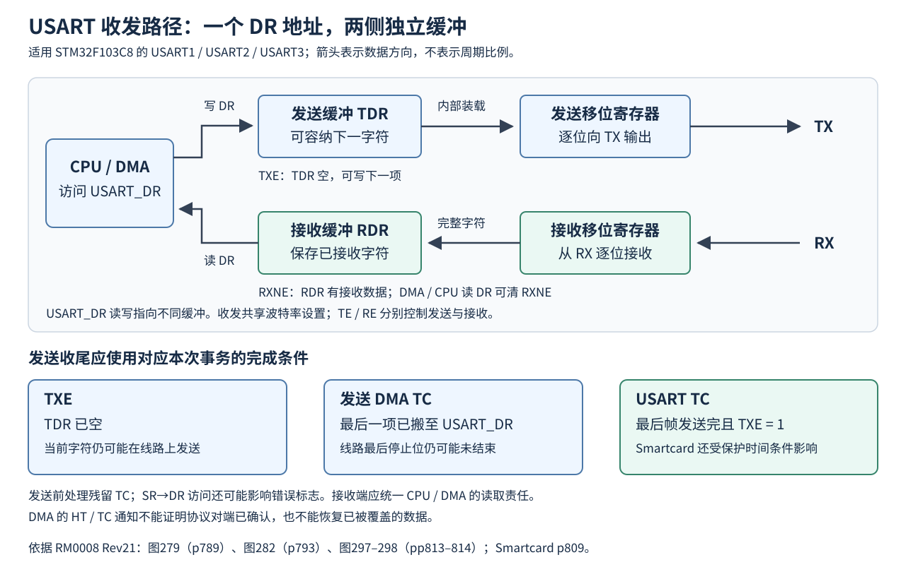

# USART与串口数据流

目标为STM32F103C8T6，含USART1、USART2、USART3，无UART4/5。以下按硬件机制、驱动契约及芯片勘误整合。本主题按固定手册与驱动提交定位；图形整合范围、源文差异及验证限制见图形关系页。

## 1 实例、时钟与DMA资源

|实例|基址|时钟来源|外部IRQ编号|DMA1发送|DMA1接收|
|---|---|---|---:|---:|---:|
|USART1|0x40013800|PCLK2，APB2|37|通道4|通道5|
|USART2|0x40004400|PCLK1，APB1|38|通道7|通道6|
|USART3|0x40004800|PCLK1，APB1|39|通道2|通道3|

IRQ编号是CMSIS的外部中断编号，不是含16个内核异常后的向量表总索引。DMA通道与其他外设共享映射；同时打开同一通道对应的多个请求源不能获得独立缓冲服务。

依据：[固定CMSIS器件头文件，中断编号](https://github.com/STMicroelectronics/cmsis-device-f1/blob/c8e9a4a4f16b6d2cb2a2083cbe5161025280fb22/Include/stm32f103xb.h#L119-L121)、[基址](https://github.com/STMicroelectronics/cmsis-device-f1/blob/c8e9a4a4f16b6d2cb2a2083cbe5161025280fb22/Include/stm32f103xb.h#L575-L611)，DMA映射见RM0008 Rev21 §13.3.7及知识库DMA参数页。

C8正常时钟约束下PCLK2最高72 MHz，PCLK1最高36 MHz；USART波特率时钟使用对应PCLK，不采用定时器的APB预分频倍频规则。16倍采样下发生器最大位率分别为4.5 Mbit/s和2.25 Mbit/s，实际通信还取决于GPIO、电气、时钟误差和软件/DMA服务能力。USART硬件支持某模式，不代表任意封装引脚组合或驱动调用顺序均合法。

### 内部模块与控制关系

图279中的模块按数据、时钟和事件分为以下关系；同一 DR 地址两侧的 TDR/RDR 已在总览图中分开表示。

|模块|输入或控制|输出及交叉条件|
|---|---|---|
|发送数据路径|CPU/DMA 写 DR → TDR → 发送移位寄存器|TX 引脚；TXE 表示 TDR 空，TC 对应发送完成条件|
|接收数据路径|RX → 接收移位寄存器 → RDR|CPU/DMA 读 DR；RXNE 与接收错误在 SR 中反映|
|公共波特率发生器|PCLK、BRR 的整数/分数字段|产生接收/发送时序；TE、RE 分别控制各自方向|
|CK 控制|CLKEN、CPOL、CPHA、LBCL|普通同步模式按有效数据位输出 CK；Smartcard 另用 GTPR.PSC|
|帧与校验|M、STOP、PCE、PS|字长、停止区、奇偶校验生成/检查|
|接收唤醒单元|WAKE、RWU、CR2.ADD|空闲或地址标记唤醒，影响普通接收事件|
|扩展模式|SCEN/NACK、HDSEL、IREN/IRLP、LINEN|Smartcard、单线、IrDA、LIN 条件；须遵守模式互斥|
|DMA 请求|DMAT、DMAR 与发送/接收状态|两个方向独立请求；请求使能不代表 DMA 通道已正确配置|
|硬件流控|CTSE、RTSE 及 CTS/RTS 引脚|约束发送起帧和通知接收硬件空间|
|中断控制|SR 状态与相应 IE 位|合入该 USART 的单一 IRQ，完整布尔条件见中断图|
|保护时间|GTPR.GT|Smartcard 发送完成后延迟 TC 置位|

图279中的简写（例如 HD、LINE、CKEN）应以寄存器定义的 HDSEL、LINEN、CLKEN 等正式字段名检索。图内 SW_RX 标注没有在本表推导成额外外部引脚；C8 可用引脚及重映射须查芯片封装和 GPIO 主题。

来源：[RM0008 图279，p789](https://www.st.com/resource/en/reference_manual/cd00171190.pdf#page=789)及[寄存器定义，pp817–827](https://www.st.com/resource/en/reference_manual/cd00171190.pdf#page=817)。

## 2 硬件与参数

- [帧结构、采样、波特率与错误](../参数/USART/帧格式波特率与接收错误.md)：字长与校验、TXE/TC、起始与停止采样、错误标志、分数分频和误差预算
- [工作模式、流控与中断](../参数/USART/工作模式流控与中断.md)：静默地址、LIN、同步主机、单线半双工、Smartcard、IrDA、RTS/CTS及单IRQ合并
- [寄存器与访问副作用](../参数/USART/寄存器与访问副作用.md)：SR、DR、BRR、CR1/2/3、GTPR的偏移、位域、复位及读写条件
- [硅勘误](../参数/USART/硅勘误.md)：PE、IDLE、地址唤醒、CTS/Break、RTS违规及GPIO/DMA交叉约束

## 3 固定HAL与LL接口

HAL接口按异步UART、同步USART及Smartcard/IrDA专用模块分别保存固定版本原型；专用模块另有CPU访问、初始化和DMA边界专题。接口声明核对不表示全部函数语义及状态交错均已完成审查。硬件支持某模式或头文件含某个STOP编码，不表示仅改初始化字段即可切换为该模式。

- [HAL配置、句柄与状态编码](../参数/USART/HAL配置句柄与状态.md)：完整字段、两套状态枚举、错误码及回调ID
- [HAL接口索引](../参数/USART/HAL接口索引.md)：UART与同步USART分别按两版保存参数类型、顺序及回调条件
- [HAL数据宽度与版本边界](../参数/USART/HAL数据宽度与版本边界.md)：旧版CPU访问宽度风险、分频进位、参数断言、状态与超时副作用
- [UART ReceiveToIdle](../参数/USART/ReceiveToIdle与事件位置.md)：v1.1.10新增接口、回调位置/类型、普通与循环DMA的结束条件
- [DMA生命周期](../参数/USART/DMA生命周期.md)：启动返回、暂停、中止、伴随发送、错误资源和回调重入
- [LL接口及结构索引](../参数/USART/LL接口与配置符号.md)：C8可用分支、字段与符号、寄存器对应关系
- [LL初始化和模式边界](../参数/USART/LL初始化与模式边界.md)：UE前提、部分写入、BRR截断、模式清置掩码及保留字段

## 4 需要一起保存的事实

- 有效数据位数由M与PCE共同决定。常见8E1/8O1在F1对应9位字长加校验；代码中的WordLength不能直接当有效载荷位数。
- DMA完成、TDR空、线路发送结束、HAL句柄READY分别回答不同问题，不能把其中一项替代全部事务收尾。
- SR→DR清标志会读取接收数据；全双工发送的SR读取/DR写入还涉及PE勘误。错误采集与数据读取需要共同设计。
- IDLE既不是永久可靠的协议分隔符，也不是锁存DMA计数的事件。协议边界及缓冲消费位置须分别建立。
- 固定版本中的某一缺陷修正不保证其他缺陷已解决；每项结论分别标出硬件修订、驱动提交和原始位置。

## 5 图形与交叉参考

- [图形关系与来源](../参数/USART/图形关系与来源.md)
- [DMA参数与请求映射](../参数/DMA参数与HAL接口.md) · [引脚复用与AFIO](../参数/引脚复用与AFIO.md)
- [GPIO内部复用冲突](../参数/GPIO内部复用冲突.md) · [范围与已知限制](../已知限制.md)
- [RM0008来源](../来源/RM0008.md#src-rm0008-r21-usart-hardware) · [固定驱动来源](../来源/驱动实现.md#src-usart-fixed-safety-boundaries)

接口名称、原型和固定函数体核查只证明相应静态内容。本文没有新增固件执行或板端测试；所记载的历史模型结果仅限原来注明的范围，未穷尽中断抢占、编译选项、用户MSP与实际电气条件。

### Smartcard 与 IrDA 专用驱动

- [数据宽度与初始化](../参数/USART/Smartcard与IrDA数据宽度及初始化.md)：两版CPU访问差异、参数校验与重初始化边界
- [DMA启动、完成与错误边界](../参数/USART/Smartcard与IrDA_DMA边界.md)：RX错误方向的句柄访问、启动返回值、循环模式差异及回调资源条件

- [Smartcard与IrDA HAL接口索引](../参数/USART/Smartcard与IrDA_HAL接口索引.md)：60个不同接口名称、两版120条声明的原型/定义位置和回调条件；单列ReInit声明与实现差异
